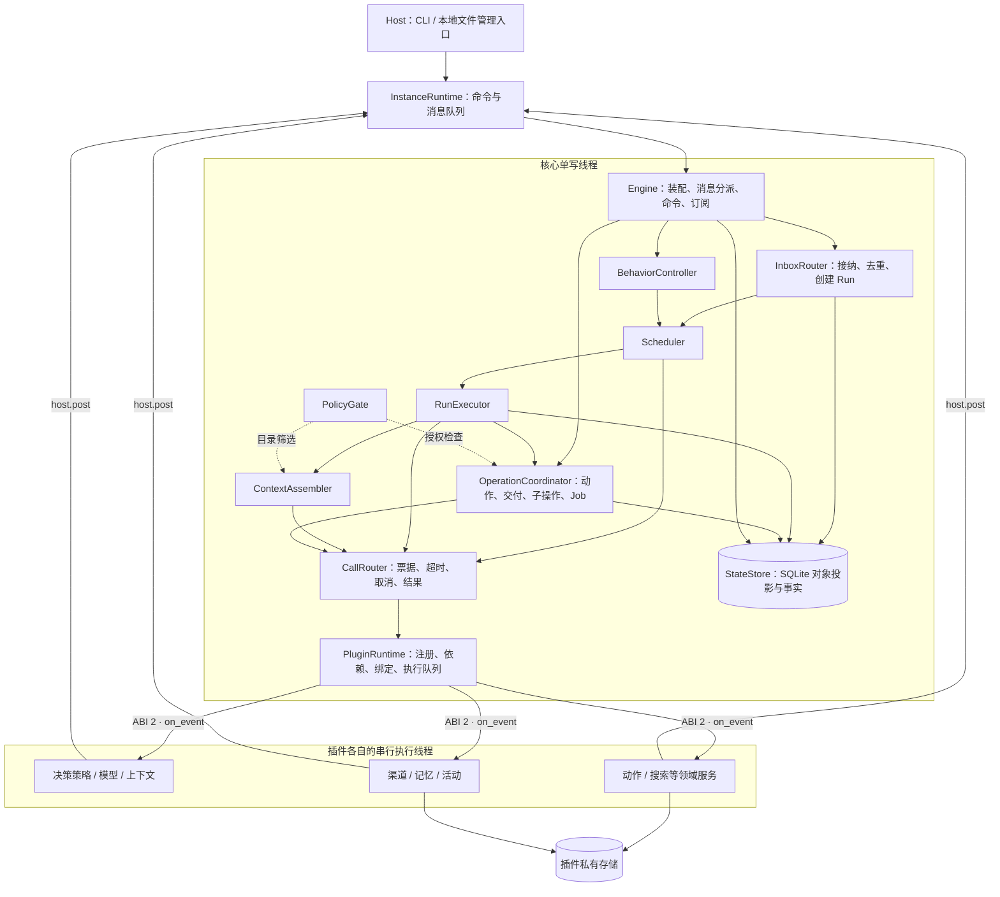

# v0.2 整体架构审阅

本文保留 v0.2 的历史审阅结论。后续修正与仍未完成的项目见[架构收敛设计的实施状态](architecture-convergence.md)；本页探针结果不代表 v0.3 的当前行为。

审阅日期：2026-11-09。审阅对象：当前 v0.2.0 工作区代码，包含尚未提交的框架重构。本文记录审阅时的实现状态；以下问题尚未因本次文档整理而修复。

对照材料：[目标设计](resident-runtime-design.md)、[实际架构说明](architecture.md)、[插件 SDK](plugin-sdk.md)和[既有验证记录](validation.md)。

## 审阅结论

核心与插件的编译依赖、动态加载和调用通道已经形成明确边界。普通静态动作、领域服务、提供方替换和基本决策策略，确实可以通过插件接入。

服务契约、渠道归属、调用作用域及部分决策流程还没有形成稳定的扩展边界。增加多渠道、通用动态工具发现、实例级服务协作或更复杂的 Agent 决策时，仍会遇到核心限制。当前适合继续完善框架协议，尚不宜把 SDK 视为已经定型。

本轮通过独立 SDK 插件确认了三个未被既有测试覆盖的场景：

- 第二个渠道接收的消息，回复仍由默认渠道发送。
- 发现型动作使用不同于通用执行方法的 schema 时，启动被拒绝。
- 把模型服务绑定到策略槽位，实例仍报告 ready，任务开始后才失败。

其余问题依据实际调用链进行静态分析，未把推导结论写成已经复现的结果。

## 当前实际架构

下图表示逻辑职责、线程归属和运行时调用。所有模块仍处于同一个进程中；插件各自拥有串行执行线程。Engine 是 [core/runtime.cpp](https://github.com/AuraKaliya/DaFeiYu-/blob/a3a8aabb695f80b0291ffef6fae11fbf6b53d8cc/core/runtime.cpp) 中的装配与分派类。



图中省略了部分查询和持久化连线。授权箭头表示已有检查位置，不表示所有调用都已获得完整的作用域与预算约束。

已经落实、建议保留的边界：

| 边界 | 实际实现 |
|---|---|
| 编译依赖 | 插件链接 SDK 与可选存储辅助库，不链接核心 |
| 状态提交 | 核心线程提交核心状态；插件通过消息和结果提供事实 |
| 服务组合 | 使用方声明命名依赖，经宿主调用具体服务；搜索示例可替换提供方 |
| 决策与执行 | 策略输出提案，核心检查预算、授权并推进阶段 |
| 副作用 | 写操作、记忆提交和交付具有操作身份与回执；未知效果保留待核对状态 |
| 私有数据 | 人格版本、渠道收据等由所属插件维护，核心保存采用记录 |

主要依据：[插件构建规则](https://github.com/AuraKaliya/DaFeiYu-/blob/a3a8aabb695f80b0291ffef6fae11fbf6b53d8cc/cmake/Plugins.cmake)、[跨插件搜索调用](https://github.com/AuraKaliya/DaFeiYu-/blob/a3a8aabb695f80b0291ffef6fae11fbf6b53d8cc/plugins/action_search/plugin.cpp)、[调用路由](https://github.com/AuraKaliya/DaFeiYu-/blob/a3a8aabb695f80b0291ffef6fae11fbf6b53d8cc/core/calls.cpp)、[操作协调器](https://github.com/AuraKaliya/DaFeiYu-/blob/a3a8aabb695f80b0291ffef6fae11fbf6b53d8cc/core/operations.cpp)。

## 问题清单

P1 表示接入相关真实能力前应优先解决；P2 表示冻结 SDK 或扩大运行规模前应补齐。优先级表示调整顺序，不表示所有问题都已经触发运行故障。

| 编号 | 优先级 | 问题 | 证据类型 |
|---|---|---|---|
| AR-01 | P1 | 输入来源与回复渠道缺少绑定 | 已复现 |
| AR-02 | P1 | 嵌套调用缺少完整的权限收窄、父子生命周期与预算继承 | 静态分析 |
| AR-03 | P2 | 内建服务契约缺少独立定义和核心槽位验证 | 已复现 |
| AR-04 | P2 | 动作描述与底层执行方法的 schema 耦合过紧 | 已复现 |
| AR-05 | P2 | 策略可替换，但模型路由和失败恢复仍受核心固定流程限制 | 静态分析 |
| AR-06 | P2 | 多层作用域主要落实为调用票据，注册与订阅生命周期不完整 | 静态分析 |
| AR-07 | P2 | 持久化结构、核心模块和插件公开视图存在耦合 | 静态分析 |
| AR-08 | P2 | 常驻调度反复扫描全部历史记录 | 静态分析 |

### AR-01：输入来源与回复渠道缺少绑定

**设计要求：** Conversation 保存渠道实例、外部会话、参与主体与可见范围，交付使用明确且不可变的目标。

**实际实现：** [InboxRouter::route](https://github.com/AuraKaliya/DaFeiYu-/blob/a3a8aabb695f80b0291ffef6fae11fbf6b53d8cc/core/inbox.cpp) 创建 Run 时采用 profile 的统一服务快照；[OperationCoordinator::deliver](https://github.com/AuraKaliya/DaFeiYu-/blob/a3a8aabb695f80b0291ffef6fae11fbf6b53d8cc/core/operations.cpp) 固定读取 `run.bindings.bindings.channel`，没有根据输入来源选择回复渠道。`source` 被保存在输入记录中，但没有形成用于交付的渠道绑定。

**已复现结果：** 独立插件提供 `channel.second` 并提交消息。任务完成后，交付操作的服务是 `channel.simulator`，默认渠道增加一条回执，第二个渠道没有收到 deliver 调用。

**影响：** 增加第二个渠道插件不足以实现正确的多渠道收发。真实平台可能出现回复错发、目标无法识别，或不同渠道外部会话 ID 冲突。

**建议：** 增加明确的 ConversationKey 和 DeliveryBinding，把渠道实例、外部会话、认证主体及回复关联随输入绑定到 Run；交付时检查该绑定及当前授权。

**验收建议：** 两个渠道使用相同的外部会话 ID 分别接收消息，回复仍各自返回原渠道；重启后保持原交付绑定。

### AR-02：嵌套调用的上下文没有完整继承和收窄

**设计要求：** 插件间调用沿用宿主签发的作用域和预算，子调用不能扩大权限；逻辑结束后只保留必要的效果核对责任。

**实际实现：**

- [OperationCoordinator::nested](https://github.com/AuraKaliya/DaFeiYu-/blob/a3a8aabb695f80b0291ffef6fae11fbf6b53d8cc/core/operations.cpp) 对只读子调用直接传递整个 `parent.scope`。父调用拥有写权限时，中间只读方法仍持有该权限。
- [CallRouter::request](https://github.com/AuraKaliya/DaFeiYu-/blob/a3a8aabb695f80b0291ffef6fae11fbf6b53d8cc/core/calls.cpp) 为每次调用重新计算完整截止时间，没有与父调用的剩余期限求最小值。
- [PendingCall 与 CallScope](https://github.com/AuraKaliya/DaFeiYu-/blob/a3a8aabb695f80b0291ffef6fae11fbf6b53d8cc/core/calls.hpp) 没有父调用关系和共享预算标识，父调用完成或超时不能统一收束其普通子调用。
- [PolicyGate::method](https://github.com/AuraKaliya/DaFeiYu-/blob/a3a8aabb695f80b0291ffef6fae11fbf6b53d8cc/core/policy.cpp) 用单个资源字符串及完全相等判断限制嵌套写。设计中的“写文件，再发送报告”如果分别使用文件域和渠道域，不能直接表达为一个获准的复合动作。

**影响：** 当前调用票据可以证明调用归属，但不足以完整表达调用树的生命周期和权限。普通子调用可能比父调用活得更久；跨多个资源域的能力组合受到接口限制。本项是代码推导，尚未将全部交错时序逐一复现。

**建议：** 引入包含父调用、收窄权限、资源集合、共享预算和最早截止时间的调用上下文。只读方法应获得只读资格；父调用终态后撤销后续业务调用资格，已发生效果继续进入核对。

**验收建议：** 验证“写动作 → 只读服务 → 写服务”的约束、父超时后的子调用处理，以及同时涉及文件和渠道的受控复合动作。

### AR-03：内建服务契约没有成为独立 SDK 定义

**设计要求：** 契约定义、提供方和使用方分离，契约 ID 与版本决定兼容关系，错误配置在加载阶段被识别。

**实际实现：** [PluginRuntime::start](https://github.com/AuraKaliya/DaFeiYu-/blob/a3a8aabb695f80b0291ffef6fae11fbf6b53d8cc/core/plugin_manager.cpp) 检查同一契约与版本的提供方声明是否一致，也检查插件声明的依赖。但 [Profile::open](https://github.com/AuraKaliya/DaFeiYu-/blob/a3a8aabb695f80b0291ffef6fae11fbf6b53d8cc/core/common.cpp) 仅要求 model、memory、channel、strategy 等槽位存在，没有完整验证核心使用方所要求的契约、版本和方法。

**已复现结果：** 将 `strategy` 指向 `model.scripted` 后，实例报告 `health=ready`，任务进入运行流程后才因 `METHOD_MISSING` 失败。

**影响：** ABI 校验不能替代服务语义校验。第三方提供方可能通过加载，却不能被对应核心角色使用；目前部分公共协议依靠字符串和 JSON 结构惯例维持。

**建议：** 在 SDK 中建立内建契约及公开数据结构的独立定义。核心作为使用方声明明确要求，并在启动阶段验证角色绑定。领域契约继续保持开放，不加入核心领域枚举。

**验收建议：** 错误角色、缺失必需方法和不支持的契约版本在发布 ready 前拒绝；合法提供方可独立构建并替换。

### AR-04：动作描述与执行传输的 schema 耦合过紧

**设计要求：** 模型侧动作与可复用领域服务能够组合，发现型插件可以在获准范围内发布能力描述。

**实际实现：** [PluginRuntime::start 的动作校验](https://github.com/AuraKaliya/DaFeiYu-/blob/a3a8aabb695f80b0291ffef6fae11fbf6b53d8cc/core/plugin_manager.cpp) 要求动作与对应服务方法的 input、output、effects、resource 完全相等。

**已复现结果：** 独立插件通过一个接受通用对象的 execute 方法注册带 query 参数的发现型动作，启动返回 `ACTION_CONTRACT_MISMATCH`。

**影响：** 普通静态工具可以为每项能力声明独立方法；但通用 MCP 桥接在启动时发现多种参数结构的工具，不能直接复用一个执行入口。目前需要预生成清单，或修改注册与执行协议。

**建议：** 分离 ActionDefinition 与执行传输。动作维护模型可见 schema，执行入口接收动作身份、定义修订与参数封装。调整时保留动作参数和执行封装两层校验，不能仅删除现有等值检查。

**验收建议：** 一个独立桥接插件在启动时注册两个参数结构、效果类别不同的动作，核心分别完成描述冻结、参数校验、授权和调用，无需修改核心源码。

### AR-05：决策策略的模型路由和失败恢复能力有限

**设计要求：** request_model 提案可以指定获准的模型绑定；策略基于模型尝试、动作结果与等待解除等事实提出后续工作。

**实际实现：** [RunExecutor::model](https://github.com/AuraKaliya/DaFeiYu-/blob/a3a8aabb695f80b0291ffef6fae11fbf6b53d8cc/core/run.cpp) 始终读取固定的 `bindings.model`。模型调用失败后，核心直接将 Run 置为等待，没有将失败作为下一次策略评估的标准输入。策略的四种提案和结束复核已经实际运行，但没有覆盖全部决策路径。

**影响：** “模型失败后换一个提供方继续”“按任务选择模型”等行为，不能仅通过新增 DecisionStrategy 完成。当前普通复核与串行规划仍可通过插件实现。

**建议：** 定义统一的决策观察结果，包含成功、失败、超时及可继续条件；支持策略从已授权绑定中选择模型。核心继续限制预算、权限和未知副作用，不能让策略绕过这些约束。

**验收建议：** 主模型返回结构化临时错误后，策略能在同一预算和记录流程内选择备用模型；无授权绑定或预算不足时明确拒绝。

### AR-06：作用域与注册生命周期尚未完整落实

**设计要求：** 实例、会话、Run、Call 具有不同生命周期，注册资源随所属作用域释放，订阅按范围过滤。

**实际实现：**

- [SDK Host::request](https://github.com/AuraKaliya/DaFeiYu-/blob/a3a8aabb695f80b0291ffef6fae11fbf6b53d8cc/sdk/include/dafeiyu/plugin.hpp) 必须依附已有 call_id，没有正常的实例级服务调用入口。
- 渠道启动时通过凭据服务建立连接等场景，缺少对应的实例调用资格。
- [Engine::subscriptions](https://github.com/AuraKaliya/DaFeiYu-/blob/a3a8aabb695f80b0291ffef6fae11fbf6b53d8cc/core/runtime.cpp) 按事件类型投递，查询时没有会话或 Run 过滤。
- SDK 没有注册句柄释放接口，也没有完整的会话级、Run 级注册模型。

**影响：** 按任务装配工具、会话专属上下文、启动期服务协作和独立管理插件，仍需要额外的宿主接口。现有调用票据不能等同于设计中的完整 Scope。

**建议：** 由核心签发不同生命周期的 Scope，明确每种 Scope 的能力、预算、订阅范围和释放责任。保留首期不支持热替换的边界，不把作用域释放与任意热重载混为一项功能。

**验收建议：** 渠道可在实例作用域中调用获准的凭据服务；Run 订阅只能接收其范围内的事实，Run 结束后资源自动释放，实例级连接继续存在。

### AR-07：持久化结构与模块、插件公开视图存在耦合

**设计要求：** 模块拥有明确状态，插件使用稳定的只读视图和命令接口，不依赖核心内部实现。

**实际实现：** [InboxRouter](https://github.com/AuraKaliya/DaFeiYu-/blob/a3a8aabb695f80b0291ffef6fae11fbf6b53d8cc/core/inbox.cpp) 直接组装完整 Run JSON；[RunExecutor](https://github.com/AuraKaliya/DaFeiYu-/blob/a3a8aabb695f80b0291ffef6fae11fbf6b53d8cc/core/run.cpp) 管理阶段，同时把完整持久化 Run 传给策略；[Scheduler](https://github.com/AuraKaliya/DaFeiYu-/blob/a3a8aabb695f80b0291ffef6fae11fbf6b53d8cc/core/scheduler.cpp) 又直接修改 Run 的活动反馈字段。各模块共享 [StateStore 的通用 put/save 接口](https://github.com/AuraKaliya/DaFeiYu-/blob/a3a8aabb695f80b0291ffef6fae11fbf6b53d8cc/core/store.hpp)。

Engine 同时处理装配、管理命令、输入入口、订阅和部分授权；OperationCoordinator 同时承担普通服务路由、效果结算和 Job 管理。

**影响：** 文件已经拆开，但状态字段和规则仍跨模块传播。调整 Run 存储结构可能同时影响核心模块和第三方策略；增加调用方式也容易扩大 Engine 或 OperationCoordinator 的职责。

**建议：** 由 Run 所有者提供创建和推进接口；插件接收版本化 RunView，而非直接接收存储投影。通用服务路由归入调用层，操作协调器专注副作用，Job 与订阅具有明确的状态所有者。可以继续位于同一个核心库，不必为目录形式增加独立库。

**验收建议：** 修改 Run 的私有存储字段不影响策略插件协议；新增普通只读领域服务不需要修改操作结算代码。

### AR-08：常驻调度反复扫描历史记录

**设计要求：** 实例在无工作时等待输入、到期、结果或管理事件，持久待处理记录作为恢复依据。

**实际实现：** [InstanceRuntime 主循环](https://github.com/AuraKaliya/DaFeiYu-/blob/a3a8aabb695f80b0291ffef6fae11fbf6b53d8cc/core/runtime.cpp) 在没有通知时约每 10ms 再次运行 tick；[Scheduler](https://github.com/AuraKaliya/DaFeiYu-/blob/a3a8aabb695f80b0291ffef6fae11fbf6b53d8cc/core/scheduler.cpp) 和 [InboxRouter](https://github.com/AuraKaliya/DaFeiYu-/blob/a3a8aabb695f80b0291ffef6fae11fbf6b53d8cc/core/inbox.cpp) 反复读取全部 Run、输入与触发记录。[StateStore::all](https://github.com/AuraKaliya/DaFeiYu-/blob/a3a8aabb695f80b0291ffef6fae11fbf6b53d8cc/core/store.cpp) 查询全部对应对象并解析 JSON，包含已结束历史。

**影响：** 空闲实例的工作量会随历史积累增长，核心查询和接纳也共享这一线程。本项确认了扫描路径，但尚未进行大规模性能测量，不给出吞吐或 CPU 数值结论。

**建议：** 建立可恢复的待处理队列、状态索引和最近到期唤醒机制。历史查询采用分页，调度只读取活动记录；启动时从持久状态重建运行队列。

**验收建议：** 大量已完成任务不显著增加空闲调度工作量；重启与通知丢失后，持久待处理任务仍能被调度。

## 新增能力是否需要修改核心

| 新增内容 | 当前接入成本 |
|---|---|
| 普通静态动作、搜索等领域服务 | 插件、清单、配置及授权更新即可 |
| 替换符合现有协议的模型、记忆、策略提供方 | 通常不需修改核心 |
| 基于现有四种提案的规划、结束复核 | 可以通过策略插件实现 |
| 固定间隔内的业务活动判断 | 可以通过活动插件实现 |
| 多渠道分别接收并原路回复 | 需要补核心路由与会话绑定 |
| 通用动态工具发现、多种动作 schema | 需要调整注册/执行协议，或预生成清单 |
| 模型失败后自主切换、范围化订阅、实例级服务协作 | 需要补核心扩展接口 |
| 子 Agent、热替换、完整日历与事实触发 | 属于已经声明的后续协议工作 |

添加插件构建目标、清单或部署配置不等于修改核心业务逻辑。当前普通能力接入已达到这一层面的插件化；增加新的核心状态转换或授权语义，仍应显式演进核心协议。

## 建议调整顺序

1. **修正渠道归属与调用上下文。** 先处理 AR-01、AR-02，确定输入、回复、资源和调用树的身份关系。
2. **完善 SDK 契约与动作执行协议。** 处理 AR-03、AR-04、AR-06，在增加大量真实能力前形成稳定的公共接口。
3. **补齐策略观察结果并收紧状态所有权。** 处理 AR-05、AR-07，使核心状态转换与插件决策之间形成清晰接口。
4. **改进待处理队列与常驻查询。** 处理 AR-08，再验证长期运行和较大历史规模。

继续遵守当前不保留旧版兼容层的开发要求。优先调整现有接口和职责，不通过增加兼容分支掩盖协议问题。身份连续性、授权、预算、事实提交和效果结算继续由核心负责。

## 针对性验证记录

本轮审阅没有修改产品源码。探针仅通过已安装 SDK 构建，在隔离状态目录运行，没有访问真实平台。

本地材料位于 `build/architecture-review/`：`consumer/probe.cpp`、`consumer/CMakeLists.txt`、`check.py` 和 `results.json`。该目录属于构建产物，不纳入版本控制；下面保留关键观察结果，避免文档依赖临时目录留存。

### 角色绑定验证

将 profile 的 strategy 槽位绑定到已安装的 model.scripted 服务。启动实例，查询健康状态，再提交任务。

```json
{
  "reported_health": "ready",
  "execution": "failed",
  "error_code": "METHOD_MISSING"
}
```

### 第二渠道路由验证

独立插件提供 channel.second 并通过 host.input 提交消息，主体通过 profile 映射到本地 owner。默认 channel 绑定仍指向 channel.simulator。任务结束后检查交付操作与两个提供方的记录。

```json
{
  "input_source": "review.extension / channel.second",
  "conversation": "platform-b/room-7",
  "execution": "completed",
  "actual_delivery_service": "channel.simulator",
  "default_channel_receipts": 1,
  "second_channel_called": false
}
```

### 发现型动作验证

独立插件声明 discovery_prefix 和一个接收通用对象的 execute 方法，在启动期间用 Host.action 注册带必填 query 字符串的动作。对应 profile 授权该动作。

```json
{
  "return_code": 1,
  "error": "ACTION_CONTRACT_MISMATCH"
}
```

既有 Debug、Release 各 41 项测试证明了已覆盖的执行、恢复和 SDK 消费流程。本轮没有重新运行该完整测试集；新增探针暴露了此前未覆盖的跨渠道、动作注册与角色绑定场景。后续修复应把这些场景纳入正式回归测试，并补充静态问题对应的行为测试。

## 审阅范围说明

子 Agent、热替换、真实网络提供方、MCP/Skills 桥接和完整日历调度已被列为后续工作，本审阅不将其尚未实现本身计为缺陷。AR-04 等问题检查的是现有公共接口是否足以承载后续插件，而不要求本轮立即完成这些产品能力。

本文是一份审阅记录，不表示调整建议已经实现。后续复审应依据代码、回归测试和具体扩展用例更新问题状态，不能仅按模块名称或测试数量判定架构目标已经达成。
