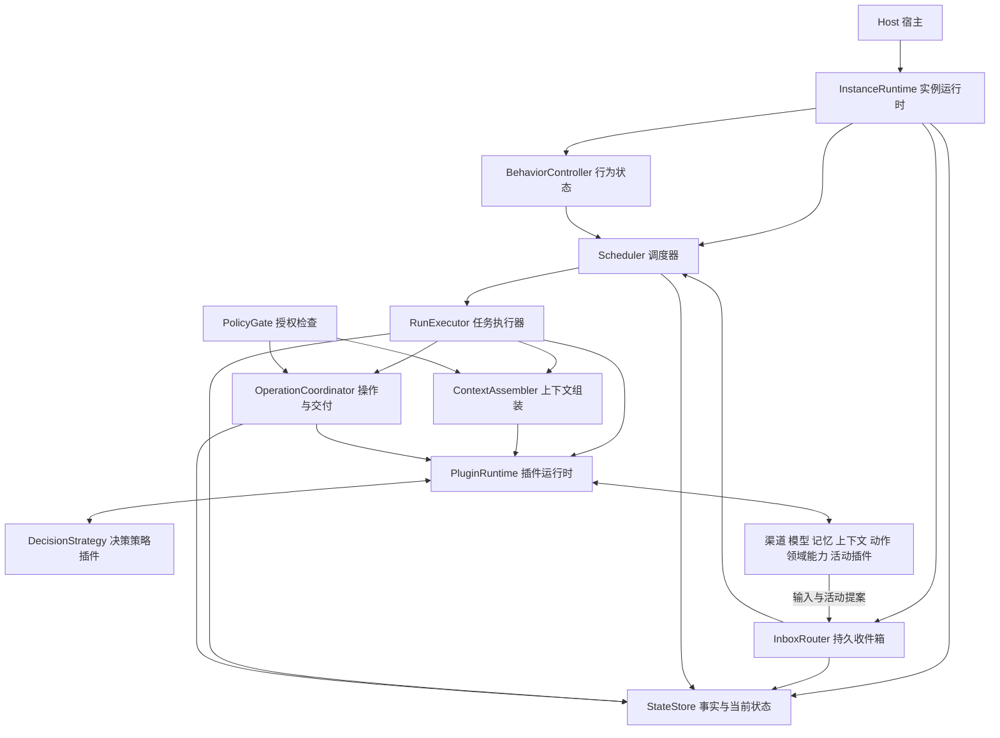
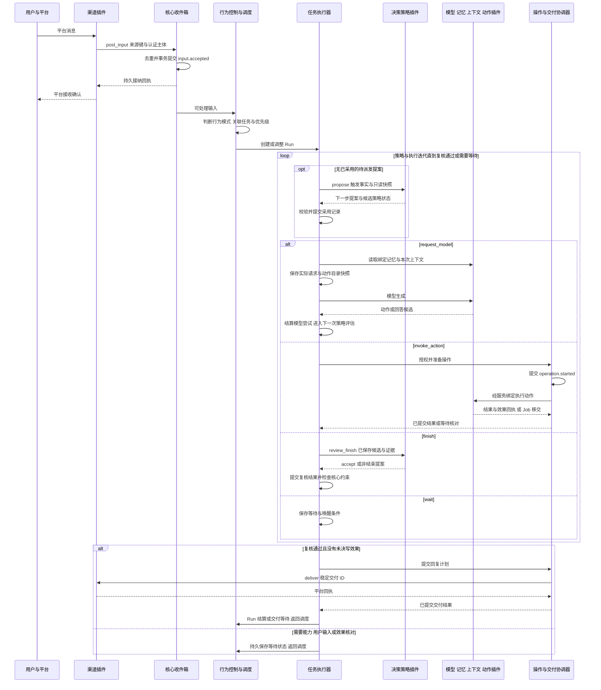
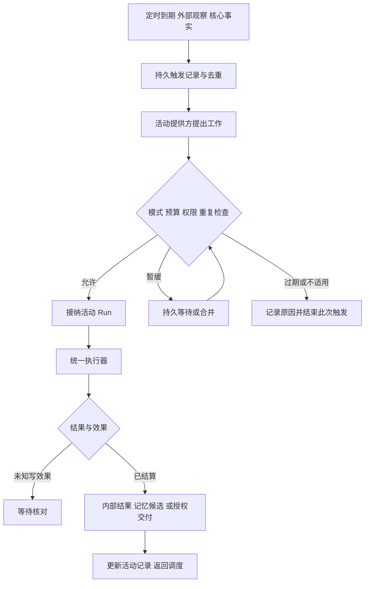

# 大肥鱼常驻核心与插件架构设计草案

设计日期：2026 年 11 月 9 日。重构起点：大肥鱼 v0.1.0，提交 `e687fb1`。本轮实现版本：v0.2.0。参考版本：本地 DeepSeek Harness，提交 `ce7073d5`。

当前阶段的建设范围已收敛到[核心 SDK 最小示例与测试夹具的设计](architecture-convergence.md)。本文保留常驻运行的长期目标；其中的业务能力、自动反思、复杂活动和委派设想不构成当前开发范围。v0.2 已有功能与后续归类调整分别以实际架构和收敛设计为准。

大肥鱼以一个长期在线的实例运行。程序启动后恢复同一身份、人格版本和未完成工作，启动配置中已启用的服务，并持续接收消息和处理主动活动。大肥鱼可以调整专注、安静、休息等内部行为状态，程序与已启用服务继续运行。

本文定义目标模块、逻辑接口、状态归属和运行流程，包含后续扩展目标。按照本轮开发要求，直接采用 ABI 2、profile 2 和存储 2，不保留旧协议、旧 CLI 或旧数据兼容层。已经实现的模块与明确边界以 [实际架构](architecture.md) 和 [当前 SDK](plugin-sdk.md) 为准，验证结果见 [验证记录](validation.md)。

## 设计目标与基本原则

常驻核心负责身份连续性、行为状态、输入接纳、任务调度、授权、预算、操作结算和恢复。插件提供模型、渠道、记忆、上下文、动作、决策策略以及主动活动的实现。所有消息响应与主动活动共用同一执行流程。

沿用 C++20 与版本化 C ABI。借鉴 DSH 的服务契约、声明式依赖、作用域注册、资源撤销和运行阶段扩展机制。DSH 的默认主循环也可被插件替换；大肥鱼的核心维护任务推进的约束与状态转换，决策策略插件提出下一步工作，核心校验并执行提案。

插件化同时覆盖两个目标：新增或替换领域能力，以及通过已定义的决策接口调整规划、复核和结束判断。新增符合公共协议的插件只增加插件包与配置，不要求核心增加具体插件或领域名称的分支。新增核心状态转换或授权规则仍需显式演进核心协议。

| 事项 | 核心拥有 | 插件可扩展 |
|---|---|---|
| 身份与人格 | 实例身份连续性、采用的人格版本、基础约束 | 人格内容、记忆检索、成长候选与整理方法 |
| 决策与执行 | 阶段转换、调度资格、预算、授权和效果结算 | 规划、下一步提案、结果复核、结束建议 |
| 领域能力 | 契约校验、服务路由、作用域和操作记录 | 搜索、文件、进程和业务系统实现及其模型侧动作 |
| 主动行为 | 行为状态、触发接纳、活动调度与恢复 | 观察来源、活动定义、触发评估及结果反馈 |

必须保持以下约束：

- 一个实例只有一个核心状态写入者；插件通过命令或结果提交事实。
- 插件声明能力与依赖不构成授权；调用时仍校验权限与作用域。
- 服务就绪、运行任务和大肥鱼的行为模式分别表达。
- 输入持久接纳后才确认接收；已提交事实发布后才能驱动后续工作。
- 每次模型请求采用的指令、记忆、上下文与可用动作能够从持久记录还原。
- 策略提案、模型输出和插件注册均不直接改变任务状态；核心接纳后才产生后续工作。
- 插件间调用沿用核心签发的权限和预算；业务副作用必须关联可核对的操作身份。
- 写操作与交付效果未知时进入核对流程，不能通过新操作 ID 自动重复执行。
- 取消和超时不抹除已发生的效果；程序重启不自动恢复已撤销的授权。
- 同进程原生插件属于受信代码。服务接口约束逻辑调用；操作系统隔离需要独立进程承载。

第一阶段提供单实例常驻运行、一个活动决策循环、有界后台工作以及持久收件箱。后续插件协议阶段开放决策策略与领域能力组合。本文为子 Run 规定兼容约束，但首期不发布委派接口，也不承诺并行多 Agent。多实例集群、任意插件热替换和不受信原生模块隔离不进入首期实现。

## 常驻核心的模块划分



图中是逻辑模块，初期可以放在同一个核心库内。表中“拥有”表示负责写入或转换该状态；其他模块通过接口使用。

| 模块 | 拥有的职责和状态 | 主要接口 |
|---|---|---|
| `Host` | 进程生命周期、启动配置、系统信号、本地管理端点 | `boot`、`request_shutdown`、`health` |
| `InstanceRuntime` | 实例身份、启动阶段、模块装配、恢复协调、健康汇总 | `start`、`snapshot`、`drain` |
| `BehaviorController` | 行为模式、各活动的运行策略、状态修订号 | `get_state`、`request_transition` |
| `InboxRouter` | 输入去重、消息归属、待处理队列、领取与完成记录 | `accept`、`route`、`claim`、`acknowledge_consumed` |
| `Scheduler` | 活动定义、到期记录、唤醒合并、优先级、预算、Run 排队 | `register_activity`、`propose`、`dispatch`、`reevaluate` |
| `RunExecutor` | 意图修订、策略调用与提案接纳、阶段转换、模型尝试和安全暂停点 | `advance`、`steer`、`pause`、`resume`、`cancel` |
| `ContextAssembler` | 本次请求的材料与动作目录选取、来源、作用域、顺序和预算 | `assemble`、`freeze_request` |
| `PolicyGate` | 入口主体映射、权限求交、动作与目标授权、撤销检查 | `admit_input`、`authorize_operation`、`authorize_delivery` |
| `OperationCoordinator` | 动作、领域写调用、交付、记忆写入的操作身份、子操作、Job、效果与核对 | `prepare`、`dispatch`、`settle`、`reconcile` |
| `PluginRuntime` | 模块加载、契约与动作注册、服务绑定、插件状态、调用队列和资源归属 | `activate`、`resolve`、`request`、`quiesce`、`dispose` |
| `StateStore` | 核心事务、事件序号、当前状态、恢复游标、不可变请求引用 | `transact`、`load`、`read_events` |

管理界面依赖公开的查询与命令接口；插件依赖 SDK 中的服务契约。它们均不引用 `RunExecutor` 或直接写核心数据库。核心不根据具体插件 ID 编写业务分支。

活动启停策略由 BehaviorController 单独拥有，Scheduler 读取策略并维护实际排队和执行状态。暂停活动的管理命令进入 BehaviorController，提交事件后由 Scheduler 重新评估队列，避免两个模块各自维护一份开关。

### 执行线程与作用域

核心状态转换在一个串行事件循环中提交。网络、模型推理和耗时动作在受管理的执行器中运行，通过消息返回结果；核心线程不直接等待阻塞的插件调用。

首期同一实例只有一个活动的模型决策循环。其他会话和活动可以排队，已启动的后台工作可在预算内继续。新的用户输入可以被立即持久接纳，在安全点影响执行顺序；不保证能够强制抢占正在执行的原生调用。

| 作用域 | 生命周期 | 典型内容 |
|---|---|---|
| 实例 | 程序运行期间，持久身份跨重启延续 | 服务注册表、渠道连接、记忆服务、活动定义 |
| 会话 | 一个渠道对话或显式创建的内部会话 | 消息历史、参与者映射、会话可见材料 |
| Run | 一项有明确意图的工作 | 权限快照、服务绑定、任务上下文、暂停与恢复信息 |
| Call | 一次模型尝试或操作调用 | 截止时间、取消状态、临时缓冲、执行资源 |

作用域由核心创建。注册资源归属于插件与作用域，结束时统一释放。插件不能通过自行填写 `run_id` 或 `actor` 获得该作用域的权限。

同一人格可以服务多个会话；会话材料和任务权限不因人格相同而自动共享。

## 状态模型与数据归属

### 程序 服务和行为状态

| 对象 | 状态或字段 | 转换规则 |
|---|---|---|
| Host | `starting / running / draining / stopped / failed` | 由启动、关闭和核心基础设施结果决定 |
| 实例健康 | `ready / degraded / unavailable` | 汇总必需能力和持久层的可用性，不等于行为模式 |
| Plugin | `discovered / validated / starting / ready / degraded / quiescing / stopped / failed` | 由插件运行时依据生命周期与健康事实维护 |
| 行为模式 | 初始支持 `available / focused / quiet / resting` | 大肥鱼或用户提交状态命令，核心校验并记录修订 |
| 活动策略 | 每个活动的 `enabled / paused`、时窗、唤醒条件 | 控制该活动是否产生新的执行，不卸载插件 |

行为模式是可解释的决策规则。具体唤醒名单、时窗和预算来自部署配置；不能只靠提示词要求模型记住。进入 `resting` 后仍接收输入、记录到期事件和结算已发生的操作，是否唤醒取决于该模式的规则。

行为状态包含 `revision`、变更主体、原因、来源 Run 和可选的 `effective_until`。有时限的模式到期后由核心按记录恢复，避免重启后永久停留在临时模式。普通行为命令不提供关闭 Host 的权限。

### 实例 会话 任务与后台工作

| 对象 | 核心字段 | 归属 |
|---|---|---|
| Instance | `instance_id`、基础身份版本、行为修订、配置修订 | 核心 |
| Conversation | 渠道实例、外部会话 ID、参与主体、可见范围 | 核心保存映射；渠道负责平台认证与传输 |
| Input | 来源键、消息或事件引用、接收时间、状态、关联 Run | 核心收件箱 |
| Run | `run_id`、来源输入、意图修订、策略绑定与状态修订、上下文与服务绑定、预算、阶段 | 核心执行器 |
| Operation | `operation_id`、所属 Run、可选父操作与步骤键、不可变参数、效果类别、资源范围、回执 | 核心协调器；提供方保存自身效果证据 |
| Job | `job_id`、所属 Run、可选来源活动、提供方绑定与工作键、操作 ID、进度、结果和取消状态 | 核心登记；插件执行具体工作 |
| Activity | 活动 ID、定义版本、触发规则、行为策略引用、下一到期点 | 调度器持有定义与计划；行为控制器持有启停策略 |
| PersonaSnapshot | 版本、人格内容或不可变引用、来源、实例身份 | 记忆插件为持久版本的唯一写入者；核心记录采用的快照 |

Run 是一次工作，Job 是这次工作中的后台执行。主动活动也先形成 Run，再登记 Job。Job 完成后向所属 Run 提交结果，由绑定策略提出后续工作并经核心接纳。Job 本身不创建新的决策循环。

Run 保留独立的状态维度：

- `execution`：`queued / running / waiting / paused / completed / failed / cancelled`。
- `phase`：`decision / context / model / action / review / delivery / settlement / done`。
- `wait_reason`：等待能力、用户输入、Job、重试时机或效果核对等结构化原因。
- `goal`：`met / partial / unmet / uncertain`，并记录评价来源；模型判断不自动升级为核心验证结论。
- `delivery`：`none / prepared / sending / sent / not-sent / unknown / suppressed`。

需要对外回复的 Run 在交付未知时保持等待。内部活动可以预先声明不对外发送，完成时 `delivery=none`。取消 Run 表示停止追求原意图；未结算操作仍由独立的核对流程处理。

### 事实 通知与插件私有状态

核心数据库保存输入、任务、策略采用记录、操作、活动调度、行为修订、服务绑定和已提交事件。记忆内容、渠道平台收据及能力专用索引分别由所属插件持有。

每条核心事件至少包含事件 ID、全局递增序号、实例 ID、类型、发生与接收时间、来源、关联对象、因果事件 ID、数据版本及载荷或不可变载荷引用。

事件分为三种用途：

| 用途 | 例子 | 规则 |
|---|---|---|
| 持久事实 | `input.accepted`、`operation.settled`、`behavior.changed` | 与对应状态在同一事务提交，之后发布通知 |
| 实时进度 | 模型文本片段、临时进度、连接心跳 | 带调用身份；不宣称硬崩溃后一定可恢复 |
| 请求与提案 | 活动建议、行为调整、补充输入 | 先接纳与校验，再决定是否产生状态变化 |

保留当前“事务快照加事件日志”的实现路线。历史请求材料必须可还原，但首期不承诺仅凭事件重建全部数据库。展示层读取已提交状态；全部事件也不会不加筛选地进入模型上下文。

## 启动 常驻与关闭流程

### 启动流程

1. Host 读取并校验 profile，取得实例独占锁，打开数据库并检查版本。
2. 恢复实例身份、人格快照引用、行为模式、收件箱、活动计划及未完成工作。
3. 建立核心事件循环、查询端点、操作协调器和插件运行时。
4. 按服务依赖图校验并启动所有已启用插件；必需依赖未就绪的插件保持等待或明确失败。
5. 发布已成功启动的服务绑定与注册；恢复活动的到期记录和插件事件订阅。
6. 恢复已采用策略提案及待处理结束候选；对未结算操作、交付、记忆提交和 Job 查询或标记核对，重建受限资源范围。
7. 核心进入常驻运行，开始领取可以安全推进的输入与 Run。

持久层或身份校验失败时不能报告实例已在线。某个能力暂时不可用时，核心可处于 `running + degraded`，接受并保存输入，将依赖该能力的任务置为等待。

渠道在调度完全就绪前收到的消息可以先持久入队；只有 `InboxRouter` 确认提交后才能确认接收。没有可用持久层时，渠道采用平台重投或自身持久队列，不返回虚假的已接收回执。

### 常驻运行

主循环等待输入、活动到期、调用结果或管理命令。没有工作时休眠于事件等待；不会持续发起模型推理。一次 Run 完成后返回调度器，实例、渠道连接、记忆服务和活动注册继续存在。

大肥鱼可以通过内置的受控命令设置行为模式、调整已授权活动、暂停自己的某项工作。行为变化产生事实事件，调度器据此更新待调度工作；已发出的外部操作继续结算。

### 关闭流程

1. Host 进入 `draining`，停止领取新的 Run 和启动新的活动。
2. 渠道停止接收新传输，或完成已接收输入的持久接纳；活动提供方停止产生新提案。
3. 向正在执行的调用请求协作取消，在关闭期限内接收结果与回执。
4. 将仍未确定的写入与交付记录为待核对，将可恢复工作、活动游标和队列保存。
5. 撤销订阅和注册，按依赖反向停止插件，再关闭数据库并释放实例锁。

接收入口停用与发送回执结算分开处理，不能为了停止新消息而提前关闭仍承担交付核对的连接。原生插件未完成退出时不能卸载仍在执行的 DLL；强制终止需要结束整个进程，或由未来的独立插件进程提供隔离。

## 插件体系与公共接口

### 插件包 服务契约和能力组合

一个插件包可以提供多个服务或注册项。服务契约规定操作、输入输出、版本和错误；提供方实现契约；使用方通过绑定调用契约，不链接具体提供方。

例如，搜索插件提供 `web.search` 能力，搜索动作负责模型侧 schema 与结果表达，通过服务绑定调用搜索能力。渠道插件也可以同时贡献消息适配、上下文信息与受控动作。

能力组合必须同时明确契约定义、提供方和使用方，三种角色可以位于同一个插件包。领域契约是开放集合：插件包可携带命名空间内的契约描述，核心验证通用描述格式和兼容性，不枚举所有搜索、文件或业务服务。相同契约 ID 与版本必须具有一致的描述摘要；不兼容的语义变更使用新契约版本。核心仅对调度、决策、动作等参与运行语义的内建契约规定固定行为。

插件清单需要声明：

| 字段 | 用途 |
|---|---|
| 插件身份、发行版本、ABI 版本、模块位置 | 加载与身份检查 |
| 提供的服务 ID、契约 ID 与契约版本 | 服务注册和兼容性判断 |
| 契约描述摘要、方法输入输出 schema、效果和资源规则 | 通用协议校验、调用授权、操作结算与恢复 |
| 动作定义及其执行绑定；发现型提供方的注册命名空间 | 构建模型可见目录，限制动态发现的注册范围 |
| 必需与可选服务依赖 | 启动排序、缺失依赖诊断、可选能力激活 |
| 配置 schema、数据 schema 版本 | 启动校验与数据迁移 |
| 所需能力与可产生的输入类型 | 对照部署授权，不自行授予权限 |
| 执行方式与并发限制 | 同步兼容、异步调用、后台事件源及调用排队 |

Profile 选择每个服务绑定的具体提供方、决策策略、启用的活动和预算。接口允许安装多个提供方，但一个 Run 的每个命名绑定必须解析为唯一提供方。依赖不允许隐式挑选“第一个可用实现”。

### 宿主向插件提供的逻辑接口

以下是接口语义，不是已经发布的 C 函数定义。

| 接口 | 输入与输出 | 约束 |
|---|---|---|
| `register_service` | 描述符 → 注册句柄 | 必须匹配清单；只在允许的生命周期阶段注册 |
| `register_action` | 动作描述、执行服务绑定、作用域 → 注册句柄 | 必须匹配清单定义或获准的发现范围；注册不授予执行权限 |
| `resolve_service` | 契约、命名绑定、作用域 → 服务句柄 | 检查依赖和授权；句柄绑定提供方版本 |
| `request_service` | 服务句柄、方法、载荷、调用句柄、适用时的操作句柄与步骤键 → 调用票据 | 根据方法效果路由；写调用须先经操作协调器接纳，不能借助嵌套调用扩大权限 |
| `post_input` | 来源键、输入类型、载荷 → 持久接纳回执或明确拒绝 | 来源身份由宿主绑定；提交成功后才确认接收 |
| `report_call_event` | 调用票据、事件序号、进度或结果 → 接纳结果 | 只能报告自己持有的调用；终态去重 |
| `register_job` | 操作句柄、提供方工作键、恢复方式 → 持久登记回执与 Job 句柄 | 在启动后台工作前登记；重复登记返回同一 Job |
| `read_job / cancel_job` | Job 句柄、可选取消原因 → 快照或取消请求回执 | 按归属校验；取消请求不等于终态 |
| `report_job_event` | Job 句柄、事件序号、进度或终态 → 接纳回执 | 终态持久化后确认，和等待唤醒同事务提交 |
| `subscribe_facts` | 事件过滤器、持久游标 → 订阅句柄 | 按范围过滤，消费可重投，使用事件 ID 去重 |
| `ack_facts` | 订阅句柄、已完成事件序号 → 游标回执 | 只有消费结果已提交后才能推进；不能越过未处理事件 |
| `register_activity` | 活动定义 → 注册句柄 | 执行资格由核心调度；注册不直接启动推理 |
| `request_behavior_change` | 预期修订、目标变化、原因 → 命令回执 | 由核心检查状态转换与授权 |
| `submit_command` | 已登记的命令类型、认证主体、预期修订、参数 → 持久命令回执 | 由核心命令处理器执行，不暴露任意字段修改 |
| `read_state` | 对象、范围、游标 → 已提交快照或事件页 | 不返回可变核心对象 |
| `release_registration` | 注册句柄 → 释放结果 | 清理对应注册；不能撤销已发生的外部效果 |

依赖关系只决定服务能否被引用。调用权限来自宿主签发的作用域与能力句柄，序列化的调用上下文只用于说明和审计。同进程插件仍需可信；恶意原生代码可绕过这些逻辑接口直接访问操作系统。

订阅投递经插件的串行事件入口处理。插件需要写自己的数据库时，先在私有事务中保存消费结果与已处理事件 ID，再调用 `ack_facts`。两次提交之间崩溃会导致重投，由事件 ID 去重；不要求核心库与插件库共同提交事务。

### 领域调用与副作用归属

每个领域方法声明输入输出 schema、`read / local-write / external-write` 效果类别、资源范围规则，以及重试、幂等和效果查询语义。核心以经验证的参数和提供方绑定确定实际资源范围。通用进程执行无法保证只读时，按可能产生的写效果声明，不能仅因动作名为查询就当作只读。

`request_service` 在每次调用时求交当前授权、Run 授权、调用者获准范围和当前操作计划的限制，并沿用原预算。只读调用经 PluginRuntime 排队；业务写调用必须带宿主签发的操作句柄，先由 OperationCoordinator 保存计划并检查未知效果限制，再派发提供方。父动作声明的效果类别与资源范围必须覆盖子调用，声明只读的动作不能嵌套发起写入。ContextContributor、readiness 和策略评估只获得只读调用资格；活动评估要执行业务动作时先提出 Run。模型生成另受核心调度与用量计量约束，只读服务资格不能用于直接调用模型。插件维护自身去重表、索引或回执等内部状态，按对应存储协议处理，不据此获得额外业务写权限。

复合动作中的独立副作用采用子操作。提供方提交父操作句柄与稳定 `step_key`，由核心分配子 `operation_id`；父操作、步骤键唯一关联不可变参数和提供方绑定，重复请求返回原记录或冲突。父操作只负责汇总时不重复计入子效果；自身执行的独立效果也需登记。已确认子结果可以复用；任一子效果未知时，父汇总保留 `effects=unknown` 和已确认回执，阻止相关步骤重放及父操作宣称全部完成。

例如“生成并发送报告”可以拥有文件写入和渠道交付两个步骤。发送状态未知时，重启后查询原发送身份，保留已确认的文件结果；不能通过重新调用整个动作重复发送。复合动作的中间进度须能从已提交子记录恢复，不能只保存在插件内存中。

### 能力目录与模型可见性

PluginRuntime 持有动作注册目录，ContextAssembler 为每次模型请求生成经过范围、授权和可用性筛选的目录快照。动作描述包含稳定 ID、定义修订、模型可见名称与说明、输入输出 schema、执行绑定、效果类别、资源规则和可用性条件。`describe` 返回已注册的版本化描述，不能在调用时悄悄改变同一版本。

| 阶段 | 规则 |
|---|---|
| 注册 | 校验描述与执行绑定；同一可见作用域的名称冲突在发布前拒绝，不依赖加载顺序覆盖 |
| 绑定 | Run 接纳时绑定候选动作定义及提供方；策略只能从该集合中进一步选择，不能扩大授权 |
| 组装 | 按当前范围、撤销状态、只读可用性条件及预算选取；保存实际送给模型的名称、说明、schema、版本和绑定 |
| 执行 | 模型动作按该请求的目录快照解析，核心再次检查当前授权、资源与 readiness；已展示不等于仍可执行 |
| 变更 | 新注册默认供新 Run 使用；在途 Run 扩展目录需在安全点显式修订绑定并重新授权，旧请求仍按旧快照解释 |
| 撤销 | 停止接纳依赖调用，保留历史描述与已发出操作的核对信息；不能把同名新提供方用于旧回执 |

ABI 2 的动作和领域方法使用有明确版本的 schema 子集。首批覆盖嵌套 object、array、string、integer、number、boolean、enum、必填字段和大小限制，明确 additionalProperties、数值范围和递归深度；不支持的关键字在注册时拒绝。模型适配器需要转换 schema 时保存实际发送定义，执行仍按规范动作定义校验；无法等价表达的动作不得静默放宽约束。

Skills 可组合内容服务、上下文目录和加载动作，实际采用的指令与资源版本进入请求记录，加载指令不增加权限。MCP 桥接可在清单授权的命名空间内发现并注册动作；外部工具描述仍需 schema、效果和资源映射，不能默认视为只读。首期只在启动阶段发布发现结果，目录更新经受控重启生效；运行中热增删能力属于后续协议，不由桥接插件自行绕过绑定规则。

### 调用与结果协议

调用身份至少包含 `call_id`、`run_id`、`operation_id`（适用时）、意图修订、服务绑定修订、截止时间、授权句柄和输入引用。模型重试使用新的 `call_id`；同一外部操作的查询和幂等重试沿用原 `operation_id`。

异步调用返回票据，之后报告进度或一个终态；终态包含 `result` 或结构化 `error`。重复终态按调用身份去重，互相矛盾的终态进入协议错误处理。调用接口接受请求仅表示已排队，不表示业务成功。

核心的截止时间到期事件不冒充提供方终态。超时后仍可收取确认效果与迟到结果，但不会据旧决策自动继续动作；实际执行资源只有在提供方结束后才能回收。在旧调用仍执行时，是否允许另一次尝试由预算、并发限制与操作效果共同决定。

动作结果保留三条独立维度：

```json
{
  "status": "succeeded | partial | failed | cancelled | unknown",
  "effects": "none | confirmed | unknown",
  "coverage": "complete | partial | unknown",
  "data": {},
  "sources": [],
  "receipts": []
}
```

错误包含 `code`、`category`、`retryability`、`effects`、`message` 和必要的核对线索。错误类别至少区分用户取消、截止时间到期、临时不可用、权限拒绝、输入无效、协议错误和效果未知。插件的可重试建议仍受核心预算和效果规则约束。

### C ABI 生命周期与线程约定

统一采用 ABI 2 的事件式接口，所有示例插件直接实现该接口。服务协议版本、插件发行版本、ABI 版本与持久数据版本独立管理。

生命周期为 `create → start → ready → quiesce → stop → destroy`。同一实例的生命周期调用串行执行；启动失败清理已取得资源和注册。服务引用只在对应提供方就绪后对使用者发布。

ABI v2 明确允许宿主拥有的异步事件入口。插件工作线程只能使用明确标注为线程安全的复制式投递接口；输入缓冲在返回前由宿主复制，排队容量有限，失败返回明确的忙或关闭状态。持久输入必须收到提交回执，不能把“复制进内存”当成持久成功。

入口排队分别管理普通输入、进度和终态。进度可以合并；每个已接纳调用及已登记 Job 预留终态与回执的投递容量，不能因普通消息拥塞丢弃效果结果。进入 quiesce 后拒绝新工作，已登记调用和 Job 的结果通道保留到结算或明确记录未知，再完成 stop。

生命周期与普通实例方法不被并发重入，除非契约显式允许。服务请求通过队列路由，不能在核心锁内递归执行另一个插件。Call 终态后可能仍需等待执行资源退出；逻辑超时不能导致仍执行中的模块提前卸载。

插件在其所有者线程获得异步票据后应返回，通过后续完成事件继续处理；不得同步阻塞等待同一执行器上的排队调用。服务之间的异步协作仍保留原调用作用域和资源归属。

每个插件由专用串行执行器承载生命周期与 on_event；宿主与插件间只使用当前接口，不增加旧 invoke 适配路径。长期输入源和后台结果通过宿主复制式投递接口接入，执行资源在 stop/destroy 前收束。

跨 ABI 继续使用版本与长度检查、UTF-8 字节和不透明句柄，不传递 STL 对象、异常或跨模块释放责任。适配器必须在所有入口收束异常。

### 配置绑定与注册释放

Run 接纳时固定提供方身份及版本、契约版本、非敏感配置修订、基础身份版本、动作 schema 与效果声明、授权策略修订、决策策略绑定及其状态 schema 版本。首次组装上下文时绑定人格快照版本；后续各次请求另行保存实际检索到的记忆项。凭据只记录引用及必要的身份版本，不持久记录明文密钥。

同一 Run 默认继续使用已经采用的人格快照；更新快照需要在安全点形成显式绑定修订。行为模式是可变化的运行状态，每次请求记录实际采用的行为修订，不因服务配置冻结而忽略用户的新行为指令。

展示说明和无关插件的变化不阻断接续；模型侧动作说明继续使用任务已保存的定义。行为配置变化不能静默替换在途任务。新增权限不自动授予旧 Run，当前权限撤销仍在实际调用前生效。旧绑定不可用时进入等待或显式迁移，不能换用新提供方后沿用旧回执。

首期配置更新通过受控重启生效。新任务采用新配置；旧任务需要原绑定可重建，或完成显式迁移。后续热替换必须先停止接纳依赖工作、等待调用退出、迁移状态并撤销旧注册，再发布新绑定。

## 各类插件接口

| 契约 | 主要方法 | 返回与职责 |
|---|---|---|
| ModelProvider | `describe`、`generate`、`cancel` | 能力描述；文本进度、用量、动作或回答候选；明确一次尝试的终态 |
| DecisionStrategy | `describe`、`propose`、`review_finish` | 规划、下一步提案、结束复核和版本化策略状态；不直接推进核心状态 |
| ChannelAdapter | 启动事件接收、`deliver`、`query_delivery` | 认证后的平台输入；稳定交付 ID 对应的发送结果和回执 |
| MemoryProvider | `snapshot`、`retrieve`、`validate`、`commit_change`、`query_change` | 有来源的记忆与人格快照；带预期版本和变更 ID 的提交 |
| ContextContributor | `collect` | 带来源、版本、有效期、范围、优先级和大小的上下文片段 |
| ActionProvider | `describe`、`readiness`、`execute`、`query_operation`、可选 `cancel` | 动作 schema、效果类别、可用性、执行结果和效果查询 |
| CapabilityProvider | 契约定义的领域方法 | 搜索、文件、进程等可复用能力；动作或其他插件使用它 |
| JobProvider | `query_job`、`reattach_job`、`cancel_job` | 查询已登记工作的状态，恢复结果投递或报告中断；不擅自重启写工作 |
| ActivityProvider | `definitions`、`evaluate_trigger`、`on_settlement` | 活动定义、执行提案、结果反馈；不自行创建未登记循环 |
| ManagementProvider | 查询、订阅、提交受控命令 | 展示状态或接收用户管理请求；不直接修改核心存储 |

ModelProvider 的工具调用和 final 输出是候选，由 DecisionStrategy 评估后向核心提出下一步；模型接口负责供应商适配与输出规范化。上下文贡献者不得修改核心指令和权限；组装器在快照中标注材料来源及信任类别，按预算选取材料并保存实际采用内容。表中契约表示角色，同一个插件可以同时实现动作、领域服务和后台工作协议。

主要方法采用以下请求和结果约定。所有身份和授权字段由宿主关联或校验，表中的业务载荷不能代替授权句柄。

| 方法 | 关键输入字段 | 关键结果字段 |
|---|---|---|
| `model.generate` | 请求快照引用、模型选择、允许的动作定义、用量预算、意图修订 | 文本片段、用量事实或未知值，以及一个动作或 final 候选 |
| `strategy.propose` | 决策键、触发原因、Run 只读快照、结果引用、策略状态与预算 | 一个下一步提案、理由、依据引用与候选新状态 |
| `strategy.review_finish` | 决策键、结束候选 ID、结果与证据引用、策略状态与预算 | accept，或一个非结束提案；附理由与候选新状态 |
| 渠道调用 `host.post_input` | 外部消息键、平台认证主体、会话键、正文或附件引用、发生时间 | 接纳 ID、去重结果或明确拒绝 |
| `channel.deliver` | delivery ID、不可变目标、正文或附件引用、回复关联 | sent、not-sent 或 unknown；相应的平台证据 |
| `channel.query_delivery` | 原 delivery ID 与提供方绑定 | 查询状态、回执引用及证据时间 |
| `memory.snapshot / retrieve` | 实例、可见范围、查询条件、材料预算 | 人格版本、记忆项、来源与不可变内容引用 |
| `memory.validate` | 已采用的版本与内容引用 | 是否有效及无效原因 |
| `memory.commit_change` | change ID、预期版本、候选变更、依据事件引用 | 新版本与回执，或版本冲突、失败、未知效果 |
| `memory.query_change` | 原 change ID | 提交状态、版本与回执 |
| `context.collect` | 任务只读视图、允许的材料范围、行为修订、预算与截止时间 | 有来源和版本的贡献项；每项包含内容、有效期与放置类别 |
| `action.readiness` | 动作 ID、已校验的操作计划和资源范围 | available、reason、可选 retry_at；不执行业务写入 |
| `action.execute` | operation ID、动作 ID、不可变参数、调用范围与截止时间 | ActionOutcome，或关联已登记 Job 的移交结果；移交不结算业务效果 |
| `action.query_operation` | 原 operation ID、原提供方绑定 | 效果是否确定、操作结果与回执 |
| `job.query_job / reattach_job` | 原 Job 身份、工作键、提供方绑定、已接纳事件游标 | 工作状态、结果或恢复事件投递；无法恢复时给出明确原因 |
| `job.cancel_job` | 原 Job 身份、取消请求 ID、原因 | 已接纳取消请求或明确拒绝；业务终态另行报告 |
| `activity.evaluate_trigger` | occurrence ID、触发事实、活动版本、只读行为状态、预算 | skip、defer 或任务提案；不直接开始业务动作 |
| `activity.on_settlement` | occurrence ID、Run 终态和已提交结果引用 | 反馈处理确认；新的活动建议另走提案入口 |
| 管理插件调用 `host.submit_command` | 命令类型、认证主体、预期对象修订、参数和原因 | 持久命令回执，后续事实通过查询或订阅读取 |

首期每个成功模型尝试只接纳一个动作或 final 候选。流中出现互相冲突的控制候选，或尝试未成功完成时，核心保留诊断，只向策略提供结构化失败事实，不把不完整候选交给策略继续执行；多个动作批量执行留给后续独立协议设计。

ChannelAdapter 的 `deliver` 接收不可变的 ID、目标和正文。相同 ID 的不同计划必须拒绝；查不到回执返回 `unknown`，只有明确的提供方证据才能返回已发送或确定未发送。

MemoryProvider 是其持久人格版本的唯一写入者。成长或反思插件提出候选变更，核心校验来源与政策后，经操作协调器调用 `commit_change(change_id, expected_revision, changes)`。插件在自身事务中提交新版本和查询回执；核心保存已采用版本与对应事件。版本冲突重新评估，不能覆盖更新；跨库中断按 `change_id` 查询，不假设分布式事务。

写动作必须提供 `query_operation`，即使实现只能明确返回 `unknown`。只读动作可以声明不适用。取消请求只表示请求停止；是否已停止、是否产生效果由终态和回执说明。

ActivityProvider 可以注册确定性的定时规则或观察源。需要模型判断的活动提案也必须受调度预算管理；插件不得在后台私自调用模型来绕开活动预算。

### 决策策略与结束复核

每个 Run 绑定一个 DecisionStrategy。初次取得执行资格、模型尝试结算、动作结算、意图修订或等待条件解除时，RunExecutor 在安全点调用 `propose`。输入是带修订号的只读快照；策略不能直接写核心存储、派发动作、发送消息或在内部启动未登记的模型循环。

| 提案类型 | 主要内容 | 核心处理 |
|---|---|---|
| `request_model` | 本次推理目的、允许的模型绑定、材料引用、动作子集 | 校验预算与范围，组装并冻结请求后调用 ModelProvider |
| `invoke_action` | 已绑定动作 ID、不可变参数、依据引用 | 检查授权、效果、schema 与 readiness，再经操作协调器执行 |
| `wait` | 用户输入、Job、能力或时机等结构化条件 | 持久登记等待与唤醒条件，归还调度资格 |
| `finish` | 候选回答或内部结果、目标评价与证据引用 | 保存结束候选，进入 `review_finish`，尚不交付或结束 Run |

`review_finish` 对一个候选 ID 返回 `accept` 或一个非结束提案。接受后核心仍检查当前意图、授权、预算与未决效果；复核本身不直接形成完成状态。要求模型检查证据时，复核返回带检查目的的 `request_model`，后续输出继续走统一流程。新的结束提案形成新候选 ID；对同一候选已采用的复核结果不重复执行。

随项目提供默认策略，表达现有的“请求模型、执行其合法动作候选、复核并结束”的行为；默认复核无需额外模型调用。规划、执行复核和串行工作流可以通过替换策略或由策略显式组合只读领域服务实现。首期不提供任意修改共享 Run 对象的钩子链；需要组合多个策略组件时，由一个已绑定策略定义顺序、冲突规则和预算，并把组件绑定纳入配置修订。

策略调用使用稳定决策键，关联触发事实、Run 修订、意图修订和策略绑定。核心在一次事务中保存采用的提案、候选策略状态与下一阶段；产生操作或模型请求时保留该决策关联，恢复时不为已接纳提案重复建立工作。输入或绑定已变化的迟到提案只留诊断，不能推进新修订。策略状态有独立 schema 版本；模型实际使用的计划或说明必须另行纳入请求材料记录。

策略评估只允许有界计算与获准的只读查询。模型推理通过 `request_model` 进入同一尝试和用量账本；领域写入通过 `invoke_action`。Run 预算包含策略步数和执行时间，重复复核、等待唤醒和更换候选 ID 不重置预算。策略不可用、协议错误或状态版本不匹配时进入明确等待或失败，不静默切回默认策略。强制取消、预算耗尽和未知写效果约束由核心直接执行，策略不能阻止。

`subscribe_facts` 用于观察已提交事实、更新私有索引或提出新活动；请求前的策略选择和结束前的复核使用上述契约。事实订阅不能回改已经采用的决策。

### Job 的登记 控制与恢复

动作需要后台执行时，先通过 `register_job` 持久登记所属操作、提供方工作键及 `query / reattach / not-resumable` 恢复能力，收到回执后才能启动后台工作。提供方工作键必须在启动前确定并用于查找或幂等启动，不能只依赖启动后才获得的进程号。同一操作、提供方和工作键重复登记返回原 Job，参数不同则拒绝。

`action.execute` 可返回 `job_started` 移交结果，结束这次 Call，但所属 Operation 仍未结算。核心将运行资源与结果投递资格归属到 Job，不能随 Call 结束释放。宿主为已接纳 Job 保留终态与回执容量，进度可以合并；Job 结果可以早于移交返回到达，核心按持久身份关联，不依赖通知顺序。

提供方通过 `report_job_event` 报告进度或 ActionOutcome 终态。核心按 Job 和事件序号去重，冲突终态进入协议错误处理；结果、操作结算或待核对状态、等待唤醒记录同事务提交后才确认终态接纳。Run 通过 `read_job`、事实订阅或策略的 `wait` 提案获得状态，`cancel_job` 只登记并转发取消请求，不能冒充工作已经停止。

重启后先按原绑定与工作键调用 `query_job`，再按能力调用 `reattach_job` 恢复事件投递。新的进程内句柄由宿主重新签发；持久 Job ID 只是查找键。提供方不可用时等待原绑定，不能换提供方后沿用原执行证据。工作已消失或不可接管时记录中断，并按原操作效果查询；只有重试政策与效果证据允许时才能重新启动。取消 Run 后仍保留原 Job 的结果接纳和副作用核对责任。

### 子 Run 与子 Agent 的后续扩展边界

Job 表示一个已登记操作的后台执行。有独立意图、上下文和多轮决策的委派工作采用子 Run。首期不开放委派提案与宿主委派入口；后续引入时必须同时实现以下规则，不能仅在动作内部隐藏另一个 Agent 循环。

| 方面 | 委派协议的必要约束 |
|---|---|
| 身份与恢复 | 核心登记 `parent_run_id`、`root_run_id` 与委派键；委派接纳和子 Run 创建原子提交，重投返回原子任务 |
| 上下文 | 显式传递材料和历史引用，按子作用域过滤；同一人格不意味着共享所有会话资料 |
| 权限 | 子权限不超过父任务当前权限与部署许可的交集；撤销对尚未派发的后续工作生效 |
| 预算 | 子任务预留父级与实例预算并统一结算；设置深度和子任务数量上限，更换子 Run 不重置消耗 |
| 调度 | 父任务等待时释放执行资格；首期扩展可串行推进子任务，禁止持有唯一执行资格同步等待子任务 |
| 结果与取消 | 结果持久关联父任务后，由父策略汇总；默认父取消传播到未完成子任务，已经发生的效果继续核对 |

外部 Agent 提供方也需要暴露任务身份、状态、用量或未知用量、结果和取消语义。其并行执行、计量与恢复能力需要独立验证；不能仅把外部进程包装成 Job 就宣称具备完整的子 Agent 管理能力。

## 消息响应的完整运行流程



### 接纳与去重

1. 渠道插件认证平台事件，产生规范化输入。来源去重键至少包含渠道实例和平台消息 ID；平台编辑事件另带修订号。
2. `PolicyGate` 将渠道声明的主体映射为实例认可的身份，校验来源与会话范围。消息正文不参与授予权限。
3. `InboxRouter` 在同一事务中保存输入、来源键、载荷摘要和 `input.accepted` 事件。
4. 相同来源键与载荷返回原接纳结果；同键不同载荷返回冲突。合法编辑通过显式修订事件处理。
5. 提交后返回接纳回执并唤醒调度器。回执丢失时渠道用相同键重投，核心返回原结果。

队列满或持久层不可用时返回可重试拒绝。永久无权限或格式无效返回明确拒绝；传输层可以确认已经处理了这次拒绝，但不能把它展示为任务已接受。拒绝记录只保留诊断所需字段。

### 路由与行为状态判定

输入进入持久收件箱后，根据显式关联、命令类型和会话当前任务决定用途：

- 管理命令交给对应的核心命令处理器。
- 用户对现有任务的补充进入该 Run 的待接纳输入，在安全点产生新的意图修订。
- 独立请求创建新的 Run，并与来源输入建立唯一关联。
- 在休息或安静模式下暂缓的消息保持排队；符合唤醒条件的消息可以触发行为调整或临时任务。

路由需要模型判断时，创建受预算约束的分类任务，返回路由提案后再由核心接纳。核心不得在计量与记录之外偷偷进行额外推理。

领取输入、创建或关联 Run、记录消费关系在同一事务完成。崩溃后恢复该关联，不创建第二个同意图任务。

### 推理与动作循环

1. 调度器为 Run 分配执行资格，确认服务绑定、当前授权和资源范围仍可用。
2. 已有采用且待派发的提案时先恢复该工作；否则在安全点调用绑定策略。校验快照修订、预算和提案范围后，提交采用的提案、策略状态与下一阶段。
3. 提案为 `request_model` 时，首次获取并绑定人格快照，后续复用；检索本次可见记忆、会话历史和上下文贡献，读取适用的行为修订。
4. `ContextAssembler` 校验材料范围和来源，按预算选择材料及动作目录；保存实际采用的完整模型请求或其不可变内容引用。
5. 调用绑定模型并记录独立尝试 ID；成功候选提交后触发下一次策略评估。失败或中断尝试不直接派发动作，重试遵循核心规则。
6. 提案为 `invoke_action` 时，经过核心白名单、效果类别、参数、目标与资源范围校验，再检查 readiness；保存操作计划与 `operation.started` 后调用提供方。
7. 动作及其子操作结果与 Run 下一阶段在同一核心事务中结算。确定的失败可交给策略继续处理；未知写效果暂停相关工作并进入核对。
8. 长动作先登记 Job 再移交执行；核心保留操作归属并接收持久完成事件。策略可提出等待，调度器在等待期间运行其他就绪工作。
9. 提案为 `finish` 时，保存候选并调用 `review_finish`；接受后经核心检查再交付或结束内部任务。复核要求继续时接纳其非结束提案。
10. 提案为 `wait` 时保存等待与唤醒条件；预算耗尽、取消或核心错误按明确规则等待、失败或取消，不由策略无限续跑。

一个 Run 可以经历多次策略评估和模型决策。策略步数、模型尝试与逻辑决策分别记录并计量；重试不重复创建已结算的动作。自动重试只在效果和提供方语义允许时进行。

### 中途补充与安全暂停

安全点包括策略提案尚未派发、尚未发起模型调用、模型结果已结算而下一动作未发出、动作结果已结算，以及交付尚未派发。已发出的外部写操作不能被调度器回滚。

新意图修订到达时，已发生的结果保留为事实；旧修订产生的策略提案、结束复核、后续动作和回复需要重新判断是否仍适用。旧模型调用的迟到结果也保留，但不能未经检查继续执行。

交付前再次检查当前意图修订、目标和授权。尚未派发的旧回复可以标记为被新计划替代；已经发送或发送状态未知的消息进入查询、说明或补充处理，不能当作从未发生。

### 交付与返回常驻状态

结束候选通过策略复核和核心检查后形成不可变交付计划，包含目标、正文或附件引用、来源意图修订、复核记录和稳定交付 ID。核心先记录 `sending`，再调用渠道。

渠道返回确认回执后，核心提交 `delivery.settled`。回复已送达、执行已结束和目标是否达成分别表达。没有发送成功证据时保持明确的等待状态，不伪造成功。

Run 所必需的结果、交付和效果都已结算后结束任务，释放任务临时资源并归还执行资格。可选的经历整理另行产生有来源的记忆候选或活动事件，不延长已完成用户请求的执行，也不阻塞实例继续接收消息。

## 主动活动的完整运行流程

### 活动定义

活动在程序启动时随插件注册并进入调度管理。注册表示活动服务已经开启；每次是否实际开展由行为状态、触发条件、预算和优先级共同决定。

首次注册采用 profile 的初始启停策略；重启注册不能覆盖已经持久保存的暂停状态。更换定义版本时检查兼容性，已接纳触发继续绑定原版本或等待显式迁移。

| 字段 | 意义 |
|---|---|
| `activity_id / definition_revision` | 稳定身份与行为定义版本 |
| `provider_binding` | 产生提案与处理反馈的服务绑定 |
| `trigger` | 定时、事实事件、外部观察或空闲条件 |
| `scope` | 实例、指定会话或明确的资源范围 |
| `allowed_modes` | 哪些行为模式允许执行 |
| `capability_grant` | 允许使用的能力与目标范围 |
| `budget` | 模型尝试、用量、运行时间、写入和通知限额 |
| `cooldown / coalesce / misfire` | 重复触发合并、冷却和错过时机的处理 |
| `delivery_policy` | 只内部处理，或允许向哪个已授权目标主动交付 |
| `priority / interruptibility` | 调度等级以及安全点的让出策略 |

预算等部署选择由 profile 显式配置，加载时校验。定时活动保存时区和下一触发点；实际超时计时使用单调时钟。观察型触发保存提供方游标和来源去重键。

活动提案必须携带触发来源、原因、任务意图、所需能力、期望输出、到期时间和业务去重键。内部事件不能伪装为用户指令，也不自动继承某个用户的全部权限。

### 从触发到结算

1. 启动时，调度器恢复活动定义的启停状态、下一到期点和未完成的触发记录。
2. 到期事件或观察事件进入持久收件箱，核心分配 occurrence ID。定时重复接收和观察重投按来源键去重。
3. ActivityProvider 对触发进行有界评估，返回无需执行、延后或活动提案；需要模型的评估作为受计量任务运行。
4. 核心检查活动是否启用、行为模式是否允许、是否仍在有效期、是否已有同类工作，以及预算和授权是否满足。
5. 不满足条件时，持久记录延后、合并、到期作废或等待原因；不能靠丢弃内存通知表达处理完成。
6. 接纳时，将触发记录与新 Run 原子关联。Run 的来源标记为活动，绑定活动定义和行为配置版本。
7. Run 使用与用户消息相同的策略提案、上下文、模型、动作、结束复核、效果核对和 Job 流程。
8. 用户消息到达时，活动在安全点让出决策资格。正在进行的写操作继续收取结果；不能通过重新启动活动代替等待结算。
9. 活动结果提交后，更新冷却、预算消耗和下一触发点，通知提供方处理反馈。
10. 若允许主动交付，经同一个交付协调器发送；否则只提交内部结果或记忆候选。



### 调度规则与避免无限自激

停止、取消和效果核对等控制事件优先处理；用户交互通常高于可延后的主动活动。并行后台工作、单 Run 预算和实例总预算同时生效。管理请求与收件箱接纳不被模型调用阻塞。

同一活动与资源范围的未完成工作默认合并后续触发，不重复启动。每个活动声明最小触发间隔、最大排队数量和有效期；到期补跑策略在 `skip / coalesce / bounded-catch-up` 中明确选择。用户创建的提醒遵循其登记规则，不能静默改成其他补跑方式。

由活动结果再次产生的唤醒保留根因果链，受连续自动唤醒次数和总预算限制。达到限制时产生可查询的等待原因，不通过更换 Run ID 重置预算。

用户优先和主动活动公平性通过配置确定；任务暂停不会重置已消耗预算。首期串行决策循环简化行为一致性，后台 I/O 并发受独立限额管理。

### 示例

“整理近期经历”活动在程序启动时已注册。出现足够的新经历或到达设定时机后，调度器记录触发；若用户正在交互，则保留等待。活动获得执行资格后，读取限定范围内的事实和记忆，生成有来源的整理候选。

候选通过记忆变更接口提交，使用预期版本避免覆盖并发更新。活动声明不对外通知时只保存结果。大肥鱼暂停该活动后，调度器停止启动新的整理 Run；记忆查询、消息接收和其他活动继续运行。

## 持久化与恢复规则

### 核心存储

建议在现有 SQLite 基础上逐步增加以下逻辑集合；物理拆表可以按实现阶段落地。

| 集合 | 保存内容 | 必要约束 |
|---|---|---|
| instance 与 behavior | 身份、模式、修订、期限 | 单实例身份；行为变更比较预期修订 |
| conversations 与 inbox | 来源映射、输入、路由和消费关系 | 来源键唯一；输入与 Run 关联可恢复 |
| runs 与 attempts | 意图、阶段、预算、模型尝试 | 任务身份稳定；尝试 ID 唯一 |
| decisions 与 strategy_states | 决策键、采用提案、策略状态修订、结束候选及复核 | 提案与状态推进同事务提交；旧修订不能推进新工作 |
| operations 与 deliveries | 操作计划、父子步骤关系、状态、效果范围、回执 | 同 ID 的计划不可变；父操作与步骤键唯一 |
| jobs | 提供方绑定与工作键、归属、恢复能力、进度、终态 | 启动前登记；终态与唤醒同事务；未知效果不能当作失败重跑 |
| activities 与 occurrences | 定义绑定、触发、时区、游标和下次时机 | 触发来源唯一；接纳与 Run 创建原子关联 |
| bindings 与 request_artifacts | 服务、策略和配置版本、动作目录、实际模型输入输出引用 | 内容版本固定；旧引用可验证 |
| events 与 subscription_cursors | 事实、因果链、已处理序号 | 追加写；按对象与序号查询 |

延续状态更新与事件同事务提交。本轮采用单写者、SQLite WAL 与 FULL synchronous；对象投影与事实分别存储。后续按查询量增加会话和输入状态索引。运行中的查询通过 Host 查询接口读取已提交快照；不由第二个 CLI 进程争抢实例写锁。

较大的请求材料或附件先写入不可变内容存储并确认持久化，再由核心事务保存内容引用与摘要。崩溃产生的未引用对象可以回收；已提交引用必须能读取和校验，不能指向仅存在于内存的缓冲。

数据保留策略必须保护未完成 Run、未核对操作和仍被引用的请求材料。事件归档、附件清理和记忆压缩使用各自的版本与引用检查，不能清理恢复所需证据。

### 崩溃 取消与超时

| 中断位置或结果 | 恢复行为 |
|---|---|
| 输入已提交，平台接纳回执未到达 | 重投相同来源键，返回原接纳结果 |
| 输入已领取，Run 尚未完成 | 根据已提交关联恢复原 Run |
| 策略提案已采用，后续请求尚未派发 | 按采用记录推进原工作；不重复接纳提案或新建同一步操作 |
| 策略或结束复核返回时意图已修订 | 保留诊断，拒绝推进旧修订；重新评估当前工作 |
| 模型请求已记录，未取得终态 | 记录中断尝试；按模型预算决定重试或等待 |
| 模型调用截止时间到期 | 记录 `deadline_exceeded`；保留任务接续资格，不能改写为用户取消 |
| 只读操作中断且契约允许重试 | 在预算内重试；记录各次尝试及观察时刻 |
| 写操作已派发但无结果 | 查询原操作 ID；无法确认则等待核对并限制相关资源范围 |
| 写操作主动返回 `effects=unknown` | 与中断写操作相同处理；不进入下一轮自动写入 |
| 复合动作的一个子操作效果未知 | 复用已确认子结果，查询原未知子操作；父操作不能宣称全部完成或整体重放 |
| 已收到确认效果，但用户同时取消 | 先保留确认事实，再停止后续工作 |
| 发送计划已派发，核心尚未结算 | 以原交付 ID 查询；确认 sent 后补齐核心记录 |
| 渠道确定 not-sent | 保留未发送事实；按照显式重试政策或重新授权处理 |
| 渠道 unknown 或查询无证据 | 等待核对，不能以新交付 ID 重发同一计划 |
| 记忆插件已提交，核心未记录 | 按原 change ID 查询版本与回执 |
| Job 已登记，启动或移交回执丢失 | 按原工作键与操作查询，再接管或按证据处理；不另建工作身份 |
| Job 工作进程消失 | 提供方报告 interrupted 或 unknown；按效果处理，不能仅凭进程消失判断未发生 |
| Job 终态已提交，提供方未收到确认 | 重投返回原接纳结果，不重复结算或唤醒同一后续工作 |
| 插件退出或不可用 | 依赖工作等待该绑定恢复；无关服务与输入接纳继续 |

写效果未知会形成一个持久的资源限制记录。资源范围由核心根据动作描述、提供方身份和已校验参数确定；无法细分时扩大到该提供方的相关写入范围。新的 Run 或 operation ID 不能绕过该限制；不相关工作可以继续。

用户取消后，核心仍允许查询和补记原操作事实，但不会自动继续原意图。显式继续需要新的意图修订或关联 Run，并继承未解决的操作约束。

跨核心库、插件库和外部平台不提供分布式事务。内部唯一键保证本地接纳去重；外部效果的防重依赖稳定操作身份、提供方幂等契约和查询证据。

### 核对接口

管理接口提供 `list_unresolved`、`query_receipt`、`record_reconciliation` 和 `authorize_retry`。这些命令要求身份、证据来源、预期状态修订和原因，结果进入不可改写的事件记录。

操作查询已确认发生时补齐结算；已确认未发生时才可按原提供方契约重试。没有证据但用户明确选择承担重复风险时，需要单独的可审计授权，并保留旧未知操作的关联，不能把旧状态伪装为“确定未发生”。

### 唤醒不丢失

输入、Job 完成和活动到期的接纳事务同时建立待处理记录。调度器检查队列并转入空闲也在串行核心内完成；提交后通知用于加速唤醒，数据库中的待处理记录才是恢复依据。

任何“准备空闲”期间到达的新输入都会保留为待处理。启动时扫描未完成输入、触发与完成事件，即使上次通知没有发出，也能再次调度。订阅游标只在消费结果提交后推进。

## 状态查询与故障可见性

常驻实例至少提供以下查询：

- 实例是否运行、健康状态、人格版本、行为模式与修订。
- 各插件与服务的就绪状态、配置版本及不可用原因。
- 队列中的用户输入、运行或等待中的任务、待处理的主动活动。
- Run 的策略绑定、已采用提案、结束复核、动作目录修订及不可见或不可执行原因。
- 后台 Job、预算消耗、下一次活动时机及暂停原因。
- 未知写效果、待核对交付及允许采取的恢复操作。
- 按会话、Run、操作和因果链分页查询事件。

管理插件只负责交互与展示。核心提供基础本地查询和关闭入口，即使展示插件故障，也可以检查实例并请求受控退出。

模型进度、任务状态和事实记录分别标注。界面可以展示正在生成的文本，但不能据此显示工具已成功、消息已送达或记忆已更新。

## 从当前项目演进的步骤

| 阶段 | 主要变更 | 完成条件 |
|---|---|---|
| 一 常驻实例 | 拆出 InstanceRuntime 与 RunExecutor；持久收件箱；Host 管理查询；行为状态 | 启动后自动在线，多条消息连续处理，任务结束不退出；重启能恢复排队输入 |
| 二 插件运行协议 | 开放领域契约、服务绑定、动作目录、作用域资源和统一异步入口；写调用纳入操作协调器 | 外部搜索服务与动作可独立安装；替换提供方不改消费者；阻塞调用不阻塞查询与接纳 |
| 三 决策与后台工作 | 默认 DecisionStrategy、结束复核、策略状态与预算、Job 登记和接管 | 复核策略通过插件改变结束判断；提案与 Job 在崩溃后恢复且不重复执行 |
| 四 主动活动 | 活动注册、持久触发、预算、让出与恢复、内部结果及交付策略 | 经历整理活动通过公共接口运行、暂停和重启恢复，候选经记忆提交协议落库 |
| 五 真实能力与运营 | 真实模型与渠道、操作核对、记忆变更、数据迁移和诊断 | 写效果未知、网络超时、进程崩溃与升级均有可验证处理路径 |
| 后续 子 Agent 与动态组合 | 委派接纳、父子 Run、权限与预算继承；另行设计并行与热变更 | 只有父子恢复、取消和资源计量验证完成后才发布委派协议；不属于首期承诺 |

写效果未知处理、取消与超时分离、配置绑定是贯穿前面阶段的约束；在允许真实写能力前必须完成，不能等到最后才补。

本轮已经替换四类固定服务与同步宿主入口，开放领域契约和嵌套 schema，并将未知写效果保留为待核对状态。真实平台、子 Agent、动态能力变更、完整事件触发和日历调度仍有后续工作；这些目标不能由示例闭环或 ABI 版本号推断为已完成。

当前文件的演进关系如下：

| 当前文件 | 后续职责 |
|---|---|
| host/main.cpp | 常驻 Host 入口与管理客户端入口；默认启动完成即在线 |
| core/runtime.cpp | 将实例装配与单 Run 推进分离；接纳策略提案，提取上下文、授权和操作结算 |
| core/plugin_manager.cpp | 扩展为契约与动作注册、服务绑定、调用队列与作用域资源管理，保持动态库加载职责 |
| core/store.cpp | 保留事务写入与实例锁，增加输入、策略、行为、活动、子操作、Job 和恢复记录 |
| sdk/include/dafeiyu/abi.h | 只提供当前 ABI 2 的生命周期、注册与复制式投递接口 |
| sdk/include/dafeiyu/plugin.hpp | 提供注册句柄、作用域、异步票据和结构化错误的 C++ 封装 |
| profiles/minimal.json | 当前最小组合仅装配必要角色；活动与扩展场景在 tests/profiles 中独立配置 |
| plugins | 保留四个示例；增加默认与复核策略、可替换搜索服务及动作、后台 Job、活动与管理示例 |

建议的核心实现组织为 `instance`、`behavior`、`inbox`、`scheduler`、`run`、`context`、`policy`、`operations`、`plugins`、`store`。按职责增长逐步拆文件，不要求立即建立十个独立库。

CLI 的任务命令逐步变为向在线实例提交命令；单次测试宿主可以复用同一个 InstanceRuntime，并在测试结束时关闭。现有 `run` 与 `resume` 的行为变更需要明确的版本说明。

本轮不提供数据库迁移器。旧数据版本明确拒绝启动，开发验证使用新的状态目录，不把旧 JSON 解释为新状态模型。以后需要发布数据迁移能力时，另行定义备份、转换、失败恢复和验收要求；业务版本与数据版本分别记录。

## 验收场景

以下是实现完成的验收条件，尚不表示当前代码已经支持。

| 场景 | 应观察到的结果 |
|---|---|
| 程序启动后不提交任务 | 实例在线，启用的服务和活动已注册，模型调用次数不无故增长 |
| 一条消息完成后再发送另一条 | 同一实例身份与持久人格延续，服务没有随第一条任务退出 |
| 大肥鱼进入休息模式 | 渠道继续接收并持久化；唤醒或延后符合模式规则 |
| 模式设置了到期时间后重启 | 按已存时间和规则恢复，不永久停留在临时模式 |
| 同一平台消息重复投递 | 一个接纳记录与原 Run，不重复执行或重复回复 |
| 输入提交后、返回接纳回执前崩溃 | 重投得到原接纳结果 |
| 活动到期与用户消息同时到达 | 两者都持久记录；用户优先，活动按规则让出或等待 |
| 空闲转换期间 Job 完成 | 完成通知最终被消费，没有依赖瞬态通知的丢唤醒 |
| 模型超过截止时间 | 标记超时而非用户取消，核心查询与输入接纳仍响应 |
| 用户补充意图时旧模型返回 | 保存旧结果，后续动作与交付检查意图修订 |
| 写动作返回 effects=unknown | 暂停相关写工作，新 Run 也不能绕过限制重复执行 |
| 渠道已发出消息但核心未结算即崩溃 | 使用同一交付 ID 查询并补齐记录，不盲目重发 |
| 用户取消时外部效果已发生 | 确认事实保留；取消不抹除回执，也不自动继续任务 |
| 暂停一项活动 | 停止新调度；插件仍就绪，其他活动与用户交互继续 |
| 活动结果持续产生新触发 | 合并、冷却和因果链预算生效，不形成无界循环 |
| 只修改插件说明文字 | 不阻断旧 Run；行为配置变化则触发绑定检查 |
| 记忆已提交但核心未记录即崩溃 | 按 change ID 恢复同一版本，不重复写入 |
| 任务作用域结束 | 临时订阅和资源撤销，实例级渠道与活动仍存在 |
| 原生调用尚未退出时关闭 | 不提前卸载模块，保留明确的退出或效果未知状态 |

插件扩展还必须通过以下验收，不能仅以动态库可加载作为完成依据：

| 场景 | 应观察到的结果 |
|---|---|
| 在独立工程增加搜索服务与模型侧动作 | 只安装插件并修改配置即可被发现和实际调用，核心无新增领域分支 |
| 更换符合相同契约的搜索提供方 | 新 Run 使用新绑定；动作与活动消费者源码不变，旧 Run 继续遵守原绑定规则 |
| 两个插件声明冲突的契约摘要或模型可见名称 | 发布前明确拒绝，不按加载顺序覆盖 |
| 带嵌套对象与数组参数的 v2 动作 | 描述、模型请求和执行校验一致；不支持的 schema 在注册阶段拒绝 |
| 模型看到动作后权限被撤销 | 请求快照保留，实际执行被拒绝，不因已展示而授予权限 |
| 新增复核策略要求补充证据 | final 候选不立即发送；经统一模型或动作流程取得证据后才再次复核，无需修改核心 |
| 策略持续要求推理或复核 | 原 Run 的策略与模型预算共同生效，不通过新候选或状态修订清零 |
| 策略提案提交后、动作派发前崩溃 | 恢复原提案与操作关联，已结算动作不重复执行 |
| 上下文或策略插件尝试直接调用领域写方法 | 在派发前拒绝；只有经操作协调器接纳的业务写调用能够执行 |
| 声明只读的动作通过领域服务嵌套写入 | 按父操作的效果范围拒绝，不因 Run 拥有其他写权限而放行 |
| 复合动作完成写文件，发送状态未知后重启 | 保留文件结果并核对原发送操作，父动作不能整体重放或报告全部完成 |
| Job 完成早于 action.execute 返回移交结果 | 通过持久 Job 与 Operation 关联结算，无结果丢失或二次终态 |
| Job 终态提交后确认回执丢失 | 提供方重投得到原回执，所属 Run 的后续工作只建立一次 |
| 重启时提供方 Job 仍在执行 | 查询并重新关联原工作，保留取消和预算归属，不重复启动 |
| 安装经历整理活动插件 | 注册、触发、记忆检索、候选生成与提交均通过公共契约完成，核心无活动 ID 分支 |
| 安装 Skills 或 MCP 桥接插件 | 使用既有内容、动作和领域服务协议；实际模型材料可还原，能力注册不扩大权限 |

子 Agent 扩展发布前另行验证：重复委派恢复同一子 Run；父任务等待时子任务可取得执行资格；子权限不能超过父权限；取消传播与已发生效果核对并存；子任务消耗计入父级与实例预算。首期无委派接口时不把这些场景报告为已支持。

## 参考与设计边界

大肥鱼当前实现依据：

- [现有架构](architecture.md)：数据归属、事务与恢复边界。
- [现有插件协议](plugin-sdk.md)：ABI 2、事件式调用、领域服务与作用域约束。
- [核心接口](../core/include/dafeiyu/core.hpp)：当前 InstanceRuntime 的公共入口。
- [ABI 定义](../sdk/include/dafeiyu/abi.h)：当前可调用的真实接口。

DSH 参考源码根目录为 `E:/DSH/deepseek harness`，本轮以提交 `ce7073d5` 的本地内容为准：

- [架构说明](<E:/DSH/deepseek harness/docs/architecture.md>)：服务接口、运行事件和持久会话事实。
- [Cordis 机制](<E:/DSH/deepseek harness/docs/cordis-primer.md>)：声明式依赖、事件模式与注册释放。
- [工具注册](<E:/DSH/deepseek harness/packages/core/tools/src/index.ts:121>)：作用域内注册与撤销。
- [作用域实现](<E:/DSH/deepseek harness/packages/core/scope/src/index.ts:129>)：资源归属与有序释放。
- [后台工作](<E:/DSH/deepseek harness/packages/jobs/README.md>)：工作身份、所属会话和完成通知。
- [持久调度](<E:/DSH/deepseek harness/packages/schedule/README.md>)：Host 持有的计划与到期消息。
- [Skills 能力组合](<E:/DSH/deepseek harness/packages/skill/README.md>)：内容提供方、目录和模型侧加载工具。
- [子 Agent 能力组合](<E:/DSH/deepseek harness/packages/subagent/README.md>)：委派服务、提供方和模型侧工具。

本文中常驻实例、行为模式、DecisionStrategy、活动接纳、持久 Job、资源核对限制和 C ABI v2 是面向大肥鱼的设计选择。借鉴 DSH 的服务组合与运行扩展方式，同时保留大肥鱼核心对运行语义与事实提交的统一控制；不承诺直接加载 DSH 的 TypeScript 插件。
