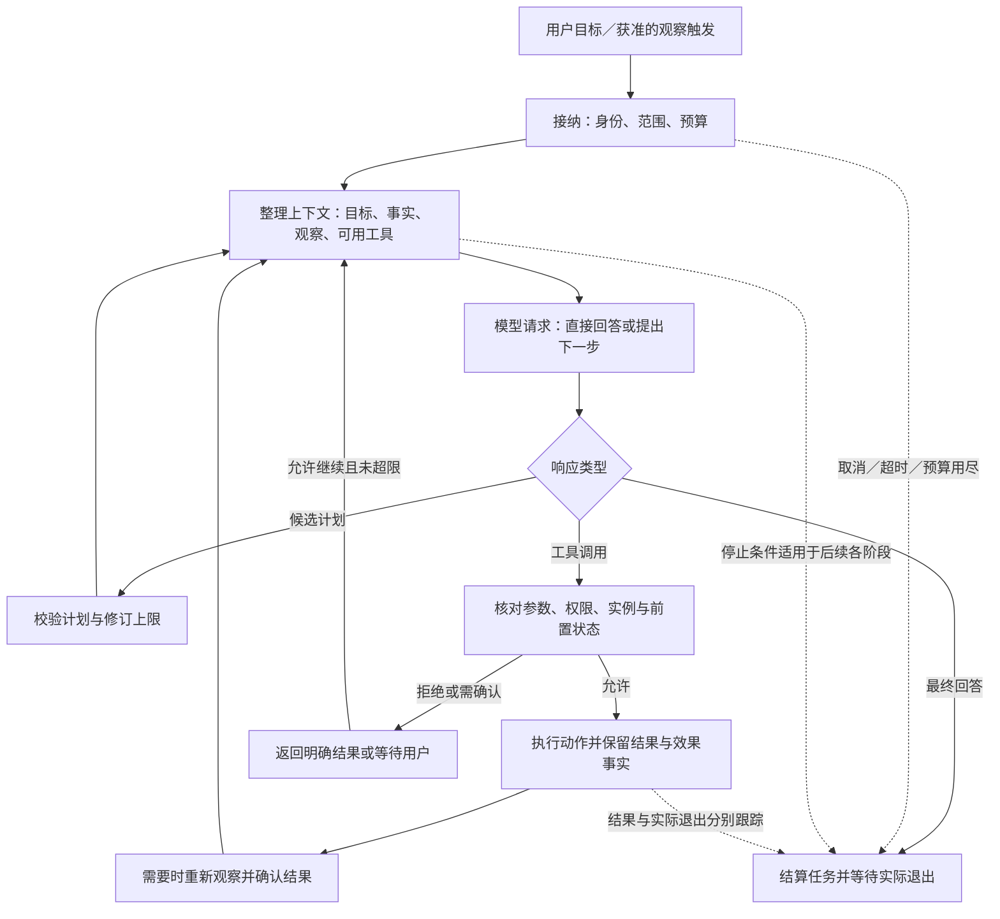

# 大肥鱼 Agent 基础能力开发计划

日期：2026-11-15。计划代码基线：`c46f133`（U01 验收完成）。用户已认可计划并授权从 A00a／A01a 持续开发至本计划完成，仍按独立小步验证、提交，最后统一全量；未完成项不能视作已有能力。进度与验证证据见 [开发记录](agent-development-log.md)，接口名称和子单元在对应实现时细化。

## 1 结论与建设范围

当前大肥鱼已有较完整的运行时和插件基础，正式 Agent 仍是一次模型请求产生一次文本回答。要扩展“观察＋行动”，必须补齐工具调用协议、工具目录与权限、可停止的多步循环、动作事实与上下文、环境观察接纳，以及行动后的确认。只增加工具列表或界面按钮不能形成闭环。

受控自动规划纳入必要建设范围：复杂目标可以生成步骤、跟踪进度并有限修订，简单问答保留直接回答路径。规划给出候选步骤，宿主决定是否允许执行和何时结束；不会要求每次聊天先生成计划，也不把模型写下“已完成”当作动作完成证据。

本阶段保持单会话单活跃任务、默认工具串行、内置模型 Provider 和可信原生 DLL。复用现有操作、调度、预算、通知与生命周期机制；不引入另一个运行时，不依赖 Python／TypeScript Agent 框架运行，也不恢复 `Old/` 框架。

“必要”按三项判断：缺失后是否使观察行动链路无法闭合；是否影响执行正确性、停止或资源回收；是否被多个入口共同需要。参考项目提供依据，不因某项目包含向量库、技能市场或多 Agent 就全部纳入首期。

## 2 当前能力与实际缺口

| 领域 | 当前事实与阅读入口 | 本阶段需要补齐 |
|---|---|---|
| 模型协议 | [Message／complete](../model/include/dafeiyu/model_client.hpp) 只有 user／assistant 文本，返回字符串；[Provider](../model/client.cpp) 只接受正常文本结束 | 系统上下文、结构化工具调用与结果、停止原因、能力声明及供应商适配 |
| Agent | [Session](../agent/session.cpp) 单轮单请求；只成对提交成功问答，失败和取消保留原历史 | 一次用户目标内多次模型与工具步骤，明确终止、等待和退出 |
| 执行记录 | [回合诊断](../agent/include/dafeiyu/session.hpp) 已关联取消、模型退出和通知回执 | Run／Step／Attempt／ToolCall 关联、动作事实与模型上下文分离 |
| 工具与插件 | [插件管理器](../plugins/runtime/include/dafeiyu/plugin_manager.hpp) 已管理实例与包，现有 SDK 不是通用工具注册 API | 名称、参数描述、权限、绑定实例、执行和结果契约 |
| 执行控制 | [预算](../runtime/include/dafeiyu/budget.hpp)、[调度](../runtime/include/dafeiyu/owner_scheduler.hpp)、[处理](../events/include/dafeiyu/processing.hpp)、[重试](../runtime/include/dafeiyu/retry_controller.hpp) 已实现 | 在 Agent 链路中明确接入；已有组件不等于默认会话已经使用 |
| 观察输入 | [事件存储](../events/include/dafeiyu/event_store.hpp) 和通知具备有界交付 | 环境观察的来源、时效、对象版本、接纳与刷新；普通通知观察者不等于环境感知器 |
| 自动规划 | 尚无计划结构、步骤状态或修订入口 | 有界计划、目标修订、步骤结果和停止条件 |
| UI | [U01](ui-u01-validation.md) 验证离线容器、Frame、输入焦点和回收 | 共享应用服务、运行与计划视图；探针消息不能充当生产工具 API |

关键迁移点：现在失败时不提交问答历史是正确行为；接入有副作用的工具后，必须保留“动作已执行／效果未知”等事实。后续模型失败、用户取消或通知丢失，都不能使这些事实从运行记录中消失。

## 3 参考项目的取舍

以下是一手资料中的机制及其对大肥鱼的启发；“纳入计划”是本项目的设计判断。源码固定到已阅读版本，官方在线文档按本次日期查阅。

| 参考 | 可借鉴的基础机制 | 在大肥鱼中的取舍 |
|---|---|---|
| [LangChain Agents](https://docs.langchain.com/oss/python/langchain/agents)、[Deep Agents](https://docs.langchain.com/oss/python/deepagents/overview) | 模型与工具形成循环；复杂任务可增加规划和上下文管理 | 采纳循环和有界规划；不把所有请求变成固定规划流程，不引入整套框架依赖 |
| [LangGraph Persistence](https://docs.langchain.com/oss/python/langgraph/persistence) | 运行状态检查点与跨会话长期存储分开 | 先有进程内执行事实和上下文投影；磁盘恢复单独审查，不能把检查点当成外部动作只执行一次的保证 |
| [DeepSeek Harness 架构](https://github.com/deepseek-ai/deepseek-harness/blob/39163dd30f703a79079e2d2446545cff3c453738/docs/architecture.md) | 一回合多步骤、作用域工具、会话事实投影、失败尝试与模型历史区分 | 采纳工具作用域、事实与上下文分层；保留默认 Provider 内置，不照搬所有功能插件化 |
| [Pi Agent](https://github.com/earendil-works/pi/blob/76c79d8bbe66993f2006b3c070544ca7c61150de/packages/agent/README.md)、[循环实现](https://github.com/earendil-works/pi/blob/76c79d8bbe66993f2006b3c070544ca7c61150de/packages/agent/src/agent-loop.ts) | 清晰的工具循环，应用消息转为模型消息，上下文变换，追加输入与引导输入区分 | 采纳小型循环与上下文入口；先串行工具，普通观察通知继续不阻塞业务结算 |
| [AI-Vtuber 后端](https://github.com/Ikaros-521/AI-Vtuber/blob/c430ee71f208f45850c1ab25c85f2a70e9b09d72/docs/backend-architecture.md)、[输入处理](https://github.com/Ikaros-521/AI-Vtuber/blob/c430ee71f208f45850c1ab25c85f2a70e9b09d72/luna/core/my_handle.py) | 来源统一接入、输入缓冲、慢处理与接收分开、合成与播放分阶段 | 采纳观察接纳、时效与输出完成区分；不直接照搬全局状态和锁布局 |

Coopanion 与 whale-room-guide 继续作为房间界面、能力入口和视图生命周期参考，见 [UI 方案](ui-framework-design.md) 的参考资料；它们不作为引入多 Agent、记忆或自动后台工作的充分理由。

## 4 目标运行流程与职责

下图是拟建链路，不是现状。普通问答可直接结束；复杂目标可以进入计划与工具步骤。

| 责任方 | 拥有的规则 | 不应承担的职责 |
|---|---|---|
| App／应用服务 | 用户目标、配置、授权范围、查询和命令入口 | 根据模型文字直接调用 DLL |
| Agent | Run 推进、上下文选择、计划和工具步骤、终止原因 | Provider JSON 方言、原生页面消息解析 |
| Model | 统一请求／响应、能力声明、DeepSeek／Qwen 协议转换 | 决定动作权限、拥有插件生命周期 |
| 工具／观察能力层 | 描述、实例绑定、参数校验、执行回执、观察快照 | 自行扩张用户目标或绕过宿主调度 |
| Runtime／Events／Plugins | 操作与退出、预算、顺序、生命周期、通知 | 将通知成功等同于业务成功 |
| UI | 展示运行、计划、动作和等待状态，调用同一应用服务 | 自建工具执行循环或把页面存在当作授权 |

运行事实与模型消息分开：事实用于解释发生了什么，模型上下文仅包含本次允许看到且预算内的内容，普通通知仅提示变化。首版事实存于有界内存；不承诺进程崩溃后恢复。

## 5 分阶段开发清单

每个 A 编号是能力阶段，不是一次提交。表中 a／b／c 是候选独立审查单元；实现时继续按约 100～300 行手写变更拆分，含测试。每个单元只测影响范围并提交，默认等用户审查后继续；最后统一全量。未实现阶段不提前建立空构建目标。

| 阶段与依赖 | 独立单元及交付 | 关键功能验收（均无真实模型） |
|---|---|---|
| A00 测试入口；无前置 | a：整理现有模型／传输替身并守住离线入口；b：随新协议增加预设响应序列、错误和延迟控制 | 未注入响应即失败，禁止意外落到真实传输；真实产品调用入口仍保留 |
| A01 运行事实；A00a | a：复用回合与 Operation，定义 Run／Step／Attempt 关联；b：有界事实和只读快照；c：事实到模型上下文的选择规则 | 唯一身份、容量耗尽、取消后事实保留、查询无副作用、通知失败后仍可查 |
| A02 模型协议；A01 | a：请求／结果结构与文本兼容；b：系统消息、工具调用／结果及能力检查；c：分别完成 DeepSeek、Qwen 的离线编解码 | 工具调用 ID 配对、非法／截断响应拒绝、不支持能力明确拒绝；供应商在线兼容仅记录 |
| A03 工具目录；A02 | a：宿主工具描述与受支持的参数 schema 子集；b：作用域目录和授权；c：可选 C ABI 注册、真实示例 DLL 绑定与撤销 | 重名／版本／非法描述拒绝，正确解析到当前实例；过期、越权、撤销实例不执行 |
| A04 工具执行；A03 | a：串行调用与结构化结果；b：取消、期限、代码持有与实际退出；c：效果状态、重复调用和安全重试规则 | 实际调用正确、失败可定位、忙碌拒绝卸载；已发生或未知效果不因重试重复施加 |
| A05 有界循环；A04 | a：模型→工具→结果→模型；b：步数／调用数／时间／容量边界；c：上下文裁剪、错误及停止策略 | 预设多步序列闭合；无工具、混合文本与调用、多个调用、重复 ID、取消和迟到结果均有确定行为 |
| A06 环境观察；A05 | a：来源和观察快照；b：有界接纳、合并与时效；c：显式开启的观察触发与停止 | 过期／重复／洪峰／丢更新处理，修订断档可重取；用户命令和动作回执不被普通采样淘汰 |
| A07 受控自动规划；A05 | a：有界顺序计划及修订；b：模型计划生成入口与校验；c：步骤映射、有限重规划与用户目标修订 | 预设计划被正确接受或拒绝，旧版本不覆盖新目标，取消后不推进；计划质量仅记录 |
| A08 观察行动闭环；A06、A07 | a：动作前置状态核对；b：执行后查询与完成判定；c：变化、失败或效果未知时停止／重观测／有限修订 | 临时状态夹具中“读状态→改状态→重读确认”；外部状态改变不盲目执行旧动作 |
| A09 集成交付；A01～A08 | a：CLI／应用服务的完整运行查询与控制；b：样例插件和接入说明；c：最终离线全量验收与分发 | 空插件文本问答、插件工具链、取消收尾、观察背压、计划修订与通知丢失后查询完整覆盖 |

默认实施顺序为 A00a → A01 → A02（同步完善 A00b）→ A03 → A04 → A05 → A06 → A07 → A08 → A09。先交付可靠的直接问答／工具执行，再增加观察和规划。A07 不必依赖具体摄像头、语音或桌面能力。

以下规则在对应单元落地，避免各层各自解释：

1. **身份与状态（A01）**：Run 表示一次已接纳用户目标，Step 表示一次模型决定及关联工具，Attempt 表示某一步的具体尝试，ToolCall 关联一次调用及回执。现有 Operation 仍拥有唯一结果和实际退出状态；新增标识用于关联，不复制另一套终态机制。
2. **上下文（A01／A05）**：系统规则与用户目标分层，观察和工具文本按数据处理；模型无权用返回文本改写宿主权限。有限历史保留完整工具调用／结果配对，失败回合中已发生或未知的效果也要进入后续所需上下文，不能只留在诊断中。限制正文与结果大小，大结果使用受控引用；首版超预算按确定规则裁剪或停止，不依赖另一次模型总结才可继续。
3. **模型适配（A02）**：统一内容、工具参数、调用 ID、停止原因与可选用量；默认非流式。参数未完整结束或响应被截断时不执行残缺调用。图片等内容按 Provider 能力显式支持或拒绝，不默认为当前文本模型已具备视觉。
4. **能力与授权（A03）**：工具 ID、schema 版本、提供实例代次与授权范围共同确定目标。一次 Run 固定工具目录快照，每次执行仍检查撤销和当前授权；新增能力下一 Run 生效。沿用用户已授予的范围，不对每个合法步骤重复确认；超范围则拒绝或按明确策略等待新授权。UI 命令与模型工具可引用同一业务能力，但拥有各自显式授权，不把全部 UI 操作自动暴露给模型。可信同进程 DLL 的校验是调用治理，不是对恶意原生代码的安全隔离。
5. **动作事实（A04）**：成功／失败／取消之外，分别表达效果已发生、确定未发生、效果未知及实际退出。接纳前预留关键事实和终态容量，记录不足就拒绝新动作；不能在效果发生后因普通队列已满而丢失事实。同一宿主调用标识与相同参数复用回执，参数冲突拒绝；不宣称能识别模型换 ID 后的所有语义重复。
6. **重试与停止（A04／A05）**：模型请求重试、工具重试、重新规划分别限额。动作仅在明确无效果或具备业务幂等契约时允许重试；效果未知先查询或等待处理。默认串行调用等前一调用实际退出后再推进；本批被拒绝或未执行的调用也有配对结果。限制模型请求数、工具次数、连续无进展、计划修订数、总期限和数据容量；用量有依据才统计，不能把未知 token 用量记为零。用户取消后不再调度新步骤，仍等待在途代码实际退出。
7. **观察（A06）**：包含来源、对象身份／代次、修订、采样时间、有效期限、信任来源和受控载荷引用。状态采样可合并，事务回执和用户命令不能套用“只留最新一条”。持续观察须显式开启并设频率与预算；先用合成状态源，实际屏幕、摄像头、语音等适配器逐项审查。
8. **计划与确认（A07／A08）**：首版为有界顺序步骤，记录目标版本、步骤 ID、验收条件及待执行／执行中／已完成／失败／跳过；等待原因独立显示。模型只提出计划和修订，宿主根据实际执行与证据推进。目标修改在步骤边界生效，不强杀 DLL；授权等待可取消、超时并重查前置状态。复杂语义完成条件无法由确定性规则证明时，显示待确认或未知，不能冒充成功；只记录可读计划和决定依据，不要求输出隐藏推理过程。

## 6 测试与模型行为记录

### 6.1 固定测试政策

开发、回归和最终验收均不调用真实模型：远程 API、本地模型推理、模型选工具和模型规划实测都不执行。使用手写固定响应、模型替身和传输替身，验证系统对给定输入的处理。文档查阅、依赖获取与必要的真实 DLL／文件／线程／原生容器测试不属于模型推理。

产品正常使用仍可调用内置 Provider；测试必须在注入点隔离真实传输，不通过删除 Provider 实现达到离线。既有真实服务记录保留历史基线，不移用为新增工具协议或规划的验收证据。

| 必须测试的功能 | 输入或夹具 | 断言 |
|---|---|---|
| 工具查找、选择与授权 | 预设模型返回工具名称／ID／参数 | 选中正确实例和实现；未知、越权、过期、参数错误时零调用 |
| Provider 适配 | 手写请求期望和响应样本、替代 HTTP 传输 | 请求字段和响应解析正确；错误分类明确，无真实密钥或外发请求 |
| 工具循环 | “调用甲→甲结果→调用乙→最终文本”等固定响应 | 结果只回填一次、调用顺序正确、必要模型上下文完整、按策略结束 |
| 停止与错误 | 异常、延迟、截断、重复调用、无进展、预算耗尽 | 不无限循环、不执行残缺参数、不因迟到响应重新启动 |
| 原生插件寿命 | 真实测试 DLL 和可控异步工作 | 业务结束与实际退出分开；在途调用仍拒绝卸载，引用最终归还 |
| 副作用与取消 | 临时目录／内存状态上的受控动作 | 取消或后续失败不抹掉已发生效果；未知效果不盲目重试 |
| 观察接纳 | 可控时钟、不同来源及修订的快照／事件 | 合并、拒绝、过期和重同步遵守源契约，不丢关键动作事实 |
| 计划执行 | 预设合法、非法、超长及旧版本计划 | 结构和引用校验、有限修订、状态推进正确；不评价模型生成质量 |
| UI／诊断 | 同一固定 Run 及通知丢失／重连 | 查询能恢复状态，取消和收尾可区分；原生事件／固定协议，无 Computer Use |

### 6.2 真实模型相关事项：仅记录，不执行

这是一份行为关注清单，不是待运行测试列表；所有行状态固定为“仅记录，不执行”。不索取测试密钥，不计入通过／失败数量，不因未实测而阻塞功能验收；交付时说明已验证系统行为及下列未覆盖的模型表现。

| 编号 | 场景与预期 | 功能测试覆盖 | 未实测部分 |
|---|---|---|---|
| M01 | 自然语言目标选中合适工具并正确提取参数 | 给定调用后名称解析、参数校验、权限和执行 | 真实模型的选择与参数提取质量 |
| M02 | 多步骤目标形成合理计划，失败后正确修订 | 计划结构、版本、进度、修订限额和控制流 | 真实模型的拆解、排序和重规划质量 |
| M03 | 理解图像、声音或环境文本并判断下一步 | 观察身份、能力匹配、载荷路由、时效与动作条件 | 真实模型感知与语义完成判断的准确率 |
| M04 | 不把观察或工具文本中的指令当成额外授权 | 来源分层、范围检查、所有调用重新授权 | 真实模型抵抗提示注入和误导的表现 |
| M05 | DeepSeek／Qwen 实际服务支持所用工具协议与能力 | 固定样本的协议编码／解析、能力拒绝和错误处理 | 供应商在线兼容性、当前模型版本差异及真实响应质量 |
| M06 | 长运行时保持上下文、合理停止，耗时和用量可接受 | 固定历史裁剪、配对完整性、计数和停止边界 | 真实模型上下文理解、延迟、费用和任务成功率 |

后续功能按相同四列追加记录，状态规则不变；不要把“模型按给定响应选择到工具”的功能测试描述成“真实模型会选对工具”。

## 7 与管理中心 UI 计划衔接

技术选型保持不变，U01 验证成果继续复用。调整的是业务依赖，不要求等待所有 Agent 功能完成才能设计组件。

| UI 单元 | 衔接规则 |
|---|---|
| U02 应用服务与桥接 | 先共享服务／只读查询，与 A01 运行身份对齐；现有问答／取消可复用 Session，新工具命令再接 A03～A05。协议版本化，不把一次 Run 固定成一条文本响应 |
| U03 组件 | 可独立建设状态、表单、列表和错误组件；规划与工具专用视图等对应数据契约确定后再接入 |
| U04 内置页面 | 配置与现有诊断可先做；完整执行视图在 A05 后接入，A07 增加计划视图 |
| U05 插件 UI 注册 | 视图注册和工具注册分别建模；共用提供实例身份、业务能力引用和代码生命周期，避免两套相互绕过的命令入口 |
| U06 设置 | 可独立推进，继续通过应用服务保存／应用；设置修改不自动为当前 Run 扩权 |
| U07 房间 | 静态场景可先设计；A08 后以真实观察、计划、动作及等待状态驱动显示，不伪造运行进度 |
| U08 自定义页面 | 延续受限 Frame 容器，能力命令使用 A03／A04 的同一执行入口；来源校验不代替业务授权 |
| U09 UI 验收 | 覆盖两级界面与原生寿命，模型一律用替身；与 A09 共享场景，最终验收时统一全量 |

## 8 暂缓内容与下一单元

| 暂缓内容 | 再讨论条件 |
|---|---|
| 磁盘检查点、会话恢复、持久动作账本 | 明确需要重启恢复或跨进程继续；先设计未知效果对账，不能直接重放动作 |
| 长期记忆、向量检索、模型总结 | 有具体跨会话信息需求；当前有限工作上下文必须先可用 |
| 多 Agent、并行工具、通用任务图 | 串行链路已有证据表明确有瓶颈，并且冲突、取消和预算契约清楚 |
| 无限后台自治、自动日程与工作系统 | 用户明确任务范围、触发机制和退出规则后逐项规划 |
| 流式生成、通用桌面操作、语音／视觉产品能力 | 有具体体验或场景需求后独立立项；不作为工具循环基础实现的前置条件 |

建议下一实现单元为 **A01a：运行与步骤身份**，先保持现有单次问答行为。开工前完成 A00a 的现有 `Completion` 注入及模型客户端传输替身复核，缺口才做最小补齐；已有覆盖满足契约就直接复用，不另造测试框架或单独制造代码改动。A01a 不增加生产工具、不改 UI 技术栈，完成必要检查并提交后进入审查。

初版计划提交 `cb293f1` 仅完成文档检查。后续实施结果按开发记录逐项登记，不把未来能力或真实模型表现列为已经验证。
