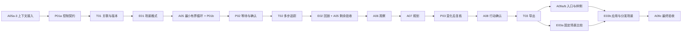

# Agent 横向能力开发计划

日期：2026-11-15。依据用户认可的职责划分，保留 [A05～A09 主线](agent-capability-development-plan.md)，补入 P（统一执行策略与人工介入）、T（多步追踪与版本关联）、E（离线场景回放与比较）三条横向能力。

截至 2026-11-18 北京时间 11:00，P02 的人工确认和 T03 的版本化诊断已接入终端。E03 已能采集固定材料的报告并跨进程比较；真实 DLL 的应用命令、进程内视图重连和 Release 分发已有定向证据。观察触发当前为只读，完整 E03 场景矩阵和 A09c 待完成。详见 [11:00 检查点](agent-progress-2026-11-18-1100.md)。

## 1 范围与共同边界

- 执行状态由 Agent 协调并复用现有 Operation；P 返回明确控制决定，T 读取事实投影，E 验证实现。计划、UI、追踪不再各自维护一套业务终态。
- 复用现有 ToolCatalog、ToolExecutor、ControlGate、RetryController、预算、顺序域、模型替身与真实测试 DLL；不重建底层运行时或通用测试框架，不引入 LangChain／LangGraph 运行依赖。
- 人工介入先支持进程内的等待与继续。跨重启恢复、持久动作账本、长期记忆、多 Agent、通用图编辑器及云部署仍另行审查；追踪文件不构成可恢复检查点。
- 开发、回归、回放、评测、最终验收均不调用远程或本地真实模型，也不使用真实模型裁判（LLM-as-judge）。真实模型表现仍在主计划 M01～M06 清单中“仅记录，不执行”，不计入通过率或验收门槛。
- 普通通知失败不改变业务结果；审批与恢复必须走显式控制命令。动作前保留关键事实和终态容量，诊断投影失败不能使已发生效果消失。

## 2 单元、依赖与验收

### P：统一执行策略与人工介入

| 单元 | 前置依赖 | 交付内容 | 必须通过的功能验收 |
|---|---|---|---|
| P01 控制契约与执行入口 | P01a：A05a-3、既有 A03／A04；P01b：P01a＋A05 最小有界循环 | a：统一控制上下文、决定与拒绝原因；b：在模型前、工具前和结果后接入既有校验 | 同一输入得到确定决定；拒绝、异常或超时不进入受控调用；普通观察者不能否决业务；已授予范围内不重复请求确认；回调顺序固定且禁止重入扩权 |
| P02 进程内等待与确认 | P01b、T01、A05 最小有界循环 | a：等待、继续、拒绝、取消与期限；b：确认命令、调用者校验和幂等回执，以原生接口验收 | 等待时不执行动作；批准后仅执行一次；重复决定复用回执；过期、跨 Run、错误调用者、旧版本或参数改变的决定拒绝；取消／拒绝／超时不自动转为允许；已开始动作仍等待实际退出 |
| P03 观察与计划变化后的复核 | P02、A06、A07 | 将目标、计划、观察、策略和插件代次绑定到待执行动作；失效后重新观察、重新决策或停止 | 等待期间目标、计划、观察或插件发生变化，旧决定不能作用于新目标；恢复不重放已完成动作；效果未知或失败但已发生时，不能仅因重新批准而重复非幂等动作 |

P01 的控制上下文至少关联 Run／Step／Attempt／调用身份、目标修订、来源、固定工具范围、策略版本和剩余预算。P 负责统一调用现有规则，最终工具授权、参数校验与实例检查仍保留在执行入口，不因上游返回“允许”而跳过。

P02 的确认只针对当前 Run 已有范围内、策略要求确认的具体候选调用。超范围调用明确拒绝，新增能力仍在下一 Run 生效；模型或插件不能通过确认请求自行扩大范围。修改参数后必须重新校验并生成新请求，旧决定失效。

确认记录包含请求 ID、命令 ID、期望修订、目标／步骤身份、规范参数摘要、策略版本、提供实例代次和截止时刻。调用者身份取自宿主绑定，不能相信消息正文自报的身份。等待保持有界，不阻塞宿主推进，不默认延长总期限；先保留预算内的值记录，批准后重新校验并接纳执行，不为等待占有共享顺序域或 DLL 凭证。

拒绝决定在原目标范围内有效，模型不能仅靠更换调用 ID 或计划版本反复弹出同一确认。重新申请须符合明确的用户修订或策略条件，并受运行内确认次数上限约束；任何时间流逝都不构成批准。

暂停在步骤边界生效；在途工作继续保留真实退出责任。恢复前重查权限、预算、目标与实例，不把已有取消终态改回运行。等待、取消和收尾是不同状态。

P03 区分“允许动作”和“确认目标完成”两类决定。人工确认目标只记录对应证据来源，不能伪造工具结果、抹去未知效果或代替新的动作授权。

### T：多步追踪与版本关联

| 单元 | 前置依赖 | 交付内容 | 必须通过的功能验收 |
|---|---|---|---|
| T01 关联语义与版本清单 | A05a-3、已有运行／步骤身份和工具契约 | 定义追踪 schema、父子关联、源修订、时钟基点与版本清单；先覆盖已有单次路径 | 同一运行的模型、工具和尝试可关联，跨运行不串线；版本信息按真实可得值记录，未知不能伪装成默认版本；不记录密钥、认证头、原生地址或可复用活动凭证 |
| T02 多步时间线与查询 | T01、P01b、P02、A05 最小有界循环 | 关联模型、工具、控制决定、历史提交、取消、效果和实际退出；提供有界快照与增量查询 | 成功／失败／取消链路均有明确终止原因；乱序或重复消息不重写事实；观察背压或追踪异常后业务结果不变；可查询补齐仍在保留范围的缺口，超出范围明确标记；持有快照不阻止 DLL 卸载 |
| T03 导出与版本关联查询 | T02、P03、A08 | 有版本的本地诊断导出，关联代码、配置与契约变化；提供 A09 可复用查询契约 | 导出不执行动作、不触发模型、不自动上传；文件中没有敏感配置和可恢复原生句柄；缺版本、未知 schema、裁剪或缺口均明确报告；导入只读取数据，不能改变当前运行或授予权限 |

建议映射为 Session → 会话分组，用户 Run → 一条追踪的根，Step／模型请求／工具调用／Attempt → 子节点；保留本项目已有身份，不照搬不同体系中同名 `run` 的含义。诊断导出增加进程启动或文件命名空间，避免不同进程的序号碰撞，但不宣称当前运行身份已支持跨重启恢复。

版本清单至少包含应用提交／构建标识、提示模板版本、公开模型配置标识、策略版本、工具契约与 schema 版本、插件版本及诊断 schema 版本。只对允许公开的配置字段取摘要，不哈希或保存整个含敏感值的实际配置；渲染后的业务提示词和工具正文默认不进入诊断文件。版本缺失显示未知。

追踪以权威事实的修订号和父子关系解释顺序，分别记录发生时刻与宿主观察时刻；导出采用明确时钟基点的相对时间，可另附壁钟信息，不把跨进程单调时钟值直接比较。模型用量缺失时标为未知，固定响应的用量和时钟属于模拟数据。

关键动作事实保存在运行内核；追踪队列是其有界投影。投影失败要显示错误或缺口，不阻塞已有正确业务结果；补拉超出保留窗口时不得伪装成完整轨迹。只读查询不推进任务、不保留后台请求或原生代码。

### E：离线场景回放与比较

| 单元 | 前置依赖 | 交付内容 | 必须通过的功能验收 |
|---|---|---|---|
| E01 场景与结果格式 | A00、T01 | 复用现有替身／CTest，定义版本化案例、断言与报告；先承接已有基础场景 | 模型响应、测试工具、时钟与预算均显式提供；缺少替身立即失败且不回退真实 Provider；未知工具绑定、未声明资源或损坏案例拒绝；模型行为记录不注册为待执行测试 |
| E02 诊断回顾与确定性重跑 | E01、P02、T02、A05 最小有界循环 | 分开提供只读时间线回顾与受控夹具重跑；形成 A05 的完整运行场景 | 只读回顾零执行；重跑只使用固定响应及批准的测试夹具；相同案例产生相同受约束行为；缺材料、版本不支持或顺序矛盾明确失败／不可重现，不猜补结果、不调用真实模型 |
| E03 场景扩展与版本比较 | E03a：E02、P03、A06～A08、T03；E03b：E03a＋A09a／b | a：扩展观察／规划／反馈场景并生成差异报告；b：补齐应用命令、重连和分发场景，提交 A09c 验收材料 | 相同案例版本与前提下比较实际行为；未知版本或输入改变标为不可直接比较；必须覆盖的场景不得被跳过计为通过；契约变更需显式更新版本和预期，不能自动接受新结果 |

案例至少包含：案例 ID／版本、对应需求和单元、初始状态、预设模型响应序列、工具测试绑定、受控外部事件、时钟／种子、预算，以及预期的调用次数、终态、效果、实际退出和关键关联。只验证系统对给定候选调用或计划的处理，不把它写成模型会正确选择或规划的证据。

“诊断回顾”只读取事实；“受控重跑”运行当前代码，但模型始终为替身，工具默认使用固定结果。需要验证 DLL、线程或文件行为时，必须显式选用现有真实测试 DLL、受控线程或隔离临时目录。回放文件不能自行指定生产插件、任意本机文件、外部服务或命令执行入口；旧原生票据、审批凭证和地址不得作为当前授权。

只含诊断元数据的文件可能不足以重现执行。缺少完整夹具时应报告不可重现；验收要求执行的功能场景必须提供完整材料并通过，不能用“不可重现”代替覆盖。真实模型行为清单与功能场景库分别管理。

比较前声明变化维度（代码、策略、模板或契约版本），该维度可以不同，其余案例输入及前提必须匹配；未声明的变化或未知版本不能当作同条件比较。可规范化随机标识和绝对时间，但必须另行核对身份唯一性、父子关系、因果顺序、期限及资源退出，不能靠删除字段掩盖串线或重复执行。报告至少给出案例和版本清单、断言结果、调用／效果差异、终止原因及缺失证据；不把模拟耗时、用量或通过率当作真实模型性能和质量。

固定材料已有测试构建中的独立采集和比较入口。核对两个源码状态后，分别配置 `DFY_APPLICATION_COMMIT` 并构建 `dfy_replay_evaluation`。用各自的程序执行同一案例 `--capture 材料.json`，将标准输出保存为两个 UTF-8 文件，再执行 `--compare 基线.json 候选.json application_commit`。比较时可追加明确允许变化的版本字段，例如允许构建配置和策略变化时指定 `build` 或 `execution_policy`。基本退出状态为相同且断言通过（0）、存在差异或断言失败（1）、不可比或证据不可读（2）。采集断言失败时也保留执行证据。

[批量比较脚本](../scripts/verify-agent-replay.ps1) 使用 VS 测试构建中已编译的固定案例，保存两份证据及逐案差异。编译案例的材料摘要绑定到场景源码和显式测试夹具，文件内的诊断只用于严格读取。原生用例使用各构建生成的指定测试包和独立数据目录。只变更配置的同一源码构建可用 PowerShell 7 运行以下命令。

```powershell
.\scripts\verify-agent-replay.ps1 -BaselineBuild .\build\rebuild\windows-tests
```

跨源码比较可用 `-CandidateBuild` 指定第二套构建。用 `-Declared build,application_commit` 声明允许变化的构建和源码字段。编译案例在断言通过且实际退出后采集证据；提前停止的用例由脚本明确报失败。

## 3 恢复后的实施顺序

下表记录各阶段的依赖与验收条件。11:00 轮次在 T03 后先接入 A09a／b 的主动委托，再推进 E03 比较及应用覆盖。每条继续以小步交付，接入标准用于最终验收。

| 顺序 | 工作 | 阶段结束条件 |
|---|---|---|
| 1 | A05a-3：正式 Session 复用 RunContext | 原单次问答、取消、历史及通知语义保持；动作事实具备正式提交入口 |
| 2 | P01a → T01 → E01 | 控制上下文、追踪关联／版本和离线场景格式先统一；复用已有实现，不另建状态机和测试框架 |
| 3 | A05 最小有界循环与 P01b 接通 | 模型→工具→模型实际接通；首个可运行循环就具有必要步数、调用数、期限和容量边界；执行必须经过统一控制点 |
| 4 | P02 → T02 → E02，再完成 A05 其余边界 | 等待、继续、取消和收尾可区分，完整轨迹可查询，A05 关键场景可用替身重跑；正式链路无绕过控制点的入口 |
| 5 | A06 环境观察 | 扩展策略、追踪和 E 场景到来源、时效、修订及背压；不丢用户命令和动作回执 |
| 6 | A07 受控规划 | 扩展到计划版本、进度、有限修订与目标更新；计划质量仍仅记录。技术前置仍为 A05／P02／T02／E02，不强制依赖具体感知设备 |
| 7 | P03 → A08 观察行动确认 | 旧批准、旧计划或旧观察不能驱动新动作；结果依据确定性回执／观察或明确人工证据，模型文字不能直接确认外部效果 |
| 8 | T03 → A09a／b | CLI／共享应用服务复用同一控制与查询接口；待审动作、读回结算与本地诊断可用 |
| 9 | E03a／b | 观察、规划与动作链路可按版本关联并形成离线差异报告；重放命令、确认、重连和样例包场景有独立证据 |
| 10 | A09c 最终验收 | A05～A08 及 P／T／E 均按约定接入；统一执行最终全量、相关跨配置检查和分发验收，仍无真实模型 |

P02 的确认命令和 T02 的查询／增量契约先用原生接口及夹具验收，不依赖尚未建设的 GUI 或完整 A09a。A09a 再连接实际入口，避免“必须先有 UI 才能审批、必须先审批才能开发 UI”的依赖环。

A09a／b 使用 A05～A08 的原生运行能力及已接入的 P02／P03／T02 契约。E03a 可继续补齐观察、规划和反馈材料，E03b 从已运行的应用入口取得证据。A09c 同时等待主线及 P／T／E 验收完成。

关系可简化为：



图示为推荐实施顺序；硬依赖以第 2 节表格为准，A07 不因此额外依赖 A06 的具体设备实现。

## 4 最小功能场景矩阵

以下全部是固定输入、预设响应与受控夹具。每个场景随对应功能加入，开发中只运行受影响部分；只有 A09c 才统一全量。

场景编号用于覆盖映射，不要求每行另建一个测试程序。已有测试可承接相应断言；跨模块闭环必须由正式接入路径验证，不能只用各模块单测通过数替代。记录场景与 CTest／夹具、具体断言的对应关系。

| 场景 | 首次加入 | 核心断言 |
|---|---|---|
| F01 普通问答／空插件 | E01 | 无工具仍可回答，响应与原历史规则兼容，查询不增加模型调用 |
| F02 多步调用及重放命令 | E02／A05 | 正确选择已注册实例、结果配对和顺序；同完整命令复用回执，跨步骤局部 ID 不串线 |
| F03 拒绝与等待确认 | P01／P02／E02 | 越权、参数错误、拒绝、超时、错误主体、旧修订均为零动作；重复批准最多一次执行 |
| F04 取消与迟到效果 | A05／E02 | 不提交新步骤；已发生／未知效果保留；业务取消不能伪造实际退出或提前卸载 |
| F05 插件变更与原生寿命 | P02／E02 | 等待期间卸载／重载使旧决定失效；在途调用拒绝卸载；退出和释放成功后可回收 |
| F06 追踪故障与重同步 | T02／E02 | 慢观察者、丢增量、查询重试不改变业务；快照补齐或明确报告缺口，无原生资源额外持有 |
| F07 观察输入变化 | A06 | 过期、重复、洪峰与修订断档按策略处理；关键命令和回执不被采样合并淘汰 |
| F08 计划／目标修订 | A07／P03 | 预设非法或旧版本计划拒绝，修订有界；目标或参数改变后旧确认不可用，不执行已撤销步骤 |
| F09 行动后确认 | A08／E03a | 状态已达到、未达到和效果未知分别处理；未确认不冒充达成，不盲目重放非幂等动作 |
| F10 应用命令与重连 | A09a／b／E03b | 同请求返回原 Run／决定；断开后可查询，重复提交不重做动作；原生／固定协议测试，不用 Computer Use |

本轮覆盖 F10 的同进程终端视图重连、历史回执边界、拒绝和实例换代，见 [正式应用用例](../tests/tool_verification.cpp)。Release 安装目录的配置、包管理及真实退出由 [分发检查脚本](../scripts/verify-agent-package.ps1) 复现。后续补齐 F07～F09 的独立采集材料，并将应用场景整理为 A09c 可核对的报告。

## 5 验收记录与 UI 衔接

每个单元记录起始提交、变化、实际目标／测试选择、结果、未覆盖边界、阅读入口和下一步。代码、追踪 schema、案例格式或预期变化时更新相应版本；只因新失败或后续变更才补跑相关检查，不在每步重复全量。

U02 复用 P02 的确认命令及 T02 的快照／增量契约；U04 展示真实步骤、等待、效果与收尾；U05／U08 的插件页面经过相同控制入口，Frame 来源验证不能代替业务授权；U07 只用已经实现的运行与验证状态驱动房间表现。UI 视图状态不作为执行或审批事实源。

A09c 的通过条件是：主线功能及三条横向能力的相关断言全部满足；无未解释的串线、重复动作、丢失关键事实、权限绕过或提前回收；最终构建、当前已实现工程的完整 CTest、完整功能场景矩阵及相关 Debug／Release／C ABI 跨配置检查通过，分发与说明完整。此处不要求真实模型质量或在线供应商验收。

本文件初版的文档验收只检查现状、依赖、编号、链接、编码和差异；后续实际开发与必要测试按 [开发记录](agent-development-log.md) 登记。当前值回顾与测试材料文件不等于 T03 诊断导出，更不构成可恢复检查点；最终全量仍只在 A09c 进行。
