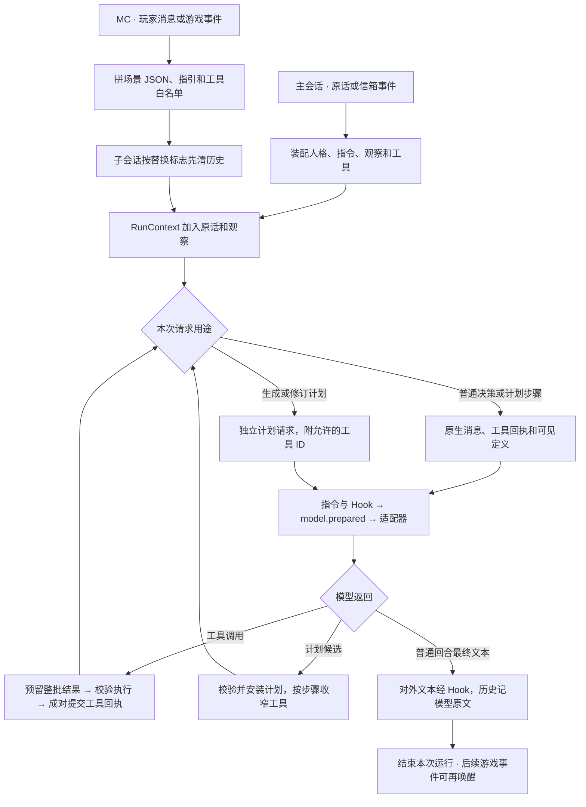
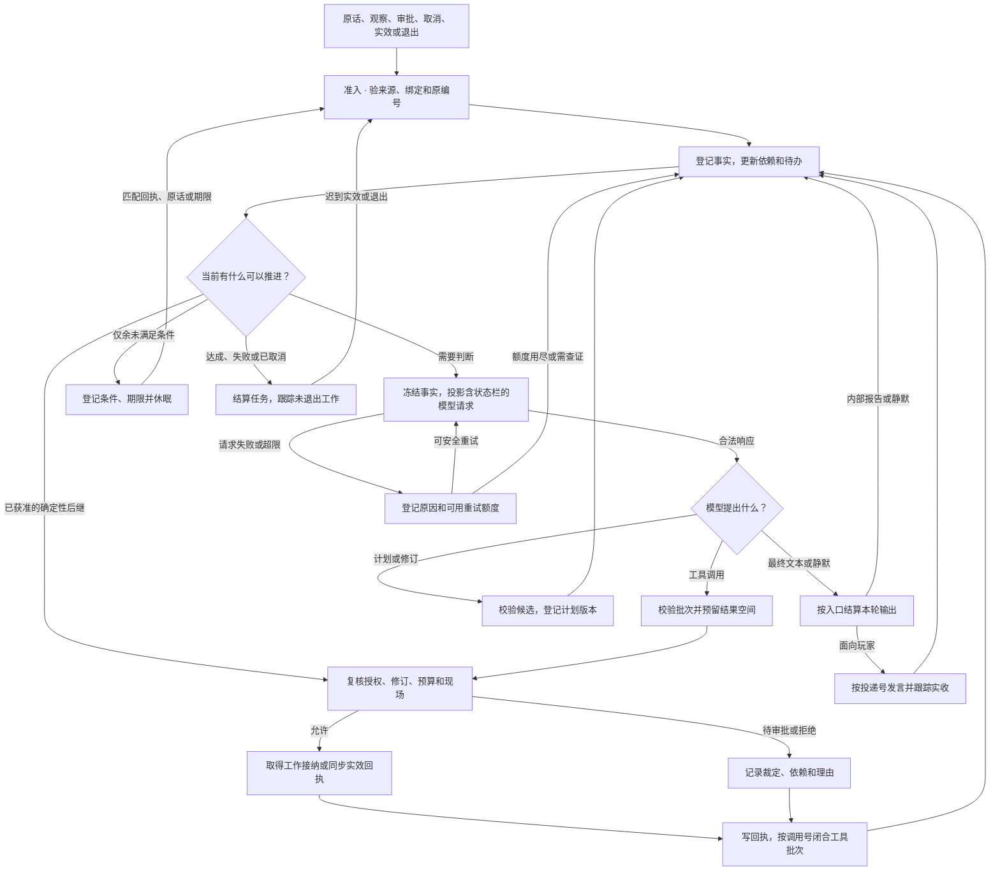
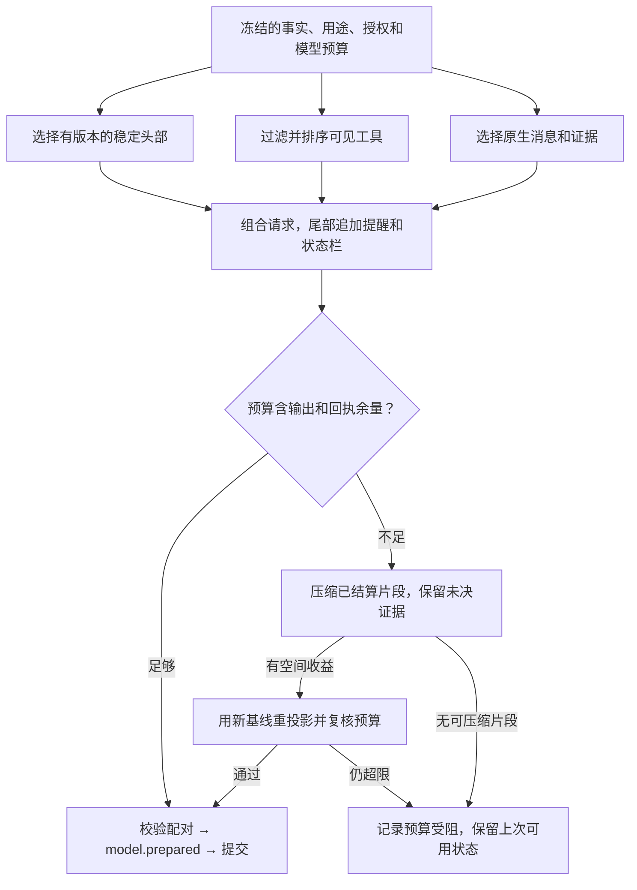

# 基础 Agent 循环核心设计方案

**状态　阶段 0～4、长会话与单玩家试点已验收**　|　**现状调查　`66c72e2`**　|　**实施基线　`b064693`**　|　**验收日期　2026-11-25**

主 Agent 和插件子会话共用 `RunLoop`，各自持有历史和当轮工具范围。宿主从当前会话已接纳的事实生成模型请求，复核权限并管理等待、唤醒和输出投递。领域插件解释现场事实，执行动作并给出业务回执。玩家改口、工具回执迟到和模型回合结束各有独立的记录与推进条件。第八节记录已接入的入口、复现案例和验收边界。[现行架构](architecture.md) · [既有提示词比较](agent-loop-prompt-design.md) · [MC 业务计划](mc-companion-development-plan.md)

## 一、实施前的请求装配

`Session` 持有已提交的消息。一次 `Run` 可以有多次模型请求及工具批次。一个 MC 游戏任务或投递工作又可以跨越多个 `Run`。下面的“新决策”是插件向子会话提交一次新请求，工具批次回传仍在原运行内进行。 [普通运行上下文](../modules/agent/src/run_context.cpp#L40) · [插件子会话](../apps/host/src/subagents.cpp#L114) · [MC 决策入口](../plugins/mc/src/partner_loop.cpp#L374)



| 待查问题 | 主仓库里的实际行为 | 对设计的影响 |
| --- | --- | --- |
| 动态系统提示词 | 人格和场景在入口叠加。求助路由将当轮 `ask` 提醒写入系统段，请求 Hook 每一步都能改写系统段。`promptTemplate` 可以早于人格叠加生成。 | 存在前缀漂移入口。以 Hook 后的 `model.prepared` 检查哪段真的变了。固定输入重复组装本身不足以证明缓存失效。 [人格装配](../apps/host/src/conversation.cpp#L21) · [求助路由](../apps/host/src/interaction_routes.cpp#L315) · [最终组装](../modules/agent/src/run_loop.cpp#L427) |
| 工具定义动态排序 | `ToolSnapshot` 保留授权方给出的 ID 顺序，计划子集沿用 `step.tools` 顺序。MC 通常按固定技能表筛选，空气观察或结算会主动收窄成员。 | 同一集合的两种排列可产生两份不同的工具列表。应规范定义的展示顺序，并保留权限变化引起的成员差异。 [授权与子集](../modules/agent/src/tool_catalog.cpp#L75) · [计划工具校验](../modules/agent/src/plan_definition.cpp#L34) · [MC 筛选](../plugins/mc/src/partner_loop.cpp#L505) |
| 滑动上下文窗口 | 普通运行复制已提交历史，追加原生消息，受 1,024 条消息、64 个工具定义和 1 MiB 计入载荷限制，未见自动滑窗或按 token 压缩。主会话的 16 轮限制用于显示。MC 每次新决策替换子会话历史，并自行保留最近 8 条对话记录。 | 普通会话面对硬上限，MC 长任务则依赖每次快照能否重述旧证据。`clear()` 早于 `begin()`，新运行准入失败也可能丢失旧历史。 [消息限制](../modules/model/src/messages.cpp#L31) · [显示窗口](../apps/host/src/conversation.cpp#L82) · [MC 对话窗口](../plugins/mc/src/partner_loop.cpp#L967) · [替换时序](../apps/host/src/subagents.cpp#L137) |
| 文本格式化 | 模型适配器保留角色、工具调用和 `tool_call_id`。核心把工具状态与输出编码在工具消息内。MC 将旧对话、采样、任务、提醒和回执放进一个 `user` 场景 JSON，模型视图还会缩短部分数据和舍入坐标。 | 保留原生对话和调用关系，另存有来源的结构化结果。展示坐标可舍入，格位判定和工具参数需用原值。 [协议编码](../modules/model/src/protocol.cpp#L30) · [工具结果](../modules/agent/src/run_context.cpp#L70) · [MC 模型视图](../plugins/mc/src/partner_model_view.cpp#L48) |
| 计划、等待和对外回复 | 计划请求自行组装两条消息，没有自动选入普通历史中的工作回执。普通运行在特定 `work_pending` 分支可结束。回复 Hook 可以改变交付文本，历史仍写入模型原文。 | 计划也要读相关证据。工作等待应跨回合存续。后续谈话要能引用玩家实际收到的版本。 [计划请求](../modules/agent/src/plan_protocol.cpp#L48) · [等待分支](../modules/agent/src/run_loop.cpp#L418) · [答复提交](../modules/agent/src/run_loop.cpp#L593) |

固定响应核查中，一次普通会话的 4 条已提交消息含库存回执，随后的规划请求只有 2 条消息、0 个可调用工具，库存回执没有进入规划。另一次核查中，回复 Hook 对外返回 B，下一次普通请求仍出现模型原文 A。对工具批次，小历史中 16 个空参数调用就能因预留结果超过 1 MiB 而在执行前拒收。三者分别对应计划证据、送达版本和预算的缺口。 [计划契约](../modules/agent/src/plan_protocol.cpp#L56) · [历史提交](../modules/agent/src/run_loop.cpp#L597) · [结果预留](../modules/agent/src/run_context.cpp#L57)

`model.prepared` 记录 Hook 后的统一请求。供应商适配器仍会做协议编码，例如按思考模式和工具集合决定是否发送 `reasoning_content`。目前读取输入、输出 token 用量。比较请求时要核对序列化后的内容、顺序和角色，实际缓存命中需另取供应商返回的统计。 [请求记录](../apps/host/src/run_log.cpp#L102) · [供应商编码及用量](../modules/model/src/protocol.cpp#L42) · [错误上下文管理模式对照实验](https://bojieli.github.io/ai-agent-book/chapter2/kv-cache/)

## 二、借鉴哪些框架机制

| 依据 | 可核对的做法 | 在大肥鱼中的取舍 |
| --- | --- | --- |
| Codex | 工作目录变化可追加带 `<environment_context>` 的消息。权限变化可以单独追加指令。官方也记录了工具排序影响前缀复用的问题。 | 为环境、权限修订、当轮提醒分别保留来源和版本，由现有模型层映射合法角色。 [OpenAI 对 Agent 循环的说明](https://openai.com/index/unrolling-the-codex-agent-loop/) |
| Claude Code | 应用可在基础提示词之外补充 `<system-reminder>`。公开文档说明，依模型可包在用户消息中或使用独立系统消息。 | 在固定头部说明提醒的来源，把临时求助或模式变化追加到决策尾部。标签只表达用途，宿主单独裁定权限。 [Claude Code 提醒机制](https://code.claude.com/docs/en/agent-sdk/modifying-system-prompts#context-claude-code-adds-outside-the-system-prompt) · [前缀缓存](https://code.claude.com/docs/en/prompt-caching) |
| DeepSeek Harness | 从会话事件派生模型可见的消息序列。`surface` 支持追加和替换，可与用户看到的记录不同。接近预算时可压缩旧历史，工具调用与结果有完整性约束。 | 同一批事实按普通决策、规划、修订等用途投影。借鉴模型可见序列和压缩边界，业务证据按本项目的会话生命周期持有。 [会话投影](https://github.com/deepseek-ai/deepseek-harness/blob/4b399c39a6d1479cd84ca591b4d7c88e24d38a96/docs/subsystems/session.zh.md#surface-types) · [压缩策略](https://github.com/deepseek-ai/deepseek-harness/blob/4b399c39a6d1479cd84ca591b4d7c88e24d38a96/packages/compaction/compaction-basic/README.zh.md) |
| 《AI Agents in Depth》 | Agent Status Bar 把次数、进度和待确认项等隐式状态显式化，可随工具结果或单独消息交给模型。 | 宿主按已接纳事实计算一份短状态，在决策末尾标明已核实进展、阻塞与可继续事项，支持按号取证。 [作者对 Agent 状态栏的说明](https://bojieli.github.io/ai-agent-book/book/chapter2/#agent-状态栏通过元信息增强-agent-轨迹管理) |

## 三、目标循环与结束条件

主 Agent 和插件子会话各自持有作用域和历史，共用下图的调度与执行路径。一次模型步骤冻结会话、绑定代次、目标修订和已接纳事件截止号。推理期间到达的新消息在下个安全边界进入决策。取消和撤权立即阻止新动作，执行前还须核对最新修订与现场。图中的“工作号”贯穿接纳、实际效果和实际退出。



- **何时继续。** 已有明确授权、已核实前置条件且参数已确定的后继可以直接执行。需要判断时才送模。某个步骤等待玩家选地点时，只挂起依赖这个选择的步骤。回合收到最终答复后记录其去向，调度器只在有新的可处理事项时再次决策。
- **何时等待或停止。** 等待记录绑定工作或问题、所需条件、作用域和可选期限。长工具可先返回“已接纳 W17”以闭合当前调用，此后实效与退出作为 W17 的独立事件进入调度，期间可以回答玩家。效果未知时沿原号查询，同一回执只推进一次。任务达成须有领域证据。失败与取消各记原因，单轮步数或时间耗尽时结束本轮并保留未决工作。
- **出错后如何恢复。** 模型或传输失败记入当前步骤和尝试号。有安全重试额度时，以同一冻结输入另开一次尝试，重新核对当前授权和修订。没有空间收益的重复压缩、缺少新证据的重复查询均停止。已产生或可能产生实效的工作和投递只沿原编号核对。
- **谁维护事实。** 宿主在进程内索引各会话仍需使用的原话、目标修订、权限、工作、问答和投递记录。插件对游戏实效等原始证据负责，提交原号、时间、覆盖对象和可回查的引用。未决事项保留到结算并满足保留策略。诊断 Trace 可以关闭或截断，运行时仍须给出同一决策输入。跨进程恢复和长期记忆另行评审。 [现有运行日志边界](../modules/agent/src/run_journal.cpp#L17) · [项目架构约定](../AGENTS.md)

## 四、Context Projection 与 Agent Status Bar

### Context Projection 的输入和产物

投影是只读函数。输入为绑定的会话事实及截止号、用途、目标修订、工具授权快照、指令版本和模型预算。输出为有序消息、工具定义、证据引用及取舍原因，由模型层编码。对相同冻结输入和版本，两次投影应逐项相同。投影只读取已有采样。现场观察、工具分派和事实提交由循环单独调度。



| 组装部分 | 规则 |
| --- | --- |
| 稳定头部 | 同一用途、人格和场景版本使用相同系统段，指令说明各类输入的来源。临时求助、工作目录或模式改变以带来源的尾部更新表达。合法的角色或规则升级显式换版本、记录原因。普通与规划各有用途契约。 |
| 工具与消息顺序 | 执行用途先求授权、可用性、计划子集的交集，再按注册时的固定展示序及规范工具 ID 排序。适配器和指纹计算使用同一份有序名称、说明和规范化参数 schema。保持调用顺序、结果关联和原话次序，运行中撤权立即在执行口生效。 |
| 用途与证据 | 普通决策选当前原话、相关实效、最近实际送达文本。生成或修订计划选相同来源中的目标、原工作回执、未知效果、允许的工具 ID 和受保护的已完成前缀，实际可执行工具数为零。步骤执行只带本步骤权限，并能回查所依赖的证据。 |
| 编码与信任 | 原生 `user`、`assistant`、`tool`、调用 ID 和协议要求的推理字段交给适配器。观察、提醒、状态栏携带宿主标注，在整批工具结果闭合后追加。当前协议只允许首条使用 `system`，可用带来源标记的 `user` 数据消息承载尾注。外部文本按数据转义，玩家输入相同标签仍是玩家原话。领域大对象附编号、采样时间及范围，原始值按权限回查。 |
| 容量与压缩 | 送模前按模型配置为输出、工具定义、下一批回执预留空间，同时遵守本地字节、消息数等硬限。执行已提出的调用前按实际批次再核算一次。优先引用大观察、压缩已结算的旧片段。保留近期原话、未决目标及修订、授权范围、原工作号、未知实效和未送达答复。调用与结果整批保留或整批归档。压缩失败沿用上次有效基线，必要时在执行动作前报预算受阻。 |

如果仅工具结果的预留空间就超过上限，压缩旧历史也无法使整批合法。可为工具声明有界的模型回执大小，将大输出保存为带工作号的证据。仍容纳不下时，在第一个动作分派前拒绝整批。旧片段压缩出的摘要只引用已核实的事实，原始证据的可读性沿用原授权。

**现有文本 Hook 的迁移。** 旧路径继续按现行协议执行 `model_request` Hook。在新路径，静态指令在场景或策略版本生效时冻结，临时指引经有来源的尾部字段进入投影。仍需任意改写整段系统提示词的插件继续走旧路径，直到迁完该 Hook。记录最后一次变换后的实际系统段、有序工具清单及首个变化位置。在相同模型、用途和配置下比较，能定位意外改变的前缀或工具顺序。

### Agent Status Bar 的字段与更新时机

状态栏是模型下一次决策前看到的短摘要。宿主根据事实计算目标版本、已核实进度、未知效果、在途工作、待答或待批事项及其阻塞范围、剩余预算和待交付输出。插件提供带证据号的业务值。只在字段影响本次判断时展示。模型可据此选择下一步，程序仍独立执行校验。下面用虚构的编号示意一次 MC 决策可见的信息。

```xml
<agent_status source="host" through_event="204" goal="U37/r2" version="7">
  <progress receipt="R91">目标 8 块圆石，已核实入包 3 块，另 2 块拾取待核实</progress>
  <work id="W17" state="running">可继续已获准的采掘</work>
  <question id="Q4" blocks="交付地点">等待玩家指定箱子</question>
</agent_status>
```

在首次决策、压缩后或建立新绑定时，从该作用域重建短基线。后续将变化字段及其版本追加在尾部。同版基线和增量仍完整可见时，仅引用当前版本。无关事件只推进诊断用的截止号，避免每次送模都因时钟或计数变化重写尾注。冻结输入重试得到相同尾部。已解决的问题追加关闭记录。状态栏与证据展开共用投影预算。

## 五、插件扩展接口

下面是供评审的能力契约。现有 `dfy.agent` 的 `open / submit / status / cancel / close` 继续服务旧调用方。事实和工作回执使用独立、可协商的 C ABI。`dfy.agent.facts@1` 接纳绑定事实和工作修订，版本 2 增加有序接纳、最终实效与原号读回。新旧插件可并存，普通对话只依赖宿主及默认模型层。[现有输入和生命周期](../sdk/include/dafeiyu/agent_abi_v2.h) · [插件 ABI 约定](plugin-abi-v2.md)

| 扩展点 | 插件交付什么 | 宿主保证什么 |
| --- | --- | --- |
| 注册场景与能力 | 稳定场景说明、段落版本、工具 ID、说明、参数 schema、展示序、前置条件及实效语义。 | 绑定插件实例和版本。能力目录、送模定义和执行校验复用同一注册项，按当轮授权生成清单。 |
| 提交原话、事实与修订 | 原事件号、修订、绑定代次、对象、采样时间、覆盖范围及结构化值或原始证据引用。快照另带其覆盖的序列号。 | 校验来源并在调用返回前复制借用数据。同号同版同内容返回原接纳号，内容冲突则拒绝。遇到序列缺口时请求同作用域基线。新基线随准入原子发布，拒收时仍可续用旧状态。 |
| 贡献投影字段 | 声明字段、适用用途、来源和大小上限。从已提交事实产生简短指引、状态栏字段或可展开的证据。 | 只读调用，按稳定次序和预算合并，标注来源与可见范围。模型角色、完整历史、最终系统段和权限由宿主决定。 |
| 接受工作、回执与唤醒 | 使用原工作号分别报接纳、实效和退出，并说明待答、待批所阻塞的步骤及满足条件。MC 负责解释入包、投物和玩家拾取的差别。 | 执行前复核绑定、授权、参数、预算和条件。按依赖唤醒，去重迟到或重复回执。已撤销绑定只接受归属原工作的结算，活动资源退出前卸载返回 `BUSY`。 |
| 输出投递 | 声明玩家、内部报告、静默三种去向，由渠道报告投递号、接纳状态和可核实的送达结果。 | 保留模型原文、Hook 后的有效文本、实际送达版本。显式 `reply` 和面向玩家的最终文本复用原消息／回合下的同一投递身份。未知沿原号核对，同一句话可独立回答两个不同原消息。 |

同一插件实例、玩家、世界代次和有效绑定构成 MC 的连续作用域。同一绑定内的新决策追加事实。换世界、换玩家、重建绑定或卸载时隔离旧授权，新工作按新代次准入，仍在退出的旧工作沿原号结算。宿主识别绑定和能力，MC 插件解释世界、格位和背包。

首版扩展的最小往返是“插件提交有版本的事实 → 宿主返回接纳号或拒绝原因 → 插件沿原工作号报告后续回执”。宿主授予的作用域由调用实例绑定。插件无法靠正文或状态栏扩大授权。断序重传、重复回调、订阅撤销和卸载后的迟到回执都依靠这些身份处理。

## 六、MC 陪玩迁移与验收

以“帮我挖 8 块圆石”为贯穿场景。伙伴采掘时，玩家询问进度。交付验收分两个场景。一个等玩家选箱子，另一个由玩家改口“扔给我”，检验满包时的投物与拾取回执。每阶段独立评审。功能验收使用固定模型响应、传输替身、真实插件线程及按需使用的隔离游戏。真实模型的选工具、参数提取和对话判断列为“仅记录，不执行”。 [项目测试原则](../AGENTS.md) · [既有测试入口](../tests/CMakeLists.txt) · [MC 隔离场景](../tests/mc-companion/README.md)

**实施前的验证边界。** 设计调查时的离线核查的 7 项 Agent／模型用例和 `mc.protocol` 通过。5 项 MC 伙伴集成用例未到达预期断言边界，其中一次单独诊断在连接本机命名管道时返回 Windows 错误 5。跨决策连续性的现状判断据源码作出。阶段 0 后续取得了真实管道请求、游戏动作和玩家端收件，数据见第八节。

| 阶段和切换边界 | 交付内容 | 通过条件与证据 |
| --- | --- | --- |
| 0　建立现状基线 | 采集一次普通对话、一次规划及其修订和上述 MC 任务的固定输入、实际统一请求、工作与投递回执。把夹具的宿主收件和玩家实收分别计时。 | 能按原话号串起 `model.prepared`、工具、实效和投递。交换同组工具的授权顺序、回复 Hook 将 A 改为 B、规划前已有库存回执，三组回放均能指出哪一层改变。MC 管道连通且实际收到请求才算覆盖。 |
| 1　并行计算新投影 | 先在主会话和一个 MC 绑定旁路生成新视图，现行路径独占送模、执行与发言。对比同一事件截止号、消息角色、有序工具和尾注。 | 输入相同则首部及工具指纹相同，同组工具的两种排列得到相同定义。仅追加提醒时上次的消息前缀逐条一致。空气观察仅有 `observe`，受限结算仅有获准的 `reply`。旁路新增模型请求、工具分派、玩家发言数均为 0。 |
| 2　接通计划、状态栏和输出 | 先让普通会话和计划／修订走共享事实选择，再接入有回执的投递路径。按目的记录基线、增量和预算。 | 两种计划请求均见相关库存回执和新目标，实际工具数为 0。固定输入重复投影时尾注相同，问题关闭后状态栏仅产生一次关闭增量。回复 A 经 Hook 成 B，送达后下一次对话能引用 B。发送结果未知时仍查原投递号。显式发言后重复最终文本只送一次，内部结算发言数为 0。 |
| 3　MC 按绑定增量接入 | MC 用来源事件、采样、原工作及投递号代替每轮重发全景。旧插件继续走原接口。先只切一个绑定，由单一路径拥有动作。 | W17 挖矿时，Q4 只阻塞交付，途中进度询问只引用已核实入包数。经第 9 条对话仍能找到未完原话与工作。重复回执只推进一次。原始坐标 `-60.000041` 的格位仍为 `-61`。换世界后旧授权失效，旧回执只结算旧工作。新请求拒收后旧历史仍可用。 |
| 4　长任务、失败和回退 | 开启按预算压缩和证据回查，演练同一绑定的取消、迟到回执、未知拾取、卸载及回退。试点稳定后逐个扩大绑定范围。 | 构造接近消息、字节或 token 上限的历史，以及单批 16 个调用的输入。压缩后能容纳则保留完整调用对并执行，仍超限则拒绝且实际分派数为 0。压缩后能查原目标、未知拾取与待答。满包时只报已投出，腾包后沿原号确认实收一次。取消后查到实际退出，忙碌卸载返回 `BUSY`。 |

**对照与回退。** 旁路逐步比较两份投影首个不同的段、消息角色／调用号、工具定义及证据编号。切换和回退都在完整批次已提交、在途工作与投递身份已交接的边界进行。保留原事件截止号、授权代次和去重记录，切换前后的合计实际采掘、投物、发言次数应与单路径对照一致。原路径无法承接的在途工作先沿原路径完成结算。

**跨阶段回归。** 每次切换都用空插件目录验证普通会话，用只读观察触发验证状态变更调用被拒绝。另在模型已选工具、执行尚未开始时撤权，要求实际分派数为 0。阶段 0 至 2 可复用上下文、工具目录和重规划夹具，阶段 3 至 4 用真实插件和隔离游戏检查渠道实收、迟到回执及资源退出。 [上下文事务](../modules/agent/tests/run_context.cpp) · [工具目录](../modules/agent/tests/tool_catalog.cpp) · [重规划](../modules/agent/tests/session_replanning.cpp) · [MC 原生夹具](../tests/mc-companion/native-world.cjs)

**体验与可观测性。** 固定场景以同一玩家端单调时钟，从“发出原话”计至“收到首条有证据的有效反馈”，目标 ≤ 5 秒。空泛确认和重复追问继续计时。另记首次动作、实效和玩家实际收到的结果。端点缺失或时钟无法对齐时标为未确认，只报告量得的分段。模型侧比较输入大小、稳定前缀长度、首次差异和压缩次数。缓存命中与未命中 token 单列，并注明供应商有无返回这两项数据。 [项目计时与验收口径](mc-companion-development-plan.md#首步验收与延迟基线) · [DeepSeek 缓存统计](https://api-docs.deepseek.com/guides/kv_cache/)

## 七、设计取舍

1. **连续性的边界。** 建议采用进程内、按绑定代次隔离的事实索引。它使历史替换、长工作和迟到回执可核对，代价是要为每项未决事实定义归属与回收条件。
2. **状态栏的更新策略。** 建议采用首次短基线、变化增量、同版引用。它兼顾显式状态与稳定前缀，代价是压缩或重绑后必须验证基线仍可独立解释。字段上限与模型预算阈值由阶段 0 的样本校准。
3. **插件的迁移边界。** 建议新增可协商的事实与回执接口，保留旧接口，以一个 MC 绑定为首个切换单位。旁路只比较投影，正式路径独占外部动作。第八节记录这项取舍的实施范围和验证结果。

## 八、master 实施计划与验收

三条开发线在 `52af378` 汇合，`b064693` 记录了 Debug 与 Release 各 280 项通过的验收结果。主聊天已经有 `main_reply`、送达记录和按原号补写，MC 已按玩家原话分别投递并可并存两个待答。核心循环沿用这些工作号及实际回执。主线采用进程内按会话及绑定代次隔离的事实索引、状态栏基线及增量、可协商的可选插件接口。下表为直接在 `master` 实施的次序，实测结果见表后。

| 次序 | 主线实现与阅读入口 | 验收门槛 |
| --- | --- | --- |
| 0　冻结对照样本 | 使用固定响应采集普通、规划、计划修订和 MC 请求。记录授权排列、库存回执、Hook 前后正文、实际工具调用与玩家收件。入口为 [RunLoop](../modules/agent/src/run_loop.cpp)、[重规划回放](../modules/agent/tests/session_replanning.cpp) 与 [MC 原生夹具](../tests/mc-companion/native-world.cjs)。 | 从真实准备请求定位差异。区分请求数、实际动作数和投递数；记录模型可见数据和可核对的时间端点。 |
| 1　只读投影 | 冻结每一步的范围、用途和证据截止号，统一有序工具定义及指纹。在主会话和一个 MC 绑定旁路比较原请求和投影。依托[工具快照](../modules/agent/src/tool_catalog.cpp)与[请求采集](../apps/host/src/run_log.cpp)。 | 同一冻结输入两次投影相同，比较过程新增调用和发言均为零；撤权与只读观察仍由原执行口裁定。 |
| 2　证据进入正式请求 | 普通、计划、修订与步骤复用当前会话证据。加入有来源的状态栏，按渠道回执处理有效答复。依托[计划编码](../modules/agent/src/plan_protocol.cpp)、[上下文事务](../modules/agent/src/run_context.cpp)和[主聊天投递](../apps/host/src/main_output.cpp)。 | 规划及修订能读到库存和原回执，工具列表为空。Hook 输出、渠道实收和下次引用相互可查，未确认投递保留原号。 |
| 3　单绑定试点 | 通过版本协商接收绑定内基线、增量、工作和投递回执，校验身份、代次与重发。MC 按玩家、世界和有效绑定选择原始证据。依托[子会话](../apps/host/src/subagents.cpp)与[插件 ABI](../sdk/include/dafeiyu/agent_abi_v2.h)。 | 第九条原话之后仍有未结工作；断序、同号冲突、换世界、准入失败和旧插件均有固定响应回归，实际执行路径只有一条。 |
| 4　容量与回退 | 按模型窗口和本地硬限为请求、输出、工具批次预留空间，整批压缩已结算材料，保留原始证据与未决工作。只在完整批次边界切换或回退。 | 预算充足时完整保留调用配对，预算不足时实际分派为零；核对负坐标、满包与实收、取消、迟到回执和忙碌卸载。 |

每个独立改变先运行对应固定回放并提交。主线切换完成后运行全量离线套件及安装包验证。实际供应商缓存命中、模型选择工具的质量和推理耗时仅记录，不执行。

### 主线实施记录

**阶段 0　固定基线　`88e8945`**

以 `0fee257` 的实现运行[同一会话的固定回放](../modules/agent/tests/loop_projection.cpp)。7 份 `model.prepared` 对应 7 次固定模型调用，库存工具实际分派 1 次。同组授权交换顺序后，首个工具从 `inventory` 变为 `inspect`。原调用号 `stock-W17` 的库存回执在后续普通请求中可见，在规划和修订请求中都缺失。回复 Hook 把 `raw-A` 改为 `effective-B`，下一次普通请求仍只有 A。两份规划请求的可执行工具数均为 0。真实主渠道的投递和数据库写入另由 [主聊天测试](../tests/plugins/plugin_mailbox_dll.cpp)及渠道回归核对。

隔离 Paper 的 `--handoff-gather-probe` 实测原话 2 要求就地取两块泥土，原话 3 在采掘中插问。回放 `run-NaaTJx` 记录了 7 份准备请求，原采集、会合和投物工作分别为 `plan.132.1` 至 `plan.132.3`，双方背包和服务端回执均核对到玩家实收 2 块。玩家端从发话到收到有证据的首次回复、进度答复分别为 179 ms 和 126 ms。宿主记录的两条原话事件位于 Trace 序号 15、38，时钟分别为启动后 295 ms、682 ms。首轮夹具仍在使用只观察圆石的旧 JAR，投物 2 块的实收为未知。用仓库中的观察端重建该隔离服后才取得上述实收证据。这组数据用于比较同场插问及实收，八块圆石的两条验收路径见下文。

**阶段 1　旁路比较　`5015d70`**

在主会话及同一时刻一个 MC 子会话比较有序定义，共用供应商的消息和工具字段编码。每份准备请求记录运行内事实截止号、用途、工具和首条消息指纹、上次同用途请求的相同消息数，以及第一处差异。隔离服 `run-yOSPJz` 的空气事件对应第 3 回合，两次送模均只含 `observe`。固定回放交换授权后取得同一有序工具列表，仍为 7 次实际请求和 1 次工具执行。

**阶段 2　正式请求与投递　`fe6af78`、`669c478`**

正式请求已采用有序工具。固定回放的规划、修订均看见 `stock-W17` 的库存结果，修订同时看见已核实的首步、原目标和新指引，两份请求可执行工具数均为 0。状态以可独立解释的基线开始，字段关闭只进入一次增量，同版引用只指向已随历史提交的状态。主聊天固定 DLL 把模型原文 `raw` 改为 `model text`，再改为 `visible reply`。SQLite 渠道确认写入后，下一轮可按原投递号引用 `visible reply`。清空会话隔离旧回合的投影。入口为[状态投影](../modules/agent/src/context_status.cpp)、[主聊天渠道](../apps/host/src/main_output.cpp)与[真实 DLL 回归](../tests/plugins/plugin_mailbox_dll.cpp)。

**阶段 3　单绑定事实与工作回执　`dfe0dce`、`0baea64`**

可在 MC 的独立配置内指定 `factPlayer` 为一个配对玩家的 UUID。插件查询 `dfy.agent.facts` 版本 1。原接口的调用者继续使用既有协议。隔离服 `--handoff-facts-probe` 的 `run-bGaAXr` 连续产生 1 份基线和 5 份增量，工作回执水位依次为 7、16、18、21。各增量只含上个水位之后更新的原工作。伙伴实际采集、会合、投物各 1 次，发言 4 次，玩家实收 2 块，两次反馈耗时 286 ms 和 116 ms。可从[插件绑定流](../plugins/mc/src/partner_facts.cpp)和[宿主索引](../apps/host/src/binding_facts.cpp)核对源序号及回执。跨 10 条插话、原号重传、旧代次迟到实效及拒收新基线由固定响应覆盖。

**阶段 4　容量与批次准入　`e1e8f4a`**

支持在模型配置中同时声明 `context_window_tokens` 和 `reserved_output_tokens`。未配置时沿用统一协议硬限。宿主用协议字段的 UTF-8 字节数加封套余量保守估算输入，真实 token 数取供应商实际返回。运行持有的原证据最多 8 MiB、8192 条，模型视图仍受 1 MiB、1024 条等原协议限制。只允许明确声明可在退出后归档的工具压缩已确认的完整旧批次，未知效果、取消和未决事项保留。原文按会话、代次和一基消息号读取，清空或换基线会使旧代次失效。十六调用回放覆盖足额执行 16 次、默认整批预留超限执行 0 次及小模型窗口执行 0 次。缓存命中和未命中用量按字段分别保存，缺失保持未知。入口为[容量计算](../modules/agent/src/context_capacity.cpp)、[正式批次](../modules/agent/src/tool_batch.cpp)与[固定回放](../modules/agent/tests/loop_projection.cpp)。[供应商用量字段](https://api-docs.deepseek.com/api/create-chat-completion/)

**回退和联验　`22c5eaa`、`6e2705c`**

增量入口以一个配对玩家为单位启用。其他玩家、未配置 `factPlayer` 或宿主未提供可选接口时，MC 继续走已有提交入口。宿主在原回合退出后允许切换入口。一次完整快照之后再次接收增量，会用当前代次已提交的事实重建基线。同号重发仍返回原接纳号。绑定事实及可读原文保留在进程内。这一阶段的初版索引在第 129 个工作或同一工作的第 17 次修订处拒收，后续修复见[长会话与回执复查](#长会话与回执复查)。[宿主回退回归](../tests/plugins/plugin_mailbox_dll.cpp) · [可选 SDK](../sdk/README.md) · [工作索引](../apps/host/src/binding_facts.cpp)

试点绑定内，MC 收回本地工具票据时会单独核对游戏退出。停止超时后，宿主保留原工作号、最近实效和已核实的进展。插件用 `partner.receipt` 只读同一桥接工作的回执，原动作的失联期限继续计时。旧桥接缺少此接口时，退出保持未确认。原工作、控制器、世界和消息号均匹配的终态才产生退出记录，实效仍可为未知。玩家纠正依赖该工作时，迟到退出会唤醒原纠正。[桥接读回](../plugins/mc/src/game_work.cpp) · [工作事实](../plugins/mc/src/partner_facts.cpp) · [纠正回放](../tests/mc-companion/mc_plugin_partner.cpp)

两局隔离 Paper 都从“帮我挖 8 块圆石”开始。玩家的交付选择仍待答时，固定模型实际提出了一次给物，宿主用原待答拦截。伙伴在此期间完成一次采掘，游戏端逐格读到八格变为空气，伙伴背包净增八块。玩家途中询问进度时，两局现场读数都是已入包 0 块。表中时间来自各局同一协议玩家，从发原话计至收到对应私聊。[固定响应](../tests/mc-companion/mc_playtest.cpp) · [协议玩家断言](../tests/mc-companion/playtest-check.cjs)

| 玩家后续选择 | 现场与原工作回执 | 首次交付追问 / 途中库存答复 |
| --- | --- | --- |
| 左箱，`run-FNAhKo` | 伙伴向原玩家确认左箱。验收截止在选箱确认，伙伴包内仍有 8 块，玩家 0 块，给物执行 0 次。 | 225 ms / 253 ms |
| 扔给我，`run-PgI8Xm` | 玩家 36 格满包。原工作 `1.30` 投出 8 块，先记实收 0、待核实 8。腾包后实际收到 8 块。同一工作保留退出记录并追加第 4 版实效，再次询问仍只查到 1 次给物。 | 239 ms / 303 ms |

满包场景首次以约一格间距投物，服务端记录伙伴自己捡回了全部物品。验收场地改为平地、双方相距两格，并对照玩家实收、其他实体拾取和未核实量。已有的 66 块、两堆泥土场景也用原工作查到了迟到拾取。[游戏取证](../plugins/mc/bridge/handoff-evidence.cjs) · [运行方式](../tests/mc-companion/README.md#固定响应验收单个玩家绑定)

**试点迁移验收　2026-11-25**

VS2022 x64 的 Debug、Release 各通过 281 项离线 CTest，其中运行时 259 项、桌面 22 项。关闭测试入口构建的 Release 安装包通过示例插件安装、加载、卸载、CLI 命令及原后台进程退出。桌面安装包检查覆盖七种原生探针模式、资源缺失时的拒绝和独立 CLI。固定响应和传输替身验证宿主行为。真实模型选工具、解释观察、推理延迟和供应商缓存命中仅记录，不执行。[测试清单](../tests/CMakeLists.txt) · [宿主包检查](../scripts/verify-agent-package.ps1) · [桌面包检查](../scripts/verify-ui-package.ps1)

### 长会话与回执复查

在 `e8de497` 上，普通对话第 513 轮被拒收，写库待定时一次主聊天发言落了两条记录，满额绑定的迟到拾取也无法登记。以下回归从原入口核对修复后的实际请求、渠道写入及游戏实物。

| 已复现的问题 | 当前行为与验收证据 |
| --- | --- |
| 主聊天写库待定时出现重复发言。真人补充要求时，旧决策仍可能开工。 | 同一来源沿原投递号查状态，独立输入仍可收到相同答复。真实 SQLite 写锁覆盖待写和补写。真人补充到达后，尚未开工的变更需重新决策，已获准的独立读取可继续。规划和修订均收到观察对象、来源、采样年龄及有效期，过期采样附有原因。两种请求的可执行工具数均为零。[投递回归](../apps/host/tests/message_recovery.cpp) · [插话回归](../modules/agent/tests/turn_input.cpp) · [实际请求](../modules/agent/tests/loop_projection.cpp) |
| 已完成的普通问答耗尽 1024 条消息或 1 MiB 送模预算，未发送的私有推理也会挤掉可交付的短回答。 | 先按完整轮次逐字组合历史，仍超预算才把旧长回答换成首尾、字节数、代次和原消息位置。送模预算按实际编码字段核算。普通会话和带工具的思考会话分别跑完 515 轮，近期消息、未决工具续行均保留原生角色。另在协议字节上限及配置小窗口下查回长回答原件。[投影实现](../modules/agent/src/context_capacity.cpp) · [协议校验](../modules/model/src/messages.cpp) · [容量回放](../modules/agent/tests/loop_projection.cpp) |
| 第 17 次修订或第 129 个工作被拒，已有动作可能丢失退出或实效。 | 有序接口保留 128 个工作原件和最近 128 个已归档工作的指纹。每个工作保留至多 16 版，首次接纳和实际退出各自保留。仅归档已退出且实效最终的工作，淘汰指纹后用接纳水位拒绝旧号。回归推进到第 45 次修订和第 390 个工作。128 个槽全为未决时，试点的新变更在游戏派发前受阻，已有原件仍能结算。[工作索引](../apps/host/src/binding_facts.cpp) · [索引回归](../apps/host/tests/binding_works.cpp) · [插件回归](../tests/mc-companion/mc_work_receipts.cpp) |
| 多份长回执可挤掉绑定基线。玩家换绑后，旧投物的迟到收件无法核实。 | 宿主按整帧预算保留工作号、回执号、最近实效和退出，必要时用指纹代替正文。试点的只读 `observe(mode="work_receipt")` 可用实际收到的代次和回执号查原件，已归档时只返回指纹。宿主在进程内共保留至多 16 份活动和退役工作索引。换绑后沿旧会话号补结算，新绑定的模型看不到旧回执。[宿主路由](../apps/host/src/subagents.cpp) · [真实 DLL 回归](../tests/mc-companion/mc_plugin_partner.cpp) · [可选 SDK](../sdk/README.md) |

隔离 Paper 使用固定响应驱动实际游戏。选箱局 `run-rhYi0v` 确认了玩家所选的左箱，截止确认时给物次数为零。满包的玩家在原绑定内腾包（`run-2MswvF`），以及用同一 UUID 重新登录后腾包（`run-lyuy2p`），独立游戏客户端均数到 8 块圆石。后一局只有一次实际投物，最终实收只追加在旧绑定原工作 `1.28` 的第 4 版。桥接失联时，原工作先保持退出未知，只读查询核实同一工作、控制器、世界和原消息后才登记退出。`binding.work_settled` 可按插件实例、会话、代次、原工作及修订串查。[桥接回执](../plugins/mc/src/game_work.cpp) · [结算 Trace](../apps/host/src/run_log.cpp) · [隔离服验收入口](../tests/mc-companion/README.md#固定响应验收单个玩家绑定)

通用会话原件仍以 8 MiB 和 8192 条消息为保留上限。插件实例卸载时，宿主撤销该实例的回执路由。跨进程恢复属于单独的设计议题。[会话原件与预算](../modules/agent/src/context_capacity.cpp) · [绑定生命周期](../apps/host/src/subagents.cpp)

**集成验收　`5f009ff`**

本次隔离 Paper 共回放 8 局，使用当前源码构建的服务端观察插件和独立协议玩家。除单绑定事实、选箱、满包及重连外，66 块多堆交付覆盖四种现场变化。满包腾出后，原号查到实收 66，另一次给物提议没有再次投物。关闭观察端时，伙伴保留收件未知。玩家移开时只投出首堆 64 块。第三人拾取时，服务端记原玩家实收 0、旁人实收 66。[现场断言](../tests/mc-companion/playtest-check.cjs) · [探针运行说明](../tests/mc-companion/README.md)

VS2022 x64 的 Debug、Release 各通过 288 项离线 CTest，含 266 项运行时和 22 项桌面用例。关闭测试入口的独立 Release 安装包通过示例插件安装和卸载、原后台退出、七种原生 WebView2 探针、缺失资源拒绝及独立 CLI 检查。模型侧均使用固定响应或传输替身。一次并行验收遇到托盘日志清理被占用和插件目录移动失败，两项分别连续复跑三次通过，随后同一代码的全量串行复跑通过。[测试入口](../tests/CMakeLists.txt) · [宿主包验收](../scripts/verify-agent-package.ps1) · [桌面包验收](../scripts/verify-ui-package.ps1)

## 九、下一轮开发计划

领域和界面的后续交付分别核对玩家指定箱子里的实物，以及管理中心打开信件时的收件状态与系统消费行为。

### 三个固定工作树的交付

| 工作树 | 第一个可审查的交付 | 后续交付与验收 |
| --- | --- | --- |
| `plugins` · MC 存箱 | 沿用八块圆石、两个箱子的隔离服场景，先只读绑定玩家指出的单个普通箱子。记录世界、维度、格位、槽位容量和伙伴库存。 | 加入明确委托“把这八块存进左箱”。正常时伙伴背包减少 8，选中箱增加 8，另一箱数量不变。满箱、只容得下部分物品、窗口中断分别报告实存量、剩余量或待核实。沿原工作复查，避免重复转移。原有“扔给我”满包用例继续核对玩家实收。[容器计划](mc-companion-development-plan.md#游戏-api-封装与工具) · [既有协议玩家场景](../tests/mc-companion/playtest-check.cjs) |
| `core` · 信箱只读接口 | 在管理 IPC 提供按后台实例、来源和修订查询的目录，再交付可公开的信件摘要、详情和回执。系统保有消费游标和回信权。 | 用现有测试插件产生一封待处理信件。连续查询前后，消费游标、回信数和模型调用数均相同。卸载再加载后，旧来源能被识别为失效，新来源可查。[信箱实现](../modules/events/src/mailboxes.cpp) · [管理协议](../apps/host/src/management/protocol.cpp) · [管理中心步骤 6](ui-framework-design.md#10-分步实施与验收) |
| `ui` · 管理中心信箱 | 按 `core` 约定的响应，用固定样本在房间内的同一信箱入口呈现来源、收件状态和公开回执，分别显示空、过期和读取失败。 | 接入已合并的后台读口。用两个真实 WebView2 窗口反复打开同一封信，断开再连接后读到当前修订。关掉一个窗口，另一窗和后台收信照常工作。[房间与信箱设计](ui-framework-design.md#2-管理中心的界面组织) · [主面板](../apps/desktop/web/src/MainPanel.vue) |

**开工与合并顺序。** `plugins` 的容器只读观察和 `core` 的信箱读口可以同时开始。`ui` 在读口字段约定后即可做样本验收，正式联调依赖 `core` 的接口提交先合入主线。MC 的容器写入依赖该插件自己的读口，与管理中心独立。每个行为单独提交和定向验证，三个开发分支由主 Session 按交付 SHA 保留历史合并。联验时在隔离 Paper 核对箱内实物，在真实窗口核对信箱读取无副作用，最后运行 Debug、Release 全量离线测试及安装包检查。[工作树流程](../.agents/skills/dafeiyu-worktree/SKILL.md) · [项目测试原则](../AGENTS.md#测试原则)

**接续边界。** MC 已在单绑定试点验证模型从摘要查回长工作实效，覆盖错代次和无效回执号。通用会话原文由宿主 C++ 接口 `Session::read_evidence` 按本会话代次和消息区间读取。若其他领域向模型开放原文读取，需在其工具授权里另行限定可读对象。房间步骤 11、12 分别核对事件发生时的感知、当前位置的取样及实际送模字段。管理中心在信箱之后接步骤 7 的设置与插件管理。[证据读口](../modules/agent/src/session.cpp) · [容量回放](../modules/agent/tests/loop_projection.cpp) · [房间实施次序](main-agent-room-development-plan.md#7-分步开发顺序) · [管理中心实施次序](ui-framework-design.md#10-分步实施与验收)
