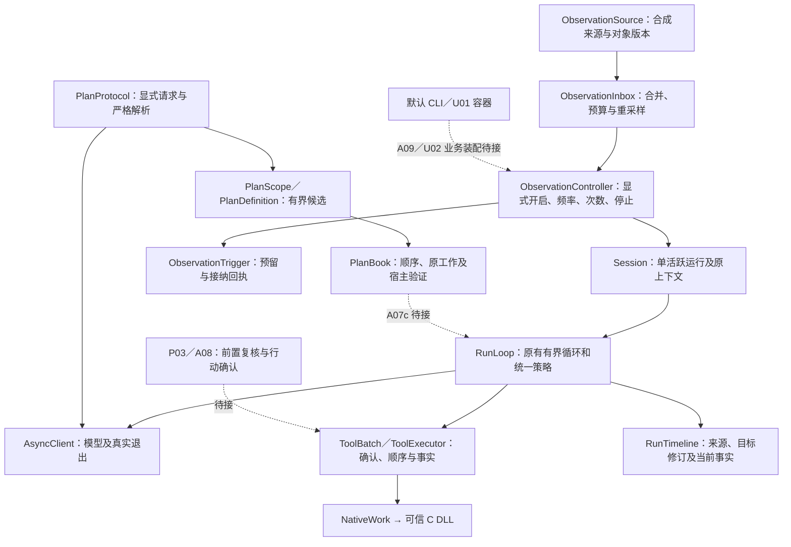

# 大肥鱼 23:30 开发检查点

本轮窗口：2026-11-16 北京时间 22:03～23:30，从干净基线 `0a842cb` 继续。功能与测试检查点 `4132b9b`，共 10 个独立开发、修复和测试提交；本页随收尾文档另行提交。到时停止，后续等待用户继续指令。

**A06 的显式有限观察触发已接入正式 Session，当前仅允许文本和声明为只读的授予工具。A07 已有候选、顺序进度和显式模型生成／解析接口，尚未接入自动计划执行。** 默认 CLI／GUI 没有自动开启观察或规划功能。

## 本轮完成

| 单元 | 当前行为 | 边界 |
|---|---|---|
| A06c 触发规则 | 默认关闭；固定来源、对象代次、目标／规则修订、最小间隔、总次数及截止；预留与真实运行接纳分别处理 | 宿主须显式开启，观察正文不能授予权限；没有无限后台自治 |
| 观察上下文 | 目标与观察数据分开；保留来源／对象／修订；支持标量、结构、数组和映射 | 最多四份，单份编码最多 64 KiB；二进制、枚举和联合等暂需专门适配 |
| 正式触发 | 用户输入待处理或会话忙碌时让出；通过原 Session／RunLoop 接纳；停止只作用于自己创建的运行 | 当前拒绝固定范围中的状态变更工具，包括暂时禁用的成员；变更行动待 P03／A08 |
| 生命周期 | 来源撤销、规则截止、控制器销毁及接纳后时钟故障均保留真实接纳和原退出责任 | 初始观察时效校验不等于已完成行动前的重新观察 |
| A07a 候选 | 不可变顺序步骤、原 Run／目标／计划版本、工具子集与有界文本 | 完成条件只是声明，没有执行状态或完成权 |
| A07a 进度 | 下一步骤绑定原工作；结果、实际退出和宿主验证分别记录；尾部修订保留已执行前缀 | 同一原工作不能绑定两步；失败或取消不能被新计划抹去；计划不结算 Run |
| A07b 生成协议 | 固定规划模板与严格 JSON 候选格式，复用 AsyncClient；不提供工具执行入口 | 只完成显式原生生成／解析；默认问答不切换为规划模式，A07c 正式执行装配未完成 |

计划模块不会因为模型文本声称“完成”就推进。宿主必须依据原工作成功及实际退出，并明确确认完成条件；最终现实目标是否达成仍属于后续 A08。当前 PlanBook 停止会阻止新步骤，原工作的取消和收尾仍归原运行所有者。

## 当前关系

实线表示已实现调用或数据流，虚线表示尚待装配的链路。

观察输入的正文进入受预算约束的数据消息，控制来源和权限仍由宿主固定。普通追踪仅复制观察关联，不保留载荷或源时钟点。模型规划调用的响应只是候选数据，原模型调用成功也不等于计划已经执行或达成目标。

## 验证与限制

每步只构建必要 Debug 目标并运行相关测试，完整时点见 [开发记录](agent-development-log.md)。本轮覆盖触发规则、数据投影、正式观察接纳、原文本会话兼容、时间线回顾、控制器、真实 DLL 只读链路，以及计划定义、顺序记录和规划协议。

关键证据包括：默认关闭与频率／次数／期限；重复或断档观察不重复运行；输入准备期间到期零模型提交；用户输入优先；接纳后时钟错误仍计数且可查询；原生结果先于退出时的撤销、到期和销毁；计划越权／重复／超量拒绝；旧版本和已执行前缀保护；原工作唯一关联；候选生成零工具执行；模型自报状态及截断候选拒绝。

模型全部使用既有 ScriptedModel 或固定响应，线程、宿主操作和 C DLL 按需实际执行。没有调用真实模型、读取模型凭据或使用 Computer Use，没有最终全量、Release／跨配置总验收或新分发包。规划质量及观察理解表现继续仅记录，不执行。

收尾核对了 41 个变更文本的严格 UTF-8、11 个公开头文件的 BOM、254 处本地文档链接及代码围栏，整体差异检查通过。这些检查不替代功能测试或最终全量验收。

当前限制：没有真实屏幕／摄像头／语音来源；没有默认 CLI／GUI 的观察规则管理或计划交互；没有自动计划执行、用户目标更新、完整行动闭环、T03 诊断导出或 E03 版本比较。已有 U01 分发包不包含本轮功能。

## 下一步

恢复后从 A07c 的正式运行装配继续：明确计划步骤与原模型／工具工作的映射、每步工具范围、有限重规划和目标修订，随后接入 P03／A08 的变化后复核与行动确认，再完成 T03／E03、A09 应用接入及最终离线全量验收。

阅读入口：[触发控制器](../agent/include/dafeiyu/observation_controller.hpp) → [观察数据](../agent/observation_input.cpp) → [计划定义](../agent/include/dafeiyu/plan_definition.hpp) → [计划记录](../agent/include/dafeiyu/plan_book.hpp) → [规划协议](../agent/include/dafeiyu/plan_protocol.hpp)。前一轮范围见 [21:30 检查点](agent-progress-2026-11-16-2130.md)。
