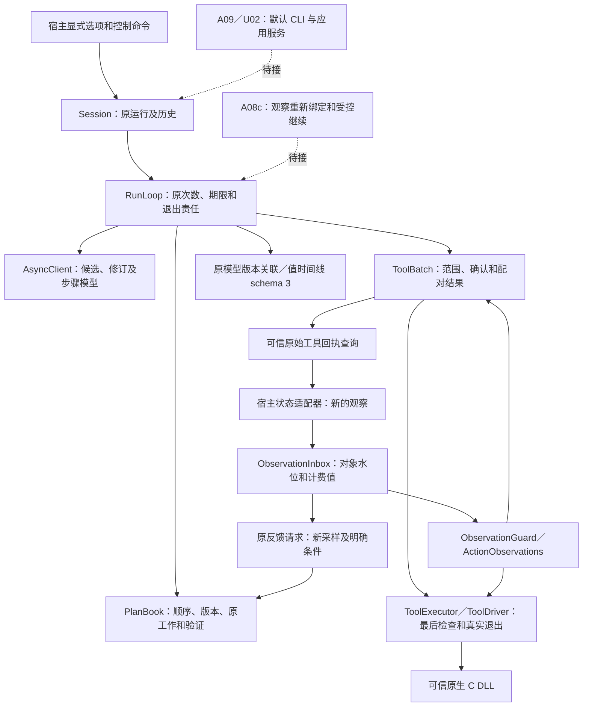

# 大肥鱼 17:00 开发检查点

授权窗口：2026-11-17 北京时间 15:01～17:00，从干净基线 `d2a2203` 接续 A07c。功能与测试检查点为 `cfa090a`，共 22 个独立开发、修复和测试提交，另有授权及本次收尾文档提交。到本轮截止后暂停，等待用户继续。

**正式 Session 已具备受控分步规划、有限重规划和步骤边界目标更新，并接入观察／计划复核及最小确定性反馈。下一步是 A08c 的运行内观察重新绑定与受控继续。** 默认 CLI／GUI 没有自动启用这些入口，观察规则仍只读。

## 本轮完成与边界

| 范围 | 当前行为 | 边界 |
|---|---|---|
| A07 正式规划 | 显式开启后使用原 Run／AsyncClient 生成候选，逐步执行原模型工具循环，每步使用原工具子集 | 生成和修订均计入原总次数／期限；默认问答不进入规划 |
| 步骤验证 | 成功结果、实际退出、宿主验证分别记录；验证命令不直接调度下一步 | 模型文字不能完成计划；宿主明确验证后才继续或结算原 Run |
| 有限重规划 | 原目标内修改未执行尾部，保护已执行前缀和证据；相同原请求复用接纳结果 | 在途、待验证及失败步骤不能被新候选抹去；次数不因目标更新重置 |
| 用户目标更新 | 原工作已退出的步骤边界显式更新，默认最多四次；旧计划停止后保留查询 | 在途更新明确拒绝，当前没有排队替换；工具范围、原总预算及截止不重置 |
| P03 变化复核 | 确认绑定目标、计划、步骤、策略、观察及原实例；观察水位、来源、集合寿命和期限均参与检查 | 固定范围内拒绝或停止；不能凭新批准重放未知／失败已发生的非幂等效果 |
| 最后动作检查 | 变更工具取得顺序资格后、调用工厂前再次核对原运行和观察；开始尝试变更后消耗旧观察依据 | 下一变更不能继续复用旧采样，即使来源尚未推送更新；只读查询可继续 |
| A08a 状态判定 | 明确区分满足、不满足、未知；精确支持 Bool、Int64、UInt64、String 和显式 Null | 仅顶层字段等值；自动证据须为当前 host_verified 来源，浮点及复杂语义另议 |
| A08b 反馈 | 原步骤或指定原工具实际退出后签发最多 64 个反馈请求；新采样满足才验证原步骤 | 保持同对象、代次及 schema，要求更高采样修订和不早于请求时刻；未知或未满足继续有界等待 |
| 追踪与查询 | 固定每次模型调用的目标／计划版本和用途；值时间线 schema 升为 3；可信入口可读原步骤和工具输出 | 普通诊断不复制正文；T03 文件导出及完整版本查询仍未实现 |

真实原生闭环由宿主先只读采样，再在原 Session 中执行获准变更和只读重查；状态适配器读取实际退出后的工具原始回执，发布新观察供原反馈请求验证。最终模型文本只作输出，不作为目标完成证据。

## 当前调用关系

实线表示已经实现的调用或数据流，虚线表示后续装配。

步骤工作的完成源由原 RunLoop 拥有，PlanBook 只读取原操作并记录宿主验证。反馈不会修改工具结果、未知效果或动作授权，目标更新也不会创建新的运行预算。既有观察控制器仍拒绝包含变更工具的范围，本次没有开放观察触发变更。

## 验证证据

各步只构建必要 Debug 目标并运行相关测试，逐项结果见 [开发记录](agent-development-log.md)。新增证据包括：

- 工具子范围不扩权，禁用／撤销和同名重装不切换原实例。
- 正式候选、顺序执行、明确验证、有限重规划、用户目标更新及原上下文事实保留。
- 错误调用者、旧计划／目标、前缀改写、重复确认、期限和模型预算均按原边界处理。
- 观察等待期间、批准后、接纳后和控制回调中的变化均阻止变更；自身变更也不能继续复用旧依据。
- 未知效果或失败已发生的动作在目标更新及再次批准后仍不重复调用。
- 真实 DLL 的结果早于退出、忙碌卸载拒绝、取消、会话销毁、目标替换和快照保留后的卸载。
- 原生初读→一次变更→同运行重读→新观察判定，满足、不满足和来源失效未知分别处理。

功能完成后的定点集成复核为 6／6：`agent.run_loop`、`agent.async_session`、`agent.observed_native_loop`、`agent.observation_controller`、`agent.replay_material`、`agent.timeline_review`。这些是本轮改动直接影响的链路，不是完整 CTest 或最终验收。

开发中记录并修复了规划在途重复提交问题；另修正两处新增测试夹具的字段描述／类型名。首次失败和最终复验均保留在开发记录中。CMake 再生成仍提示现有 CMP0225 开发者警告，必要构建成功，未修改无关构建策略。

收尾复核另修复移动后空观察集合被误判有效的边界，仅重建并复验 `agent.session_action_guard`，通过。收尾核对 57 个变更文本的严格 UTF-8、16 个头文件的 BOM、259 处本地文档链接及代码围栏，整体差异检查通过；这些检查不替代功能测试或最终全量验收。

全部模型响应使用 ScriptedModel 或固定替身，按需实际执行线程、宿主操作及测试 DLL。未调用远程或本地真实模型，未读取模型凭据，未使用 Computer Use；没有最终全量、Release／跨配置总验收或新分发包。规划质量和观察理解仍仅记录、不执行。

## 后续顺序

1. A08c：显式换入新的完整观察，保持输入、动作绑定、旧批准失效及原总预算一致，完成变化／失败／未知后的受控继续；相应条件齐备后再明确开放观察触发变更。
2. T03／E03a：补齐规划和反馈的诊断导出、完整版本关联及离线差异报告。
3. A09a／b → E03b：CLI／共享应用服务、样例插件、命令重试和重连场景。
4. A09c：统一最终离线全量、相关跨配置和分发验收。

真实设备、长期记忆、跨会话恢复、多 Agent 及完整管理中心 UI 均未在本轮展开。当前仍只承诺进程内状态和显式原生控制，不把诊断或反馈值当作可恢复检查点。

阅读入口：[正式会话](../agent/include/dafeiyu/session.hpp) → [原运行协调器](../agent/run_loop.cpp) → [动作观察绑定](../agent/include/dafeiyu/action_observations.hpp) → [确定性判定](../agent/include/dafeiyu/observation_verification.hpp) → [反馈请求](../agent/include/dafeiyu/plan_feedback.hpp) → [真实原生反馈场景](../tests/native_action_feedback.cpp)。前一基线见 [23:30 检查点](agent-progress-2026-11-16-2330.md)。
