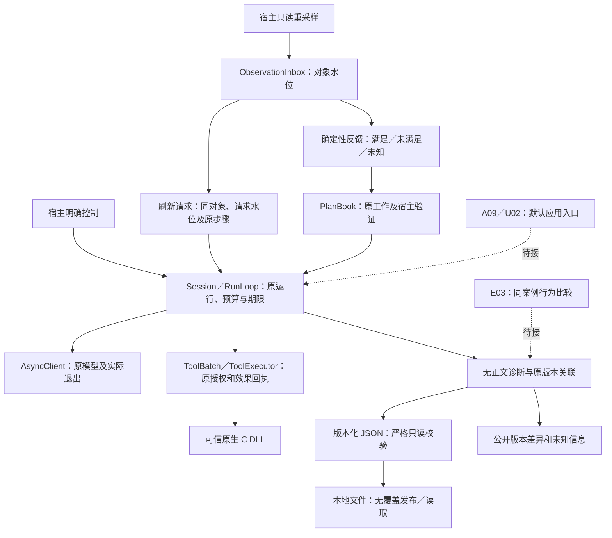

# 大肥鱼 23:00 开发检查点

本轮窗口：2026-11-17 北京时间 20:17～23:00。先刷新远端并确认本地与 `origin/master` 同为干净基线 `40f948c`，同步最新 17:00 进度后从 A08c 接续。功能与测试检查点为 `6dd758a`，完成 14 个开发、修复和测试提交，另有同步授权及收尾文档提交。到时停止，等待用户继续。

**原 Session 已支持在步骤退出后的待验证边界换入完整新观察，复用原执行器受控继续；诊断可保存为版本化本地文件并严格只读加载。** 观察控制器仍只读，默认 CLI／GUI 尚未装配新控制及导出命令，E03 同案例行为比较未实现。

## 完成范围

| 范围 | 当前行为 | 边界 |
|---|---|---|
| A08c 刷新 | 原步骤、原观察、请求时刻及当时最高水位绑定；默认最多 16 次，硬上限 64 | 限定成功且实际退出、仍待验证的计划步骤；不在途替换 |
| 完整后继 | 同集合、来源对象、代次及 schema，全部修订增加且不早于请求 | 部分更新、旧样本、换代及跨集合拒绝；原值过期仍可请求重采样 |
| 原运行继续 | 先准备完整输入与回执，再切换行动依据；原次数、期限及工具回执保持 | 刷新不执行模型、不验证步骤、不扩大工具范围 |
| 效果保护 | 旧批准和旧刷新只返回原回执，不能重新启用已消费依据 | 未知或失败已发生的非幂等效果不重放；明确未发生才允许受控尝试 |
| T03 快照 | 时间线、计划状态、反馈末次判断、观察链与原模型控制关联 | 无目标、回答、参数、条件期望值或人工证据正文 |
| 本地诊断 | 文件封套版本 1、时间线 schema 6；相对时间、未知及缺口明确 | 最大 8 MiB；严格读取，不是运行恢复检查点 |
| 文件发布 | 完整写入同目录临时文件后无覆盖发布，明确路径读取 | 不上传、不覆盖已有目标、不加载插件或恢复任务 |
| 公开版本 | 规范 schema SHA-256、原插件声明版本、公开模型及策略摘要、差异查询 | 未知代码／构建／模板保持未知；声明版本不是二进制签名，差异查询不是行为比较 |

正确顺序为：原步骤退出并等待验证 → 请求刷新／反馈 → 宿主实际重采样 → 换入完整新观察 → 验证原步骤 → 后续推进。失败不会发布半份输入，刷新也不会抹去旧失败、已发生或未知效果。

公开模型摘要仅包含 provider、model、timeout；端点、凭据引用及完整配置不读取、不哈希。基础策略摘要反映实际限额，控制扩展只接收宿主公开标签。不把仓库 HEAD 猜成已经构建程序的版本。

## 当前关系

诊断只有值，不持有原生工作、观察载荷或调用者凭证。读取不会触发模型、工具或反馈判定；其中的标识不能恢复旧任务或重新授予权限。

## 验证与剩余工作

每步只构建必要 Debug 目标，逐项证据见 [开发记录](agent-development-log.md)。验证覆盖请求水位、完整更新、身份／版本／期限、真实 DLL 两次变更间的重读与刷新、旧回执不能追加效果、原预算和未知效果保持、诊断正文排除及往返、中文路径和拒绝覆盖、SHA-256 标准向量与公开配置隐私，以及损坏完整历史和矛盾等待状态拒绝。

最后定点复核 `agent.replay_material`、`agent.observation_controller`、`agent.session_goal_revision`，3／3 通过；这些是直接受本轮接口影响的入口，不是完整 CTest。未调用真实模型、未读取模型凭据、未使用 Computer Use，没有最终全量、Release／跨配置总验收或新分发包。

收尾核对 57 个变更文本的严格 UTF-8、19 个头文件的 BOM、258 处本地文档链接及代码围栏，整体差异检查通过。此类检查不替代功能测试或最终验收。

下一步先补观察规则允许变更时的明确触发条件、授权及失败停止，默认仍只读；再推进 E03 的同案例同输入前提下的离线行为比较、场景扩展，以及 A09 共享服务、CLI／样例、重试／重连和最终验收。T03 的默认命令及构建标签装配随应用入口完成。长期记忆、跨会话恢复、多 Agent、真实设备及完整管理中心 UI 未在本轮展开。

阅读入口：[刷新接口](../agent/include/dafeiyu/observation_rebind.hpp) → [原运行](../agent/run_loop.cpp) → [诊断快照](../agent/include/dafeiyu/diagnostic_snapshot.hpp) → [编码／读取](../agent/include/dafeiyu/diagnostic_json.hpp) → [本地文件](../app/diagnostic_files.hpp) → [版本查询](../agent/include/dafeiyu/trace_identity.hpp)。此前范围见 [17:00 检查点](agent-progress-2026-11-17-1700.md)。
