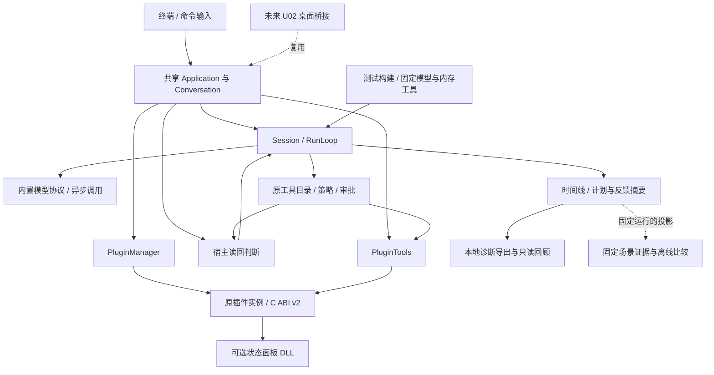

# 大肥鱼 11:00 开发检查点

2026-11-18 北京时间 09:19～11:00。本地从与 `origin/master` 一致的干净基线 `ffba816` 开始，功能和定向测试推进到 `11d877c`，包含 25 个独立开发、修复和测试提交。用户认可优先做主动委托，本轮交付共享服务和首个终端任务，随后补齐当前离线比较与分发证据。11:00 暂停等待继续。

## 首个用户任务

大肥鱼可以接收“把状态面板切换到专注模式”，先读取实际模式，显示待审变更并等待用户决定。批准后在原插件实例执行，再读取实际状态判断是否达到 `focus`。宿主核对原工具身份、调用顺序、审批和实际退出。状态不匹配或证据不足时停止任务，已发生的效果仍可查。

在 Release 安装目录启动程序，输入以下命令。

```text
/plugins install "examples/plugins/example.status"
/plugins load example.status
/task example.status/read example.status/set_focus focus "把状态面板切换到专注模式" --request 1
```

首读后用 `/confirmations` 查看待审调用。按实际显示的请求号和修订输入 `/approve 请求号 修订` 或 `/deny 请求号 修订`，再用 `/status` 和 `/verification` 查看运行与证据。样例提供 `idle` 和 `focus` 两态，状态随当前实例存活，第一次加载为 `idle`。完整命令见 [运行说明](run-guide.md)。

## 架构与边界



| 单元 | 当前结论 |
|---|---|
| A09a 共享服务 | 保留单会话单活跃运行。普通文字采用内置 Provider，空插件目录仍可用；只有显式工具命令会授予指定工具范围。终端由共享服务取得状态与回执 |
| P02／A08 应用闭环 | `/task` 固定单步、同一活动插件实例和两个无参工具。首读、变更、读回均为独立调用。批准与执行分开，拒绝、实例换代及缺首读保持零变更 |
| E03b 应用重连 | 同一进程更换终端视图可查询原运行，并安全重发已编号任务或审批决定。保留最近 16 项任务接纳与 64 项审批决定；运行详情只保留当前或最近一轮。过期任务号、顺序缺口或不同内容明确拒绝 |
| T03 应用诊断 | `/diagnostic export` 写新文件，`--review-diagnostic` 离线读。记录实际退出、效果、计划及反馈摘要。编译器、平台和构建配置随二进制固定，源码提交需构建者显式核实并声明。诊断用途限于事实回顾 |
| E03a 固定回放 | `dfy_replay_evaluation` 采集固定材料的实际证据并比较构建结果。比较检查输入、版本、终态、效果、调用上下文与事实顺序；未知版本、未声明差异及缺失历史明确报告。当前材料使用内存工具，完整观察／计划／反馈案例待补 |
| A09b 示例与分发 | `example.status` 是明确安装和加载的可信同进程 C DLL。Release 含独立示例包和可从公开 SDK 构建的源码。默认插件目录为空 |

应用命令、会话推进与插件推进由同一宿主线程协调。应用内重连的作用域为存活的宿主进程。当前业务模板只验证插件读回的精确文本状态。独立诊断和回放证据文件均为值记录，应用任务与审批回执在进程结束时释放。观察控制器当前只接纳只读触发。桌面生产桥接若接入，应复用同一个应用服务和同一审批入口。

## 本轮验证

- Debug 逐步验证 `app.lifecycle`、`app.tools`、`app.async_chat`、`app.diagnostic_files`、`app.tool_verification`、`plugins.status_example`、`agent.session_confirmation`、`agent.scenario_replay`、`agent.replay_material`、`agent.replay_evaluation` 和 `model.complete`。新增拒绝场景连续三次通过 `app.tool_verification`。并行编译期间有一次定向测试超时，编译完成后复测通过。收尾重建直接受影响的应用、样例和比较目标，定向 CTest 8／8。
- 原生应用测试覆盖匹配、不匹配、缺首读、实例替换及拒绝。核对实际写入次数、退出和证据；重连后重复提交或决定保持原回执。Release 安装程序离线回顾从 Debug 导出的两份中文路径诊断，确认普通批准和拒绝分别记录一次及零次已发生效果，两次实际退出均已确认。
- Release 定向验证了样例工具、应用闭环、材料读取和离线比较的实际构建入口。用 [分发检查脚本](../scripts/verify-agent-package.ps1) 从独立目录启动正式程序，两个无密钥配置均通过检查；状态包从默认空目录完成安装、加载、卸载和移除，保留已有用户设置。
- 从安装后的 SDK 独立生成 Release 状态面板，由 Debug 宿主实际装入并执行。另以 `11d877c` 的 Debug 和 Release 分别采集同一固定案例，明确允许构建配置变化时结果一致，未声明该变化时报告不可比。无源码标签时同样报告不可比。

开发、回归及分发检查均使用固定响应、传输替身或纯本地命令，无 Computer Use。真实模型选工具与规划表现仅记录。最终全量 CTest、完整场景矩阵与整体跨配置验收留在 A09c。

## 恢复后的顺序

1. 补齐 E03 的 F07～F09 可采集案例和应用比较材料。复用已验证的观察换入、目标修订、反馈和停止用例，把固定前提、实际效果及退出写入证据。F10 复用本轮终端与分发检查。
2. 审查并补齐自动观察变更的明确触发、授权、时效复核及失败停止；异常或未知效果应有可见结算。长期记忆、跨进程恢复、多 Agent 和桌面业务桥接另行审查。
3. 条件齐备后执行 A09c 的离线全量、相关跨配置和最终分发验收。

阅读入口为 [共享应用](../app/application.cpp)、[证据判断](../app/tool_verification.cpp)、[原生样例测试](../tests/tool_verification.cpp)、[离线比较入口](../tests/replay_evaluation.cpp)、[主计划](agent-capability-development-plan.md) 和 [逐步开发记录](agent-development-log.md)。
