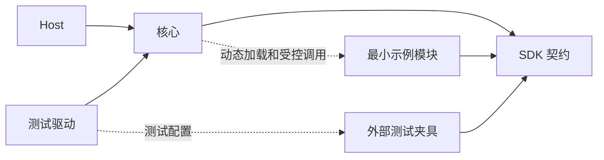

# 大肥鱼架构收敛设计

设计日期：2026 年 11 月 9 日。代码基线：v0.2.0，提交 `a3a8aab`。阶段：架构设计与最小验证。

当前目标是确定原生 C++ Harness 的职责、公共契约和运行约束，并用最小实现验证扩展边界。核心拥有运行规则和状态提交权，SDK 定义双方的调用约定，最小示例演示完整流程，测试夹具验证异常与替换场景。当前阶段暂停增加业务插件。

以下内容规定整体收敛目标。v0.3 完成公开契约、最小示例与夹具分离；v0.4 补齐会话/交付绑定和 Run 内调用树。完整范围不因这些批次完成而自动视为实现。现状以[实际架构](architecture.md)和[当前 SDK](plugin-sdk.md)为准；问题依据见[v0.2 架构评审](architecture-review-v0.2.md)。[常驻运行设计](resident-runtime-design.md)保留为长期参考。

## 当前实施状态

| 事项 | v0.4 状态 |
|---|---|
| 核心公共接口与 SDK | 数据契约和插件封装已分开；核心私有依赖不再经公共头文件传播 |
| 内建槽位与方法 | SDK 统一定义并在 ready 前校验，修正 AR-03 |
| RunView | 策略和插件查询已使用版本化视图；AR-07 的内部状态写入归属仍待收紧 |
| 最小示例和夹具 | 五个必要角色进入 examples/minimal，扩展和故障实现进入 tests/fixtures，按场景装配 |
| 默认配置与构建 | 默认只构建核心和 SDK；显式选择示例或测试，测试产物不进入正常安装 |
| 会话与交付 | AR-01 已补齐渠道/账号命名、接纳时绑定、原路交付、重启及授权代次检查 |
| Run 内调用树 | AR-02 已实现父关系、权限收窄、资源集合、继承期限、结束传播与持久共享调用额度；当前权限仍按命名资源域，预算按次数计量 |
| 完整 Scope | AR-06 的实例/会话调用资格、范围化订阅与注册释放仍待实现，不能把 Call 关系等同于完整 Scope |
| 其他协议与调度 | AR-04、AR-05、AR-07 的活动结算视图及内部状态归属、AR-08 仍按后续批次处理 |

实际检查结果见[验证记录](validation.md)。下面的职责和完成条件继续约束后续实现。

## 当前阶段范围

保留 C++20、CMake、版本化 C ABI、单实例常驻、核心单线程提交状态和插件事件式调用。核心不依赖 DSH 运行时；参考其服务契约、声明式依赖、作用域与资源释放机制。

当前应完成：

- 明确核心、SDK、示例和夹具之间的编译依赖、运行权限与数据归属。
- 明确输入归属、服务绑定、调用树、授权收窄、预算、状态提交及恢复协议。
- 保持一套可运行、可重启的最小闭环，并能用独立构建的提供方检验替换能力。
- 将评审问题转为针对公共契约的测试，不以增加插件数量衡量进展。

真实模型与消息平台、搜索产品、媒体处理、记忆成长算法、自动反思、业务工作流、MCP/Skills 适配均暂缓。子 Agent、任意热替换、集群和不受信代码隔离不进入本阶段。已有 Job、活动与订阅机制保留必要的正确性验证，不因此成为默认启动的业务功能。

## 组成与依赖边界

| 组成 | 职责 | 允许依赖 | 边界 |
|---|---|---|---|
| Host | 进程启动、配置入口、系统信号、本地管理传输 | 核心公共接口 | 不实现任务决策和平台业务 |
| 核心 | 身份、接纳、调度、授权、状态推进、效果结算、恢复和插件生命周期 | SDK 契约、原生基础设施 | 不引用具体业务插件，不按插件 ID 分支 |
| SDK | C ABI、生命周期、消息封装、契约定义、公开视图和 C++ 使用封装 | 必要的数据编码库 | 不持有运行实例、不启动调度器、不访问核心私有存储 |
| 最小示例 | 以确定性实现展示完整调用链 | SDK、无业务状态的基础辅助库 | 不形成正式业务能力，不依赖核心内部头文件 |
| 测试夹具 | 构造替代提供方、错误、延迟、崩溃和作用域场景 | SDK；测试驱动可使用核心测试接口 | 不进入正常安装包或默认运行配置 |
| 正式业务插件 | 后续阶段的真实领域能力 | SDK 与各自原生依赖 | 当前不新增、不设为架构阶段的完成条件 |



核心负责装配与调用具体提供方，但不在编译时链接其实现。SDK 中的 C++ 对象不穿过 DLL 边界；边界只传递约定的 C 数据、函数表和编码消息。共享的数据库辅助库不拥有全局运行状态。核心内部可继续位于同一个库，不为目录形式强行拆库。

## 核心职责与状态归属

核心固化运行约束与状态转换；策略插件提出下一步工作，模型插件产生候选，能力插件返回结果。所有提案经核心检查和提交后才生效。预算耗尽、权限撤销、取消和未知写效果由核心约束，策略不能自行解除。

| 状态或规则 | 唯一所有者 | 对外使用方式 |
|---|---|---|
| 实例身份、固定底色版本、启动和关闭阶段 | 实例运行时 | 只读状态与受控管理命令 |
| 会话映射、输入去重、持久接纳和领取 | 输入接纳模块 | 入站请求及提交后的回执 |
| Run 意图修订、阶段、策略状态及采用记录 | Run 所有者 | 创建和推进命令、版本化 RunView |
| 运行资格、待处理队列和到期唤醒 | 调度模块 | 排队、让出、取消及就绪查询 |
| Grant、资源范围、撤销、预算预留与结算 | 授权和预算模块 | 宿主签发的限定调用资格 |
| Call 父子关系、截止时间、逻辑和物理结束 | 调用层 | 有归属的结果、取消及资源收束 |
| Operation、交付计划、效果与核对记录 | 操作和交付模块 | 准备、派发、结算、查询与核对 |
| 插件注册、绑定、作用域资源及生命周期 | 插件运行时 | 注册句柄、服务解析及有序释放 |
| 经历与阶段人格 | 记忆提供方 | 有版本的快照与来源引用 |
| 平台侧发送记录与回执 | 渠道提供方 | 按稳定交付身份查询真实效果 |

持久层负责事务与查询，不成为业务状态的共同修改入口。其他核心模块通过状态所有者推进 Run；插件接收 RunView，不接收完整存储投影。内部字段调整不应迫使策略插件修改协议。

阶段人格的持久版本仍由记忆提供方唯一维护；核心保存本轮采用的版本与材料记录。固定底色是有版本的部署资源，其文字与预算数值不必硬编码在核心。

Run 分别记录目标评价、执行状态和交付状态。模型或策略判断目标达成、运行结束、收到发送回执分别形成事实，不能通过一个 success 字段相互推导。

## SDK 契约边界

### 契约与实现

插件包是加载与分发单元，服务是可调用能力，契约是提供方与使用方共同遵守的约定，动作是向模型公开的操作定义。一个包可以贡献多个服务，一个服务也可以支持多个动作；接口数量不决定包数量。

内建 model、strategy、channel、memory 契约及其公开数据结构在 SDK 中有统一定义。核心作为使用方声明必需方法与支持版本，在发布 ready 前验证角色绑定。契约匹配、插件生命周期就绪和外部服务健康分别表达。领域契约保持开放，由其定义方与消费者约定；核心不枚举所有业务名称。

内建契约以最小运行所必需的方法为边界。记忆的快照与读取可独立实现，成长写入等扩展通过明确的附加契约声明；不要求最小提供方用空实现占据尚未提供的业务能力。

策略使用版本化 RunView 与 DecisionObservation。成功、明确失败、超时及等待解除都可以成为观察结果；策略只从当前获准绑定中选择模型和动作。所有模型调用进入统一尝试记录与预算，切换提供方不重置消耗。

ActionDefinition 保存动作身份、定义修订、模型可见 schema、所需许可及执行绑定。ActionInvocation 携带动作身份、修订、已校验参数和操作身份。核心分别校验动作参数与执行封装，不能仅删除现有 schema 等值检查。当前只验证启动期动作发现与冻结，不开放运行中任意安装能力。

### 身份与作用域

ConversationKey 由实例、渠道实例和外部会话身份组成，渠道实例须区分账号。核心依据真实提供方和已配置主体映射建立身份关联。DeliveryBinding 固定渠道绑定、账号、目标会话、回复关联及授权修订，并随 Run 保存；原渠道不可用时等待，不能静默改投默认渠道。内部工作显式声明是否交付及获准目标。

| 概念 | 负责表达的内容 |
|---|---|
| Scope | 实例、会话、Run 或 Call 的生命周期及资源归属 |
| Grant | 当前允许的操作与资源集合 |
| CallContext | 本次调用、父调用、意图修订、Scope、Grant 和预算关联 |
| Budget | 同一 Run 与实例的预留、消耗、剩余量和截止约束 |

普通子调用取父许可、方法许可上限与当前授权的交集，继续检查依赖声明；截止时间取父截止时间与本次期限的较早者。只读中转服务不能继承完整写资格。资源采用明确集合，副作用类别不单靠高低等级推导权限。并发子调用向同一预算账本预留和结算，不能复制父预算余额。

父调用逻辑结束后，普通子调用失去继续业务的资格；物理执行和已发生效果仍需收束。Job 仅在显式持久移交后取得独立的执行归属，核对资格仅用于原操作的结果核实。取消、超时或换 Run ID 不抹除效果记录，也不恢复已撤销的授权。

实例级服务协作使用核心授予的实例 Scope，不伪造 Run。订阅同时按事件类型、所属范围和当前许可过滤；注册与订阅资源随 Scope 结束释放，实例连接不因某个 Run 结束而消失。持久身份与活跃资源生命周期分别维护。

### 生命周期与版本

延续现有事件式入口和每插件串行执行约定，核心线程不阻塞等待插件结果。启动依次完成声明校验、依赖绑定、资源恢复和激活；部分失败撤销注册并回收资源。关闭先停止接纳，再收束调用，最后销毁实例并卸载模块。逻辑结束不等于插件代码已经停止，模块必须保留至物理执行和回调结束。

ABI、服务契约、profile 和持久存储分别管理版本。本阶段不为旧实验接口增加兼容层；不兼容数据应明确拒绝打开并保留原数据，不能删除或改写版本号来通过启动。函数表、调用约定或生命周期承诺改变时评估 ABI 变更，业务消息结构改变时评估对应契约版本。

原生插件是受信的同进程代码。Scope、授权与协作取消约束框架调用，不提供操作系统隔离。

## 最小示例

只保留一个 minimal 组合入口，包含以下五种角色。这是协议验证角色列表，不是五个独立产品的发布要求；源码按角色组织，打包方式由替换边界决定。

| 角色 | 最小行为 | 不承担的业务 |
|---|---|---|
| 脚本模型 | 确定性地产生一次动作候选和最终候选 | 自然语言理解、供应商接入、模型路由产品 |
| 默认策略 | 提出模型、动作、等待或结束工作，展示核心接纳流程 | 复杂规划、自动反思、多 Agent 协作 |
| 模拟渠道 | 提交入站消息，保存并查询模拟交付回执 | 真实平台认证和网络发送 |
| 最小记忆 | 保存初始人格版本，提供快照与历史有效性检查 | 成长算法、向量检索、自动人格修订 |
| 示例动作 | 完成一个有界、无外部副作用的确定性操作 | 搜索、文件管理、进程执行和业务集成 |

示例使用与正式宿主相同的入口和调度路径：

```text
启动并恢复实例
  → 接纳一条模拟输入并绑定会话
  → 采用人格快照与策略提案
  → 记录模型请求并接纳动作候选
  → 校验权限与参数，执行并结算示例动作
  → 形成结果并绑定交付目标
  → 模拟渠道返回持久回执，核心结算
  → 返回常驻等待
```

最小配置仅授予示例动作需要的只读许可和资源范围，不用通配写权限。默认启动没有周期反思、业务唤醒、后台 Job 或自动记忆写入。没有输入、到期或待处理结果时等待事件；调度只读取活动记录，不反复解析全部已结束历史。

一次正常任务与一次检查点重启足以展示主流程。故障注入、多个替代提供方和边界组合放入专用测试配置，不继续增加默认示例分支。

## 测试夹具

每个夹具必须对应明确的不变量或评审问题，使用独立状态目录，能够确定性地构造触发条件和可检查结果。能用同一个夹具的参数描述场景时，不额外创建业务插件。替换测试仍需独立编译的模块，证明其只依赖已安装 SDK。

| 验证主题 | 最小夹具与预期结果 | 关联评审 |
|---|---|---|
| 渠道归属 | 两个假渠道使用同一外部会话 ID；回复和重启恢复均保持各自绑定 | AR-01 |
| 调用权限与生命周期 | 只读中转、父超时、有限资源组合；子调用不越权、不重置预算，迟到效果仍可核对 | AR-02、AR-06 |
| 服务契约 | 错误槽位、缺少方法、版本冲突在 ready 前拒绝；合法替代实现能独立安装 | AR-03 |
| 动作封装 | 一个假执行器注册两个不同 schema 的动作，分别校验、授权并冻结定义 | AR-04 |
| 策略观察 | 假模型返回临时错误，策略在原预算内选择获准替代者；未知写效果不能被策略跳过 | AR-05 |
| 状态所有权 | 内部 Run 投影变化不改变 RunView；插件仅通过命令或提案影响状态 | AR-07 |
| 常驻调度 | 已完成历史增长不引入全历史轮询；重启和通知遗漏后持久待办仍可调度 | AR-08 |
| 持久与副作用 | 提交后硬终止、重复结果、未知写与已发回执；恢复不盲目重放、不丢失确认事实 | 运行基本约束 |

测试驱动可在夹具中制造错误或检查隔离数据库；插件夹具通过公开 SDK 与核心交互，不通过核心私有对象模拟一条本不存在的扩展入口。故障注入不能成为正式核心或默认示例中的隐藏开关。

Job、活动唤醒和事实订阅使用专用协议夹具验证登记、归属、终态、游标和资源释放，不实现“搜索产品”“反思产品”或真实后台执行器。测试目标仅随测试构建，夹具模块、清单和故障配置不随正常安装发布。禁止把全部现有插件换个目录后继续作为默认依赖。

## 现有示例的收敛归属

v0.2 曾构建并默认加载 14 个目标，包括周期反思。v0.3 已按下表完成归类；[当前最小配置](../profiles/minimal.json)仅装配五个角色且 activities 为空，[测试夹具](../tests/fixtures/README.md)只在相应场景中启用。

| 现有实现 | 收敛去向 | 保留的验证目的 |
|---|---|---|
| model_scripted、strategy_default、channel_simulator、memory_minimal、action_add | 最小示例组合 | 完整流程、契约分工、持久身份与快照 |
| search 的两个提供方、action_search | 提取通用服务组合夹具 | 命名依赖、异步子调用、替代提供方；移出默认搜索行为 |
| action_remember | 提取记忆提交夹具 | 单一数据所有者、版本检查、子操作与回执 |
| action_background、action_write_demo | 后台工作和效果夹具 | 移交、取消、硬中断与未知效果 |
| activity_reflection | 提取无业务内容的唤醒夹具 | 到期、暂停、接纳与恢复；移出默认反思活动 |
| context_clock | 提取上下文和订阅夹具 | 来源校验、范围过滤与游标确认 |
| action_behavior | 提取受控命令夹具 | 权限、预期修订、命令去重；移出默认动作目录 |

实施时先确认现有测试验证的行为，再迁移最小必要逻辑和对应测试。重复、无独立断言或超出本阶段的示例可以退出当前构建；不能通过删除失败测试来宣称架构已经收敛。

## 目标目录与构建边界

```text
core/                         核心运行规则与状态所有者
sdk/                          ABI 契约 公开视图与 C++ 封装
host/                         CLI 与本地管理传输
support/                      无业务状态的基础辅助代码
examples/minimal/             五类最小验证角色及组合说明
profiles/minimal.json         仅装配最小组合
tests/contracts/              SDK 与核心使用方的契约验证
tests/fixtures/               故障 替换 调用链与生命周期夹具
tests/sdk_consumer/            仅依赖已安装 SDK 的外部工程
plugins/                      后续正式业务插件的保留位置
docs/                         当前设计 实现说明与验证证据
```

v0.3 已采用上述目录布局。核心与 SDK 的构建不依赖示例或夹具目标。DFY_BUILD_EXAMPLES 与 BUILD_TESTING 默认均为 OFF，分别选择最小示例和测试；windows 开发预设显式开启两者。测试驱动按场景建立配置，夹具输出独立于示例目录。构建入口见 README。

核心 SDK 安装、最小示例安装与测试产物分别管理。正常安装不得携带测试 DLL；安装示例时不得顺带安装搜索、反思和其它业务示例。分发验证必须在新目录中安装 SDK，并由独立工程构建提供方，检查真实加载与调用。

## 实施顺序与阶段完成条件

| 顺序 | 工作 | 应形成的结果 |
|---|---|---|
| 一 | 明确状态所有者、内建契约、ConversationKey、DeliveryBinding、RunView 和调用上下文 | 可审阅的协议及职责；没有与存储投影混用的公开接口 |
| 二 | 收敛构建和配置，迁移最小示例与必要夹具 | 最小默认运行入口，测试产物独立，既有关键验证有归属 |
| 三 | 按契约修正评审问题，优先处理归属、槽位验证、调用资格和状态写入口 | 通过公共 SDK 复现与验证对应边界，不新增业务能力 |
| 四 | 验证重启、空闲调度和独立 SDK 消费，更新实际架构与验证记录 | 设计、实现及证据一致，明确剩余限制 |

本阶段完成时应能证明：

1. 核心与 SDK 可独立构建，最小示例不需要任何真实平台或业务插件。
2. 默认运行只处理显式输入及其持久工作的恢复，主动后台行为仅在指定测试中触发。
3. 替换符合契约的提供方无需在核心加入具体插件分支；错误绑定在 ready 前拒绝。
4. 会话与交付归属、权限收窄、共享预算和 Scope 释放具有可执行验证。
5. 人格版本只有一个持久来源；公开视图不暴露内部可变投影。
6. 已确认效果不丢失，未知效果不被新 ID 或重启绕过；持久接纳的工作能继续被调度。
7. 测试夹具不进入正常分发，真实能力扩展仍有独立的需求、契约和验收入口。

以上是收敛验收要求，不沿用 v0.2 的测试数量作为已完成证明。文档中的后续业务设想不自动成为当前开发任务；架构和最小验证形成一致基线后，再逐项评估正式能力接入。
