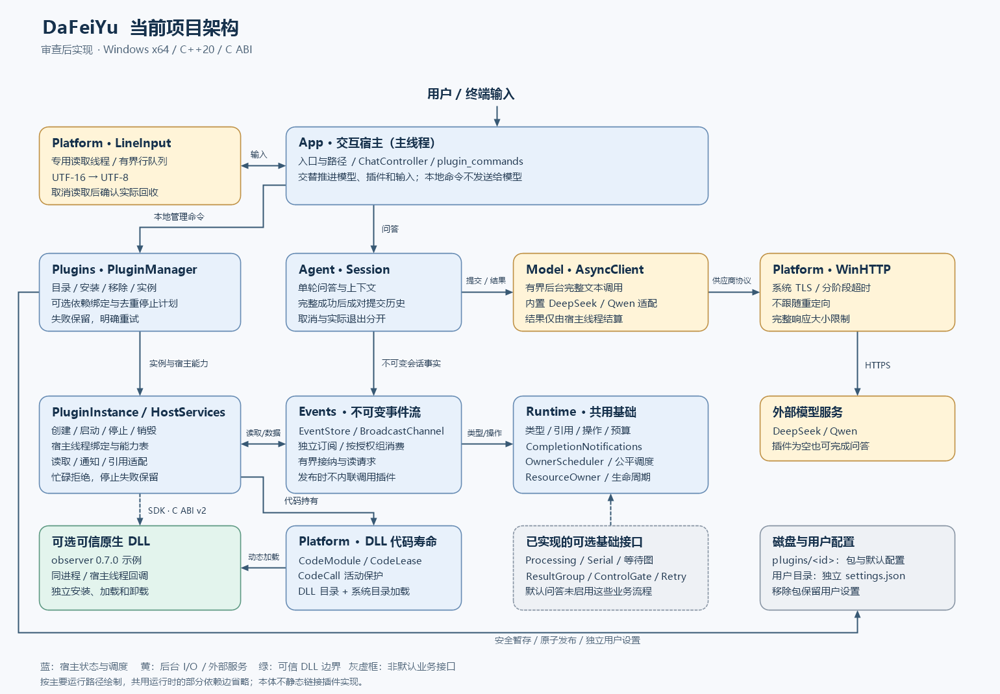
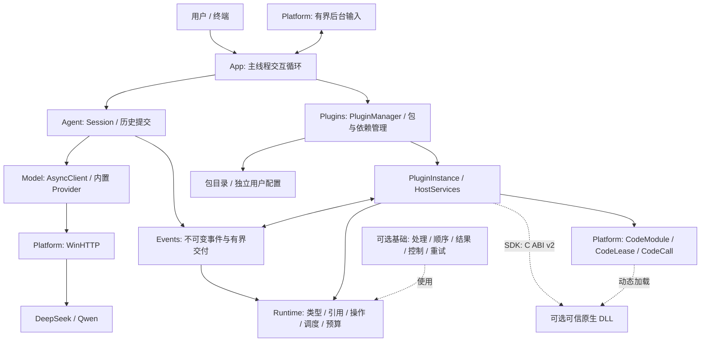

# 当前项目架构

当前终端通过 `dfy_application` 提交和查询问答、工具授权、审批、读回任务及诊断。共享服务复用原 Session／RunLoop 和插件寿命，状态验证使用同一插件实例的真实工具回执。观察替换在原运行边界完成。原生观察规则默认只读，显式配置状态变更时固定一项工具和数据契约，在真实调用前重查采样和审批。测试构建另提供固定材料执行与离线证据比较。关系图及证据见 [2026-11-18 12:30 检查点](agent-progress-2026-11-18-1230.md)。

下方 PNG／SVG、边界说明和 Mermaid 图保留此前 35 个提交审查后的历史基线。可选 UI 容器已完成原生探针验收，桌面业务桥接待 U02 接入。此前观察替换及文件诊断的接入结构见 [23:00 检查点](agent-progress-2026-11-17-2300.md)，UI 探针见 [U01 记录](ui-u01-validation.md)。

[SVG 矢量图](architecture.svg) 可放大查看；[生成脚本](../scripts/draw-architecture.ps1) 在 Windows PowerShell 7 下使用系统绘图库生成 SVG 和 PNG，不依赖在线绘图服务。

## 历史基线的关键边界

- **正式问答**：App → Session → AsyncClient → 内置 DeepSeek／Qwen 协议 → WinHTTP。后台只处理输入快照和调用结果，状态与历史提交由宿主线程维护。
- **运行诊断**：模型后台单次发布调用时间，Session 关联回合状态、取消和通知回执；App 的 `/status` 读取当前或最近一轮值快照。通知接纳失败独立提示，诊断不构成第二套执行状态，也不持有正文或插件资源。
- **事件消费**：Session 发布不可变事实；PluginManager 推进读取、安排延后通知并运行一个公平调度步骤；HostServices 在有效绑定和代码活动保护内调用 DLL。
- **插件管理**：发现不自动加载。实例与依赖、包文件、用户配置分别管理；停止失败保留，包移除分批恢复，用户设置不随包删除。
- **可选接口**：ProcessingQueue、SerialDomain／等待图、ResultGroup、ControlGate、RetryController 已有实现和测试，默认问答没有自动启用这些业务流程。`observe` 事实通知已在正式会话使用。组消费由宿主明确授权，普通管理器默认采用独立订阅。
- **代码寿命**：PluginModuleV2 使用 Platform 的 CodeModule、CodeLease、CodeCall；数据引用不等于代码持有，业务完成不等于可以卸载。
- **历史范围**：同步 Bus 仅保留为早期独立基础及测试，正式 Session 不再依赖它；Old 不参与新根工程构建。

## 历史基线的可编辑结构图

当前静态构建由 `dafeiyu` 连接 `dfy_terminal`，终端连接 `dfy_application` 及有界输入，应用服务经 `dfy_plugin_tools` 使用 Agent 和原生插件运行时。观察包和状态面板由宿主按需加载。Runtime 提供数据、调度和资源记录，插件运行时完成 C ABI 适配。
