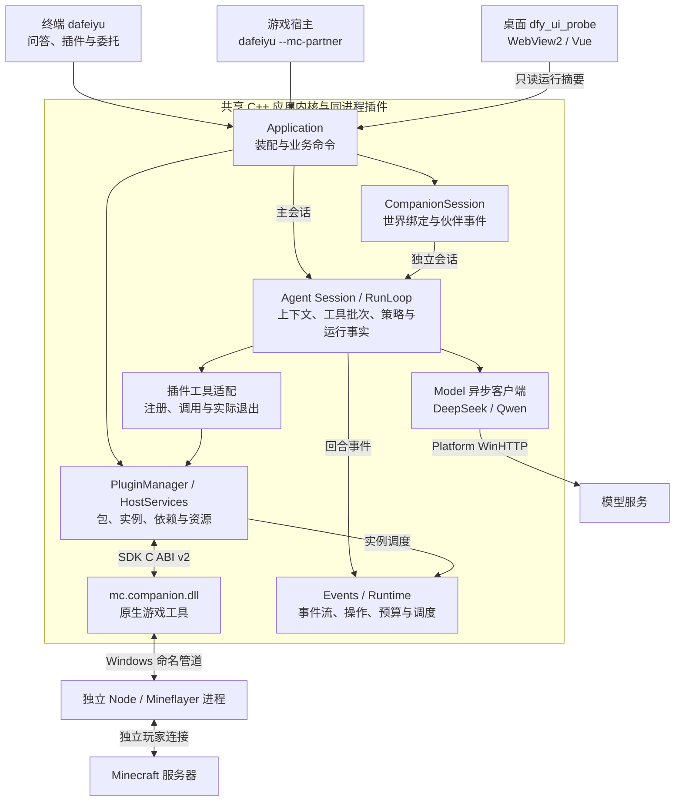
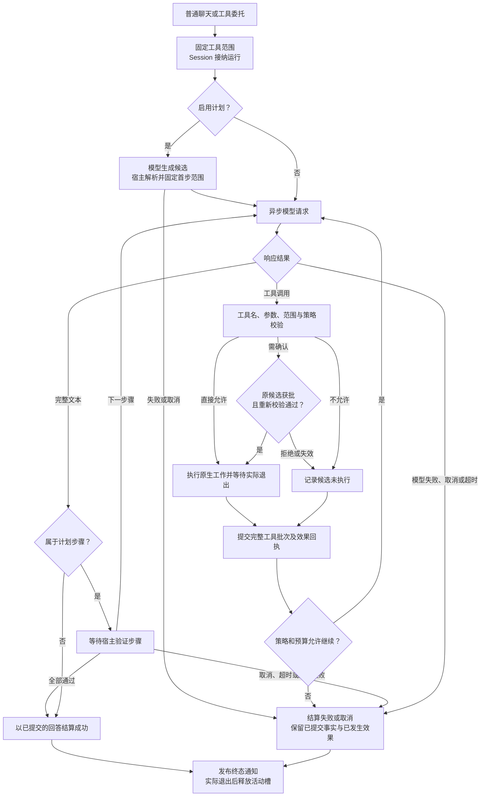
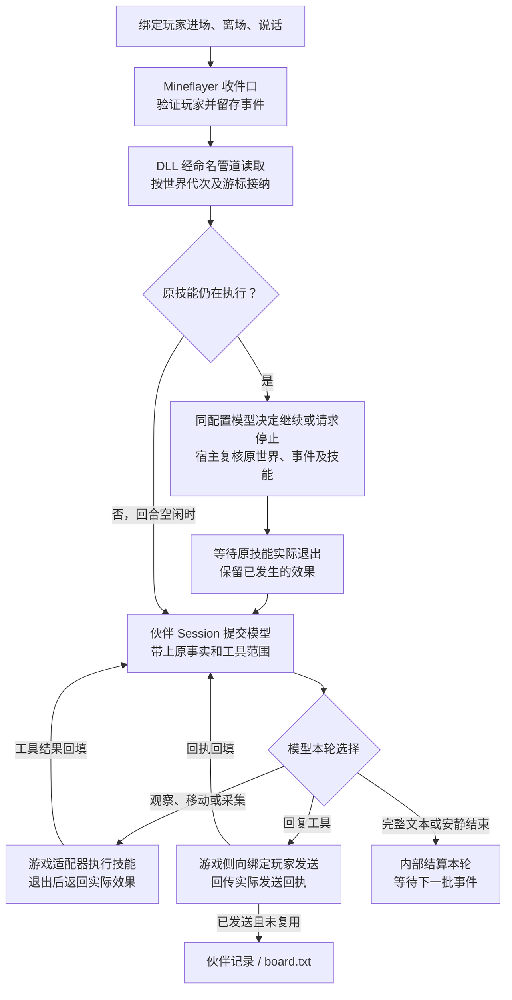

# 大肥鱼当前架构

代码基线为 `343d5ed`。大肥鱼通过共享的 `Application` 装配会话、插件管理和事件通道。终端与 MC 伙伴已经接入实际业务。桌面探针在自己的业务线程装配同一套服务，向页面提供只读运行摘要，另有独立的空闲与忙碌房间预览。

## 架构图

箭头表示运行时调用或数据方向。终端、专用游戏宿主和桌面探针按各自入口创建应用实例。

| 模块 | 职责与源码入口 |
| --- | --- |
| **App** | 组装模型、插件和主会话，接纳终端工具授权、审批与状态读回。普通聊天、`--mc-partner` 和桌面探针共享应用服务代码。另有 `--complete` 直接调用模型的单次文本入口。[命令行](../app/main.cpp) · [Application](../app/application.cpp) · [Conversation](../app/conversation.cpp) |
| **Agent** | `Session` 持有当前运行和有界历史。每个 `RunLoop` 根据本轮工具快照、策略及预算推进模型、工具、可选计划和诊断。主会话与伙伴会话分别持有自己的上下文。[Session](../agent/session.cpp) · [RunLoop](../agent/run_loop.cpp) · [策略](../agent/execution_policy.cpp) |
| **Model / Platform** | Model 编解码请求并通过异步客户端接收完整响应。HTTP、控制台输入、DLL 装载和摘要算法属于 Windows Platform。默认 Provider 内置，空插件目录可直接问答。[模型客户端](../model/client.cpp) · [协议](../model/protocol.cpp) · [WinHTTP](../platform/winhttp.cpp) · [代码装载](../platform/code_module.cpp) |
| **Plugins / SDK** | 运行时负责包发现、显式安装与加载、独立设置、活动实例和卸载。安装完成后还需显式启用。卸载依据依赖关系、对象持有和工作实际退出状态完成，等待或失败时保留相应资源。面向正式实例的契约为 v2 C ABI。[管理器](../plugins/runtime/manager.cpp) · [工具适配](../plugins/tools/native_work.cpp) · [v2 契约](plugin-abi-v2.md) |
| **Runtime / Events** | Runtime 提供类型与值、操作状态、资源所有者、预算和调度。Events 提供有界广播、订阅和处理。回合通知携带身份及状态，正文留在会话，通知接纳与回合结果独立结算。[运行时目标](../runtime/CMakeLists.txt) · [广播通道](../events/broadcast_channel.cpp) · [通知接纳](../agent/session.cpp) |
| **Desktop** | WebView2 主文档通过 `state.read` 获取当前或最近运行摘要，可按会话号和回合号筛选。桌面原生业务线程发布值副本，房间预览取固定样本。[业务线程](../app/gui/run_status_host.cpp) · [主文档桥接](../ui/host/probe_host.cpp) · [运行说明](ui-probe-run-guide.md) |

构建入口是 CMake 和 VS2022 x64，宿主采用 C++20，公开 SDK 支持 C 消费者。终端是默认启动目标，`BUILD_GUI` 和 `BUILD_TESTING` 控制探针和测试目标。[根构建](../CMakeLists.txt) · [预设](../CMakePresets.json) · [分发规则](../cmake/Distribution.cmake)

## Agent 会话与工具流程

- **普通问答**每轮接收一次完整文本。成功时提交整轮对话。失败或取消后，仍保留先前已经提交的对话与工具事实。[历史提交](../agent/run_context.cpp) · [会话推进](../agent/session.cpp)
- **终端委托**中，`/run` 授予一个只读工具，`/run-confirmed` 允许具体变更候选进入审批。`/task` 固定同一个插件实例上的首读、变更、末读，宿主核对步骤顺序、实际回执和期望值。原候选的批准与实际调用分开记录。[应用入口](../app/application.cpp) · [工具批次](../agent/tool_batch.cpp) · [读回验证](../app/tool_verification.cpp)
- **原生观察与计划控制**通过显式宿主入口接纳。观察触发默认只读，变更分支要求声明条件、可信当前采样和确认。计划步骤支持有界重规划、目标修订和等待验证时换入新观察。诊断和离线比较沿用运行身份和版本信息。[观察控制](../agent/observation_controller.cpp) · [计划与观察入口](../agent/session.cpp) · [离线场景](../tests/offline_scenario.cpp)

## MC 伙伴的事件与动作流程

默认伙伴模式将玩家原话和在场变化作为有序事件，已接纳工作由原票据跟踪，新事件让旧回合在下一控制边界停止继续发起调用。实际发言来自 `reply` 工具，回合终态文本留在内部，技术故障进入系统状态。固定圆石场景使用独立的 `scenario` 模式，包含显式委托及场景专用拾取与返程证据。[伙伴会话](../app/companion_partner.cpp) · [原生技能注册](../plugins/mc/native.cpp) · [游戏技能实现](../plugins/mc/bridge/partner.cjs) · [MC 插件运行说明](../plugins/mc/README.md)

## 当前边界

当前架构靠三条边界维持可追溯性。模型提出动作，由宿主定义工具和审批范围。插件回执区分动作效果与工作退出，宿主据此保留已经发生的事实。桌面读取值副本，业务状态由其宿主管理。会话、审批和运行记录主要驻留进程内。MC 跨回合持续目标、通用动作调度，以及桌面对话投递、审批和伙伴面板属于后续设计。[运行诊断](../agent/diagnostic_snapshot.cpp) · [MC 交互方案](mc-companion-development-plan.md) · [桌面主面板方案](main-agent-room-development-plan.md)
