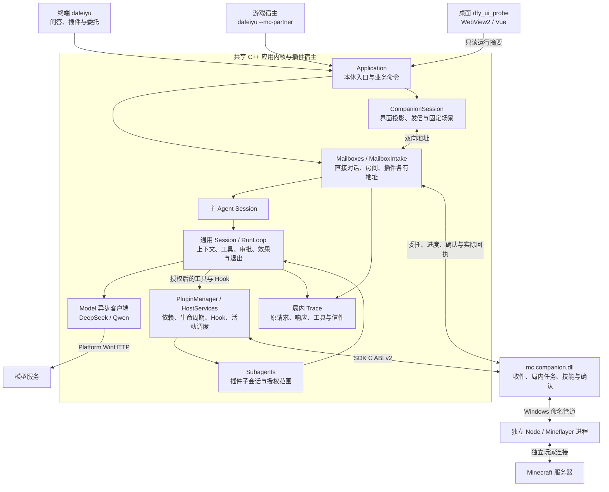
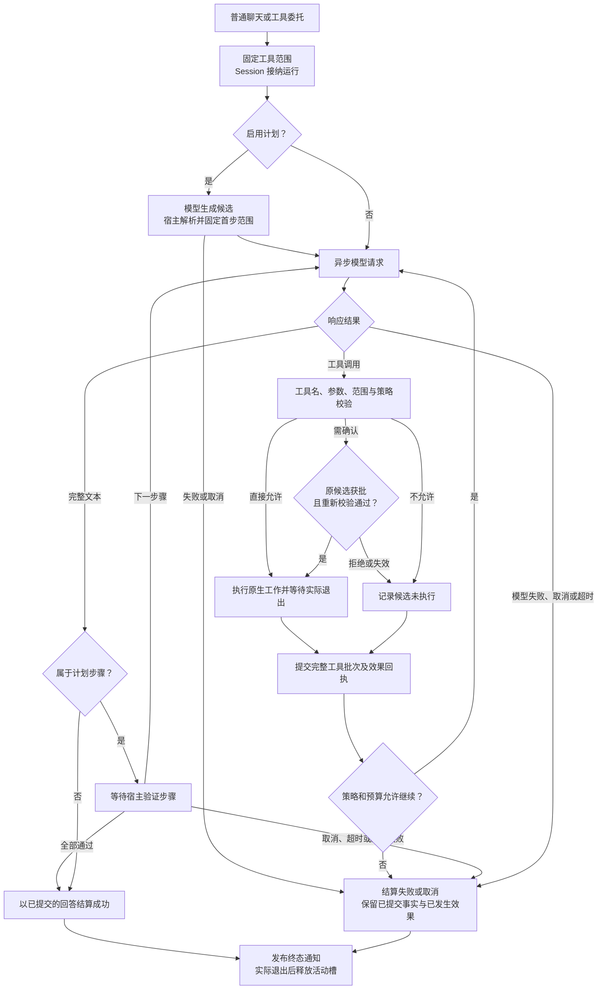
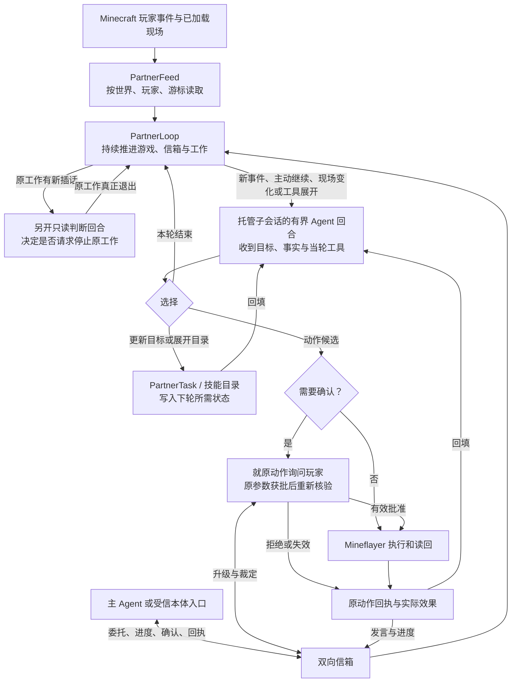
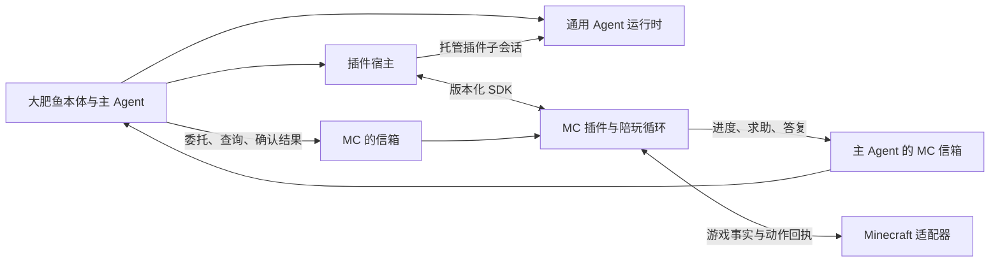
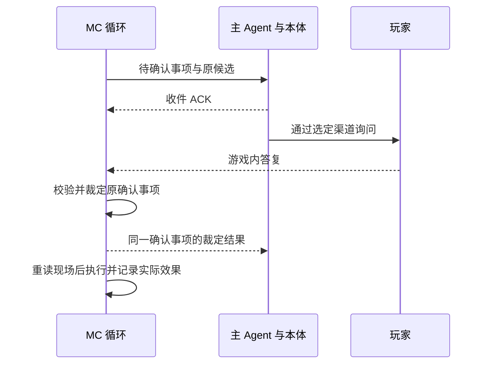

# 大肥鱼当前架构

大肥鱼本体通过 `Application` 装配主 Agent、内置模型、插件宿主和受信用户入口。MC 插件持有自己的陪玩循环、游戏知识和技能，使用宿主托管的独立子会话。终端和 MC 宿主使用正式入口。桌面探针提供只读运行摘要和固定样本房间预览。

## 架构图

箭头表示运行时调用或数据方向。终端、专用游戏宿主和桌面探针按各自入口创建应用实例。

| 模块 | 职责与源码入口 |
| --- | --- |
| **App** | 组装模型、插件和主会话，接纳终端工具授权、审批与状态读回。普通聊天、`--mc-partner` 和桌面探针共享应用服务代码。另有 `--complete` 直接调用模型的单次文本入口。[命令行](../app/main.cpp) · [Application](../app/application.cpp) · [Conversation](../app/conversation.cpp) |
| **Agent** | `Session` 持有当前运行和有界历史。每个 `RunLoop` 按工具快照、策略和预算推进模型、工具、计划与诊断。主 Agent 和插件子会话共享执行器并独立保存上下文。[Session](../agent/session.cpp) · [RunLoop](../agent/run_loop.cpp) · [子会话宿主](../app/subagents.cpp) |
| **Model / Platform** | Model 编解码请求并通过异步客户端接收完整响应。HTTP、控制台输入、DLL 装载和摘要算法属于 Windows Platform。默认 Provider 内置，空插件目录可直接问答。[模型客户端](../model/client.cpp) · [协议](../model/protocol.cpp) · [WinHTTP](../platform/winhttp.cpp) · [代码装载](../platform/code_module.cpp) |
| **Plugins / SDK** | 插件包使用同进程 v2 C ABI，安装后显式加载。宿主按声明的依赖发布 Hook 顺序，公平推进插件注册的活动步骤，并在原工作实际退出后处理卸载。[管理器](../plugins/runtime/manager.cpp) · [工具适配](../plugins/tools/native_work.cpp) · [SDK](../sdk/README.md) |
| **Runtime / Events** | Runtime 提供有界操作、预算和调度，Events 提供广播通知与定向信箱。信箱地址绑定发送方、接收方与独立 FIFO，类别和版本决定处理方式。接纳、业务结果和实际退出分别结算。[广播通道](../events/broadcast_channel.cpp) · [信箱](../events/mailboxes.cpp) · [本体收件](../app/mailbox_intake.cpp) |
| **Trace** | 主会话和插件子会话记录实际提交的统一模型请求、独立退出的模型响应、各工具与信件的身份和结果。支持按回合查看证据，并用录制响应和工具回执离线重跑直接回合。[模型与工具记录](../agent/include/dafeiyu/run_capture.hpp) · [本体落盘](../app/run_log.cpp) · [审阅与回放](run-guide.md) |
| **Desktop** | WebView2 主文档通过 `state.read` 获取当前或最近运行摘要，可按会话号和回合号筛选。桌面原生业务线程发布值副本，房间预览取固定样本。[业务线程](../app/gui/run_status_host.cpp) · [主文档桥接](../ui/host/probe_host.cpp) · [运行说明](ui-probe-run-guide.md) |

构建入口是 CMake 和 VS2022 x64，宿主采用 C++20，公开 SDK 支持 C 消费者。终端是默认启动目标，`BUILD_GUI` 和 `BUILD_TESTING` 控制探针和测试目标。[根构建](../CMakeLists.txt) · [预设](../CMakePresets.json) · [分发规则](../cmake/Distribution.cmake)

## Agent 会话与工具流程

- **普通问答**每轮接收一次完整文本。成功时提交整轮对话。失败或取消后，仍保留先前已经提交的对话与工具事实。[历史提交](../agent/run_context.cpp) · [会话推进](../agent/session.cpp)
- **终端委托**中，`/run` 授予一个只读工具，`/run-confirmed` 允许具体变更候选进入审批。`/task` 固定同一个插件实例上的首读、变更、末读，宿主核对步骤顺序、实际回执和期望值。原候选的批准与实际调用分开记录。[应用入口](../app/application.cpp) · [工具批次](../agent/tool_batch.cpp) · [读回验证](../app/tool_verification.cpp)
- **原生观察与计划控制**通过显式宿主入口接纳。观察触发默认只读，变更分支要求声明条件、可信当前采样和确认。计划步骤支持有界重规划、目标修订和等待验证时换入新观察。诊断和离线比较沿用运行身份和版本信息。[观察控制](../agent/observation_controller.cpp) · [计划与观察入口](../agent/session.cpp) · [离线场景](../tests/offline_scenario.cpp)

## MC 伙伴的事件与动作流程

- **局内状态。** `PartnerLoop` 由宿主活动调度持续推进。插件保存当前共同目标、修订、已知与待核实事项、最近行动回执。一次模型回合结算后，插件按新玩家事实、任务继续、私有现场变化或目录展开选择何时开下一轮。玩家事件优先，每批新玩家事实最多补充四轮自主决策额度。离场、换世界和关闭会回收局内任务。[插件循环](../plugins/mc/partner_loop.cpp) · [任务状态](../plugins/mc/partner_task.cpp) · [配对读口](../plugins/mc/partner_feed.cpp)
- **工具快照。** 基础回合收到观察、交流、目录和任务更新。目录列出 12 类及各类当前实现，查询后最多选三类进入后续回合。宿主每轮固定实际工具契约，游戏侧仍检查世界、来源、范围和动作前置条件。[技能注册表](../plugins/mc/partner_skills.hpp) · [宿主授予](../app/subagents.cpp) · [游戏实现](../plugins/mc/bridge/partner.cjs)
- **放置读回。** 观察返回已加载的方块体积和坐标原点。放置检查精确目标格、支撑面、占用及材料，再依据回执里的实际方块与库存判断效果。门上下两格分别核对。旧圆石路径由独立 `scenario` 入口承接显式委托、拾取和返程。[现场取样](../plugins/mc/bridge/block-survey.cjs) · [游戏放置](../plugins/mc/bridge/placement.cjs) · [宿主回执校验](../plugins/mc/world_protocol.cpp)

## 当前边界

信箱去重窗口、局内任务和业务确认驻留进程内。局内 Trace 写本地证据并按运行关联。桌面通过值副本读取状态，房间生产者和伙伴面板按桌面方案接入。原生 Hook 在宿主线程同步返回，活动任务通过 `dfy.activity` 推进。Agent 宿主审批和 MC 业务确认有各自的状态和生命周期。[运行诊断](../agent/diagnostic_snapshot.cpp) · [MC 交互方案](mc-companion-development-plan.md) · [桌面主面板方案](main-agent-room-development-plan.md)

## 架构调整方案

2026-11-20 评审确定目标边界，迁移从 `1d47ce2` 开始。上面记录当前代码的运行路径，下面保留评审确定的交互与验收边界。

- **本体**持有主 Agent、用户交互和固有能力。房间信箱接纳房间服务提交的可感知事实，内置模型后端支持空插件目录问答。
- **Agent 运行时**统一推进模型和工具，负责上下文、权限、审批、预算、取消、效果与实际退出。应用和插件子会话分别持有自己的会话范围。
- **插件宿主**拥有信箱寻址、插件工作归属、子会话托管、Hook 注册及退出回收。新增 C ABI 能力表独立协商版本。
- **MC 插件**拥有外层陪玩循环和 MC 世界状态。玩家事件、长动作、回复投递和确认升级由插件推进。主 Agent 可向插件询问进度和委托任务。

### 信箱、唤醒与确认

主 Agent 为直接对话、房间和获准插件分别接收消息。插件循环也持有自己的接收信箱。信箱 ID 标识目的地，分类标识处理方式，发送方及实例代次从宿主绑定取得。每箱有接收顺序和容量，跨信箱消息通过询问、委托或动作身份关联。旧实例的地址和发送权在注销后失效。

收件方可以主动读取，也可以按分类配置到件触发。房间中的被点名事件可唤醒主 Agent，在场变化由接收入口过滤。MC 升级确认支持空闲时自动启动或手动审查。容量不足返回明确的拒收结果，MC 发件端按原发送编号保留队首重投。ACK 表示当前进程已接纳该信件，其去重范围受保留窗口限制。[房间信箱](../app/room_mailbox.cpp) · [确认入口](../app/companion_confirmation.cpp)

采集和放置共享按原动作发起的确认流程。游戏内和本体终端的答复使用同一个确认标识。插件按处理顺序接纳第一条通过身份、时效和世界代次校验的答复。后到的答复复用原裁定。批准后由适配器用最新现场核对原候选。当前等待上限是 25 秒，到期记录 `expired`。子 Agent 的决策、信件接纳、问题发出、裁定、实效和退出各有记录。[动作确认](../plugins/mc/partner_confirm.cpp)

### Hook 注册与执行

插件载入时声明 Hook 点和适用范围，范围可含整个主会话。宿主校验完整依赖图并检测环，再按稳定拓扑顺序固定各 Hook 表。依赖已满足的插件按注册顺序取用，同一插件内按处理器注册顺序取用。每次触发持有当前顺序快照，相关工作实际退出后才能释放插件模块。

`dfy.hooks@1` 对模型请求、工具启动和工具结果提供控制，工具启动支持等待人工批准。`dfy.hook.text@1` 支持消息入轮、模型请求发出前、模型响应收到后、工具参数和最终回复投递的字段改写。独立提案基于原字段，不同结果产生冲突。声明接续且依赖先前改写者的处理器可读到前一结果。工具使用最终参数进行授权、校验和审批，实际效果保留原回执。回复投递改写与会话历史各自保存。[C ABI](../sdk/include/dafeiyu/hook_abi_v2.h) · [正式循环](../agent/run_loop.cpp)

### 本轮实施和验收顺序

| 交付 | 验收标准 |
| --- | --- |
| 实际上下文记录与离线回放 | 按原会话、回合、步骤和调用身份读到送模消息、详细工具、模型输出、工具回执与最终结果。固定证据重跑得到相同的模型输入和结果。 |
| 整理测试 | 功能回归采用固定模型、传输替身或隔离 Paper。真人操作仅保留已搭墙体主题。 |
| 插件局内循环 | 一轮模型结束后，插件仍收取世界和玩家事实。固定样本验证无新聊天时自主继续、现场变化触发、插话、退出和回收。 |
| 分类展开和通用候选确认 | 初始工具范围保持精简，展开类别后核对正式送模契约。采集与放置共用确认状态机，批准与实际执行分别取证。 |
| 放置及首次架构审查 | 隔离游戏由独立协议玩家核对原墙、补上的一格、审批前的空门洞和批准后的上下门格。用户审查本页后进行实际模型体验，并按日志讨论。 |

子会话使用主程序选定的模型配置。长期记忆、跨会话保存和真实房间面板另行审查。首次真人体验采用同一正式伙伴入口。[首轮实机设计](../tests/mc-companion/README.md#首轮实机接续我已经搭的墙)
