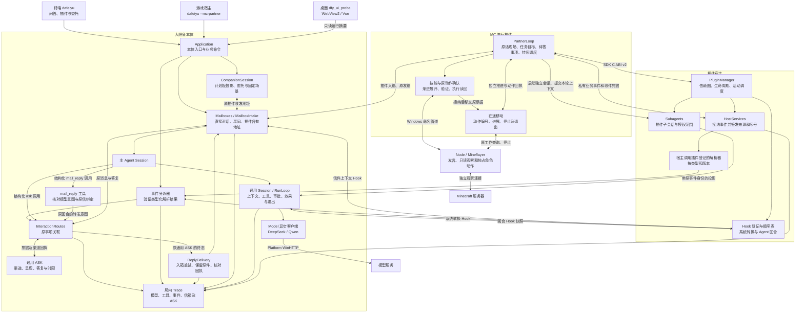
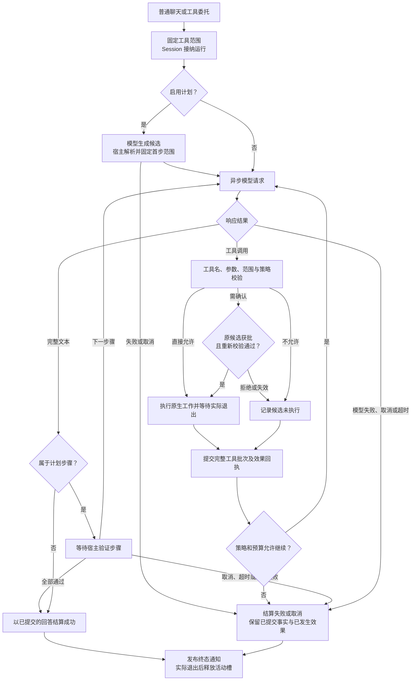
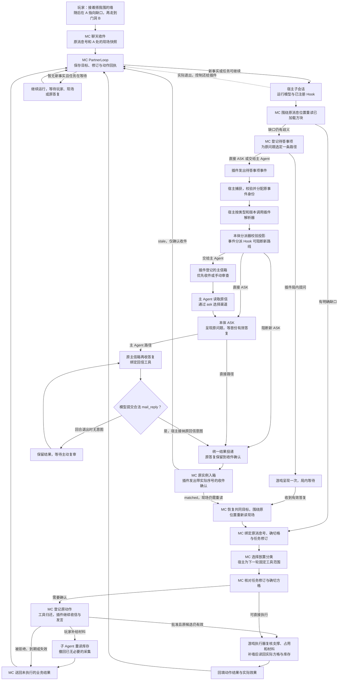

# 大肥鱼当前架构

大肥鱼本体通过 `Application` 装配主 Agent、内置模型、插件宿主和受信用户入口。MC 插件持有自己的陪玩循环、游戏知识和技能，使用宿主托管的独立子会话。终端和 MC 宿主使用正式入口。桌面探针提供只读运行摘要和固定样本房间预览。

## 架构图

箭头表示运行时调用或数据方向。终端、专用游戏宿主和桌面探针按各自入口创建应用实例。

| 模块 | 职责与源码入口 |
| --- | --- |
| **App** | 组装模型、插件和主会话，接纳终端工具授权、审批与状态读回。普通聊天、`--mc-partner` 和桌面探针共享应用服务代码。另有 `--complete` 直接调用模型的单次文本入口。[命令行](../app/main.cpp) · [Application](../app/application.cpp) · [Conversation](../app/conversation.cpp) |
| **Agent** | `Session` 持有当前运行和有界历史。每个 `RunLoop` 按工具快照、策略和预算推进模型、工具、计划与诊断。主 Agent 和插件子会话共享执行器并独立保存上下文。[Session](../agent/session.cpp) · [RunLoop](../agent/run_loop.cpp) · [子会话宿主](../app/subagents.cpp) |
| **Model / Platform** | Model 编解码请求并通过异步客户端接收完整响应。HTTP、控制台输入、DLL 装载和摘要算法属于 Windows Platform。默认 Provider 内置，空插件目录可直接问答。[模型客户端](../model/client.cpp) · [协议](../model/protocol.cpp) · [WinHTTP](../platform/winhttp.cpp) · [代码装载](../platform/code_module.cpp) |
| **Plugins / SDK** | 插件包使用同进程 v2 C ABI，安装后显式加载。宿主按依赖发布 Hook 顺序，独立接纳插件事件并调用对应解析器，公平推进插件活动步骤。卸载等原工作退出，再撤销地址与注册。[管理器](../plugins/runtime/manager.cpp) · [事件宿主](../plugins/runtime/host_routed_events.cpp) · [接口](../sdk/include/dafeiyu/routed_event_abi_v2.h) |
| **Runtime / Events** | Runtime 提供有界操作、预算和调度，Events 提供广播通知与定向信箱。信箱地址绑定发送方、接收方与独立 FIFO，类别和版本决定处理方式。接纳、业务结果和实际退出分别结算。[广播通道](../events/broadcast_channel.cpp) · [信箱](../events/mailboxes.cpp) · [本体收件](../app/mailbox_intake.cpp) |
| **ASK** | `AskService` 持有通用票据，`InteractionRoutes` 将声明式解析结果分流到渠道或主 Agent 信箱。插件消费原答复并裁定动作。[ASK 状态机](../app/ask.cpp) · [交互路由](../app/interaction_routes.cpp) |
| **回信与回执** | `mail_reply` 将模型工具调用解析为绑定原信和本轮的转发意图。`ReplyDelivery` 处理两条路径的最终入箱与确认。入箱回执和插件消费回执各有身份。[回信工具](../app/mail_reply_tool.cpp) · [结果投递](../app/reply_delivery.cpp) |
| **Trace** | 主会话和插件子会话记录实际提交的统一模型请求、独立退出的模型响应、各工具及信件结果。事件、信箱、ASK 和游戏回执通过原身份关联。支持按回合查看，并用录制响应和工具回执离线重跑单轮。[模型与工具记录](../agent/include/dafeiyu/run_capture.hpp) · [本体落盘](../app/run_log.cpp) · [审阅与回放](run-guide.md) |
| **Desktop** | WebView2 主文档通过 `state.read` 获取当前或最近运行摘要，可按会话号和回合号筛选。桌面原生业务线程发布值副本，房间预览取固定样本。[业务线程](../app/gui/run_status_host.cpp) · [主文档桥接](../ui/host/probe_host.cpp) · [运行说明](ui-probe-run-guide.md) |

构建入口是 CMake 和 VS2022 x64，宿主采用 C++20，公开 SDK 支持 C 消费者。终端是默认启动目标，`BUILD_GUI` 和 `BUILD_TESTING` 控制探针和测试目标。[根构建](../CMakeLists.txt) · [预设](../CMakePresets.json) · [分发规则](../cmake/Distribution.cmake)

## Agent 会话与工具流程

- **普通问答**每轮接收一次完整文本。成功时提交整轮对话。失败或取消后，仍保留先前已经提交的对话与工具事实。[历史提交](../agent/run_context.cpp) · [会话推进](../agent/session.cpp)
- **终端委托**中，`/run` 授予一个只读工具，`/run-confirmed` 允许具体变更候选进入审批。`/task` 固定同一个插件实例上的首读、变更、末读，宿主核对步骤顺序、实际回执和期望值。原候选的批准与实际调用分开记录。[应用入口](../app/application.cpp) · [工具批次](../agent/tool_batch.cpp) · [读回验证](../app/tool_verification.cpp)
- **原生观察与计划控制**通过显式宿主入口接纳。观察触发默认只读，变更分支要求声明条件、可信当前采样和确认。计划步骤支持有界重规划、目标修订和等待验证时换入新观察。诊断和离线比较沿用运行身份和版本信息。[观察控制](../agent/observation_controller.cpp) · [计划与观察入口](../agent/session.cpp) · [离线场景](../tests/offline_scenario.cpp)

## 接续我已经搭的墙

- **局内状态。** `PartnerLoop` 由宿主活动调度持续推进。玩家原话携带收件时客户端已知的玩家位置及可用朝向。插件核对当前回合的任务变更并分配修订，跨回合保留原消息号及已选方块。模型回合结算后，插件按新玩家事实、动作退出、任务继续、私有现场变化或目录展开选择是否开下一轮。玩家事件优先，每批新玩家事实最多补充四轮自主决策额度。 [插件循环](../plugins/mc/partner_loop.cpp) · [任务状态](../plugins/mc/partner_task.cpp) · [配对读口](../plugins/mc/partner_feed.cpp)
- **在途工作和发言。** 局内移动、跟随、采集和放置由游戏接纳后交还工具，插件持原票据推进。需确认的局内动作先将待办交给插件循环，等待和执行期间可继续观察和发言。角色操作共享独占游戏控制。`activeMotion` 提供原工作进度，`finishedWork` 把实际退出交给下一次局内决策。显式停止、离场、换世界和关闭触发原动作回收。本体主动委托经原工具等待结果后回报。 [动作票据](../plugins/mc/game_work.cpp) · [游戏桥接](../plugins/mc/bridge/partner.cjs) · [跟随](../plugins/mc/bridge/follow.cjs)
- **玩家回复与结算。** `reply` 立即提交私聊。处理玩家原话时，若本轮尚未请求发言或提问，插件会把普通最终文本送入同一个游戏回复通道。空文本和 `{"internal":"…"}` 用于内部结算。无新聊天的唤醒可用 `reply` 主动发言，主 Agent 委托的最终文本仍作为委托报告。纯文本私聊回执在 `mc.partner.action` 标记 `source=final_text`，按原会话、子请求和 `bridgeWork` 关联。 [回合结算](../plugins/mc/partner_loop.cpp) · [实际发言](../plugins/mc/bridge/partner.cjs)
- **上下文与工具快照。** MC 以本轮原话、最多八条已处理对话、任务、待答事项和实际回执组装输入。宿主按插件标志替换跨轮消息历史，保留同一会话身份、当前轮工具回传与原始 Trace。上轮观察只带概要和采样信息，地图用 `observe` 重新读取。工具目录保留已选择的类别，有原话锚点时提供移动，选定目标格后下一轮提供放置。宿主在本轮内固定工具契约，游戏侧校验实际动作。 [插件循环](../plugins/mc/partner_loop.cpp) · [技能注册表](../plugins/mc/partner_skills.hpp) · [宿主授予](../app/subagents.cpp)
- **玩家指向。** 游戏执行器保存原消息的眼位、朝向和采样时间。在原位置重读已加载场景，区分原玩家视线、实时玩家位置和陪玩角色视线。只有唯一穿过的缺口才提供默认候选。插件从同一原消息的观察解析候选编号，固定实际方格，再由执行器在落地时重读。 [收件采样](../plugins/mc/bridge/chat.cjs) · [墙体候选](../plugins/mc/bridge/player-focus.cjs) · [目标绑定](../plugins/mc/partner_task.cpp)
- **放置读回。** 观察返回已加载的方块体积和坐标原点。放置检查精确目标格、支撑面、占用及材料，再依据回执里的实际方块与库存判断效果。门上下两格分别核对。旧圆石路径由独立 `scenario` 入口承接显式委托、拾取和返程。[现场取样](../plugins/mc/bridge/block-survey.cjs) · [游戏放置](../plugins/mc/bridge/placement.cjs) · [宿主回执校验](../plugins/mc/world_protocol.cpp)

## 当前边界

信箱去重窗口、局内任务和业务确认驻留进程内。局内 Trace 写本地证据并按运行关联。桌面通过值副本读取状态，房间生产者和伙伴面板按桌面方案接入。原生 Hook 在宿主线程同步返回，活动任务通过 `dfy.activity` 推进。Agent 宿主审批和 MC 业务确认有各自的状态和生命周期。[运行诊断](../agent/diagnostic_snapshot.cpp) · [MC 交互方案](mc-companion-development-plan.md) · [桌面主面板方案](main-agent-room-development-plan.md)

## 事件注册与解析

`dfy.event.routes@1` 在插件加载时登记事件名、版本、闭合字段契约和原生解析器。运行中的插件按实例序号提交事件。宿主校验并入队时记录 `event.captured`，后续取件调用原解析器并记录 `event.decoded`。应用分派器把 ABI 投影转换为类型化指令，再记录 `event.dispatched` 或拒绝。普通信件、直接 ASK、交主 Agent 的提问、渠道反馈和插件收件确认分别进入对应处理分支。MC 的待答事项及超时规则由 MC 插件持有。[插件 SDK](../sdk/include/dafeiyu/routed_event_abi_v2.h) · [宿主解析](../plugins/runtime/host_routed_events.cpp) · [应用分派](../app/event_dispatch.cpp)

## 信箱优先级与唤醒

直接对话、房间和每个注册插件分别使用受信地址。每箱独立 FIFO，信箱 ID 锚定发送方与收件方，分类及版本决定处理方式。`dfy.mailbox.rules@1` 声明同一插件信箱的多个分类，按箱设优先级、按类别设唤醒。高优先和普通档各自轮转，两档都有待办时最多连续取三封高优先件。主回合忙碌时，到件留队等待；审查通过的消息在回合接纳后出队，被过滤的事实由收件器消费。[信箱网络](../events/mailboxes.cpp) · [取件调度](../app/mailbox_intake.cpp)

到件可按类别唤醒空闲主 Agent。用户也可用 `/mail review` 主动审查，或在发起普通对话时带入一封已审查的待收信件。`/mail wake manual` 暂停插件信箱的自动唤醒。消息接纳、ASK 呈现、真人答复及 MC 动作读回分别结算，均可通过 Trace 关联。[房间信箱](../app/room_mailbox.cpp) · [通用交互路由](../app/interaction_routes.cpp)

## 通用 ASK

ASK 票据关联原事件、事项和修订。原事件声明可用的游戏渠道，宿主按运行入口报告能呈现和接收答复的终端渠道。主 Agent 的 `ask` 工具只枚举可用渠道，实际调用时复核。网页陪玩宿主由后台管道启动，MC 问题只有游戏渠道。渠道实际呈现后，在答复截止前接纳配对的第一份有效答复。直接路径把结果送回原插件入箱。主 Agent 路径把结果放入原主信箱，由 `mail_reply` 转发。已接纳的答复在本次宿主运行内跨越答复截止继续保留，直至同一插件实例按原身份确认收件。Trace 分别记录答复接纳、信箱入队和 `interaction.acknowledged`。普通信件可作为上下文入轮，提问工具仅在对应的提问信件回合中开放。[ASK](../app/ask.cpp) · [分流和回信](../app/interaction_routes.cpp)

采集与放置共享 MC 的原候选确认。局内确认可由插件自行处理，交给主 Agent 的确认复用上述 ASK。原候选的确认窗口为 25 秒。局内回合的工具先返回待办编号，后续新消息随 `pendingApproval` 装入上下文。子 Agent 可在重读库存后用 `withdraw_confirmation` 撤回已无必要的采集。MC 插件收件时按候选时限、玩家、世界、游戏游标和任务修订裁定，候选失效也确认收件，Trace 将其标为 `stale`。动作在角色可用时交给游戏执行器复查现场与参数。未执行的终态经 `approvalResult` 返回，执行后的实际读回经 `finishedWork` 返回。Agent 运行时的工具权限审批处理自己的候选、修订和调用权限。[MC 动作确认](../plugins/mc/partner_confirm.cpp) · [宿主审批](../agent/confirmation.cpp)

主侧结果信件按原消息序号和实际接纳它的回合绑定 `mail_reply({})`。模型的结构化工具调用经过通用执行器后接纳转发意图，Trace 记作 `reply.intent`。主回合已退出而尚未提交意图时，原答复进入待复审，用户调用 `/mail review` 可再次取件。复审信件使用被动类别。[回信工具](../app/mail_reply_tool.cpp) · [复审与意图处理](../app/interaction_routes.cpp)

直接路径与主 Agent 路径使用同一个结果投递服务。原信箱暂满时保留正文重试，入箱后等待插件确认。MC 版本 2 的收件事件带实际信箱和信件序号，与原事件、事项、修订、票据和实例共同核对。宿主兼容版本 1 的关联凭据，并在 Trace 标记 `legacyReceipt`。[结果投递](../app/reply_delivery.cpp) · [MC 收件](../plugins/mc/partner_question.cpp)

## Hook 注册与执行

插件载入时声明 Hook 点和适用范围，范围可覆盖本体、本插件或其他插件。宿主校验依赖图并检测环，再按稳定拓扑顺序发布各 Hook 表。依赖已满足的插件按注册顺序取用，同一插件内按处理器注册顺序取用。每个主回合和子回合在接纳时固定控制、文本和实际退出的登记表及版本。当前回合持有适用模块直至实际退出。事件、通用 ASK 与信箱等独立于回合的系统转换使用各转换开始时的已发布表。

| 阶段转换 | 插件能力和宿主保留的字段 |
| --- | --- |
| 事件接纳 → 取件解析 | 只读观察事件身份和类型。接纳通知在宿主推进时从有界队列送出。 |
| 解析完成 → 投影分派 | 解析结果可只读观察。分派前可阻断普通事件或新 ASK，阻断 ASK 产生 `route_denied` 终态投递。渠道反馈和收件确认只读。分派完成可观察接受或拒绝。 |
| 信箱审查 → 主回合上下文 | 普通信件可按序改写模型侧正文或过滤。Trace 保存原信身份及正文。绑定 ASK 和回信的信件只暴露元数据。结构化信封由宿主包装。 |
| ASK 已呈现 / 答复接纳 / 到期、取消或失败 | 只读观察实际状态迁移、票据和渠道，重复回执复用同一次迁移。 |
| 回信入箱 → 插件确认收件 | 只读观察首次入箱和首次收件，含原事项及实际信箱与消息序号。 |
| 文本入轮 → 请求发出 | 可改写普通输入和模型请求的系统指令字段，可阻断模型请求。 |
| 模型返回 → 工具候选 | 可改写模型文本和普通工具参数。绑定 `ask`、`mail_reply` 的回合保留原工具参数。 |
| 工具候选 → 实际启动 | 按最终参数授权、校验和审批。控制 Hook 可拒绝或要求确认。 |
| 工具读回 → 下一步 | 控制 Hook 可阻断后续运行。宿主记录已经发生的效果及原回执。 |
| 最终文本 → 可见回复 → 回合实际退出 | 可改写可见回复，原会话历史独立保存。实际退出只读观察。 |

系统阶段用 `dfy.hook.transition@1`，回合控制和字段改写沿用 `dfy.hooks@1` 与 `dfy.hook.text@1`。回合字段的独立提案基于原值，不同结果产生冲突。声明接续且依赖先前改写者的处理器可读到前一结果。只读观察异常与业务状态独立，Trace 可记录系统观察的版本和异常数。[C ABI](../sdk/include/dafeiyu/hook_abi_v2.h) · [宿主顺序表](../plugins/runtime/manager.cpp) · [正式循环](../agent/run_loop.cpp)

## 实施和验收

| 交付 | 验收标准 |
| --- | --- |
| 实际上下文记录与离线回放 | 按原会话、回合、步骤和调用身份读到送模消息、详细工具、模型输出、工具回执与最终结果。固定证据重跑得到相同的模型输入和结果。 |
| 整理测试 | 功能回归采用固定模型、传输替身或隔离 Paper。真人操作仅保留已搭墙体主题。 |
| 插件局内循环 | 一轮模型结束后，插件仍收取世界和玩家事实。固定样本验证无新聊天时自主继续、现场变化触发、插话、退出和回收。 |
| 分类展开和通用候选确认 | 初始工具范围保持精简，展开类别后核对正式送模契约。采集与放置共用确认状态机，批准与实际执行分别取证。 |
| 放置及首次架构审查 | 隔离游戏由独立协议玩家核对原墙、补上的一格、审批前的空门洞和批准后的上下门格。用户审查本页后进行实际模型体验，并按日志讨论。 |
| 事件注册与解析 | 拒绝无对应版本、非法载荷、冲突重投和未登记的信箱分类；实例停止后回收原登记。 |
| 优先级、主动收件与 ASK | 检查两档取件、主回合接纳后出队、主动对话带入待收件、呈现后首答、到期及重复、迟到答复。 |
| 两条墙体路径 | 固定后端和隔离 Paper 验证直接 ASK、主 Agent 自动唤醒及手动审查；检查同一答复进入子 Agent 后续上下文并继续原墙。 |

子会话使用主程序选定的模型配置。长期记忆、跨会话保存和真实房间面板另行审查。首次真人体验采用同一正式伙伴入口。[首轮实机设计](../tests/mc-companion/README.md#首轮实机接续我已经搭的墙)
