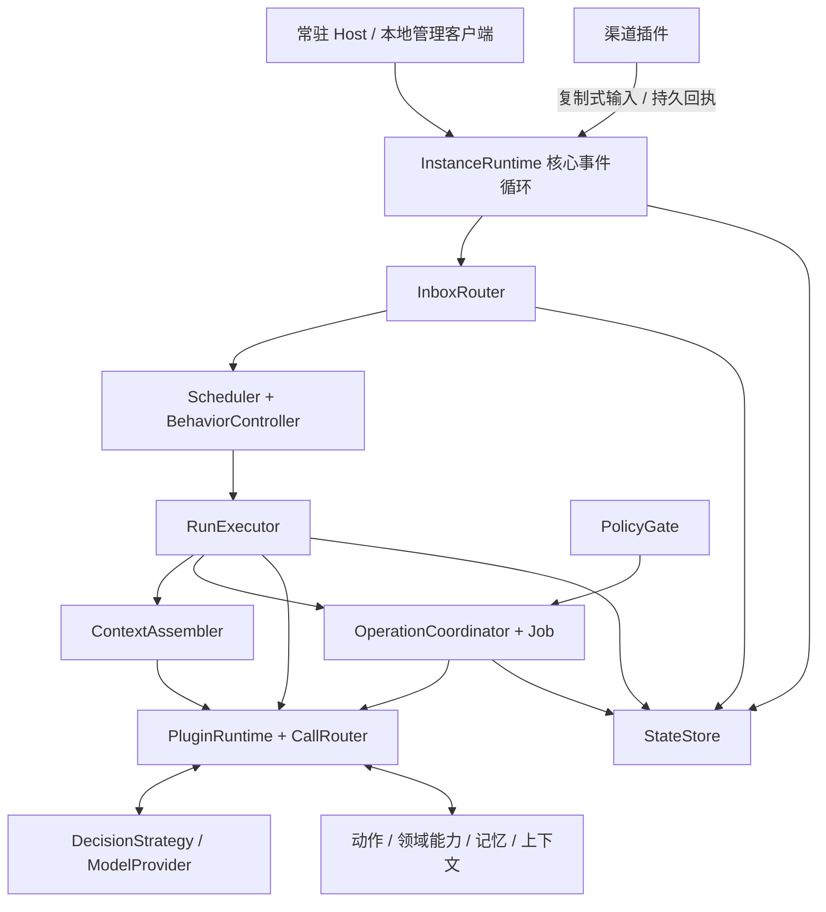

# v0.4 实际架构

本文描述 v0.4 已实现的边界。当前阶段的建设范围以[架构收敛设计](architecture-convergence.md)为准，较完整的常驻目标保留在[长期设计参考](resident-runtime-design.md)中。

当前实现与目标设计的偏差、复现证据和调整建议见 [v0.2 整体架构审阅](architecture-review-v0.2.md)。

## 本轮公开边界与构建范围

SDK 分为 dafeiyu::contracts 和 dafeiyu::plugin_sdk：前者只提供值、schema、内建服务契约及 RunView，后者提供插件作者使用的 ABI 封装。核心公共头文件不再传递插件执行或 SQLite 头文件；内部调用层仍可私有依赖这些实现。

SDK 统一定义内建服务的方法 schema，清单按契约 ID / 版本引用。提供方显式声明不同方法集合、绑定角色不匹配或使用未支持版本，都在发布 ready 前拒绝。渠道与策略契约为版本 3，其余内建契约为版本 2；领域契约继续由定义方维护。

策略输入和插件 read_state(run) 返回 RunView v2，增加结构化 ConversationKey 和嵌套调用用量。视图不包含绑定闭包、原授权对象、内部请求或调度字段。原准入动作不代表当前仍可执行，派发仍检查实时授权。核心内部各模块的完整状态写入归属尚未全部收紧，AR-07 只完成了公开视图部分。

## 会话与交付归属

Conversations 依据插件所有权、profile 的 channels 配置与主体映射建立渠道实例、账号和外部会话的联合身份。输入持久接纳时即保存路由；Run 创建和中途补充验证该身份，不能只比较外部会话字符串。队列重启后使用原绑定，不重新套用默认渠道。

DeliveryBinding 保存具体服务/账号、外部目标、回复关联、提供方版本和配置指纹，以及核心维护的授权代次。配置身份或权限变化推进相应代次；从当前配置消失的渠道实例保留撤销记录，恢复原名称也不会让旧授权复活。交付派发检查绑定和当前授权，效果查询只验证原提供方身份，允许保留撤权前已发生的事实。

平台交付统一经过 OperationCoordinator；普通嵌套服务调用不能直调内建 channel.deliver。查询渠道回执也必须指向本 Run 的原交付操作与原服务。内部活动默认不交付；显式配置 reply 时必须给出 reply_channel 绑定，不借用默认渠道。

## Run 内调用树

CallRouter 为子调用记录父票据、实际方法效果、委派许可及原 Run 的预算身份。子期限取请求期限、宿主上限与父期限的最小值。只读调用仅保留读资格；写入资源限制为当前方法 resources 与祖先写资源的交集，不能借额外的只读委派资源扩大写入范围。派发前仍检查当前根动作、效果和资源授权。

limits.nested_calls 限制同一 Run 的已接纳子调用尝试；额度在派发前持久预留，提供方派发失败不退回，硬重启或新的父 Call 不清零。核对等核心根调用不消耗业务子调用额度；模型和策略仍使用各自计数。这里没有真实供应商 token/费用或实例总消费预算。

父调用正常结束、超时或取消都会撤销普通后代调用的业务资格。模块与调用记录保留到物理结束；迟到确认仍进入效果结算。尚未物理结束的异步父调用可以收到 terminal_only 错误以便释放资源和报告终态，但不能继续发起业务。Job 通过既有显式登记移交，独立结果通道不随原 Call 自动销毁。

profile 与核心存储当前为版本 3，插件私有数据库仍为版本 2；旧核心数据明确拒绝打开，无自动迁移或删除。

普通 CMake 配置默认不构建示例或测试。examples/minimal 提供五个必要角色，tests/fixtures 提供按场景装配的验证实现；正式 plugins 目录当前没有构建目标。测试产物和最小示例位于不同输出目录，普通安装只按 DFY_BUILD_EXAMPLES 选择是否携带五个示例模块。

以下运行机制继续保留，涉及搜索、可写记忆、Job、活动和上下文订阅的具体提供方均已归入测试夹具，默认最小配置不启用它们。

## 依赖与模块

宿主链接核心；核心链接 SDK 与 SQLite 辅助库；插件链接 SDK 及可选的 SQLite 辅助库，均不链接核心。公共入口是 core/include/dafeiyu/core.hpp 中的 InstanceRuntime：request 支持并发提交，拥有者串行执行 shutdown 与对象销毁。

| 模块 | 实现位置 | 状态所有权 |
|---|---|---|
| 实例装配与事件循环 | core/runtime.cpp | 核心线程、管理命令队列、插件消息接纳、订阅投递 |
| 插件运行时 | core/plugin_manager.cpp | DLL、每插件执行线程、注册、依赖图、调用资格 |
| 调用路由 | core/calls.cpp | 调用票据、截止时间、协作取消、逻辑与物理结束 |
| 输入接纳 | core/inbox.cpp | 来源去重、持久接纳、输入与 Run 的原子关联 |
| 调度 | core/scheduler.cpp | 用户任务优先、单决策资格、定时触发、活动结果反馈 |
| 行为与授权 | core/policy.cpp | 行为修订与期限、活动启停策略、当前授权及撤销 |
| Run 执行 | core/run.cpp | 意图修订、策略提案采用、模型尝试、复核、交付 |
| 上下文组装 | core/context.cpp | 人格绑定、记忆检索、上下文贡献、实际动作目录 |
| 操作与 Job | core/operations.cpp | 操作计划、父子步骤、效果核对、Job 登记与恢复 |
| 持久层 | core/store.cpp | 实例锁、对象投影、不可变事实、原子事务 |
| 本地管理传输 | host/control.cpp | 请求/响应文件、启动 epoch、客户端等待 |

## 执行与消息

每个实例只有一个核心状态写入线程。公共命令通过队列进入它；插件分别拥有一个串行执行线程，create、start、on_event、quiesce、stop、destroy 都在该线程执行。一个阻塞模型调用不会阻塞其他插件线程或管理接纳。

插件通过 host.post 复制消息到宿主队列，不持有核心对象。核心按回调来源和当前调用票据验证权限；在 JSON 中填写 run_id、operation_id 或其他 actor 不会签发调用资格。普通消息队列有容量限制；已登记调用和 Job 的完成消息单独接纳，同一身份的相同待处理终态合并。

调用超时先产生逻辑结果并请求协作取消，原模块和执行资源仍保留到实际结束。迟到结果保留为证据；旧模型和策略提案不能继续新意图。关闭时先收束调用，再等待插件停止，最后销毁模块。无法协作退出的原生代码仍可能阻止进程正常关闭。

## 决策与能力组合

默认流程是策略提案、上下文组装、模型候选、策略采用、动作结算、再次决策、结束复核与交付。核心识别 request_model、invoke_action、wait、finish 四种提案；review_finish 接受候选或提出非结束工作。策略状态与采用记录同事务保存。

ModelProvider 只生成规范化候选。默认策略实现简单工具循环；复核配置通过同一个 request_model 流程取证，模型调用数与策略步数持续计量。当前显式 wait 条件为时间与用户输入；动作 Job 等待由核心的操作阶段维护。

领域契约是开放集合，清单描述方法 schema、效果和资源域。契约 ID 与版本相同时，方法描述必须一致。使用方声明命名绑定依赖；加载器验证缺失、版本、环及实际服务注册。搜索动作依赖搜索契约，可以在 profile 中替换提供方。

Run 保存所用模型、记忆、渠道、策略、上下文和动作的依赖闭包。绑定包括提供方与服务描述、显式配置修订及确定性配置指纹。模型实际看到的动作说明、schema 与材料保存在模型尝试记录中；后续配置说明变化不重写历史请求。配置使用非敏感值和凭据引用，持久绑定不保存配置明文。

## 授权与操作

本版采用一个本地 owner。渠道插件的外部主体通过其 profile 中的 principals 映射到该 owner；本地管理入口由状态目录权限保护。这里没有对外平台认证服务或多用户授权系统。

动作执行检查 Run 原授权与当前授权。资源范围采用清单声明的保守命名资源域，例如 memory、web、channel；尚未实现按文件路径或业务对象细分的范围解析器。嵌套写调用必须具有有效父操作，其效果级别和资源域不能超出父操作，且使用方必须声明相应依赖。

独立副作用使用父操作与稳定步骤键生成子操作。计划提交后才派发；同身份不同参数拒绝。未知写效果锁定相关资源域，新 Run 也不能绕过。已确认结果不被迟到错误覆盖，补充证据另行记录。

记忆提供方是人格版本的唯一写入者。最小示例仅提供初始版本和只读快照；记忆提交夹具通过单独的 test.memory.changes 服务完成子操作、版本变化和回执。当前 Run 继续使用原人格快照，新 Run 采用新版本。

受控命令夹具需要部署声明的命令许可、有效操作资格与 local-write 范围；核心执行修订检查和持久命令去重。插件不能通过该入口关闭宿主或直接编辑核心字段。

## 持久化与恢复

核心采用 SQLite WAL 与 FULL synchronous。objects 保存按 kind/id 定位的 JSON 当前投影；facts 是带递增序号、来源和因果字段的不可变事实表。投影和对应事实由 StateStore.atomic 一起提交。当前没有纯事件重放重建整个数据库的承诺。

| 记录 | 关键语义 |
|---|---|
| input、run | 来源键去重；消费关联与任务创建原子提交 |
| decision、attempt | 已采用提案、策略状态与完整模型请求/结果 |
| operation | 不可变计划、原提供方、父子步骤、效果及回执 |
| job | 启动前登记的工作键、归属、终态和取消请求 |
| activity、occurrence | 定义、持久启停、下一到期点与待处理触发 |
| subscription | 过滤器、已确认游标和未确认投递页 |
| command | 管理修改的参数与返回回执，支持重试去重 |

硬崩溃后的只读操作可按原计划重新执行；写操作先查询原身份。渠道收据已提交而核心未结算时，通过 query_delivery 补齐。查不到证据保持 unknown，不自动换 ID 重发。人工核对要求预期修订、证据和原因。

Job 在启动前持久登记，移交只结束原 Call。核心接收早于移交返回的 Job 终态并按操作身份关联。重启使用原提供方查询和接管；后台示例模拟一个可持续查询的工作系统，不是通用子进程执行器。Job 完成记录和操作结果同事务提交，调度以数据库记录为依据。

事实订阅按部署允许的事件类型投递；插件先提交自身消费结果，再确认游标。重启重投未确认页，消费者用事件 ID 去重。上下文示例实际使用这一协议。

## 活动与首轮边界

默认 minimal 配置的 activities 为空。以下机制仅在明确装配的测试场景中运行，不是随宿主启动的自动反思功能。

活动由插件清单贡献，profile 选择服务绑定、间隔、允许模式、动作授权和交付策略。已持久保存的暂停状态优先于初始配置。当前定时规则支持固定毫秒间隔、skip 和 coalesce；事实触发、日历时区规则和 bounded-catch-up 尚未实现。

首轮已有单实例常驻、单活动决策循环、跨插件服务、策略复核、持久输入、行为模式、定时活动、记忆提交、Job、核对接口和本地管理。模型/策略次数、调用期限、输入和 Job 数量有界；供应商 token 成本与实例总用量预算尚待真实模型接入。

仍未开放子 Agent、热替换、Run 内动态能力安装、单个注册项的热撤销、MCP/Skills 桥接、附件内容存储、操作系统隔离和真实网络平台适配。未来实现应沿相应契约扩展，不能在具体插件 ID 上添加核心业务分支。
