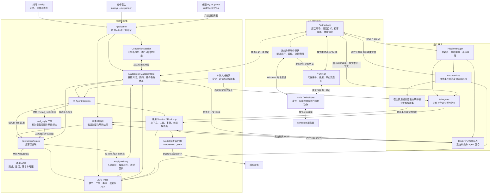
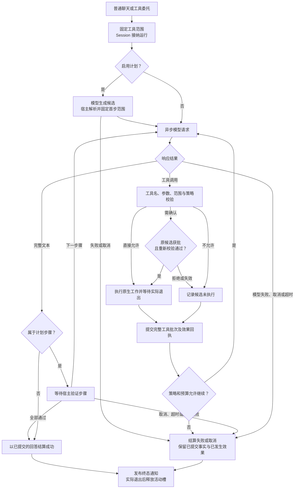
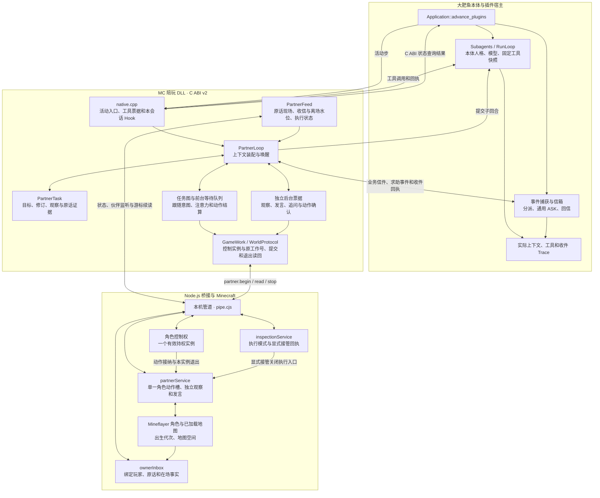
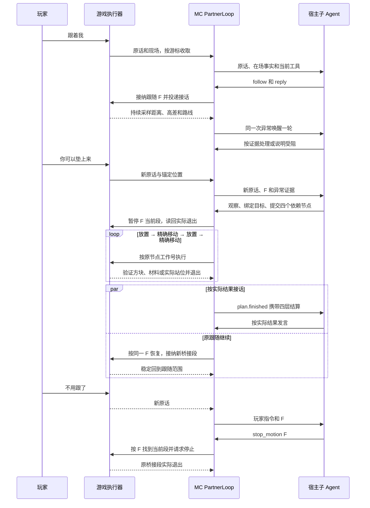
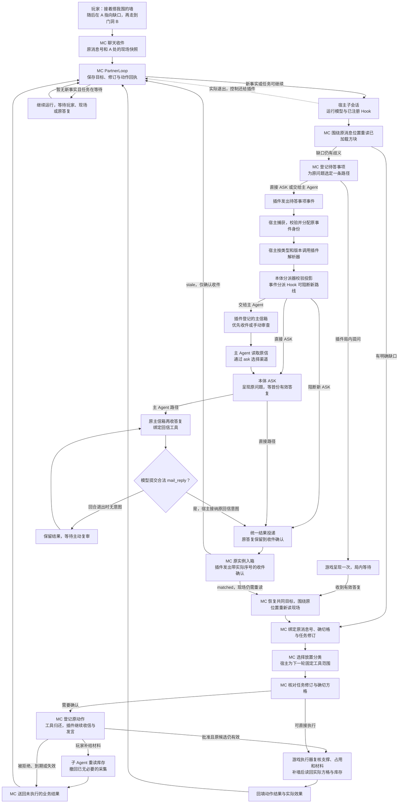

# 大肥鱼当前架构

大肥鱼本体通过 `Application` 装配主 Agent、内置模型、插件宿主和受信用户入口。MC 插件持有自己的陪玩循环、游戏知识和技能，使用宿主托管的独立子会话。终端和 MC 宿主使用正式入口。桌面探针提供只读运行摘要和固定样本房间预览。

## 架构图

箭头表示运行时调用或数据方向。终端、专用游戏宿主和桌面探针按各自入口创建应用实例。

| 模块 | 职责与源码入口 |
| --- | --- |
| **App** | 组装模型、插件和主会话，接纳终端工具授权、审批与状态读回。普通聊天、`--mc-partner` 和桌面探针共享应用服务代码。另有 `--complete` 直接调用模型的单次文本入口。[命令行](../app/main.cpp) · [Application](../app/application.cpp) · [Conversation](../app/conversation.cpp) |
| **Agent** | `Session` 持有当前运行和有界历史。每个 `RunLoop` 按工具快照、策略和预算推进模型、工具、计划与诊断。主 Agent 和插件子会话共享执行器并独立保存上下文。[Session](../agent/session.cpp) · [RunLoop](../agent/run_loop.cpp) · [子会话宿主](../app/subagents.cpp) |
| **人格与场景** | 本体读取一个版本化人格档案，直接对话、房间点名和声明面向玩家的子回合共用。插件提供领域规则、原话和游戏事实。宿主按人格、场景规则、当前回合消息的顺序装配，固定本轮工具定义。内部停手判断和委托结算使用独立契约。真实送模记录保存人格和场景版本。[人格档案](../app/persona.cpp) · [子回合装配](../app/subagents.cpp) · [SDK 声明](../sdk/include/dafeiyu/agent_abi_v2.h) |
| **Model / Platform** | Model 编解码请求并通过异步客户端接收完整响应。HTTP、控制台输入、DLL 装载和摘要算法属于 Windows Platform。默认 Provider 内置，空插件目录可直接问答。[模型客户端](../model/client.cpp) · [协议](../model/protocol.cpp) · [WinHTTP](../platform/winhttp.cpp) · [代码装载](../platform/code_module.cpp) |
| **Plugins / SDK** | 插件包使用同进程 v2 C ABI，安装后显式加载。宿主按依赖发布 Hook 顺序，独立接纳插件事件并调用对应解析器，公平推进插件活动步骤。卸载等原工作退出，再撤销地址与注册。[管理器](../plugins/runtime/manager.cpp) · [事件宿主](../plugins/runtime/host_routed_events.cpp) · [接口](../sdk/include/dafeiyu/routed_event_abi_v2.h) |
| **Runtime / Events** | Runtime 提供有界操作、预算和调度，Events 提供广播通知与定向信箱。信箱地址绑定发送方、接收方与独立 FIFO，类别和版本决定处理方式。接纳、业务结果和实际退出分别结算。[广播通道](../events/broadcast_channel.cpp) · [信箱](../events/mailboxes.cpp) · [本体收件](../app/mailbox_intake.cpp) |
| **ASK** | `AskService` 持有通用票据，`InteractionRoutes` 将声明式解析结果分流到渠道或主 Agent 信箱。插件消费原答复并裁定动作。[ASK 状态机](../app/ask.cpp) · [交互路由](../app/interaction_routes.cpp) |
| **回信与回执** | `mail_reply` 将模型工具调用解析为绑定原信和本轮的转发意图。`ReplyDelivery` 处理两条路径的最终入箱与确认。入箱回执和插件消费回执各有身份。[回信工具](../app/mail_reply_tool.cpp) · [结果投递](../app/reply_delivery.cpp) |
| **Trace** | 主会话和插件子会话记录实际提交的统一模型请求、独立退出的模型响应、各工具及信件结果。事件、信箱、ASK 和游戏回执通过原身份关联。支持按回合查看，并用录制响应和工具回执离线重跑单轮。[模型与工具记录](../agent/include/dafeiyu/run_capture.hpp) · [本体落盘](../app/run_log.cpp) · [审阅与回放](run-guide.md) |
| **Desktop** | WebView2 主文档通过 `state.read` 获取当前或最近运行摘要，可按会话号和回合号筛选。桌面原生业务线程发布值副本，房间预览取固定样本。[业务线程](../app/gui/run_status_host.cpp) · [主文档桥接](../ui/host/probe_host.cpp) · [运行说明](ui-probe-run-guide.md) |

构建入口是 CMake 和 VS2022 x64，宿主采用 C++20，公开 SDK 支持 C 消费者。终端是默认启动目标，`BUILD_GUI` 和 `BUILD_TESTING` 控制探针和测试目标。[根构建](../CMakeLists.txt) · [预设](../CMakePresets.json) · [分发规则](../cmake/Distribution.cmake)

## Agent 会话与工具流程

- **普通问答**每轮接收一次完整文本。成功时提交整轮对话。失败或取消后，仍保留先前已经提交的对话与工具事实。[历史提交](../agent/run_context.cpp) · [会话推进](../agent/session.cpp)
- **终端委托**中，`/run` 授予一个只读工具，`/run-confirmed` 允许具体变更候选进入审批。`/task` 固定同一个插件实例上的首读、变更、末读，宿主核对步骤顺序、实际回执和期望值。原候选的批准与实际调用分开记录。[应用入口](../app/application.cpp) · [工具批次](../agent/tool_batch.cpp) · [读回验证](../app/tool_verification.cpp)
- **原生观察与计划控制**通过显式宿主入口接纳。观察触发默认只读，变更分支要求声明条件、可信当前采样和确认。计划步骤支持有界重规划、目标修订和等待验证时换入新观察。诊断和离线比较沿用运行身份和版本信息。[观察控制](../agent/observation_controller.cpp) · [计划与观察入口](../agent/session.cpp) · [离线场景](../tests/offline_scenario.cpp)

## MC 陪玩插件

### 运行边界

`Application::advance_plugins` 驱动宿主子会话、DLL 活动、事件分派和信箱。插件启用陪玩入口后，`PartnerLoop` 开始轮询游戏并决定何时提交下一轮。Node 进程在游戏里持有独立的 Mineflayer 角色，通过本机命名管道提供读口、动作和回执。[宿主调度](../app/application.cpp) · [插件入口](../plugins/mc/native.cpp) · [桥接启动](../plugins/mc/bridge/start.cjs)

| 边界 | 代码中的职责 |
| --- | --- |
| 收信与上下文 | `PartnerFeed` 按角色代次、玩家和消息序号保存原话现场。即使两条在场变化同批收到，或离场事件被有界窗口淘汰，独立水位仍会触发离场结算。插件结算旧工作后，把重新在场后的事实交给新子会话。`PartnerLoop::submit` 装入新事实、至多八条已处理对话、任务、观察和待答事项，再绑定本轮工具。宿主为玩家回合拼接本体人格，按插件请求替换会话历史。[游戏收件](../plugins/mc/bridge/chat.cjs) · [插件读口](../plugins/mc/partner_feed.cpp) · [回合装配](../plugins/mc/partner_loop.cpp) · [子会话宿主](../app/subagents.cpp) |
| 执行就绪与交接 | 私有 `chat.read` 只读取，`partner.listen` 为当前控制实例申请或续期角色持权。只有 `partner/ready` 的持权者能提交子回合和新工作。并发监听者仍可读取，执行状态为 `busy`。普通退出用 `control.detach`，原工作实际退出后角色才交给后来者。显式 `control.stop` 指定 `scope=role` 后关闭桥接的执行入口并保留读口。 [控制权](../plugins/mc/bridge/controller.cjs) · [协议分派](../plugins/mc/bridge/pipe.cjs) · [宿主状态](../app/companion_partner.cpp) |
| 工具与计划 | `partner_skills.hpp` 声明工具、类别和实际执行映射。`skills` 可展开类别供后续回合使用。计划入口检查节点、依赖、任务范围和授权，分类错误返回有效键。重复无效的计划保留原提交编号和原因，达到额度后给当前回合一次结算请求。[技能目录](../plugins/mc/partner_skills.hpp) · [计划校验与结算](../plugins/mc/partner_plan.cpp) |
| 前台执行 | 每个计划最多四个节点。调度器以实际结果推进依赖，后台观察可以与前台动作重叠，角色变更在同一个前台槽内依次执行。桥接用控制实例和工作号查找原票据，提交、读回和停止均核对世界代次、原消息、技能及原参数。DLL 和桥接需使用同一工作身份契约。[动作调度](../plugins/mc/partner_queue.cpp) · [工作票据](../plugins/mc/game_work.cpp) · [游戏执行](../plugins/mc/bridge/partner.cjs) |
| 跟随与注意力 | 桥接约每 125 ms 采样距离、高差、可见性和寻路结果。受阻时清除移动控制，跟随等到现场或站位变化并读到可达证据后可原段恢复。前台任务接管时，通常结束当前执行段并在任务结算后以同一逻辑工作号恢复，新的桥接段使用 `.resume.N`。[跟随执行](../plugins/mc/bridge/follow.cjs) · [原号交接](../plugins/mc/partner_queue.cpp) |
| 本插件的 Hook | MC 登记本插件会话的 `MODEL_REQUEST` 和 `TOOL_START`。有更新的玩家输入、世界变化或过期的异常回合时，Hook 可拒绝旧过渡。已接纳一次性工作等需要等待的场景，在下一次模型请求前让出当前回合，插件照常推进原工作。[MC Hook 登记与裁定](../plugins/mc/native.cpp) · [宿主应用快照](../app/subagents.cpp) |
| 提问与交付 | 自然追问持有自己的事项和投递回执，玩家可以先听到接话，再收到问题。普通回复和可发言的实际结果使用同一个游戏投递入口。显式 `direct` 或 `main` 求助由插件发出路由事件，宿主捕获并调用登记的解析器。主 Agent 处理路径由 `mail_reply({})` 提交回信意图，原插件收到结果后确认收件并裁定动作。[局内追问](../plugins/mc/partner_question.cpp) · [应用分派](../app/event_dispatch.cpp) · [回信工具](../app/mail_reply_tool.cpp) |

### 垫上来与跟随掉队

放置节点使用已绑定的目标格，执行时重查支撑、占用和库存。精确移动核对脚位及头部净空，成功回执包含实际位置。通过验证的前序节点解锁后继。如果一个节点在实际执行中受阻，之前的回执仍可用于结算，依赖它的节点记为 `skipped`。绕墙的 `route` 仍由执行器按实际检查点计圈，可以与精确移动在同一个计划内编排。[计划](../plugins/mc/partner_plan.cpp) · [放置](../plugins/mc/bridge/placement.cjs) · [动作读回](../plugins/mc/world_protocol.cpp)

当前跟随注意力以连续样本判定。距离持续 3 秒大于期望距离加 2 格，且其间没有把距离缩短至少 1 格，记为掉队。高差至少 2 格且寻路器持续 2 秒明确报无路，记为高差异常。失去实体 5 秒或执行明确受阻也可触发异常。同一异常只提交一次判断，新玩家消息优先，并能携带该证据。回到期望距离加 0.5 格内并持续 1 秒后，恢复写入 Trace 并进入后续上下文。[注意力判定](../plugins/mc/follow_attention.hpp) · [异常唤醒与收件顺序](../plugins/mc/partner_loop.cpp)

核对计划时，可比对原游戏工作号、游戏退出、`plan.finished` 的实际模型上下文和信箱入队记录。插件本地结算可以先进入下一轮上下文，信箱外发则按队列逐件交付。固定模型响应的隔离 Paper 探针同时核对这四类证据。[插件外发队列](../plugins/mc/partner_loop.cpp) · [游戏验收](../tests/mc-companion/playtest-check.cjs)

## 接续我已经搭的墙

- **局内状态。** `PartnerLoop` 由宿主活动调度持续推进。玩家原话携带收件时客户端已知的玩家位置及可用朝向。插件按任务修订保留原消息号及已选方块。玩家事件优先，可和已到达的动作回执一起入轮。每批新玩家事实最多补充四轮自主探索额度，已接纳的动作和计划仍可提交自己的实际结果。 [插件循环](../plugins/mc/partner_loop.cpp) · [任务状态](../plugins/mc/partner_task.cpp) · [配对读口](../plugins/mc/partner_feed.cpp)
- **门和洞口的观察。** `doors` 在已加载局部格核对门的上下两格，归成一个对象。洞口候选按两侧边界和底部支撑识别，最多四列两层。任务按原消息号保存指向候选，供 `targetObservation` 和绑定使用。读取玩家现位置不会覆盖原话证据。 [方块搜索](../plugins/mc/bridge/partner.cjs) · [门对象](../plugins/mc/bridge/block-survey.cjs) · [洞口候选](../plugins/mc/bridge/player-focus.cjs) · [候选绑定](../plugins/mc/partner_task.cpp)
- **多来源与连续观察。** `observe` 可合并自己、配对玩家和原话三个中心。每帧只读取一次重叠坐标，保留各中心的来源和覆盖范围。连续观察最多三帧，只比较相邻帧都已知的方块。窗口移动与区块未加载单独表达。等待可取消，完整采样进入工具回执，任务保存可用于指向和后续回合的摘要。 [多来源采样](../plugins/mc/bridge/partner-observe.cjs) · [任务记录](../plugins/mc/partner_task.cpp)
- **放置目标身份。** 插件按原话锁定目标格，同一原话不会因新视角换到别的缺口。换目标需当前玩家的新指令和显式 `replace`。玩家原话要求过来且旧位置不可用时，可先登记 `approach`，等实际到达回执后，用本角色附近的已知空格绑定同一原话。直接放置和预输入都核对这组格，游戏执行器在动手前再次核对维度、空格、材料和支撑。 [目标校验](../plugins/mc/partner_task.cpp) · [游戏放置](../plugins/mc/bridge/placement.cjs)
- **玩家纠正。** 子 Agent 用 `begin_correction` 登记本轮玩家原话，插件停止旧计划与待执行动作，持原工作号结算已接纳动作。纠正权与目标证据分别保存。旧工作退出后，`commit_correction` 用保存的纠正消息和当前已验证格，一起切换目标说明、实际方格和执行修订。旧工作退出未核实时，本次世界绑定继续暂停纠正提交并在上下文显示原工作号。 [局内调度](../plugins/mc/partner_loop.cpp) · [目标切换](../plugins/mc/partner_task.cpp)
- **动作预输入与短任务。** `queue_actions` 将模型提交的意图按原任务修订登记，前台待办由插件转换为具体游戏工作。顺序队列支持追加、打断跟随和按原工作号替换。计划模式接纳最多四个带 ID 的有向无环节点，按层调度。后台观察可和同层前台动作共存，多个前台动作由一个角色依次执行。每层发布一次 `mc.partner.plan` 终态，已满足的后继由程序推进，失败节点阻断其依赖。计划终态或新玩家消息携带 `planSettlements`。取消会清除尚未接纳的节点，并等已接纳的工作退出。合成当前作为能力不可用的节点结算。 [动作队列](../plugins/mc/partner_queue.cpp) · [短任务编排](../plugins/mc/partner_plan.cpp)
- **任务执行修订。** `detail` 和 `next` 更新说明及唤醒方式，继续沿用当前执行修订。目标、绑定格或取材范围变化会推进修订。新确认使计划中尚未终结的动作需要批准时，原计划也失效。两类取消都保留原计划与工作号，等待已接纳动作的实际退出，再带 `cancelReason` 与逐层回执回到子 Agent。原话的确切墙面候选独立于后续视线命中保存。插件按候选展开方格，同一原话的显式方格须与已明确指向的墙面吻合。 [任务修订与目标绑定](../plugins/mc/partner_task.cpp) · [动作确认](../plugins/mc/partner_confirm.cpp)
- **导航任务切换与重开。** `start_task` 以当前原话登记新任务。`restart_task` 保留原任务、墙候选与圈数，推进执行修订。旧追问失效，旧计划的实际退出以原号保存在 Trace。插件通过 `taskHandoff` 交接原工作，核实退出后一次 `task.ready` 可续行。退出未获核实则保持前台门槛。每个修订接纳一条路线。 [任务身份](../plugins/mc/partner_task.cpp) · [原工作结算](../plugins/mc/partner_loop.cpp)
- **墙体与多段移动。** `observe(mode=wall)` 用原话位置查已加载墙体和两侧落脚区。`observe(mode=route)` 使用只读寻路，核对一组有序站位能从四侧绕过同一对象。当前处理同高度、有支撑且可通行的路线。执行器在一项 `route` 游戏工作里逐段走，读回实际脚位，走完四段并回起点才累计一圈。检查点更新 `activeMotion` 和 Trace，计划完成、普通受阻或实际中断后返回结果。玩家仍可发消息，跟随在任务交接完成后依据原工作号恢复。 [墙体与路线](../plugins/mc/bridge/partner-route.cjs) · [游戏执行](../plugins/mc/bridge/partner.cjs) · [回执核对](../plugins/mc/world_protocol.cpp)
- **前台交接。** 待机是无前台工作时的状态。插件保留跟随意图及稳定工作号，桥接执行段各有工作号。一次性前台动作可以取得优先权，分组时用 `queue_actions.interrupt` 声明。插件先要求执行器清除跟随路径和控制输入并确认退出，再下发临时动作。临时动作结算后重新接管原跟随，原路已受阻时先重读可达条件。明确叫停、配对失效和未确认退出使原跟随结束。观察和发言使用独立的后台票据。 [跟随调度](../plugins/mc/partner_queue.cpp) · [执行器释放](../plugins/mc/bridge/follow.cjs)
- **领域知识与完工依据。** `skills` 展开 `query` 后可按需查询 Java 1.21.4 的小型词条库。词条说明草方块通常掉落泥土，以及精准采集的例外。队列只按实际方块和入包回执推进。依赖组在执行中逐格记录回执，组结束后再唤醒规划，新的玩家原话仍可立即参与下一轮。 [知识查询](../plugins/mc/partner_knowledge.hpp) · [队列验收](../plugins/mc/partner_effect.hpp)
- **在途工作和发言。** 游戏接纳一次性动作或插件接纳计划后，原子会话可通过模型请求边界主动结束，当前批次的发言和观察仍完整收尾。修改备注或下一步说明沿用原执行修订。目标或范围变化会让旧计划和一次性动作停止接纳后续输入。新增确认要求时撤下关联的旧动作。插件按原号读回退出，已落地的变化归原工作。`activeMotion` 提供进度，`workSettlement` 提供同组退出与未执行节点。玩家离场时桥接先停止游戏输入，插件再结算在途工作。 [动作票据](../plugins/mc/game_work.cpp) · [插件循环](../plugins/mc/partner_loop.cpp) · [通用回合](../agent/run_loop.cpp)
- **玩家回复与结算。** `reply` 和可向玩家交付的最终文本用同一通道。本轮可发言时，尚未申请显式回复或原票据明确未发出，才允许有效最终文本送达。显式回复尚在途、已发或结果未知时，保留原票据并抑制补发。本地追问有独立的事项和投递回执。空文本和 `{"internal":"…"}` 用于内部结算，主 Agent 委托的最终文本作为委托报告。最终文本的 `mc.partner.action` 标记 `source=final_text`，通过会话、子请求和 `bridgeWork` 关联。 [回合结算](../plugins/mc/partner_loop.cpp) · [实际发言](../plugins/mc/bridge/partner.cjs)
- **上下文与工具快照。** MC 装配本轮原话、最多八条已处理对话、任务、待答事项和实际回执。宿主按插件标志替换跨轮消息历史并附上本体人格。初始目录包含观察、发言、任务操作、跟随、挖指定单格和按库存取材，其余类别按需展开，绑定确切格后提供整处补墙。同一组退出正文直接用 `workSettlement`，需要时可按 `primary` 索引读主回执。 [插件循环](../plugins/mc/partner_loop.cpp) · [技能注册表](../plugins/mc/partner_skills.hpp) · [宿主授予](../app/subagents.cpp)
- **玩家指向与自然追问。** 原话保留眼位、朝向和采样时间。`focus=objects` 合并准星命中、视锥中确实可见的候选、命中格邻域及双方附近的加载信息，按格去重并标明来源。附近已加载材料只作为参考。单格破坏依据原话材料、可信视线及相对位置核验，执行器动手前重读目标和参照。同一句最多两次指向观察，证据不足时可自然追问。 [收件采样](../plugins/mc/bridge/chat.cjs) · [视锥](../plugins/mc/bridge/player-focus.cjs) · [目标核验](../plugins/mc/partner_task.cpp)
- **追问后的依赖续接。** 局内 `ask_player.afterPickup` 保存玩家原话和指定产物。收到新指向后，`queue_actions(plan, resolves)` 核验已观察的挖掘目标，续接原合成后继。破坏回执及所需物品有效入包共同决定是否推进。合成目前返回 `skill_unavailable`，整组结算时只开放一次发言。 [待答事项](../plugins/mc/partner_question.cpp) · [计划续接](../plugins/mc/partner_plan.cpp)
- **放置读回。** 单格、门的两格和整处补墙都核对支撑、占用、材料和最终世界状态。批量优先从下往上处理，缺支撑或视线的格可在同一目标内等其他格放好后重试，遇到占位或未核实的放置停止。已完成的回执保留，续补跳过已有正确材料的格。 [游戏放置](../plugins/mc/bridge/placement.cjs) · [回执校验](../plugins/mc/world_protocol.cpp)
- **取材范围和对象保护。** `dig_block` 固定所指格和实际方块名，动手前重读目标和视线。`gather_ground` 用目标物品和库存计算缺口，查找允许采掘的裸露地层，分别核对逐格变化与入包。执行器用本次游戏连接内的地图名及维度登记已验收的格、门和支撑，同图重生仍保留。普通采掘前重读涉及的格，已确认移除的对象解除保护，未加载时保留保护。登记保存在当前桥接进程内。 [取材判定](../plugins/mc/bridge/collection.cjs) · [地图身份](../plugins/mc/bridge/world.cjs) · [对象保护](../plugins/mc/bridge/built-objects.cjs)
- **渡水。** 游戏执行器根据真实物理帧读回游动、离开水域及站稳干岸。跟随目标在干岸时，达到距离且自身也在干地才算靠近。固定站位有干地条件时，同样经过到达复核。两种移动共用禁止采掘搭路的寻路策略，回执带实际位置和渡水次数。[渡水读回](../plugins/mc/bridge/navigation.cjs) · [持续跟随](../plugins/mc/bridge/follow.cjs)

## 当前边界

信箱去重窗口、局内任务、建造对象登记和业务确认驻留进程内。同一连接内各张地图保留各自的已建物及支撑，返回原维度时按现场读数核验。采掘审批由执行器用实际掉落与拟破坏的方格核对，未经确认的重叠动作在破坏前返回 `approval_required`。短断线暂停接纳新动作，信箱从已核验的原游标续读，原工作沿用原编号查询退出。局内 Trace 保存这些边界的本地证据。 [地图隔离](../plugins/mc/bridge/built-objects.cjs) · [采掘审批](../plugins/mc/bridge/collection.cjs) · [断线续读](../plugins/mc/partner_feed.cpp)

通用 Agent、信箱和动作让出 Hook 由本体提供。应用层伙伴面板和委托入口目前仍适配 `mc.partner.*` 消息。原生 Hook 在宿主线程同步返回，活动任务通过 `dfy.activity` 推进。Agent 宿主审批和 MC 业务确认各有状态和生命周期。 [运行诊断](../agent/diagnostic_snapshot.cpp) · [应用层伙伴适配](../app/companion_partner.cpp) · [MC 交互方案](mc-companion-development-plan.md)

## 事件注册与解析

`dfy.event.routes@1` 在插件加载时登记事件名、版本、闭合字段契约和原生解析器。运行中的插件按实例序号提交事件。宿主校验并入队时记录 `event.captured`，后续取件调用原解析器并记录 `event.decoded`。应用分派器把 ABI 投影转换为类型化指令，再记录 `event.dispatched` 或拒绝。普通信件、直接 ASK、交主 Agent 的提问、渠道反馈和插件收件确认分别进入对应处理分支。MC 的待答事项及超时规则由 MC 插件持有。[插件 SDK](../sdk/include/dafeiyu/routed_event_abi_v2.h) · [宿主解析](../plugins/runtime/host_routed_events.cpp) · [应用分派](../app/event_dispatch.cpp)

## 信箱优先级与唤醒

直接对话、房间和每个注册插件分别使用受信地址。每箱独立 FIFO，信箱 ID 锚定发送方与收件方，分类及版本决定处理方式。`dfy.mailbox.rules@1` 声明同一插件信箱的多个分类，按箱设优先级、按类别设唤醒。高优先和普通档各自轮转，两档都有待办时最多连续取三封高优先件。主回合忙碌时，到件留队等待；审查通过的消息在回合接纳后出队，被过滤的事实由收件器消费。[信箱网络](../events/mailboxes.cpp) · [取件调度](../app/mailbox_intake.cpp)

到件可按类别唤醒空闲主 Agent。用户也可用 `/mail review` 主动审查，或在发起普通对话时带入一封已审查的待收信件。`/mail wake manual` 暂停插件信箱的自动唤醒。消息接纳、ASK 呈现、真人答复及 MC 动作读回分别结算，均可通过 Trace 关联。[房间信箱](../app/room_mailbox.cpp) · [通用交互路由](../app/interaction_routes.cpp)

## 通用 ASK

MC 子 Agent 的普通追问默认由插件作为局内对话投递。登记问题后当前回合让出，聊天、观察和原跟随仍可继续。局内追问到期时保留 `pendingQuestion.status=expired`，写入 Trace 并继续等新消息。到期本身不送模、不发提醒，也不解除受待答约束的写入。玩家可用新原话提供现场证据，或明确更换任务。普通答复、局内追问和实际动作结果各有投递边界，按原回合和游戏工作回执防重。显式使用 `direct` 或 `main` 时仍走本体 ASK，动作确认走专门的确认路径。

从已绑定的格中选择放置目标时，局内 `ask_player.placementOptions` 将回答关联到选项方格。直调、顺序队列和计划按步骤影响范围核对答复，独立步骤沿用原授权。受阻步骤回执带待答事项号，顺序队列保留原步骤次序，计划的独立分支可以继续。匹配答复将获选格交给下一回合，未获选格在原任务修订下不可放置。模型按答复重新核对和提交，首次下发仍检查原授权，游戏侧核验现场和实际变化。旧式无范围追问继续约束新采掘和放置。 [待答判断](../plugins/mc/partner_question.cpp) · [计划执行](../plugins/mc/partner_plan.cpp)

ASK 票据关联原事件、事项和修订。原事件声明可用的游戏渠道，宿主按运行入口报告能呈现和接收答复的终端渠道。主 Agent 的 `ask` 工具只枚举可用渠道，实际调用时复核。网页陪玩宿主由后台管道启动，MC 问题只有游戏渠道。渠道实际呈现后，在答复截止前接纳配对的第一份有效答复。直接路径把结果送回原插件入箱。主 Agent 路径把结果放入原主信箱，由 `mail_reply` 转发。已接纳的答复在本次宿主运行内跨越答复截止继续保留，直至同一插件实例按原身份确认收件。Trace 分别记录答复接纳、信箱入队和 `interaction.acknowledged`。普通信件可作为上下文入轮，提问工具仅在对应的提问信件回合中开放。[ASK](../app/ask.cpp) · [分流和回信](../app/interaction_routes.cpp)

采集与放置共享 MC 的原候选确认。局内确认由插件持有，游戏发言真实送达后识别玩家答复。交给主 Agent 的确认复用上述 ASK。局内回合先返回待办编号，后续新消息随 `pendingApproval` 装入上下文。子 Agent 可在重读库存后用 `withdraw_confirmation` 撤回已无必要的采集。MC 插件按候选时限、玩家、世界、游戏游标和任务修订裁定，候选失效也确认收件，Trace 将其标为 `stale`。动作在角色可用时交给执行器复查现场与参数。未执行的终态经 `approvalResult` 返回，执行后的实际读回经 `workSettlement` 返回。[MC 动作确认](../plugins/mc/partner_confirm.cpp) · [宿主审批](../agent/confirmation.cpp)

主侧结果信件按原消息序号和实际接纳它的回合绑定 `mail_reply({})`。模型的结构化工具调用经过通用执行器后接纳转发意图，Trace 记作 `reply.intent`。主回合已退出而尚未提交意图时，原答复进入待复审，用户调用 `/mail review` 可再次取件。复审信件使用被动类别。[回信工具](../app/mail_reply_tool.cpp) · [复审与意图处理](../app/interaction_routes.cpp)

直接路径与主 Agent 路径使用同一个结果投递服务。原信箱暂满时保留正文重试，入箱后等待插件确认。MC 版本 2 的收件事件带实际信箱和信件序号，与原事件、事项、修订、票据和实例共同核对。宿主兼容版本 1 的关联凭据，并在 Trace 标记 `legacyReceipt`。[结果投递](../app/reply_delivery.cpp) · [MC 收件](../plugins/mc/partner_question.cpp)

## Hook 注册与执行

插件载入时声明 Hook 点和适用范围，范围可覆盖本体、本插件或其他插件。宿主校验依赖图并检测环，再按稳定拓扑顺序发布各 Hook 表。依赖已满足的插件按注册顺序取用，同一插件内按处理器注册顺序取用。每个主回合和子回合在接纳时固定控制、文本和实际退出的登记表及版本。当前回合持有适用模块直至实际退出。事件、通用 ASK 与信箱等独立于回合的系统转换使用各转换开始时的已发布表。

| 阶段转换 | 插件能力和宿主保留的字段 |
| --- | --- |
| 事件接纳 → 取件解析 | 只读观察事件身份和类型。接纳通知在宿主推进时从有界队列送出。 |
| 解析完成 → 投影分派 | 解析结果可只读观察。分派前可阻断普通事件或新 ASK，阻断 ASK 产生 `route_denied` 终态投递。渠道反馈和收件确认只读。分派完成可观察接受或拒绝。 |
| 信箱审查 → 主回合上下文 | 普通信件可按序改写模型侧正文或过滤。Trace 保存原信身份及正文。绑定 ASK 和回信的信件只暴露元数据。结构化信封由宿主包装。 |
| ASK 已呈现 / 答复接纳 / 到期、取消或失败 | 只读观察实际状态迁移、票据和渠道，重复回执复用同一次迁移。 |
| 回信入箱 → 插件确认收件 | 只读观察首次入箱和首次收件，含原事项及实际信箱与消息序号。 |
| 文本入轮 → 请求发出 | 可改写普通输入和模型请求的系统指令字段，可阻断模型请求。 |
| 模型返回 → 工具候选 | 可改写模型文本和普通工具参数。绑定 `ask`、`mail_reply` 的回合保留原工具参数。 |
| 工具候选 → 实际启动 | 按最终参数授权、校验和审批。控制 Hook 可拒绝或要求确认。 |
| 工具读回 → 下一步 | 控制 Hook 可阻断后续运行。原子会话所有者还可在下一次模型请求处让出回合，由原插件决定何时提交新一轮。宿主记录效果和原回执，离线回放复现该让出边界。 |
| 最终文本 → 可见回复 → 回合实际退出 | 可改写可见回复，原会话历史独立保存。实际退出只读观察。 |

系统阶段用 `dfy.hook.transition@1`，回合控制和字段改写沿用 `dfy.hooks@1` 与 `dfy.hook.text@1`。回合字段的独立提案基于原值，不同结果产生冲突。声明接续且依赖先前改写者的处理器可读到前一结果。只读观察异常与业务状态独立，Trace 可记录系统观察的版本和异常数。[C ABI](../sdk/include/dafeiyu/hook_abi_v2.h) · [宿主顺序表](../plugins/runtime/manager.cpp) · [正式循环](../agent/run_loop.cpp)

## 实施和验收

| 交付 | 验收标准 |
| --- | --- |
| 实际上下文记录与离线回放 | 按原会话、回合、步骤和调用身份读到送模消息、详细工具、模型输出、工具回执与最终结果。固定证据重跑得到相同的模型输入和结果。 |
| 整理测试 | 功能回归采用固定模型、传输替身或隔离 Paper。真人操作仅保留已搭墙体主题。 |
| 插件局内循环 | 一轮模型结束后，插件仍收取世界和玩家事实。固定样本验证无新聊天时自主继续、现场变化触发、插话、退出和回收。 |
| 分类展开和通用候选确认 | 初始工具范围保持精简，展开类别后核对正式送模契约。采集与放置共用确认状态机，批准与实际执行分别取证。 |
| 放置及首次架构审查 | 隔离游戏由独立协议玩家核对原墙、补上的一格、审批前的空门洞和批准后的上下门格。用户审查本页后进行实际模型体验，并按日志讨论。 |
| 事件注册与解析 | 拒绝无对应版本、非法载荷、冲突重投和未登记的信箱分类；实例停止后回收原登记。 |
| 优先级、主动收件与 ASK | 检查两档取件、主回合接纳后出队、主动对话带入待收件、呈现后首答、到期及重复、迟到答复。 |
| 两条墙体路径 | 固定后端和隔离 Paper 验证直接 ASK、主 Agent 自动唤醒及手动审查；检查同一答复进入子 Agent 后续上下文并继续原墙。 |

子会话使用主程序选定的模型配置。长期记忆、跨会话保存和真实房间面板另行审查。首次真人体验采用同一正式伙伴入口。[首轮实机设计](../tests/mc-companion/README.md#首轮实机接续我已经搭的墙)
