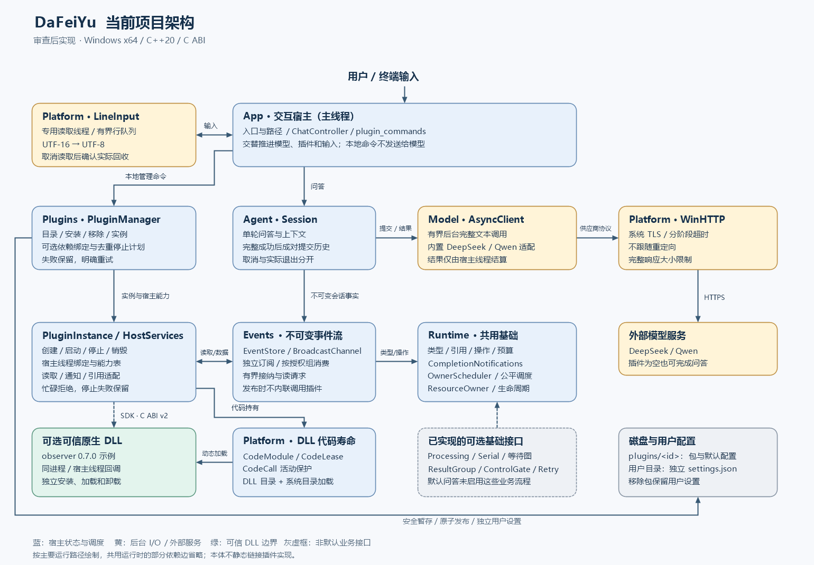
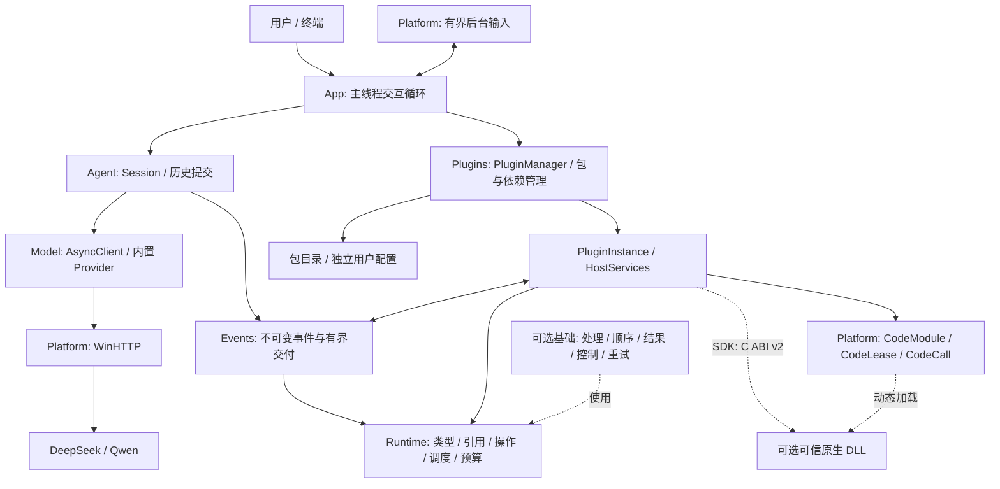

# 当前项目架构

本图依据本轮 35 个提交及审查修复后的代码绘制。主要运行路径见下图；共享库的部分细粒度依赖边省略，并不表示 Runtime 反向依赖 Events。

[SVG 矢量图](architecture.svg) 可放大查看；[生成脚本](../scripts/draw-architecture.ps1) 在 Windows PowerShell 7 下使用系统绘图库生成 SVG 和 PNG，不依赖在线绘图服务。

## 关键边界

- **正式问答**：App → Session → AsyncClient → 内置 DeepSeek／Qwen 协议 → WinHTTP。后台只处理输入快照和调用结果，状态与历史提交由宿主线程维护。
- **事件消费**：Session 发布不可变事实；PluginManager 推进读取、安排延后通知并运行一个公平调度步骤；HostServices 在有效绑定和代码活动保护内调用 DLL。
- **插件管理**：发现不自动加载。实例与依赖、包文件、用户配置分别管理；停止失败保留，包移除分批恢复，用户设置不随包删除。
- **可选接口**：ProcessingQueue、SerialDomain／等待图、ResultGroup、ControlGate、RetryController 已有实现和测试，默认问答没有自动启用这些业务流程。`observe` 事实通知已在正式会话使用。组消费由宿主明确授权，普通管理器默认采用独立订阅。
- **代码寿命**：PluginModuleV2 使用 Platform 的 CodeModule、CodeLease、CodeCall；数据引用不等于代码持有，业务完成不等于可以卸载。
- **历史范围**：同步 Bus 仅保留为早期独立基础及测试，正式 Session 不再依赖它；Old 不参与新根工程构建。

## 可编辑的结构图

静态构建上，`dfy_terminal` 依赖 Agent、输入和插件运行时，正式 App 不静态链接 observer DLL。Runtime 不依赖 SDK、Agent、Events 或插件实现；数据、调度和资源记录由它提供，C ABI 适配位于插件运行时。
