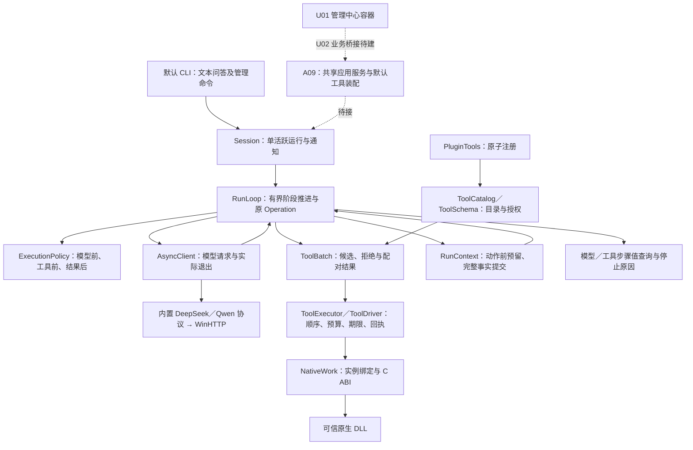

# 大肥鱼 21:00 开发检查点

本轮时间窗口：2026-11-15 北京时间 18:52～21:00。从干净基线 `800ab57` 推进，功能检查点为 `dc7fa8b`，共 11 个功能、测试与记录提交；本页作为收尾记录另行提交。截止后停止，等待用户继续指令。

**正式 Session 已具备显式授权下的最小有界工具循环。** 默认 CLI 仍使用原文本入口，尚未自动把加载的插件工具装配到会话；完整管理中心业务接入也尚未开始。

## 本轮完成

| 范围 | 已实现与验证 | 当前边界 |
|---|---|---|
| A05a-3 | 正式会话复用 RunContext，失败／取消／清空兼容 | 后续工具事实可独立于最终回答提交 |
| P01 | 运行、目标和策略绑定；模型前、工具前、结果后控制；扩展只能收紧规则 | P02 交互未实现，要求确认的工具候选拒绝执行，不自动批准 |
| T01 | 追踪父子身份、公开版本清单、单次投影、工具值投影 | 构建／模板等缺失版本保持未知；T02 完整多步时间线尚未实现 |
| E01 | 版本化固定响应场景、输入契约、明确调用数、受控时钟与结果报告 | 测试专用 C++ 场景；E02 文件回顾、重跑与 E03 比较尚未实现 |
| A05 最小循环 | 模型→工具批次→完整结果→下一模型；请求数、工具数、期限、上下文容量及重复批次限制 | 不包含自动规划、环境观察或自然语言目标达成判断 |
| 退出及诊断 | 取消阻止新步骤，迟到效果保留；会话销毁后保留真实收尾责任；模型与运行退出分别显示 | 尚未做完整 A05 阶段或 A09 最终验收 |

## 当前运行关系

实线为已实现路径，虚线为待接入部分；工具分支需要宿主显式提供结构化后端和固定授权快照。

运行数据仍由原回合和模型／工具 Operation 负责。协调器没有另建业务终态；通知失败不改变结果。业务取消之后，仍等模型或工具真正退出；资源释放失败不会通过“已取消”掩盖。

工具动作完成后，配对结果先成为完整上下文，再决定是否请求下一次模型。因此后续模型失败时，下一轮仍能看到已发生动作。新测试通过正式 Session、固定模型响应及真实 C DLL 验证了这条路径。

## 本轮验证

逐小步仅构建相关目标并运行对应 Debug 测试。相关入口包括 `agent.async_session`、`app.async_chat`、`agent.execution_policy`、`agent.trace_identity`、`agent.run_trace`、`agent.offline_scenario`、`agent.tool_batch`、`agent.run_loop`、`agent.session_tool_loop`、`model.async`、`app.lifecycle`；各自的执行时点与范围见 [开发记录](agent-development-log.md)，不把重复执行次数当成覆盖率。

关键证据包括：真实 C DLL 多步成功；工具后模型失败仍保留效果；未知／拒绝候选零动作；控制异常、整批超量或提交前到期不发起动作；结果回调取消阻止下一模型；模型次数与无进展停止；会话销毁后继续真实收尾；查询不占结果槽；原观察插件与应用生命周期兼容。

本轮没有调用真实模型、读取真实凭据或使用 Computer Use；没有执行最终全量、Release／跨配置总验收，也没有重新制作分发包。真实模型的选工具、规划质量、在线协议兼容和实际性能继续仅记录，不执行测试。

## 下一步与未完成内容

恢复后先实施 P02 的进程内等待、确认、继续和幂等决定，再完善 T02 多步追踪与 E02 回放，完成 A05 剩余验收。之后才按原主线进入 A06 环境观察、A07 受控规划、P03／A08 行动确认、T03／E03 和 A09 交付。

尚未具备：真实人工确认交互、完整多步追踪／导出、诊断文件重跑和版本比较、环境感知接纳、自动规划、行动后目标验证、默认 CLI 插件工具自动装配，以及管理中心业务页面和插件 UI 注册。当前运行结束不等于已经证明复杂现实目标达成。

阅读入口：[主计划](agent-capability-development-plan.md) → [横向计划](agent-cross-cutting-plan.md) → [正式会话](../../../agent/session.cpp) → [运行协调器](../../../agent/run_loop.cpp) → [工具批次](../../../agent/tool_batch.cpp) → [原生集成测试](../../../tests/session_tool_loop.cpp)。
