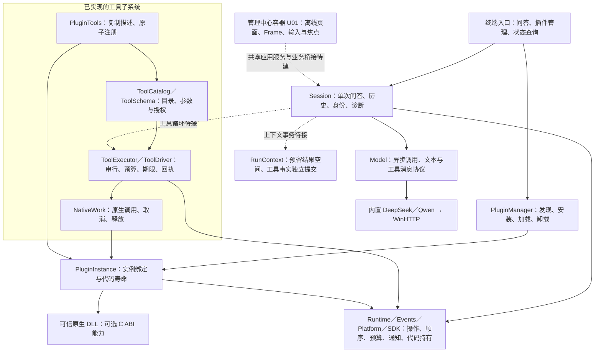

# 大肥鱼当前进度与框架

检查点：2026-11-15，功能提交 `a173b86`。用户要求当前小步完成提交后暂停，现停于 A05a-2；本轮共 26 个开发、测试与记录提交，范围 `cb293f1..a173b86`。本页随后作为暂停记录提交，不增加功能。

当前可以概括为：**单次问答主体＋已独立跑通的工具基础链路＋U01 管理中心容器**。模型和工具之间的多步闭环尚未接入正式 Session，观察、规划和行动确认也尚未实现。

## 已开发的范围

| 阶段 | 当前状态 | 实际成果与边界 |
|---|---|---|
| A00 离线测试入口 | 已完成本轮所需内容 | 复用模型／传输替身，增加固定结构化响应序列；没有真实模型调用 |
| A01 身份与运行事实 | 已完成单次问答范围 | Run／Step／Attempt 身份、五类生命周期事实、只读快照；当前正式回合仍为一个步骤和一次尝试 |
| A02 模型协议 | 已完成最小实现 | 系统、助手、工具调用与结果消息；DeepSeek／Qwen 编解码；停止原因、可选用量与原异步生命周期；在线兼容性仅记录 |
| A03 工具目录与插件注册 | 已完成最小实现 | 严格参数契约、运行授权快照、实例代次、可选 `dfy.tools` C ABI、描述复制及原子注册回滚 |
| A04 工具执行 | 已完成最小实现 | 串行执行、预算、期限、取消、回执复用、效果状态、独立退出与故障、DLL 清理失败保留；默认不自动重试动作 |
| A05 工具循环 | 进行中，暂停于 a-2 | 正式 Session 已支持显式结构化后端；独立 `RunContext` 已通过测试，尚未接入 Session；尚无自动“模型→工具→模型”循环 |
| A06～A08 | 未开始 | 环境观察接纳、受控自动规划、行动后确认 |
| A09 | 未开始 | 共享应用服务、CLI 完整接入、开发者示例与最终全量验收／分发 |
| UI | U01 已完成；U02～U09 未实施 | 本地 WebView2 容器、Frame 授权、中文输入、焦点与回收已有验证；业务页面、组件库和插件 UI 注册仍待开发 |

工具模块已经能通过正式目录、执行器及真实 C DLL 完成受控调用，但当前由专项测试和宿主接口驱动。默认 CLI 尚未创建 `PluginTools` 注册控制器，也尚未把模型返回的工具调用交给 `ToolExecutor`。

## 当前框架

实线表示当前已经接通的路径；虚线表示待接入关系。工具子系统框内组件已实现并完成必要测试，不代表默认问答已经会使用它们。

依赖分层保持 C++20／CMake／VS2022。`dfy_plugin_tools` 是连接 Agent 与插件运行时的独立适配层；`plugins/runtime` 没有反向依赖 Agent。普通通知用于观察变化，业务结果和实际退出由原 Operation 负责。

## 系统现在如何运转

1. **问答路径**：CLI 接收输入，Session 检查忙碌和历史边界，AsyncClient 在后台请求模型，宿主推进后提交完整回答并更新诊断、通知。默认入口仍是一次模型调用；收到未启用的工具响应会明确失败，不会擅自执行。
2. **工具路径**：宿主读取插件可选工具描述，复制到目录并形成明确授权的快照。候选调用经过名称、参数、实例、预算和重复效果检查后排队；实际获得顺序资格才进入原生代码。结果完成、效果已发生和资源退出分别记录。
3. **插件路径**：PluginManager 负责包和实例生命周期。空闲工具注册仅弱引用实例；在途 NativeWork 持有能力和代码，阻止提前卸载。取消或释放失败会保留工作，实际退出后才归还责任。
4. **上下文模块**：RunContext 在动作开始前准备整批结果空间，未完成占位不能传给模型。工具结果可以先独立提交，后续回答失败不会回滚。该机制目前独立验证，正式 Session 仍使用原文本历史逻辑。
5. **UI 路径**：U01 验证窗口能加载本地页面并验证容器边界，尚未通过共享应用服务连接问答、工具或插件管理。房间首页、业务组件与自定义页面注册还属于后续 UI 建设。

## 验证与暂停边界

各小步只构建受影响目标、运行相应 Debug 测试，结果均记录在 [开发记录](agent-development-log.md)。覆盖模型消息与固定响应、工具选择和参数、真实 DLL、取消／迟到效果、预算与顺序、释放失败、原子注册，以及禁止分配区间内的工具上下文提交。

本轮未运行真实模型、未采用 Computer Use，未做最终全量或跨配置验收，也未生成新分发包。此前 U01 的完整验收结果仍属于其原提交，不能作为本轮全部新增功能的最终验收证据。

恢复后先做 A05a-3：正式 Session 复用 RunContext；后续按已补充的 [P／T／E 横向计划](agent-cross-cutting-plan.md) 接入策略与人工介入、追踪与版本、离线回放，再沿 A05～A09 主线推进。该规划修订不改变本页已实现状态，当前仍暂停。

阅读入口：[开发计划](agent-capability-development-plan.md) → [逐步记录](agent-development-log.md) → [正式会话](../../../agent/session.cpp) → [工具执行器](../../../agent/tool_executor.cpp) → [原生注册](../../../plugins/tools/registration.cpp)／[原生工作](../../../plugins/tools/native_work.cpp) → [上下文事务](../../../agent/run_context.cpp)。
