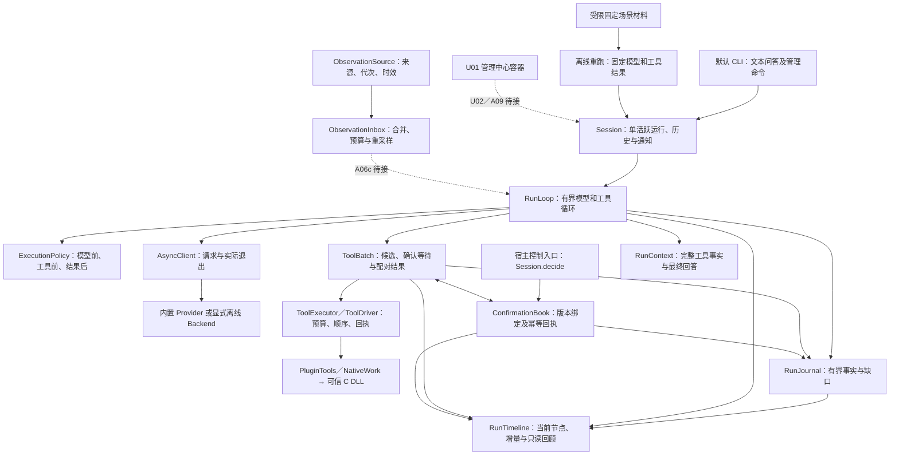

# 大肥鱼 21:30 开发检查点

时间窗口：2026-11-16 北京时间 20:10～21:30，从干净基线 `9c781d6` 接续。功能检查点为 `bd91a80`，共 19 个独立实现、修复和测试提交；本页随收尾文档另行提交。到时停止，后续等待新的继续指令。

**正式 Session 已接通人工确认、多步追踪与离线场景重跑；观察基础推进到 A06b，尚未自动触发运行。** 默认 CLI 仍走文本入口，管理中心仍为 U01 容器，确认界面和插件工具自动装配属于后续应用接入。

## 本轮完成与边界

| 范围 | 已实现 | 当前边界 |
|---|---|---|
| P02 人工介入 | 宿主绑定调用凭证；等待、批准、拒绝、取消、期限；精确参数／修订／实例绑定及幂等回执 | 原生 C++ 控制接口，尚无 CLI／GUI 确认交互；跨重启恢复不在范围内 |
| A05 受控循环 | 确认后重查与执行分开推进；拒绝覆盖同目标重复候选；参数排版不再绕过无进展停止 | 仍是有界串行执行，不含自动规划或真实目标达成判断；默认不重发失败模型请求 |
| T02 多步追踪 | 模型、工具效果、实际退出、控制决定、确认及历史提交；有界增量、明确缺口及完整当前节点 | 普通诊断无正文；完整待审参数只走可信确认查询；T03 文件导出仍未实现 |
| 版本信息 | 固定实际模型、策略、工具契约／实例；支持宿主公开提交／构建／模板标签 | 未提供的标签为未知；插件包及 schema 标识采集待 T03 完善 |
| E02 离线回顾／重跑 | 只读值时间线校验；既有替身驱动正式 Session；有版本的受限 JSON 固定场景 | 诊断元数据不能自行重现动作；文件材料只允许内存固定工具结果；真实 DLL 继续由专门集成夹具验证 |
| A06a／b 观察基础 | 来源、对象代次、采样修订、有效期、不可变载荷；有界合并、冲突／乱序拒绝、保留预算、完整重采样 | 尚未接入 A06c 观察触发、真实设备或 Agent 输入组装；只合并状态采样 |

人工确认等待期间不接纳工具、不占用工具顺序或 DLL 凭证。批准不扩大原工具范围，继续执行前仍检查原授权和实例；旧回执可以重取，但不会恢复已消费、取消或失效的许可。动作已经发生后取消，效果与真实退出仍分别保留。

观察断档不会被下一条连续采样掩盖。只有宿主明确发起的完整重采样、原对象水位仍匹配且新值成功接纳，才建立当前状态基线；丢失的中间历史样本不会被伪造为已恢复。

## 当前运行关系

实线为已实现调用或数据流，虚线为后续接入。正式工具链需显式提供结构化 Backend、工具范围及相应策略。

追踪仍是原执行事实的值投影。窗口裁剪、通知问题和只读回顾错误都不会成为新的业务状态机；查询不执行模型或工具。运行结果、工具效果及资源实际退出仍由原 Operation 和工具回执负责。

## 验证证据

每个提交只构建、运行受影响的 Debug 目标，具体时点和覆盖见 [开发记录](agent-development-log.md)。必要入口包括确认／工具批次／正式 Session、单次与多步追踪、增量记录、只读回顾、固定场景重跑与文件材料、观察值及观察接纳；原文本会话与终端兼容检查按改动范围补跑。

关键断言包括：

- 错误调用者、旧版本、参数改变、同目标拒绝、到期及取消均不能扩大或恢复动作许可。
- 真实 C DLL 批准仅执行一次；等待时实例可关闭；已发生效果后的取消仍等实际退出。
- 控制回调取消、拒绝或抛错不会启动已批准候选；后续模型失败不抹去动作事实。
- 追踪分页、裁剪和投影故障可见；重复／乱序／跨运行及矛盾诊断拒绝解释。
- 固定场景必须完整消耗模型、工具及控制材料；缺材料和意外调用不能冒充预期失败。
- 旧观察保留继续计费；容量失败不改变原水位；迟到或跨集合重采样不能覆盖新状态。

本轮未调用远程或本地真实模型，未读取模型凭据，未使用 Computer Use；没有进行最终全量、Release 总验收、跨配置总验收或重新打包。现有 U01 分发包不包含本轮新增功能。真实模型选工具、规划和观察理解表现继续“仅记录，不执行”。

收尾核对了 49 个本轮变更文本的严格 UTF-8、14 个公开／支持头文件的 BOM、243 处本地文档链接及代码围栏；整体差异检查通过。上述数字是编码与文档检查，不能替代功能或最终全量验收。

## 后续顺序

恢复后从 A06c 的显式观察触发、频率／运行预算和停止边界开始，再进入 A07 受控顺序计划，随后 P03／A08 的变化后复核及行动确认、T03／E03 和 A09 应用接入与最终验收。长期记忆、跨会话恢复、多 Agent 和完整管理中心业务 UI 仍不在本轮自动展开。

阅读顺序：[主计划](agent-capability-development-plan.md) → [横向计划](agent-cross-cutting-plan.md) → [确认接口](../../../agent/include/dafeiyu/confirmation.hpp) → [多步查询](../../../agent/include/dafeiyu/run_trace.hpp) → [受限场景材料](../../../tests/support/replay_material.hpp) → [观察接纳](../../../agent/include/dafeiyu/observation_inbox.hpp)。
