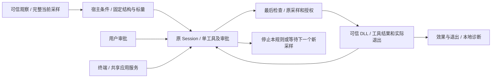

# 大肥鱼 12:30 开发检查点

2026-11-18 北京时间 11:02～12:30。从干净的 11:00 检查点 `2940d62` 接续，按独立小步验证和提交。功能与测试基线为 `40a276c`，本轮包含 19 个独立开发、修复及测试提交。到 12:30 暂停。

## 交付范围

| 范围 | 当前行为 |
|---|---|
| F07 环境观察 | 合成过期、重复、断档与高频采样。用户待处理时让出调度，完整重采样之后才接纳断档对象，原运行的替换关联可比较 |
| F08 计划与目标 | 可采集计划尾部修订、非法前缀、取消与期限，以及新旧目标、旧回执和总预算。证据保留计划步骤、原模型上下文和宿主验证 |
| F09 行动反馈 | 用固定响应和真实 C DLL 执行初读、变更及重读，分别记录满足、不满足和未知。模型文字与实际效果、业务结算及退出各有原事实 |
| F10 应用与分发 | 正式终端接入共享服务，进程内重连和编号命令保持原任务与审批回执，实例替换或拒绝后保持零新动作。使用独立 Release 安装目录和 SDK 样例 |
| 原生观察变更 | C++ 宿主显式给出一个动作、准确数据契约、标量条件与审批调用者。来源默认关闭，启动后仅用当前宿主可信样本匹配条件，实际变更仍等待人工审批 |

观察命中后，控制器用同一采样生成当前性守卫并交给原 Session。工具开始之前复查原对象、水位、时效、授权和停止状态。一次触发只允许一个工具候选，审批也绑定同一候选。模型跳过动作、候选越限、批准过期、工具失败或效果未知时终止运行，控制器在轮询确认实际退出后停止本规则。已发生或未知效果仍在原工具回执和诊断中可查。规则的停止作用于自己的运行，共享 Session 可继续接收用户问答。CLI 保留主动委托和读回任务入口，观察变更配置当前由原生宿主接入。

## 离线比较

沿用版本 1 证据封套和严格诊断读取。执行证据保存时间线、计划和反馈。比较核对原目标及计划版本、采样关系、动作效果、审批所指原候选和事实顺序，再按相对位置对齐独立运行分配的临时身份。执行时由固定场景和允许的测试夹具提供行为；证据文件的读取及比较不会执行工作。

批量入口使用实际构建标签和固定案例材料摘要。从两个源码基线执行同一案例时，只按显式声明允许对应版本项变化。场景采集失败、字段差异和不可比均保留到相应报告，最终通过数只统计实际能比较且断言通过的场景。 [批量比较入口](../../../scripts/verify-agent-replay.ps1)

## 功能场景覆盖

| 场景 | 主要 CTest 或检查入口 |
|---|---|
| F01 普通问答／空插件 | `agent.offline_scenario`、`app.async_chat`、`app.lifecycle` |
| F02 多步调用及命令重放 | `agent.session_tool_loop`、`agent.scenario_replay`、`agent.multi_run_trace` |
| F03 拒绝及确认 | `agent.session_confirmation`、`agent.session_action_guard`、`app.tools` |
| F04 取消及迟到效果 | `agent.session_tool_loop`、`agent.goal_effect_guard`、`agent.replay_native_observation_action` |
| F05 插件变更与寿命 | `plugins.tool_abi`、`plugins.status_example`、`app.tool_verification` |
| F06 追踪及重同步 | `agent.run_journal`、`agent.timeline_review`、`agent.diagnostic_json`、`app.diagnostic_files` |
| F07 观察输入 | `agent.observation_inbox`、`agent.replay_observation_dispatch`、`agent.replay_observation_rebind`、`agent.observation_action` |
| F08 计划及目标 | `agent.session_replanning`、`agent.replay_plan_revision`、`agent.replay_goal_revision` |
| F09 行动后确认 | `agent.native_action_feedback`、`agent.replay_action_feedback`、`agent.replay_observation_action` |
| F10 应用、重连及分发 | `app.tool_verification`、`app.replay_task`、[分发检查脚本](../../../scripts/verify-agent-package.ps1) |

本轮测试使用预设模型响应、传输替身或纯本地命令。真实模型选工具、生成计划和判断观察表现仍在仅记录范围。原生 DLL、线程和文件按场景实际执行。

## 验收过程中的修复

- 初次独立构建发现时间线与诊断文件测试仍引用原回放字段。迁移到完整诊断值后，两个入口定向复测通过。
- 完整运行最初两种配置各通过 140／145。当前 Windows 账户缺少创建符号链接的权限，五个测试在准备夹具时失败。新夹具优先使用真正的符号链接，在特权不足时使用实际 NTFS 目录联接和文件重解析标记。标准账户的验收使用了这些实际替代类型。 [Windows 符号链接创建条件](https://learn.microsoft.com/en-us/windows/win32/api/WinBase/nf-winbase-createsymboliclinka)
- 清单和配置改为在路径分类及读取之前检查原生重解析属性，保留原错误类别。通用重解析标记有独立断言；原生拒绝相关五项定向复测通过。

## A09c 验收记录

以 `40a276c99e0cf3063415f5185ceeb210f184c755` 配置独立 VS2022 x64 目录 `build/a09-verify-120406/vs`。第三方依赖使用本地缓存的固定归档，重新核对 SHA-256 后解包。当前终端与原生 Agent 验收使用 `windows-tests`，U01 的桌面探针沿用此前的独立范围。

| 检查 | 结果 |
|---|---|
| 独立 Debug 构建和完整 CTest | **145／145** |
| 独立 Release 构建和完整 CTest | **145／145** |
| E03 固定案例跨 Debug／Release | **31／31**，只声明构建配置差异 |
| E03 跨源码提交 | `2a45eb6` 与 `40a276c` 的 Release 证据 **31／31** 一致，只声明源码字段差异 |
| Debug 宿主加载 Release DLL | **23／23**，包括基础平台与 C ABI 的 16 项，以及工具、观察行动与应用的 7 项 |
| Release 分发检查 | 两份示例配置有效；真实状态面板安装、加载、卸载、移除和用户设置保留通过，默认包目录为空 |
| 分发 SDK 和诊断回顾 | 从安装 SDK 独立编译状态面板 Release DLL，再由 Debug 宿主实际执行；安装版离线读取中文路径下的 Debug 诊断，确认原源码标签、实际退出及一次已发生效果 |

A09c 在上述离线范围内通过。两套完整 CTest 日志及 JUnit XML 在 `build/a09-verify-120406`，其中 `distribution` 为独立 Release 运行目录。逐案原证据和比较结果在 `build/agent-replay-check/4e717a60d5054a96948e1af93a195fa5`。配置保留 CMake 4.5 对原 x86 夹具的开发提示，相关加载器用例已通过。

## 后续

下一步按用户选择接入 U02 桌面业务桥接，并复用同一 Application、审批和只读查询。长期记忆、跨进程任务恢复、多 Agent 和真实设备适配保留独立审查边界。普通终端的可复现操作见 [运行说明](../../run-guide.md)，独立提交见 [开发记录](agent-development-log.md)。
