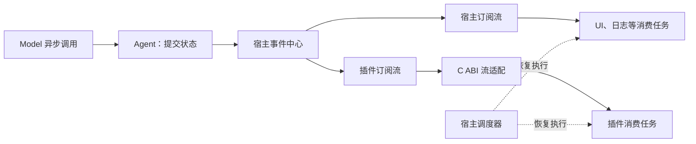

# 异步事件流分析与待讨论问题

记录日期：2026-11-11；同日继续补充资源卸载、接口与实施路线。业务代码基线：`00a5b0c`，前次讨论记录提交及本次记录前仓库 HEAD：`60a185d`；第 07 步 DLL 加载查询已完成。

**已确认方向：整个宿主与插件的事件订阅统一采用异步事件流。** 当前代码仍是同步回调总线；已确认结论集中记录在第 0 节，其余内容须按“建议”与“待讨论”标记阅读，不表示异步化已经实现。第 08 步实例生命周期的实施顺序，应在事件交付与资源回收规则明确后重新对齐。

**R01 最小接口契约及隔离验收、R02a 签发域与引用表、R02b 基础值、R02 最小结构数据及 R03a FIFO 与 R03b 操作终态已完成；下一审查项为 R03c-1 协作取消请求。** 生产运行时已包含最小结构数据与反射读取，及独立 FIFO、操作终态记录，但尚无生产取消和完成通知、v2 适配、资源依赖及插件实例。具体进度与验收限制以 [开发指导](foundation-development-guide.md#39-操作唯一终态r03b) 为准。

## 0. 本轮已确认结论与讨论边界

### 职责与普通事件的数据所有权

- 宿主统一跟踪消费者任务的启动、取消与完成，业务处理者提供具体处理逻辑。
- 支持运行时字段反射：没有预编译某种事件类型的宿主或插件，也能枚举字段、检查类型并读取内容；已知类型可以提供本地 C++ 强类型封装。
- 普通事件的类型描述、校验、数据所有权及释放统一由宿主管理。字段描述表达数据结构，不依赖插件内部 C++ 对象布局。
- 类型注册形成宿主持有的描述快照，不能仅借用 DLL 静态内存；普通载荷采用宿主可解释、校验和释放的统一类型体系。
- 事件发布后数据不可变；消费者需要变更内容时产生新事件。描述与载荷按引用寿命保留，相关使用结束后回收，不要求永久保存。
- 跨 DLL 仍使用 C ABI，通过不透明句柄及类型、数据访问接口交互；C++ 强类型封装留在各模块内部。具体接口、载荷表示和 ABI 版本仍待定。
- 完全由宿主管理的普通描述与数据可以独立于定义插件存活。资源句柄、插件自定义解码或析构函数涉及额外依赖，须在资源管理议题中明确。

### 已确认的类型体系

| 类别 | 类型 | 含义 |
|---|---|---|
| 基础 | `Bool` | 布尔值 |
| 基础 | `Int64`、`UInt64` | 有符号与无符号整数 |
| 基础 | `Float64` | 浮点数 |
| 基础 | `String`、`Bytes` | UTF-8 文本与有明确长度的二进制数据 |
| 组合 | `Struct` | 字段明确、可嵌套的结构 |
| 组合 | `Array<T>` | 元素类型明确的有序数组 |
| 组合 | `Map<String, T>` | 键动态变化、值类型明确的映射 |
| 组合 | `Enum` | 有名称及稳定取值的枚举 |
| 组合 | 带标签联合类型 | 多种已声明结构中的一种，纳入基础能力 |

组合类型允许插件在运行时声明，消费者可递归查询描述。字段“可选”与“可空”分别表达：缺失、显式空值及空字符串不能混为同一结果；业务含义由事件契约规定。具体约束编码、数值边界、联合类型标签及递归限制仍须设计。

2026-11-12 补充确认：R02c 使用完整名称加精确契约版本，定义与使用分开，同名同版本对应唯一正式定义；结构值通过宿主统一构造和严格校验。最初只覆盖六种基础类型的必填、不可空字段，嵌套、可选与可空分别验收。R02c-1 已实现身份及描述快照，具体名称规则、显式容量、字段约束和错误边界见开发指导第 3.5 节；目录冲突处理与结构值仍分别留待 R02c-2／R02c-3。

本次参考 DSH `ce7073d` 的 [Typert 注册](https://github.com/deepseek-ai/deepseek-harness/blob/ce7073d51254c26cd63b22a60835b8f948deb447/packages/typert/registry/src/service.ts#L560)、pi `822b37a` 同仓 Chord 的 [schema 快照](https://github.com/earendil-works/pi/blob/822b37a27580073ff3f5d2654df6126e8a6f4383/packages/chord/src/contracts/snapshot.ts)及 AI-Vtuber `c430ee7` 的 [统一消息构造](https://github.com/Ikaros-521/AI-Vtuber/blob/c430ee71f208f45850c1ab25c85f2a70e9b09d72/luna/core/message.py)。借鉴注册前校验、独立描述和统一构造责任；大肥鱼采用宿主可解释的明确种类及字节约束，不引入 JavaScript schema 工厂、隐式类型转换或任意字典扩展。仅阅读参考源码与相关测试，未运行参考项目。

### 类型共享与处理责任

- **类型定义归属明确，发布与消费可由多个插件承担。** 契约使用关系与提供服务的插件实例依赖分别讨论。
- **普通订阅默认承担观察责任，只有显式登记为业务参与者才进入业务完成条件。** 普通观察者的失败独立报告，不改变原业务结果；宿主仍管理其任务和资源寿命。
- 业务完成与取消隔离原则见下文；参与者的具体结果汇总策略、接口和状态枚举仍待定稿。

### 执行与顺序：已确认的两条基础规则

1. **调度对象是投递及其处理任务，事件接纳顺序作为稳定记录保留。** 取出策略不改写事件的接纳先后，广播接收方分别维护投递进度。
2. **先依据顺序、依赖和容量筛选可执行集合，再应用取出策略。** 优先级不能突破必要前置条件、顺序约束或接收方并发限制。

作为上述规则的细化候选：宿主在统一接纳点确定并发来源的先后，为事件分配递增序号；池内共享不可变载荷，投递记录引用它；具体消费者组成员可在领取时选择。宿主接纳先后不能推断成不同机器或线程上的物理发生先后，接纳成功也不表示业务完成。

顺序域可按订阅、接收方加会话标识或消费者组加业务对象划分。严格串行域中的前一处理未结束时，后一处理不能因优先级较高而开始；前一处理异步等待时让出执行线程，但保留必要顺序占用。常驻消费者等待下一事件与正在处理一份投递的容量占用应区分。顺序域的具体键、默认串行粒度、失败后是否继续以及占用释放边界仍待明确。

等待后的恢复属于原任务继续执行，不重新发布事件或领取投递。需要检查等待依赖，防止任务占用某个顺序域，却等待必须进入同域才能执行的回复或控制处理者。这些候选细节仍须在接口和调度验收时定稿。

### 结果与完成：已确认的分层与 hook 分类

**处理进度、业务结果和资源回收分别管理。** 不给一个广播事件设置能够代表全部消费者的单一处理状态；普通事件记录保持不可变，状态位于宿主管理的投递、任务、业务及资源记录中。

| 管理层次 | 回答的问题 | 与其他层次的边界 |
|---|---|---|
| 处理进度 | 这份投递正在排队、执行、等待还是收尾 | 处理阶段与调度状态分别表达；阶段和状态枚举尚未冻结 |
| 业务结果 | 本次请求的必要工作是否满足完成条件 | 由显式参与者和完成契约决定，普通观察者不进入完成条件 |
| 资源回收 | 是否仍有调用、等待、恢复任务或资源需要清理 | 结果确定、读到流结束或等待超时均不能证明资源已经释放 |

**已确认三类 hook：观察、控制和清理。**

| 分类 | 职责 | 等待与失败原则 |
|---|---|---|
| 观察 hook | 通知已经发生的接纳、开始、取消请求或结果变化 | 原业务不等待观察处理，观察失败独立记录，不改变业务终态 |
| 控制 hook | 在明确边界请求准入、检查或方案决策 | 显式参与决策，主流程等待类型化响应；决策汇总、超时和替代规则须在控制契约中声明 |
| 清理动作 | 撤销注册、释放资源、等待受管理工作退出 | 具有所有者和可等待完成记录；失败不能被当作已回收 |

以下仍是结果协议的细化方案：唯一结果、全部成功、任一成功与首个终态分别表达；确定结果后如何处理剩余工作须同时声明。业务提交点规定成功与取消竞争的裁定边界，已确定终态不被迟到结果、观察错误或清理错误覆盖。普通资源清理失败另行记录；必要业务步骤应在结果确定前纳入判断。

`accepted`、`before_execute`、`started`、`before_commit`、`settled`、`cancel_requested` 是候选 hook 名称，不是已冻结 API。`before_commit` 需要业务提供明确的提交边界，不能自动回滚已经产生的外部效果。三类 hook 继续使用统一的事件、任务及资源机制；控制处理也必须避免顺序域内的相互等待。

### 积压与调度：已确认的四条基础规则

1. **容量按宿主、所有者、接收方和单事件分层限制，覆盖排队、处理、等待及结果保留。**
2. **默认采用有预算的优先级调度，结合按所有者的加权公平；优先级服从执行资格。**
3. **溢出策略由交付契约明确声明，丢弃、替代或终止都留下可见结果。**
4. **为取消、终态记录和必要收尾预留受限资源，使过载时仍能推进回收。**

| 容量层次 | 需要细化的计量 |
|---|---|
| 单事件 | 载荷字节、字段和容器规模、嵌套深度及构造／校验成本 |
| 订阅或处理组 | 待处理投递、保留数据、同时处理数量 |
| 资源所有者 | 名下订阅、任务、等待项及数据的总量，防止增加订阅绕过总预算 |
| 宿主整体 | 事件存储、投递、任务、结果、入池等待者及控制预留 |

计量细化建议：共享载荷在全局实际存储中只计算一次，但各订阅的投递记录及保留关系仍需计量；从队列取出只是转入处理，引用未释放不能提前归还实际存储预算。等待容量的发布者也有成本。宿主管理资源的接纳上限不等于同进程原生插件的全部内存或 CPU 获得强隔离。

调度细化建议：优先级表达响应倾向，权重表达竞争份额，配额表达上限；先选有预算的所有者，再从其可执行候选中选择，记录一次恢复到挂起／返回的执行占用。异步 I/O 等待不占宿主执行时间，但仍占活动工作及数据预算。空闲能力可让其他所有者利用，长期不活动不积累无限额度。具体轮转算法、成本计费、压力阈值、等待时间提升、优先级继承及所有数值尚未确定。

溢出候选包括：普通事实观察超限后明确终止订阅；状态观察按键替换未执行投递；允许取舍的输入按契约丢弃或过期；必要业务在接纳前反压或拒绝，接纳后异常形成可查询结果。合并不得修改共享事件正文，已开始的工作应走取消协议。上述各类默认策略仍待确定，未引入持久化交付或无限等待承诺。

预留通路应支持取消状态更新、等待唤醒及必要收尾，不能依赖向已满普通队列再次投递；仍需自身预算和可查询状态。反压要检查资源等待关系，防止处理者占着顺序域却等待向该域满队列投递。协作执行仍只在返回或挂起处切换，不承诺抢占任意 DLL 代码或硬实时完成。

### 取消、关闭与故障：已确认的四条基础规则

1. **取消沿所有权和显式关联传播，取消请求与实际退出分别记录。**
2. **订阅支持排空关闭和取消关闭，重复调用共同等待，关闭与资源回收分别完成。**
3. **故障按观察、业务参与、控制和清理责任隔离，清理失败保留所需资源。**
4. **默认不自动重试；显式重试具有副作用安全条件、次数／时间／资源边界，并重新经过调度。**

取消传播分别考虑一次读取或等待、一份投递、一次业务及所有者作用域。普通观察任务由订阅所有者管理，关闭日志不默认取消问答，取消问答也不自动取消相关结束通知的观察处理。共享事件、关联 ID 或服务引用本身不构成取消链。首个有效取消原因、后续关停限制、代次隔离及读取与取消竞争的原子结算，需要在接口中明确。

| 关闭方式 | 新投递 | 尚未执行的投递 | 已开始的处理 |
|---|---|---|---|
| 排空关闭 | 停止接纳 | 按原契约继续 | 继续执行并收尾，必要续执行仍可调度 |
| 取消关闭 | 停止接纳 | 逐项结算取消或失效 | 请求协作取消，等待退出 |

关闭细化建议：排空可升级取消，不能恢复接纳；重新启用产生新身份或代次。排空中的重试仍受既有次数、期限和预算限制，取消关闭不再创建新尝试。关闭单个组成员与关闭整个组分别处理；未领取投递可由其他存活成员继续，已领取工作须先明确旧尝试的退出和结果，不能因成员关闭而直接并发重放。

停止接纳完成、已有处理退出、资源回收完成分别可观察和等待；`next()` 返回流结束不代表消费任务已经退出。具体接口、默认关闭模式、结束原因格式和等待时限仍待定。关闭或回收超时只报告未完成并保留必要引用，不能据此释放仍可能使用的模块。

| 故障位置 | 已讨论的隔离方向 |
|---|---|
| 类型、契约或参数 | 接纳前拒绝，不默认重试 |
| 普通观察 | 记录单次投递失败，不改变原业务；是否继续消费取决于处理者是否仍可安全使用 |
| 必要业务参与 | 按本次业务完成契约汇总，不自动扩散到无关业务 |
| 控制 hook | 缺省不把失败解释为允许执行，替代决策必须声明 |
| 清理动作 | 独立记录回收失败，保留仍被依赖的资源；可安全独立完成的清理继续执行 |

诊断应关联所有者、业务、投递与执行尝试，区分原业务错误和清理错误；报告不能递归制造同一故障，原始状态不依赖通知成功。上述隔离面向约定内失败，同进程 DLL 的非法内存访问等原生故障仍没有进程级隔离。

重试细化方向：业务声明可重试错误及幂等、查询或其他副作用安全条件；超时不能证明远端未执行。退避可取消并计入预算，到期后重新检查执行资格及调度份额；严格顺序工作保留必要占用。保留业务和投递身份，为每次尝试分配独立标识，默认不并发执行同一投递的新旧尝试，也不重新广播给全部消费者。清理重试只重试清理，不重放已成功提交的业务。具体错误分类、幂等协议、退避参数和迟到结果接口仍待细化。

### 资源登记与插件卸载：已确认的基础规则

1. **资源归属、资源使用和 DLL 代码依赖独立登记，由宿主关联管理。** 归属表示清理责任，不改变分配方释放自身内存的规则。
2. **资源和使用关系绑定具体实例及代次；使用者收尾期间所需的提供方资源保持有效。** 类型定义归属、普通数据寿命与代码依赖分别判断，宿主普通数据不因来源插件而自动保持其 DLL。
3. **受管理副作用在执行前建立追踪责任，初始化或清理失败保留未完成记录及必要引用。** 回调、恢复任务、协程销毁和清理函数均可能产生代码依赖，活动调用数为零不足以证明可以释放模块。
4. **默认拒绝仍被依赖的卸载；联动停止与重新绑定必须显式选择并明确影响范围。** 联动停止不自动扩大成释放全部依赖方 DLL，必要的实例销毁应列入计划。
5. **使用者退出期间保留提供方资源，旧凭证绑定原实例；重新绑定在明确边界产生新绑定。** 新绑定可用不表示旧使用已经退出，不自动迁移插件内部状态。
6. **停止成功、实例相关资源回收、实例销毁及模块引用释放依次满足条件，销毁至多执行一次。** 停止、清理及销毁仍需要的提供方绑定，保留到最后一次实际使用结束；模块引用在相关代码返回宿主后释放。
7. **失败保留必要资源及逐阶段进度；重试未完成部分，不强制释放、不重放已完成销毁，也不承诺整体回滚。** 进行中重复请求共同等待，失败后的显式重试复用进度；v1 的 `destroy` 不提供可恢复错误结果，不能将其契约违约当作普通失败再次调用。

具体登记字段、依赖环处置、重新绑定协议、联动影响范围及卸载状态机仍需细化。有活动原生调用时返回忙碌且不变更实例的既有约束继续有效；只释放宿主持有的模块引用，不宣称其他引用已经消失。

### 接口与实施顺序：已确认的三条基础规则

1. **C++ 便利接口与 C ABI 映射到同一套宿主记录，异步完成及资源寿命语义一致。**
2. **v1 保持冻结，v2 使用明确的新查询入口和版本化能力表，不隐式兼容旧同步语义。**
3. **先完成最小真实 DLL 异步链路，再按能力扩展；每阶段继续拆成独立验收提交。**

接口职责、操作句柄与完成通知、版本区分和 R01～R16 阶段组以 [开发指导第 4.5 节起](foundation-development-guide.md#45-c-接口与异步操作) 为维护入口。R01a 已固定 `dfy_plugin_query_v2` 及静态查询布局，生产加载器仍仅接受 v1，其余能力表继续独立审查。每次约 100～300 行手写变更的审查参考包含测试，复杂单元继续拆分，不因路线获认可而连续实施多个阶段。

### 已纳入范围、但尚未定稿的建议

| 议题 | 当前讨论范围与未决部分 |
|---|---|
| 类型身份与注册 | 完整名称加精确契约版本、定义与使用分开、同名同版本唯一正式定义已确认；R02c-1 已实现描述。R02c-2 已实现重复／冲突拒绝与精确查询；命名权限、撤销后的新操作及后续兼容转换仍待定稿 |
| 交付方式 | 独立订阅／广播、指定接收方、消费者组都纳入设计范围。每组由一个成员领取、广播与组并存、接纳时固定目标而调度时选择成员，是待定的具体方案 |
| 投递与任务 | 原子领取、组成员重分配、顺序链、短路及具体结果聚合协议；已有基础规则不能代替这些协议 |
| 执行与顺序 | 两条基础已确认；接纳序号、顺序域键、串行粒度、失败后推进、重入及恢复接口仍待细化 |
| 状态与 hook | 三层管理与三类 hook 已确认；状态枚举、hook 名称、决策汇总、提交竞争和默认超时仍未冻结 |
| 积压与调度 | 四条基础已确认；预算计量与数值、具体公平算法、优先级提升以及各类默认溢出策略仍待定 |
| 取消与故障 | 四条基础已确认；取消接口、默认关闭模式、故障分类、退避及副作用安全协议仍待细化 |
| 依赖与副作用 | 登记与卸载基础已确认；依赖环、能力重新绑定、联动范围、资源状态及清理动作重试协议待细化，不自动引入安装时的软件包版本求解 |
| 接口与实施 | R01a 查询、R01b 句柄／借用及 R01c-1 操作状态契约与隔离验收已完成；R01c-2 已固定取消请求，R01c-3 已完成通知布局及隔离验收，后续能力独立审查 |

此前“超限关闭普通观察订阅”“状态合并”“同一订阅串行消费”等均保留为候选策略，不能因确认了统一机制或默认观察责任而当作已批准规则。既有忙碌时拒绝卸载、停止失败保留实例与模块的约束继续有效。

## 1. 当前实现与目标的差距

目前 [Bus](../events/bus.cpp) 在 `publish()` 调用栈上依次执行回调，返回时可以汇总回调结果；没有可等待读取、订阅缓冲或流结束机制。[Session](../agent/session.cpp) 同步调用模型，成功后成对提交历史再通知，失败保留原历史。

[WinHTTP](../platform/winhttp.cpp) 和 [终端输入](../app/chat.cpp) 都会阻塞调用线程。因此，给订阅加上 `next()` 外观还不足以支持请求进行中的事件消费，需要同时确定宿主调度方式和 I/O 的执行方式。

事件异步消费、模型按 token 输出和多线程执行是三个独立选择。首版可以保留完整文本响应，先实现异步执行及生命周期事件流；不必同时增加工具循环、规划、记忆或持久化。

## 2. 参考版本与源码结论

| 项目 | 本次分析版本 | 范围 |
|---|---|---|
| DSH | `687f282e8625c6b8d11ff58211a90524be2e4317` | 本地 `D:\DSH\deepseek-harness` 的模型流、Agent 分发、会话观察和 Cordis 资源清理 |
| pi | `75d59639aa0e53833173c86361637f5c8e1c4642` | pi-ai、agent-core、coding-agent 扩展以及同仓库 Chord watch |

本节前两组结论保留首次分析的版本与阅读位置；后续版本见本节末尾“本轮补充阅读”。结论来自源码及相关测试的阅读，未运行参考项目；源码引用固定到对应提交。

### DSH

1. **模型层提供异步可迭代流。** `LlmRuntime.stream()` 返回 `AsyncIterable<StreamChunk>`，Agent 用 `for await` 消费。适配器失败被转换为终态片段，消费者与中间件错误保留其自身失败语义；提前退出时尝试关闭底层迭代器。[模型流实现](https://github.com/deepseek-ai/deepseek-harness/blob/687f282e8625c6b8d11ff58211a90524be2e4317/packages/llm/llm/src/index.ts#L1064)
2. **宿主内分发仍包含回调机制。** Cordis 区分同步通知、并行等待、顺序等待、短路和 waterfall。DSH 的 Agent 通知逐个调用监听器，分别容纳同步异常及 Promise 拒绝，但不等待观察者的异步处理完成；控制钩子则可以影响后续执行。[Agent 分发](https://github.com/deepseek-ai/deepseek-harness/blob/687f282e8625c6b8d11ff58211a90524be2e4317/packages/core/agent/src/dispatch.ts#L107)、[Cordis 分发模式](https://github.com/deepseek-ai/deepseek-harness/blob/687f282e8625c6b8d11ff58211a90524be2e4317/vendor/cordis/src/events.ts#L183)
3. **会话观察流为每个订阅建立独立队列。** `follow()` 先注册监听，再交付初始快照和后续事件，用序号处理连续性，退出时在 `finally` 中解除监听。它提供了从通知到异步订阅的实际连接方式。[会话 follow](https://github.com/deepseek-ai/deepseek-harness/blob/687f282e8625c6b8d11ff58211a90524be2e4317/packages/api/session-controller/src/history.ts#L120)
4. **提交与观察失败分开。** 会话先将事件加入内存日志，再通知观察者；观察者失败不回滚提交。这里不能直接理解成每条事件已经落盘。[会话提交](https://github.com/deepseek-ai/deepseek-harness/blob/687f282e8625c6b8d11ff58211a90524be2e4317/packages/core/session/src/index.ts#L876)
5. **注册项具有所有者和可等待的清理流程。** 作用域清理会等待其受管理的清理工作。但取消监听本身不能证明所有异步处理都已结束，更不能直接作为原生 DLL 可卸载的依据。[作用域清理](https://github.com/deepseek-ai/deepseek-harness/blob/687f282e8625c6b8d11ff58211a90524be2e4317/packages/core/scope/src/index.ts#L115)

DSH 的 `follow()` 缓冲在该层没有容量上限；不能因其返回 `AsyncIterable` 就推断具备完整背压保证。适合大肥鱼借鉴的是用途划分、先提交后通知、独立订阅及资源归属；全部能力插件化和完整会话持久化体系不属于本轮改造范围。

### pi

1. **底层 Agent loop 提供事件流和独立结果。** `EventStream` 用队列和等待者支持异步迭代，`result()` 独立取得最终结果。`push()` 不等待消费完成；同一个流共享一套队列，没有为不同迭代器广播副本，也没有在该类中限制容量。[EventStream](https://github.com/earendil-works/pi/blob/75d59639aa0e53833173c86361637f5c8e1c4642/packages/ai/src/utils/event-stream.ts#L26-L87)、[Agent loop](https://github.com/earendil-works/pi/blob/75d59639aa0e53833173c86361637f5c8e1c4642/packages/agent/src/agent-loop.ts#L47-L70)
2. **上层 Agent 监听器具有等待语义。** `Agent.subscribe()` 的 Promise 按顺序被等待，`prompt()` 和 `waitForIdle()` 包含这些监听器的完成时间。测试明确覆盖了 `agent_end` 已发出但监听器未完成时仍不空闲的情况。[订阅完成测试](https://github.com/earendil-works/pi/blob/75d59639aa0e53833173c86361637f5c8e1c4642/packages/agent/test/agent.test.ts#L362-L433)
3. **扩展事件可以承担控制职责。** 例如 `tool_call` 的处理器被等待，并能返回 `block` 阻止执行。这类决策不能改成发布后不等待的普通通知。[扩展处理](https://github.com/earendil-works/pi/blob/75d59639aa0e53833173c86361637f5c8e1c4642/packages/coding-agent/src/core/extensions/runner.ts#L1256-L1273)
4. **Chord watch 提供延后、串行的异步观察。** 它不会在发布位置直接执行观察者；状态变化积压时可以合并为最新值。`NativeWatch` 超过 100 个待处理值时会合并替换，不能将这一策略直接套到必须逐条交付的业务事实。[调度](https://github.com/earendil-works/pi/blob/75d59639aa0e53833173c86361637f5c8e1c4642/packages/chord/src/watch.ts#L204-L246)、[积压处理](https://github.com/earendil-works/pi/blob/75d59639aa0e53833173c86361637f5c8e1c4642/packages/chord/src/watch.ts#L398-L438)
5. **watch 关闭不等于正在执行的回调结束。** `stop()`／`closed` 可以先完成，已运行的回调仍继续。这与原生 DLL 卸载需要的静止条件不同。[关闭语义](https://github.com/earendil-works/pi/blob/75d59639aa0e53833173c86361637f5c8e1c4642/packages/chord/src/watch.ts#L46-L54)

pi 的流、Agent 监听器和 Chord watch 是不同层的机制，不能统一描述为“全系统都是异步迭代器”。大肥鱼可以采用更一致的订阅接口，但必须自己确定广播、背压、取消和资源回收语义。

### 本轮补充阅读

| 项目 | 本轮版本 | 核对范围 |
|---|---|---|
| DSH | `ce7073d51254c26cd63b22a60835b8f948deb447` | 本地 `E:\DSH\deepseek harness`；Agent 通知、模型流、会话观察、Cordis 依赖与清理 |
| pi | `473515f9c297c75cf2c3ebb3ba027049ed836d27` | 在线固定提交；EventStream、Agent 等待语义、扩展控制与 Chord watch |
| AI-Vtuber / Luna AI | `c430ee71f208f45850c1ab25c85f2a70e9b09d72` | 平台入口、消息缓冲、处理锁、TTS／播放队列、停止与相关测试 |

DSH 的 `follow()` 已移动到 [web/controller.ts](https://github.com/deepseek-ai/deepseek-harness/blob/ce7073d51254c26cd63b22a60835b8f948deb447/packages/api/session-controller/src/web/controller.ts#L32)，先建立监听再取得快照，使用游标衔接后续事件；[ListenerBuffer](https://github.com/deepseek-ai/deepseek-harness/blob/ce7073d51254c26cd63b22a60835b8f948deb447/packages/api/session-controller/src/history/listener.ts#L176) 未在该层限制容量。不能直接把旧分析的位置用于当前源码。

DSH 的 [Agent 清理](https://github.com/deepseek-ai/deepseek-harness/blob/ce7073d51254c26cd63b22a60835b8f948deb447/packages/core/agent-loop/src/index.ts#L495) 共享一次 teardown，发出取消后等待空闲，再清理作用域等资源并汇总失败。[Cordis Fiber](https://github.com/deepseek-ai/deepseek-harness/blob/ce7073d51254c26cd63b22a60835b8f948deb447/vendor/cordis/src/fiber.ts#L713) 保留提供方资源直到依赖方退出；单个 effect 内的清理逆序执行，Fiber 顶层清理可以并行，不能概括成全系统严格逆序。原生 DLL 仍需额外证明不存在活动调用、排队恢复或依赖其代码的销毁动作。副作用登记可管理订阅、定时器、服务和任务等资源，已完成的外部行为需要业务定义补偿，不能承诺自动撤销。

DSH 的 [cancel / whenIdle](https://github.com/deepseek-ai/deepseek-harness/blob/ce7073d51254c26cd63b22a60835b8f948deb447/packages/core/agent-loop/src/agent.ts#L191) 分开提出取消与等待活动退出，支持选择是否保留待处理输入；`whenIdle()` 跟踪当前活动直至空闲，并非某一条消息的业务结果。[观察通知](https://github.com/deepseek-ai/deepseek-harness/blob/ce7073d51254c26cd63b22a60835b8f948deb447/packages/core/agent/src/dispatch.ts#L120) 分别容纳同步异常与 Promise 拒绝；[生命周期测试](https://github.com/deepseek-ai/deepseek-harness/blob/ce7073d51254c26cd63b22a60835b8f948deb447/packages/core/agent-loop/tests/scope-lifecycle.spec.ts#L1062) 检查并发清理调用共同等待真正退出。

DSH 的 [llm-retry](https://github.com/deepseek-ai/deepseek-harness/blob/ce7073d51254c26cd63b22a60835b8f948deb447/packages/llm/llm-retry/src/index.ts#L146) 将业务取消与插件生命周期信号合并，提供可取消退避；退出时撤销监听、中止等待并等待在途恢复处理。[测试](https://github.com/deepseek-ai/deepseek-harness/blob/ce7073d51254c26cd63b22a60835b8f948deb447/packages/llm/llm-retry/tests/retry.spec.ts#L808) 覆盖退出后不再发请求及计时器回收。其 provider 策略还包含无限重试，不能直接作为本项目已确认的有界重试默认；本项目也不随之引入持久会话重试日志。

pi 当前 [EventStream](https://github.com/earendil-works/pi/blob/473515f9c297c75cf2c3ebb3ba027049ed836d27/packages/ai/src/utils/event-stream.ts) 仍以共享队列提供事件与独立结果，没有逐订阅广播或容量限制；[Agent](https://github.com/earendil-works/pi/blob/473515f9c297c75cf2c3ebb3ba027049ed836d27/packages/agent/src/agent.ts#L569) 则先更新状态再逐个等待监听器。二者的完成含义不同。

AI-Vtuber 的 [process_data / process_last_data](https://github.com/Ikaros-521/AI-Vtuber/blob/c430ee71f208f45850c1ab25c85f2a70e9b09d72/luna/core/my_handle.py#L3382) 按类型建立定时缓冲并保留最近数据；接收锁与处理锁分开，取走批次后串行业务处理。部分 [HTTP 入口](https://github.com/Ikaros-521/AI-Vtuber/blob/c430ee71f208f45850c1ab25c85f2a70e9b09d72/app/api.py#L34) 直接调用处理器，不能推断整个系统统一串行。其经验补充了输入接纳与工作调度，不能把直播消息筛选策略直接用于已提交事实通知。

AI-Vtuber 的 [合成与播放队列](https://github.com/Ikaros-521/AI-Vtuber/blob/c430ee71f208f45850c1ab25c85f2a70e9b09d72/luna/audio/service.py#L513) 按优先级插入、同级保留先后，但上限检查依据是插入位置，高优先级仍可能使实际长度超过配置值；[测试](https://github.com/Ikaros-521/AI-Vtuber/blob/c430ee71f208f45850c1ab25c85f2a70e9b09d72/tests/unit/test_audio_queue.py#L61) 保留了这一行为。清空队列只移除待处理项，已取出的合成仍可继续；[WebUI 停止](https://github.com/Ikaros-521/AI-Vtuber/blob/c430ee71f208f45850c1ab25c85f2a70e9b09d72/webui_server/runtime.py#L100) 使用进程终止，不能代替本项目的 DLL 安全回收契约。

操作系统调度参考：[Windows 优先级与同级轮转](https://learn.microsoft.com/en-us/windows/win32/procthread/scheduling-priorities)。可以研究就绪选择、等待唤醒与公平性；若采用单宿主线程协作执行，只能在返回或挂起边界切换，不能宣称可抢占任意插件代码。

补充参考：[Windows 动态优先级提升](https://learn.microsoft.com/en-us/windows/win32/procthread/priority-boosts)；[Linux cgroup v2](https://docs.kernel.org/admin-guide/cgroup-v2.html) 的分层权重、使用上限及内存压力阈值；[EEVDF](https://docs.kernel.org/scheduler/sched-eevdf.html) 按已获份额判断资格并选择虚拟截止时间，后者不等于业务超时；[RT-mutex 优先级继承](https://docs.kernel.org/locking/rt-mutex.html) 沿资源等待关系临时提升持有者。这里只借鉴资源与调度原则，没有选择照搬内核算法或提供操作系统级隔离。

## 3. 大肥鱼的建议结构

本节保留最初结构示意；第 0 节已确认规则优先适用。图中订阅流后续还需表达各接收方的投递与任务记录；具体拓扑、队列结构、串行粒度和调度算法仍待定，并需覆盖广播、指定接收方与消费者组。

宿主和插件共享异步订阅语义，宿主持有不可变事件数据；投递及其处理任务是调度对象，接纳顺序保持稳定，先筛选执行资格再按策略取出。每订阅单独建队列、默认整个订阅串行，以及发布位置仅做登记和唤醒，仍是具体实现候选；不能从图示推断已经采用某个容器或线程模型。

事件应携带发生时的必要事实以及会话、回合和顺序信息。延迟消费时再读取可变 `Session`，可能已经看到后续回合或清空后的状态；不能沿用同步回调中“读取当前状态就等于事件发生时状态”的假设。

| 用途 | 例子 | 建议语义 |
|---|---|---|
| 事实通知 | 回合开始、完成、失败、会话清空 | 保持顺序，不悄悄合并或丢弃；溢出必须显式报告 |
| 状态观察 | 当前进度、当前状态、累计用量 | 可合并为最新快照，但须标明替换语义 |
| 控制请求 | 审批、执行前检查、插件能力调用 | 显式等待响应，定义超时、取消与失败，不依赖普通观察者及时处理 |

若控制请求也通过流传输，需要请求标识和回复协议；不能把它与不可撤销的事后事实混为一类。当前只有最小问答，控制请求的具体功能仍须逐项讨论。

有限内存、生产者永不等待、消费者任意慢以及每条事件永不丢，不能同时保证。建议普通观察订阅超限时终止该订阅并报告溢出，Agent 继续执行；状态观察允许快照替换。需要可靠逐条交付的消费应明确采用反压或持久化，后者会扩大当前范围。**这一默认溢出策略尚未确认。**

## 4. 关闭完成条件与 DLL

依据第 0 节已确认的分层，以下完成条件分别表达；具体 API 与卸载状态机仍待讨论：

| 条件 | 含义 |
|---|---|
| 一轮执行完成 | 模型结果与会话状态已经确定，必要业务步骤完成 |
| 停止接纳完成 | 新发布不再进入该订阅，后续处理按排空或取消模式推进 |
| 处理关闭完成 | 已有投递均已结算，相关处理已经退出；读到流结束本身不构成这一证明 |
| 消费任务回收完成 | 当前处理、排队恢复任务和协程帧均已清理 |
| DLL 可卸载 | 实例停止成功，注册资源已撤销，不再有可能进入 DLL 的调用或恢复任务 |

取消沿所有权和显式关联传播。关闭日志或 UI 订阅不默认取消问答；取消问答也不自动取消其结束通知的普通观察处理。具体取消接口及结束原因格式仍待确定。

等待 `next()` 的常驻观察插件不能一直被视为无法卸载的忙碌插件。建议允许请求关闭订阅、取消等待读取、恢复消费任务去执行退出清理，再等待回收完成。真正仍在执行的原生调用继续遵守忙碌拒绝卸载的既有约束。停止请求已接受、停止投递和实际卸载完成必须返回不同状态。

异步化后，只有活动调用计数为零还不充分：排队的恢复函数、挂起协程及其销毁逻辑也可能依赖 DLL 代码。模块引用必须覆盖这些资源的寿命。停止失败或未能回收时仍须保留模块，不能强制释放。

## 5. C ABI 与执行方式

C++ 消费侧可以提供 `co_await subscription.next()`；C ABI 应使用订阅句柄、异步读取、取消、完成通知和显式事件释放，不跨 DLL 传递 C++ 协程对象或 STL 对象。用于唤醒的底层 C 回调可以存在，但插件业务消费由调度器恢复执行。

现有 [ABI v1](plugin-abi.md) 的表布局已经冻结，且订阅接口仍是回调形式。已确认 v2 使用独立固定查询入口与版本化能力表，不隐式兼容 v1 同步语义；具体签名、借用期、操作结果及停止接口仍需定稿，参见 [ABI 演进方案](foundation-development-guide.md#46-abi-v2-与能力表版本演进)。

建议保留单一宿主执行线程维护 Agent 状态和插件调用，把输入、网络等阻塞工作交给受控异步 I/O 或宿主执行设施。采用哪种执行器、等待类型和 I/O 适配方式尚未决定；异步订阅不意味着每个插件都拥有自己的线程，也不能隔离不主动让出执行权的原生代码。

## 6. 对现有工程的影响

| 位置 | 需要重新讨论的部分 | 可保留的基础 |
|---|---|---|
| `events/` | 发布完成含义、异步读取、广播、缓冲、关闭和错误报告 | 类型明确的事件、订阅所有者、确定性顺序 |
| `agent/` | 执行寿命跨越等待点，事件使用发生时的数据；订阅停止与问答取消分离 | 成功后提交历史、失败保持历史、会话隔离 |
| `app/`、`platform/` | 输入与模型请求不能占住宿主调度线程 | 现有终端命令、模型协议与传输分层 |
| `sdk/` | 流句柄、等待与取消、事件数据释放、版本变更 | C ABI、固定宽度类型、分配方释放资源原则 |
| 插件生命周期 | 所有者统一跟踪订阅、任务、协程和模块借用，明确停止与回收状态 | 已完成的清单、配置、发现、加载及 ABI 校验能力 |

现有模型协议、配置和 DLL 加载基础不需要整体推翻。异步化也不取消已完成的第 07 步验收；它改变的是接下来实例生命周期所依赖的运行机制。

## 7. 讨论进度与后续问题

下表替代首次记录的 Q1～Q9 排序；基础方向已讨论确认，不等于全部接口细节已经定稿。当前转入开发指导 R01 的最小接口契约与验收单元细化。

| 顺序 | 议题 | 当前状态与后续问题 |
|---|---|---|
| 1 | 职责边界 | 方向已确认：宿主管理消费者任务生命周期，业务提供处理逻辑 |
| 2 | 事件统一表达 | 反射、普通数据归属、类型体系及共享方式已确认；身份、注册、编码、版本、约束和资源引用待细化 |
| 3 | 订阅与处理责任 | 默认观察、显式业务参与已确认；三种交付方式纳入范围；目标匹配时点、初始快照、过滤、组成员选择及退出结算待定 |
| 4 | 执行与顺序 | 两条基础已确认；顺序域、原子接纳、并发／重入、等待恢复、线程与阻塞 I/O 的具体契约待细化 |
| 5 | 结果与完成 | 三层管理和三类 hook 已确认；状态枚举、结果聚合、提交竞争、超时及 hook 接口待细化 |
| 6 | 积压与调度策略 | 分层全寿命容量、有预算优先级与所有者公平、可见溢出、控制收尾预留已确认；计量、算法、数值与各类默认溢出策略待细化 |
| 7 | 取消、关闭与故障 | 传播与退出分开、两种关闭及共同等待、按责任隔离、默认不重试与显式有界重试已确认；具体协议待细化 |
| 8 | 资源归属与插件卸载 | 三类关系登记、具体实例绑定、默认拒绝依赖卸载、显式联动／重绑定及逐阶段回收重试已确认；具体协议待细化 |
| 9 | 接口与实施顺序 | R01 最小接口及隔离验收、R02a 标识与引用、R02b 基础值、R02 最小结构数据与 R03a 执行器及 R03b 终态记录已完成；**下一项为 R03c-1 协作取消请求**，生产异步运行时及其他能力仍分步建设 |

## 8. 建议开发与验收顺序

分组路线以 [开发指导第 5.1 节](foundation-development-guide.md#51-重排后的阶段组与验收) 为准，替代本节此前候选顺序：R01 先定最小接口契约，R02～R07 分别建设数据、执行、资源、交付、C ABI 与最小生命周期，R08 用真实纯 C DLL 验收完整异步链路，再扩展其余类型、交付调度、结果、重试及依赖策略，最后单独接入 App／Agent 和交付入口。

阶段组不等于提交，每组仍按能力拆分。未实现能力明确返回不支持；保留既有同步问答和 v1 查询验收，不提前对正式应用宣称新生命周期可用，也不以无界缓冲或占位成功代替最小实现。

这份顺序是讨论建议，不能当作一次性实现授权。每次仍只完成一个可独立审查的功能点，验证、提交后停止；记忆、工作、工具循环、规划和会话持久化继续另行讨论。
