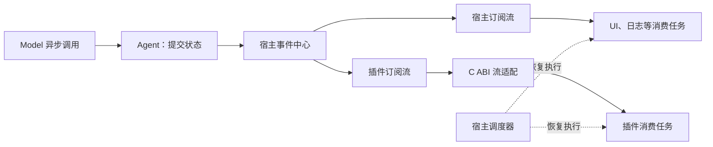

# 异步事件流分析与待讨论问题

记录日期：2026-11-11；同日补充本轮讨论结论。业务代码基线：`00a5b0c`，本次记录前仓库 HEAD：`8a18f48`；第 07 步 DLL 加载查询已完成。

**已确认方向：整个宿主与插件的事件订阅统一采用异步事件流。** 当前代码仍是同步回调总线；已确认结论集中记录在第 0 节，其余内容须按“建议”与“待讨论”标记阅读，不表示异步化已经实现。第 08 步实例生命周期的实施顺序，应在事件交付与资源回收规则明确后重新对齐。

**下一讨论项：执行与顺序。** 重点展开“按触发顺序进入缓冲池，按不同策略取出执行”；宿主接纳顺序、可执行条件、策略选择与完成顺序尚未定稿。本次只记录此前讨论，不实施运行机制或提前确定本轮新议题。

## 0. 本轮已确认结论与讨论边界

### 职责与普通事件的数据所有权

- 宿主统一跟踪消费者任务的启动、取消与完成，业务处理者提供具体处理逻辑。
- 支持运行时字段反射：没有预编译某种事件类型的宿主或插件，也能枚举字段、检查类型并读取内容；已知类型可以提供本地 C++ 强类型封装。
- 普通事件的类型描述、校验、数据所有权及释放统一由宿主管理。字段描述表达数据结构，不依赖插件内部 C++ 对象布局。
- 类型注册形成宿主持有的描述快照，不能仅借用 DLL 静态内存；普通载荷采用宿主可解释、校验和释放的统一类型体系。
- 事件发布后数据不可变；消费者需要变更内容时产生新事件。描述与载荷按引用寿命保留，相关使用结束后回收，不要求永久保存。
- 跨 DLL 仍使用 C ABI，通过不透明句柄及类型、数据访问接口交互；C++ 强类型封装留在各模块内部。具体接口、载荷表示和 ABI 版本仍待定。
- 完全由宿主管理的普通描述与数据可以独立于定义插件存活。资源句柄、插件自定义解码或析构函数涉及额外依赖，须在资源管理议题中明确。

### 已确认的类型体系

| 类别 | 类型 | 含义 |
|---|---|---|
| 基础 | `Bool` | 布尔值 |
| 基础 | `Int64`、`UInt64` | 有符号与无符号整数 |
| 基础 | `Float64` | 浮点数 |
| 基础 | `String`、`Bytes` | UTF-8 文本与有明确长度的二进制数据 |
| 组合 | `Struct` | 字段明确、可嵌套的结构 |
| 组合 | `Array<T>` | 元素类型明确的有序数组 |
| 组合 | `Map<String, T>` | 键动态变化、值类型明确的映射 |
| 组合 | `Enum` | 有名称及稳定取值的枚举 |
| 组合 | 带标签联合类型 | 多种已声明结构中的一种，纳入基础能力 |

组合类型允许插件在运行时声明，消费者可递归查询描述。字段“可选”与“可空”分别表达：缺失、显式空值及空字符串不能混为同一结果；业务含义由事件契约规定。具体约束编码、数值边界、联合类型标签及递归限制仍须设计。

### 类型共享与处理责任

- **类型定义归属明确，发布与消费可由多个插件承担。** 契约使用关系与提供服务的插件实例依赖分别讨论。
- **普通订阅默认承担观察责任，只有显式登记为业务参与者才进入业务完成条件。** 普通观察者的失败独立报告，不改变原业务结果；宿主仍管理其任务和资源寿命。
- 业务参与者的结果如何汇总、何时判定业务完成，以及取消和失败如何传播，尚未定稿。

### 已纳入范围、但尚未定稿的建议

| 议题 | 当前讨论范围与未决部分 |
|---|---|
| 类型身份与注册 | 完整名称加契约版本、进程内类型句柄、事件实例标识分开；定义与声明使用分开；校验后公开、冲突拒绝、版本并存等均为建议。命名权限、兼容规则与撤销后的新操作尚未确认 |
| 交付方式 | 独立订阅／广播、指定接收方、消费者组都纳入设计范围。每组由一个成员领取、广播与组并存、接纳时固定目标而调度时选择成员，是待定的具体方案 |
| 投递与任务 | 建议共享不可变事件数据，为接收方分别记录投递和处理状态；原子领取、订阅退出结算、重试、顺序链、短路及结果聚合仍待讨论 |
| 执行与顺序 | 用户提出按触发顺序入池、按其他策略取出；触发顺序如何观测，是否映射为宿主接纳顺序，以及因果、串行、并发和重入规则尚待讨论 |
| 状态与 hook | 考虑由宿主管理投递／任务状态，在明确边界提供 hook；观察通知与需等待决策的控制 hook 要分别定义 |
| 积压与调度 | 研究操作系统中的就绪／等待队列、优先级、公平性、配额与唤醒；未选择具体算法，也未确认默认溢出策略 |
| 取消与故障 | 参考 DSH 的协作取消、等待退出、共享清理完成与错误汇总，并适配本项目原生模块约束 |
| 依赖与副作用 | 纳入运行期插件依赖及副作用回收；拒绝卸载、级联停止、替换绑定、清理顺序和失败重试仍待定，不自动引入安装时的软件包版本求解 |

此前“超限关闭普通观察订阅”“状态合并”“同一订阅串行消费”等均保留为候选策略，不能因确认了统一机制或默认观察责任而当作已批准规则。既有忙碌时拒绝卸载、停止失败保留实例与模块的约束继续有效。

## 1. 当前实现与目标的差距

目前 [Bus](../events/bus.cpp) 在 `publish()` 调用栈上依次执行回调，返回时可以汇总回调结果；没有可等待读取、订阅缓冲或流结束机制。[Session](../agent/session.cpp) 同步调用模型，成功后成对提交历史再通知，失败保留原历史。

[WinHTTP](../platform/winhttp.cpp) 和 [终端输入](../app/chat.cpp) 都会阻塞调用线程。因此，给订阅加上 `next()` 外观还不足以支持请求进行中的事件消费，需要同时确定宿主调度方式和 I/O 的执行方式。

事件异步消费、模型按 token 输出和多线程执行是三个独立选择。首版可以保留完整文本响应，先实现异步执行及生命周期事件流；不必同时增加工具循环、规划、记忆或持久化。

## 2. 参考版本与源码结论

| 项目 | 本次分析版本 | 范围 |
|---|---|---|
| DSH | `687f282e8625c6b8d11ff58211a90524be2e4317` | 本地 `D:\DSH\deepseek-harness` 的模型流、Agent 分发、会话观察和 Cordis 资源清理 |
| pi | `75d59639aa0e53833173c86361637f5c8e1c4642` | pi-ai、agent-core、coding-agent 扩展以及同仓库 Chord watch |

本节前两组结论保留首次分析的版本与阅读位置；后续版本见本节末尾“本轮补充阅读”。结论来自源码及相关测试的阅读，未运行参考项目；源码引用固定到对应提交。

### DSH

1. **模型层提供异步可迭代流。** `LlmRuntime.stream()` 返回 `AsyncIterable<StreamChunk>`，Agent 用 `for await` 消费。适配器失败被转换为终态片段，消费者与中间件错误保留其自身失败语义；提前退出时尝试关闭底层迭代器。[模型流实现](https://github.com/deepseek-ai/deepseek-harness/blob/687f282e8625c6b8d11ff58211a90524be2e4317/packages/llm/llm/src/index.ts#L1064)
2. **宿主内分发仍包含回调机制。** Cordis 区分同步通知、并行等待、顺序等待、短路和 waterfall。DSH 的 Agent 通知逐个调用监听器，分别容纳同步异常及 Promise 拒绝，但不等待观察者的异步处理完成；控制钩子则可以影响后续执行。[Agent 分发](https://github.com/deepseek-ai/deepseek-harness/blob/687f282e8625c6b8d11ff58211a90524be2e4317/packages/core/agent/src/dispatch.ts#L107)、[Cordis 分发模式](https://github.com/deepseek-ai/deepseek-harness/blob/687f282e8625c6b8d11ff58211a90524be2e4317/vendor/cordis/src/events.ts#L183)
3. **会话观察流为每个订阅建立独立队列。** `follow()` 先注册监听，再交付初始快照和后续事件，用序号处理连续性，退出时在 `finally` 中解除监听。它提供了从通知到异步订阅的实际连接方式。[会话 follow](https://github.com/deepseek-ai/deepseek-harness/blob/687f282e8625c6b8d11ff58211a90524be2e4317/packages/api/session-controller/src/history.ts#L120)
4. **提交与观察失败分开。** 会话先将事件加入内存日志，再通知观察者；观察者失败不回滚提交。这里不能直接理解成每条事件已经落盘。[会话提交](https://github.com/deepseek-ai/deepseek-harness/blob/687f282e8625c6b8d11ff58211a90524be2e4317/packages/core/session/src/index.ts#L876)
5. **注册项具有所有者和可等待的清理流程。** 作用域清理会等待其受管理的清理工作。但取消监听本身不能证明所有异步处理都已结束，更不能直接作为原生 DLL 可卸载的依据。[作用域清理](https://github.com/deepseek-ai/deepseek-harness/blob/687f282e8625c6b8d11ff58211a90524be2e4317/packages/core/scope/src/index.ts#L115)

DSH 的 `follow()` 缓冲在该层没有容量上限；不能因其返回 `AsyncIterable` 就推断具备完整背压保证。适合大肥鱼借鉴的是用途划分、先提交后通知、独立订阅及资源归属；全部能力插件化和完整会话持久化体系不属于本轮改造范围。

### pi

1. **底层 Agent loop 提供事件流和独立结果。** `EventStream` 用队列和等待者支持异步迭代，`result()` 独立取得最终结果。`push()` 不等待消费完成；同一个流共享一套队列，没有为不同迭代器广播副本，也没有在该类中限制容量。[EventStream](https://github.com/earendil-works/pi/blob/75d59639aa0e53833173c86361637f5c8e1c4642/packages/ai/src/utils/event-stream.ts#L26-L87)、[Agent loop](https://github.com/earendil-works/pi/blob/75d59639aa0e53833173c86361637f5c8e1c4642/packages/agent/src/agent-loop.ts#L47-L70)
2. **上层 Agent 监听器具有等待语义。** `Agent.subscribe()` 的 Promise 按顺序被等待，`prompt()` 和 `waitForIdle()` 包含这些监听器的完成时间。测试明确覆盖了 `agent_end` 已发出但监听器未完成时仍不空闲的情况。[订阅完成测试](https://github.com/earendil-works/pi/blob/75d59639aa0e53833173c86361637f5c8e1c4642/packages/agent/test/agent.test.ts#L362-L433)
3. **扩展事件可以承担控制职责。** 例如 `tool_call` 的处理器被等待，并能返回 `block` 阻止执行。这类决策不能改成发布后不等待的普通通知。[扩展处理](https://github.com/earendil-works/pi/blob/75d59639aa0e53833173c86361637f5c8e1c4642/packages/coding-agent/src/core/extensions/runner.ts#L1256-L1273)
4. **Chord watch 提供延后、串行的异步观察。** 它不会在发布位置直接执行观察者；状态变化积压时可以合并为最新值。`NativeWatch` 超过 100 个待处理值时会合并替换，不能将这一策略直接套到必须逐条交付的业务事实。[调度](https://github.com/earendil-works/pi/blob/75d59639aa0e53833173c86361637f5c8e1c4642/packages/chord/src/watch.ts#L204-L246)、[积压处理](https://github.com/earendil-works/pi/blob/75d59639aa0e53833173c86361637f5c8e1c4642/packages/chord/src/watch.ts#L398-L438)
5. **watch 关闭不等于正在执行的回调结束。** `stop()`／`closed` 可以先完成，已运行的回调仍继续。这与原生 DLL 卸载需要的静止条件不同。[关闭语义](https://github.com/earendil-works/pi/blob/75d59639aa0e53833173c86361637f5c8e1c4642/packages/chord/src/watch.ts#L46-L54)

pi 的流、Agent 监听器和 Chord watch 是不同层的机制，不能统一描述为“全系统都是异步迭代器”。大肥鱼可以采用更一致的订阅接口，但必须自己确定广播、背压、取消和资源回收语义。

### 本轮补充阅读

| 项目 | 本轮版本 | 核对范围 |
|---|---|---|
| DSH | `ce7073d51254c26cd63b22a60835b8f948deb447` | 本地 `E:\DSH\deepseek harness`；Agent 通知、模型流、会话观察、Cordis 依赖与清理 |
| pi | `473515f9c297c75cf2c3ebb3ba027049ed836d27` | 在线固定提交；EventStream、Agent 等待语义、扩展控制与 Chord watch |
| AI-Vtuber / Luna AI | `c430ee71f208f45850c1ab25c85f2a70e9b09d72` | 平台入口、消息缓冲、处理锁、TTS／播放队列、停止与相关测试 |

DSH 的 `follow()` 已移动到 [web/controller.ts](https://github.com/deepseek-ai/deepseek-harness/blob/ce7073d51254c26cd63b22a60835b8f948deb447/packages/api/session-controller/src/web/controller.ts#L32)，先建立监听再取得快照，使用游标衔接后续事件；[ListenerBuffer](https://github.com/deepseek-ai/deepseek-harness/blob/ce7073d51254c26cd63b22a60835b8f948deb447/packages/api/session-controller/src/history/listener.ts#L176) 未在该层限制容量。不能直接把旧分析的位置用于当前源码。

DSH 的 [Agent 清理](https://github.com/deepseek-ai/deepseek-harness/blob/ce7073d51254c26cd63b22a60835b8f948deb447/packages/core/agent-loop/src/index.ts#L495) 共享一次 teardown，发出取消后等待空闲，再清理作用域等资源并汇总失败。[Cordis Fiber](https://github.com/deepseek-ai/deepseek-harness/blob/ce7073d51254c26cd63b22a60835b8f948deb447/vendor/cordis/src/fiber.ts#L713) 保留提供方资源直到依赖方退出；单个 effect 内的清理逆序执行，Fiber 顶层清理可以并行，不能概括成全系统严格逆序。原生 DLL 仍需额外证明不存在活动调用、排队恢复或依赖其代码的销毁动作。副作用登记可管理订阅、定时器、服务和任务等资源，已完成的外部行为需要业务定义补偿，不能承诺自动撤销。

pi 当前 [EventStream](https://github.com/earendil-works/pi/blob/473515f9c297c75cf2c3ebb3ba027049ed836d27/packages/ai/src/utils/event-stream.ts) 仍以共享队列提供事件与独立结果，没有逐订阅广播或容量限制；[Agent](https://github.com/earendil-works/pi/blob/473515f9c297c75cf2c3ebb3ba027049ed836d27/packages/agent/src/agent.ts#L569) 则先更新状态再逐个等待监听器。二者的完成含义不同。

AI-Vtuber 的 [process_data / process_last_data](https://github.com/Ikaros-521/AI-Vtuber/blob/c430ee71f208f45850c1ab25c85f2a70e9b09d72/luna/core/my_handle.py#L3382) 按类型建立定时缓冲并保留最近数据；接收锁与处理锁分开，取走批次后串行业务处理。部分 [HTTP 入口](https://github.com/Ikaros-521/AI-Vtuber/blob/c430ee71f208f45850c1ab25c85f2a70e9b09d72/app/api.py#L34) 直接调用处理器，不能推断整个系统统一串行。其经验补充了输入接纳与工作调度，不能把直播消息筛选策略直接用于已提交事实通知。

AI-Vtuber 的 [合成与播放队列](https://github.com/Ikaros-521/AI-Vtuber/blob/c430ee71f208f45850c1ab25c85f2a70e9b09d72/luna/audio/service.py#L513) 按优先级插入、同级保留先后，但上限检查依据是插入位置，高优先级仍可能使实际长度超过配置值；[测试](https://github.com/Ikaros-521/AI-Vtuber/blob/c430ee71f208f45850c1ab25c85f2a70e9b09d72/tests/unit/test_audio_queue.py#L61) 保留了这一行为。清空队列只移除待处理项，已取出的合成仍可继续；[WebUI 停止](https://github.com/Ikaros-521/AI-Vtuber/blob/c430ee71f208f45850c1ab25c85f2a70e9b09d72/webui_server/runtime.py#L100) 使用进程终止，不能代替本项目的 DLL 安全回收契约。

操作系统调度参考：[Windows 优先级与同级轮转](https://learn.microsoft.com/en-us/windows/win32/procthread/scheduling-priorities)。可以研究就绪选择、等待唤醒与公平性；若采用单宿主线程协作执行，只能在返回或挂起边界切换，不能宣称可抢占任意插件代码。

## 3. 大肥鱼的建议结构

本节保留最初结构建议；第 0 节已确认的职责、普通数据归属与不可变性优先适用。拓扑、独立队列形态、串行范围及调度策略仍待定，后续需同时表达广播、指定接收方与消费者组。

宿主和插件共享异步订阅语义，每个订阅具有独立消费位置和有界待处理队列。同一订阅串行消费，发布位置不执行消费者业务，也不直接恢复消费者去完成整段处理。事件数据由宿主持有，可共享不可变数据，避免复制整段内容给每个订阅。

事件应携带发生时的必要事实以及会话、回合和顺序信息。延迟消费时再读取可变 `Session`，可能已经看到后续回合或清空后的状态；不能沿用同步回调中“读取当前状态就等于事件发生时状态”的假设。

| 用途 | 例子 | 建议语义 |
|---|---|---|
| 事实通知 | 回合开始、完成、失败、会话清空 | 保持顺序，不悄悄合并或丢弃；溢出必须显式报告 |
| 状态观察 | 当前进度、当前状态、累计用量 | 可合并为最新快照，但须标明替换语义 |
| 控制请求 | 审批、执行前检查、插件能力调用 | 显式等待响应，定义超时、取消与失败，不依赖普通观察者及时处理 |

若控制请求也通过流传输，需要请求标识和回复协议；不能把它与不可撤销的事后事实混为一类。当前只有最小问答，控制请求的具体功能仍须逐项讨论。

有限内存、生产者永不等待、消费者任意慢以及每条事件永不丢，不能同时保证。建议普通观察订阅超限时终止该订阅并报告溢出，Agent 继续执行；状态观察允许快照替换。需要可靠逐条交付的消费应明确采用反压或持久化，后者会扩大当前范围。**这一默认溢出策略尚未确认。**

## 4. 取消、资源回收与 DLL

建议区分四个完成条件：

| 条件 | 含义 |
|---|---|
| 一轮执行完成 | 模型结果与会话状态已经确定，必要业务步骤完成 |
| 订阅关闭 | 不再接收新事件，等待中的读取被唤醒 |
| 消费任务回收完成 | 当前处理、排队恢复任务和协程帧均已清理 |
| DLL 可卸载 | 实例停止成功，注册资源已撤销，不再有可能进入 DLL 的调用或恢复任务 |

停止消费事件与取消模型请求应是独立操作。关闭日志或 UI 订阅，不应隐式取消问答；具体取消接口及结果表达仍待确定。

等待 `next()` 的常驻观察插件不能一直被视为无法卸载的忙碌插件。建议允许请求关闭订阅、取消等待读取、恢复消费任务去执行退出清理，再等待回收完成。真正仍在执行的原生调用继续遵守忙碌拒绝卸载的既有约束。停止请求已接受、停止投递和实际卸载完成必须返回不同状态。

异步化后，只有活动调用计数为零还不充分：排队的恢复函数、挂起协程及其销毁逻辑也可能依赖 DLL 代码。模块引用必须覆盖这些资源的寿命。停止失败或未能回收时仍须保留模块，不能强制释放。

## 5. C ABI 与执行方式

C++ 消费侧可以提供 `co_await subscription.next()`；C ABI 应使用订阅句柄、异步读取、取消、完成通知和显式事件释放，不跨 DLL 传递 C++ 协程对象或 STL 对象。用于唤醒的底层 C 回调可以存在，但插件业务消费由调度器恢复执行。

现有 [ABI v1](plugin-abi.md) 的表布局已经冻结，且订阅接口仍是回调形式。流接口、借用期和停止语义需要重新审查，并采用明确的版本变更；具体版本、接口和是否保留兼容层尚未决定。

建议保留单一宿主执行线程维护 Agent 状态和插件调用，把输入、网络等阻塞工作交给受控异步 I/O 或宿主执行设施。采用哪种执行器、等待类型和 I/O 适配方式尚未决定；异步订阅不意味着每个插件都拥有自己的线程，也不能隔离不主动让出执行权的原生代码。

## 6. 对现有工程的影响

| 位置 | 需要重新讨论的部分 | 可保留的基础 |
|---|---|---|
| `events/` | 发布完成含义、异步读取、广播、缓冲、关闭和错误报告 | 类型明确的事件、订阅所有者、确定性顺序 |
| `agent/` | 执行寿命跨越等待点，事件使用发生时的数据；订阅停止与问答取消分离 | 成功后提交历史、失败保持历史、会话隔离 |
| `app/`、`platform/` | 输入与模型请求不能占住宿主调度线程 | 现有终端命令、模型协议与传输分层 |
| `sdk/` | 流句柄、等待与取消、事件数据释放、版本变更 | C ABI、固定宽度类型、分配方释放资源原则 |
| 插件生命周期 | 所有者统一跟踪订阅、任务、协程和模块借用，明确停止与回收状态 | 已完成的清单、配置、发现、加载及 ABI 校验能力 |

现有模型协议、配置和 DLL 加载基础不需要整体推翻。异步化也不取消已完成的第 07 步验收；它改变的是接下来实例生命周期所依赖的运行机制。

## 7. 讨论进度与后续问题

下表替代首次记录的 Q1～Q9 排序；“方向已确认”不等于接口或所有细节已经定稿。当前从第 4 项继续。

| 顺序 | 议题 | 当前状态与后续问题 |
|---|---|---|
| 1 | 职责边界 | 方向已确认：宿主管理消费者任务生命周期，业务提供处理逻辑 |
| 2 | 事件统一表达 | 反射、普通数据归属、类型体系及共享方式已确认；身份、注册、编码、版本、约束和资源引用待细化 |
| 3 | 订阅与处理责任 | 默认观察、显式业务参与已确认；三种交付方式纳入范围；目标匹配时点、初始快照、过滤、组成员选择及退出结算待定 |
| 4 | 执行与顺序 | **下一项**：顺序接纳与策略取出、可执行条件、顺序保证范围、因果约束、重入、等待恢复、宿主线程与阻塞 I/O |
| 5 | 结果与完成 | 投递／任务状态、观察与控制 hook、请求响应、超时、短路及结果聚合；观察完成与业务完成分开 |
| 6 | 积压与调度策略 | 条数、字节数和单事件限制；公平性、优先级、配额、过期、合并、反压及溢出；终态和控制通知不能依赖已满的普通队列 |
| 7 | 取消、关闭与故障 | 读取取消、订阅关闭、任务取消、业务失败与流故障；重试与副作用重复；参考 DSH 并明确本项目边界 |
| 8 | 资源归属与插件卸载 | 任务、等待项、描述、服务和模块的引用寿命；运行期依赖、副作用清理、忙碌拒绝、停止失败保留与重试 |
| 9 | 接口与实施顺序 | C++ 适配、C ABI 及版本演进；根据定稿契约拆分独立验收步骤，不暗改 v1 布局 |

## 8. 建议开发与验收顺序

1. 继续第 7 节的语义议题，补齐类型、交付、执行和生命周期规则，再修订以下候选实施步骤；类型体系也应拆分验收，不作为一次提交。
2. 建设最小宿主调度器和有界可等待订阅，验证独立广播、顺序、关闭唤醒、溢出和错误隔离。
3. 接入输入与模型异步执行，验证成功提交、失败回滚约束、取消与订阅解除的区别，以及事件数据在延迟消费时仍有效。
4. 更新 C ABI 和 C++ 消费适配，验证等待取消、排队恢复及 DLL 引用寿命。
5. 在上述规则通过审查后，重新拆分并推进第 08 步实例生命周期。

这份顺序是讨论建议，不能当作一次性实现授权。每次仍只完成一个可独立审查的功能点，验证、提交后停止；记忆、工作、工具循环、规划和会话持久化继续另行讨论。
