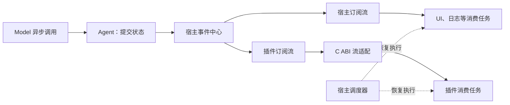

# 异步事件流分析与待讨论问题

记录日期：2026-11-11。大肥鱼代码基线：`00a5b0c`，第 07 步 DLL 加载查询已完成。

**已确认方向：整个宿主与插件的事件订阅统一采用异步事件流。** 当前代码仍是同步回调总线；本文记录参考实现、建议方案和待决问题，不表示异步化已经实现，也不表示建议策略已获确认。第 08 步实例生命周期的实施顺序，应在事件交付与资源回收规则明确后重新对齐。

## 1. 当前实现与目标的差距

目前 [Bus](../events/bus.cpp) 在 `publish()` 调用栈上依次执行回调，返回时可以汇总回调结果；没有可等待读取、订阅缓冲或流结束机制。[Session](../agent/session.cpp) 同步调用模型，成功后成对提交历史再通知，失败保留原历史。

[WinHTTP](../platform/winhttp.cpp) 和 [终端输入](../app/chat.cpp) 都会阻塞调用线程。因此，给订阅加上 `next()` 外观还不足以支持请求进行中的事件消费，需要同时确定宿主调度方式和 I/O 的执行方式。

事件异步消费、模型按 token 输出和多线程执行是三个独立选择。首版可以保留完整文本响应，先实现异步执行及生命周期事件流；不必同时增加工具循环、规划、记忆或持久化。

## 2. 参考版本与源码结论

| 项目 | 本次分析版本 | 范围 |
|---|---|---|
| DSH | `687f282e8625c6b8d11ff58211a90524be2e4317` | 本地 `D:\DSH\deepseek-harness` 的模型流、Agent 分发、会话观察和 Cordis 资源清理 |
| pi | `75d59639aa0e53833173c86361637f5c8e1c4642` | pi-ai、agent-core、coding-agent 扩展以及同仓库 Chord watch |

结论来自源码及相关测试的阅读；本轮未运行 DSH 或 pi。以下引用固定到对应提交，避免后续主分支变化影响复查。

### DSH

1. **模型层提供异步可迭代流。** `LlmRuntime.stream()` 返回 `AsyncIterable<StreamChunk>`，Agent 用 `for await` 消费。适配器失败被转换为终态片段，消费者与中间件错误保留其自身失败语义；提前退出时尝试关闭底层迭代器。[模型流实现](https://github.com/deepseek-ai/deepseek-harness/blob/687f282e8625c6b8d11ff58211a90524be2e4317/packages/llm/llm/src/index.ts#L1064)
2. **宿主内分发仍包含回调机制。** Cordis 区分同步通知、并行等待、顺序等待、短路和 waterfall。DSH 的 Agent 通知逐个调用监听器，分别容纳同步异常及 Promise 拒绝，但不等待观察者的异步处理完成；控制钩子则可以影响后续执行。[Agent 分发](https://github.com/deepseek-ai/deepseek-harness/blob/687f282e8625c6b8d11ff58211a90524be2e4317/packages/core/agent/src/dispatch.ts#L107)、[Cordis 分发模式](https://github.com/deepseek-ai/deepseek-harness/blob/687f282e8625c6b8d11ff58211a90524be2e4317/vendor/cordis/src/events.ts#L183)
3. **会话观察流为每个订阅建立独立队列。** `follow()` 先注册监听，再交付初始快照和后续事件，用序号处理连续性，退出时在 `finally` 中解除监听。它提供了从通知到异步订阅的实际连接方式。[会话 follow](https://github.com/deepseek-ai/deepseek-harness/blob/687f282e8625c6b8d11ff58211a90524be2e4317/packages/api/session-controller/src/history.ts#L120)
4. **提交与观察失败分开。** 会话先将事件加入内存日志，再通知观察者；观察者失败不回滚提交。这里不能直接理解成每条事件已经落盘。[会话提交](https://github.com/deepseek-ai/deepseek-harness/blob/687f282e8625c6b8d11ff58211a90524be2e4317/packages/core/session/src/index.ts#L876)
5. **注册项具有所有者和可等待的清理流程。** 作用域清理会等待其受管理的清理工作。但取消监听本身不能证明所有异步处理都已结束，更不能直接作为原生 DLL 可卸载的依据。[作用域清理](https://github.com/deepseek-ai/deepseek-harness/blob/687f282e8625c6b8d11ff58211a90524be2e4317/packages/core/scope/src/index.ts#L115)

DSH 的 `follow()` 缓冲在该层没有容量上限；不能因其返回 `AsyncIterable` 就推断具备完整背压保证。适合大肥鱼借鉴的是用途划分、先提交后通知、独立订阅及资源归属；全部能力插件化和完整会话持久化体系不属于本轮改造范围。

### pi

1. **底层 Agent loop 提供事件流和独立结果。** `EventStream` 用队列和等待者支持异步迭代，`result()` 独立取得最终结果。`push()` 不等待消费完成；同一个流共享一套队列，没有为不同迭代器广播副本，也没有在该类中限制容量。[EventStream](https://github.com/earendil-works/pi/blob/75d59639aa0e53833173c86361637f5c8e1c4642/packages/ai/src/utils/event-stream.ts#L26-L87)、[Agent loop](https://github.com/earendil-works/pi/blob/75d59639aa0e53833173c86361637f5c8e1c4642/packages/agent/src/agent-loop.ts#L47-L70)
2. **上层 Agent 监听器具有等待语义。** `Agent.subscribe()` 的 Promise 按顺序被等待，`prompt()` 和 `waitForIdle()` 包含这些监听器的完成时间。测试明确覆盖了 `agent_end` 已发出但监听器未完成时仍不空闲的情况。[订阅完成测试](https://github.com/earendil-works/pi/blob/75d59639aa0e53833173c86361637f5c8e1c4642/packages/agent/test/agent.test.ts#L362-L433)
3. **扩展事件可以承担控制职责。** 例如 `tool_call` 的处理器被等待，并能返回 `block` 阻止执行。这类决策不能改成发布后不等待的普通通知。[扩展处理](https://github.com/earendil-works/pi/blob/75d59639aa0e53833173c86361637f5c8e1c4642/packages/coding-agent/src/core/extensions/runner.ts#L1256-L1273)
4. **Chord watch 提供延后、串行的异步观察。** 它不会在发布位置直接执行观察者；状态变化积压时可以合并为最新值。`NativeWatch` 超过 100 个待处理值时会合并替换，不能将这一策略直接套到必须逐条交付的业务事实。[调度](https://github.com/earendil-works/pi/blob/75d59639aa0e53833173c86361637f5c8e1c4642/packages/chord/src/watch.ts#L204-L246)、[积压处理](https://github.com/earendil-works/pi/blob/75d59639aa0e53833173c86361637f5c8e1c4642/packages/chord/src/watch.ts#L398-L438)
5. **watch 关闭不等于正在执行的回调结束。** `stop()`／`closed` 可以先完成，已运行的回调仍继续。这与原生 DLL 卸载需要的静止条件不同。[关闭语义](https://github.com/earendil-works/pi/blob/75d59639aa0e53833173c86361637f5c8e1c4642/packages/chord/src/watch.ts#L46-L54)

pi 的流、Agent 监听器和 Chord watch 是不同层的机制，不能统一描述为“全系统都是异步迭代器”。大肥鱼可以采用更一致的订阅接口，但必须自己确定广播、背压、取消和资源回收语义。

## 3. 大肥鱼的建议结构

以下为建议，尚未定稿。

宿主和插件共享异步订阅语义，每个订阅具有独立消费位置和有界待处理队列。同一订阅串行消费，发布位置不执行消费者业务，也不直接恢复消费者去完成整段处理。事件数据由宿主持有，可共享不可变数据，避免复制整段内容给每个订阅。

事件应携带发生时的必要事实以及会话、回合和顺序信息。延迟消费时再读取可变 `Session`，可能已经看到后续回合或清空后的状态；不能沿用同步回调中“读取当前状态就等于事件发生时状态”的假设。

| 用途 | 例子 | 建议语义 |
|---|---|---|
| 事实通知 | 回合开始、完成、失败、会话清空 | 保持顺序，不悄悄合并或丢弃；溢出必须显式报告 |
| 状态观察 | 当前进度、当前状态、累计用量 | 可合并为最新快照，但须标明替换语义 |
| 控制请求 | 审批、执行前检查、插件能力调用 | 显式等待响应，定义超时、取消与失败，不依赖普通观察者及时处理 |

若控制请求也通过流传输，需要请求标识和回复协议；不能把它与不可撤销的事后事实混为一类。当前只有最小问答，控制请求的具体功能仍须逐项讨论。

有限内存、生产者永不等待、消费者任意慢以及每条事件永不丢，不能同时保证。建议普通观察订阅超限时终止该订阅并报告溢出，Agent 继续执行；状态观察允许快照替换。需要可靠逐条交付的消费应明确采用反压或持久化，后者会扩大当前范围。**这一默认溢出策略尚未确认。**

## 4. 取消、资源回收与 DLL

建议区分四个完成条件：

| 条件 | 含义 |
|---|---|
| 一轮执行完成 | 模型结果与会话状态已经确定，必要业务步骤完成 |
| 订阅关闭 | 不再接收新事件，等待中的读取被唤醒 |
| 消费任务回收完成 | 当前处理、排队恢复任务和协程帧均已清理 |
| DLL 可卸载 | 实例停止成功，注册资源已撤销，不再有可能进入 DLL 的调用或恢复任务 |

停止消费事件与取消模型请求应是独立操作。关闭日志或 UI 订阅，不应隐式取消问答；具体取消接口及结果表达仍待确定。

等待 `next()` 的常驻观察插件不能一直被视为无法卸载的忙碌插件。建议允许请求关闭订阅、取消等待读取、恢复消费任务去执行退出清理，再等待回收完成。真正仍在执行的原生调用继续遵守忙碌拒绝卸载的既有约束。停止请求已接受、停止投递和实际卸载完成必须返回不同状态。

异步化后，只有活动调用计数为零还不充分：排队的恢复函数、挂起协程及其销毁逻辑也可能依赖 DLL 代码。模块引用必须覆盖这些资源的寿命。停止失败或未能回收时仍须保留模块，不能强制释放。

## 5. C ABI 与执行方式

C++ 消费侧可以提供 `co_await subscription.next()`；C ABI 应使用订阅句柄、异步读取、取消、完成通知和显式事件释放，不跨 DLL 传递 C++ 协程对象或 STL 对象。用于唤醒的底层 C 回调可以存在，但插件业务消费由调度器恢复执行。

现有 [ABI v1](plugin-abi.md) 的表布局已经冻结，且订阅接口仍是回调形式。流接口、借用期和停止语义需要重新审查，并采用明确的版本变更；具体版本、接口和是否保留兼容层尚未决定。

建议保留单一宿主执行线程维护 Agent 状态和插件调用，把输入、网络等阻塞工作交给受控异步 I/O 或宿主执行设施。采用哪种执行器、等待类型和 I/O 适配方式尚未决定；异步订阅不意味着每个插件都拥有自己的线程，也不能隔离不主动让出执行权的原生代码。

## 6. 对现有工程的影响

| 位置 | 需要重新讨论的部分 | 可保留的基础 |
|---|---|---|
| `events/` | 发布完成含义、异步读取、广播、缓冲、关闭和错误报告 | 类型明确的事件、订阅所有者、确定性顺序 |
| `agent/` | 执行寿命跨越等待点，事件使用发生时的数据；订阅停止与问答取消分离 | 成功后提交历史、失败保持历史、会话隔离 |
| `app/`、`platform/` | 输入与模型请求不能占住宿主调度线程 | 现有终端命令、模型协议与传输分层 |
| `sdk/` | 流句柄、等待与取消、事件数据释放、版本变更 | C ABI、固定宽度类型、分配方释放资源原则 |
| 插件生命周期 | 所有者统一跟踪订阅、任务、协程和模块借用，明确停止与回收状态 | 已完成的清单、配置、发现、加载及 ABI 校验能力 |

现有模型协议、配置和 DLL 加载基础不需要整体推翻。异步化也不取消已完成的第 07 步验收；它改变的是接下来实例生命周期所依赖的运行机制。

## 7. 待讨论问题

以下条目均未定稿，建议按顺序讨论。

| 编号 | 问题 | 当前建议或选择范围 |
|---|---|---|
| Q1 | 普通观察插件跟不上时，是否允许只终止该订阅而继续 Agent？ | 建议显式溢出并隔离订阅；若要求可靠逐条交付，需选择反压或扩大范围引入持久化 |
| Q2 | 哪些事件是事实，哪些是可替换状态，哪些属于控制请求？ | 事实不可静默合并；状态可快照替换；控制使用显式请求／响应 |
| Q3 | 初次订阅只接收未来事件，还是先取得状态快照？ | 需定义快照与后续事件的连续性、过滤规则及序号保证范围 |
| Q4 | 缓冲如何计量和限制？ | 明确条数、字节数、单事件上限以及终态／溢出通知的处理，不能只加无界队列 |
| Q5 | 消费失败、流结束、取消读取和取消问答如何表达？ | 普通消费失败不回滚业务；取消订阅不默认取消问答；流异常与业务失败需区分 |
| Q6 | 何时算插件真正停止，可以释放 DLL？ | 区分停止投递与任务回收，包含活动调用、排队恢复和协程帧；不能把悬挂读取永久当作 Busy |
| Q7 | C ABI 流接口及版本如何调整？ | 用句柄与完成通知适配，不传 C++ 协程对象；明确升级并更新消费者，不暗改 v1 布局 |
| Q8 | 宿主调度器与 I/O 采用什么实现？ | 在原生异步 I/O、宿主管理的后台执行及可维护库之间选择；先保持宿主逻辑串行 |
| Q9 | 如何安排开发步骤和验收？ | 先定语义，再做最小可等待订阅与调度，随后改会话和 ABI，最后进入实例生命周期 |

## 8. 建议开发与验收顺序

1. 先确定 Q1～Q6，形成可审查的事件流与生命周期规则。
2. 建设最小宿主调度器和有界可等待订阅，验证独立广播、顺序、关闭唤醒、溢出和错误隔离。
3. 接入输入与模型异步执行，验证成功提交、失败回滚约束、取消与订阅解除的区别，以及事件数据在延迟消费时仍有效。
4. 更新 C ABI 和 C++ 消费适配，验证等待取消、排队恢复及 DLL 引用寿命。
5. 在上述规则通过审查后，重新拆分并推进第 08 步实例生命周期。

这份顺序是讨论建议，不能当作一次性实现授权。每次仍只完成一个可独立审查的功能点，验证、提交后停止；记忆、工作、工具循环、规划和会话持久化继续另行讨论。
