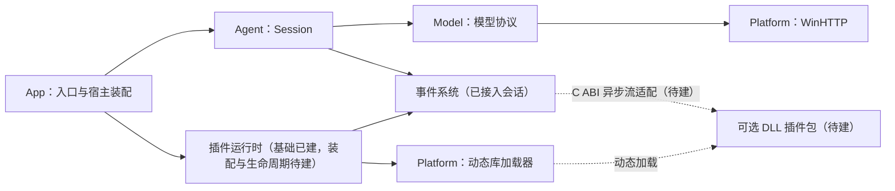

# 大肥鱼剩余基础开发指导

代码基线：`90309e7`（最小 Agent 会话与终端问答流程）。本文件面向后续逐次开发、提交和人工审查，配合 [AGENTS.md](../AGENTS.md) 使用。

**已确认的约束**来自现有项目规范与此前设计讨论；**建议方案**是本文件给出的实施细节，尚未实现，随对应阶段审查定稿。路线不是一次性开发授权，每完成一个审查点仍须验证、提交并停止。

## 1. 从哪里继续

| 已有能力 | 代码入口 | 当前边界 |
|---|---|---|
| VS2022、C++20、CMake 与职责分组 | [根构建](../CMakeLists.txt)、[预设](../CMakePresets.json) | 已有 App、Agent、Model、Platform、SDK、Plugins 和可选 Tests 目标；查询样例以 C11 编译 |
| DeepSeek / Qwen 配置与同步调用 | [模型接口](../model/include/dafeiyu/model_client.hpp)、[调用实现](../model/client.cpp) | 非流式、关闭思考；密钥取自环境变量；消息正文总量上限 1 MiB |
| HTTPS 传输 | [WinHTTP 实现](../platform/winhttp.cpp) | Windows；分阶段超时；不跟随重定向；成功响应正文上限 8 MiB |
| 平台 DLL 引用 | [DynamicLibrary](../platform/include/dafeiyu/dynamic_library.hpp) | 07a 已实现受控加载、导出查找和引用释放；不校验插件 ABI 或管理实例 |
| 最小 Agent | [Session](../agent/session.cpp) | 单线程同步；成功后成对提交问答，失败保留原历史；四类事件及同步重入保护已实现 |
| 独立同步事件 | [Bus](../events/include/dafeiyu/events.hpp)、[实现](../events/bus.cpp) | 按所有者订阅、取消和同步发布，已接入 Agent；不依赖模型或 DLL |
| 终端入口 | [启动分派](../app/main.cpp)、[会话循环](../app/chat.cpp) | `--check-config`、`--complete`、`--chat`；会话支持 `/clear`、`/exit` |
| 插件清单 | [清单接口](../plugins/runtime/include/dafeiyu/plugin_manifest.hpp) | 版本 1 格式、描述字段和包内文件校验；不扫描目录或加载 DLL |
| 插件发现 | [Registry](../plugins/runtime/include/dafeiyu/plugin_registry.hpp) | 单层扫描、坏包隔离、全部 ID 冲突拒绝、只读快照与显式刷新；不加载 DLL |
| 插件配置 | [配置接口](../plugins/runtime/include/dafeiyu/plugin_config.hpp) | 默认配置与独立用户设置按顶层键覆盖，输出只读 JSON 文本快照；不创建插件实例 |
| 插件模块查询 | [PluginModule](../plugins/runtime/include/dafeiyu/plugin_module.hpp) | 复核清单、受控加载和 ABI 校验，失败回收本次引用；不创建实例 |
| 宿主数据基础 | [域签发](../runtime/include/dafeiyu/runtime_ids.hpp)、[引用表](../runtime/include/dafeiyu/handle_registry.hpp)、[基础值](../runtime/include/dafeiyu/value.hpp) | 已实现有界类型化引用和六种不可变基础值；结构字段、动态类型目录与 C ABI 装配待建 |
| C ABI 契约 | [v1 SDK](../sdk/include/dafeiyu/plugin_abi.h)、[v2 SDK](../sdk/include/dafeiyu/plugin_abi_v2.h)、[v2 契约](plugin-abi-v2.md) | v1 冻结；v2 查询、引用、操作状态、取消与通知契约及隔离验收完成，生产适配和实例生命周期待建 |
| 离线测试 | [测试构建](../tests/CMakeLists.txt) | 共十七项，覆盖模型、会话、事件、插件、v1／v2 ABI 与生产数据基础；包含真实 x64 依赖、Win32 拒绝及故障查询 DLL |

真实 DeepSeek / Qwen 成功回答及多轮联通仍待有效凭据验证。此前真实 HTTPS 的 HTTP 401 检查只验证鉴权失败路径，不能替代成功调用验收。

第 01 步实现提交：`23909d8`（`feat: 建立独立同步事件基础`）。当次 VS2022 Debug、Release 构建及四项离线 CTest 通过；仅验收独立总线。

第 02 步实现提交：`0bc9273`（`feat: 接入会话事件与同步重入保护`）。当次 VS2022 Debug、Release 构建及四项离线 CTest 通过，另完成双服务配置在两种构建下的 8 项离线命令行检查。会话测试使用真实事件总线及替身模型；未验收真实模型服务或 DLL。

第 03 步实现提交：`830a782`（`feat: 解析并校验插件包清单`）。当次 VS2022 Debug、Release 构建及五项离线 CTest 通过，清单测试覆盖真实文件及符号链接，未加载 DLL 或访问模型服务。

第 04 步实现提交：`f54eb65`（`feat: 建立插件发现与只读注册表`）。当次 VS2022 Debug、Release 构建及六项离线 CTest 通过，验证了坏包隔离、多包 ID 冲突、增删刷新、快照存活及根目录故障恢复；未加载 DLL 或接入终端管理命令。

第 05 步实现提交：`aab1213`（`feat: 合并插件默认配置与独立用户设置`）。当次 VS2022 Debug、Release 构建及七项离线 CTest 通过，验证了顶层覆盖、插件隔离、只读快照、文件和 JSON 边界；未加载 DLL 或改动模型配置。

第 06 步实现提交：`91ca301`（`feat: 定义插件 C ABI 与最小查询 DLL`）。当次 VS2022 Debug、Release 构建及八项离线 CTest 通过，C11 DLL 与 C++20 宿主验证了布局和实际导出查询；另通过 Debug 宿主查询 Release DLL。

第 07 步已整体完成，按 07a 与 07b 分别提交。07a 提交：`34cd195`（`feat: 封装受控 DLL 加载与模块引用`）；当次 Debug、Release 构建及九项离线 CTest 通过，验证了中文路径、引用归属、依赖搜索、缺失导出、架构拒绝及线程错误模式恢复。

07b 实现提交：`00a5b0c`（`feat: 完成插件 ABI 查询与兼容性校验`）。当次 Debug、Release 构建及十项离线 CTest 通过；真实 DLL 覆盖查询状态、返回表、全部必需函数、前置清单校验、关闭与失败回收，并确认未调用实例生命周期函数。

**R02b 基础值已实现；下一审查点为 R02c 结构字段描述与读取。** [v2 契约](plugin-abi-v2.md#r01c-1-操作状态与读取)及公开头文件区分受理、查询状态和操作终态；真实 C DLL 与隔离宿主验证只读快照、独立引用及终态不改写。R01a 查询和 R01b 句柄借用保持不变，生产加载器仍只支持 v1，生产类型化引用表与基础值已实现，C ABI 装配、异步机制和实例生命周期尚未实现。其余已确认方向见 [讨论记录](async-event-stream-review.md#0-本轮已确认结论与讨论边界)，分组路线见第 5.1 节；每个单元仍独立验收并停止审查。

R01a 当次验证：Debug、Release 主工程及 Debug 测试构建通过；新查询测试与 Debug 消费者调用 Release C DLL 通过。完整离线 CTest 为 8／11 通过，`plugins.manifest`、`plugins.registry`、`plugins.config` 在创建真实符号链接时因当前进程缺少权限而失败，未完成这些用例的全部断言；本次未修改这三项测试及其业务实现，也未跳过链接校验。复验命令见 [v2 验收记录](plugin-abi-v2.md#验收与下一单元)。

R01b 当次验证：Debug／Release 主工程、Debug 测试构建及 Debug 消费者调用 Release C DLL 通过；完整离线 CTest 为 9／12 通过，`sdk.handles_v2` 通过，上述三项测试仍因符号链接权限不足失败。正式引用运行时、业务完成及异步回收不在该步范围内。

R01c-1 本次从 `7275306` 的干净工作区开始，改动前重建后 12／12 CTest 通过；改动后 Debug／Release 主工程、Debug 测试构建及完整 13／13 CTest 通过，三个 Debug v2 消费者调用 Release C DLL 均通过。此前受权限影响的三项链接测试本次已通过，未修改或跳过相关校验。新增状态由隔离宿主手动结算，不验收生产异步执行、取消竞争或通知寿命。

## 2. 基础建设完成的范围

最近各单元的实现提交与当次完整 CTest 如下；详细边界见第 3 节和 v2 契约，隔离验收不等于生产异步运行时已经接入。

| 单元 | 提交 | 完整 CTest |
|---|---|---|
| R01c-2 取消请求与原因读取 | `03bf68e` | 13／13 |
| R01c-3a 通知接口与布局 | `d3a2481` | 13／13 |
| R01c-3b 通知行为隔离验收 | `13290cd` | 14／14 |
| R02a-1 宿主签发域 | `a76047f` | 15／15 |
| R02a-2 类型化引用表 | `e9ce8cf` | 16／16 |
| R02b-1 不可变数值 | `6c32013` | 17／17 |
| R02b-2 String／Bytes | `2b013cb` | 17／17 |

以下约束已经确认，后续实现应保持：

1. 大肥鱼本体能够直接调用模型，默认 Provider 随程序发布；空插件目录不妨碍正常问答。
2. 插件通过指定目录中的包在运行时发现、安装、加载、卸载；本体构建不固定链接某个插件实现，也不靠配置把必需角色绑定给插件。
3. 插件描述和默认配置随包提供，用户配置按插件独立保存，程序启动后在内存中汇总管理。
4. 插件采用同进程可信原生 DLL 和 C ABI；忙碌时明确拒绝卸载，不强制终止插件执行。
5. 保持小步提交。通常以约 100～300 行手写代码为审查参考，测试也计入；复杂步骤继续拆分，不把行数当作必须凑满的指标。
6. `Old/` 只供参考，不成为新工程的构建、运行或测试依赖。

本轮基础建设的交付物是：**最小 Agent + 事件通知 + 可独立安装卸载的本地插件系统 + 可复现验收与运行目录**。

记忆、工作、工具循环、规划、会话持久化、模型 token 流式输出、面向用户的后台作业、插件商店、在线下载、自动升级和安装时的软件包版本求解不在这份路线中。异步执行设施及运行期插件依赖属于已确认的基础设计，不能与上述扩展功能混淆。模型 Provider 插件化也不是完成当前基础设施的前提；如后续需要，再扩展 SDK 能力。

## 3. 模块边界与线程模型

下图为建议的完成形态；标注“待建”的部分尚不存在。实线表示调用关系，虚线表示事件交付或动态加载，不表示本体静态链接插件。



| 职责 | 建议放置位置 / VS 分组 | 边界 |
|---|---|---|
| 入口、路径选择、组件创建和命令分派 | `app/` / App | 装配基础服务实例，不列举必需插件或固定插件角色 |
| 问答状态与通知发布 | `agent/` / Agent | 依赖模型接口和事件接口，不读取插件清单、不包含供应商 JSON |
| 事件订阅、交付与取消 | `events/` / Platform | 当前为同步总线；异步投递与调度按新路线建设，不依赖 Agent、模型服务或插件实现 |
| 域、类型化引用与不可变值 | `runtime/` / Platform | 不依赖 SDK、Agent、事件或插件；生产 C ABI 适配与异步执行另行建设 |
| DLL 系统操作 | `platform/` / Platform | 封装平台句柄和加载路径，不负责业务状态或配置合并 |
| 插件发现、注册表、配置、生命周期及事件适配 | `plugins/runtime/` / Plugins | 管理可选插件；业务信息主要保存在运行时注册表中 |
| 对插件公开的 C 契约 | `sdk/include/dafeiyu/` / SDK | 只包含 ABI 所需类型与函数，不暴露宿主 C++ 实现 |
| 示例插件源码与包素材 | `plugins/examples/` / Plugins | 可独立构建、独立打包；本体不链接其实现 |

目录和目标名为建议。只在实际产生相应模块时加入 CMake；不能为了补齐分组创建空壳库。SDK 可以先是头文件接口目标。

当前实现采用单线程同步调用：App 在同一线程串行处理终端输入与会话调用，事件是当前调用栈上的通知，尚无异步订阅队列或宿主调度器。后续统一异步事件流及调度、取消的基础规则已确认，具体线程模型、容器、算法和参数仍按 [讨论记录](async-event-stream-review.md) 细化。

当前模型请求期间管理命令要等请求结束后处理。忙碌拒绝卸载仍须通过直接调用和回调重入测试验证，不能因为终端暂时无法并发输入而省略保护。ABI v1 不支持插件自建后台工作线程；后续模型与终端异步适配分别审查，不能仅增加可等待接口外观而继续阻塞宿主调度线程。

### 3.1 宿主签发域标识（R02a-1）

R02a-1 新增实际目标 `dfy_runtime`，位于 `runtime/`、归入 Platform 分组，当次只实现[域标识签发](../runtime/include/dafeiyu/runtime_ids.hpp)及其[分配算法](../runtime/id_sequence.hpp)。该单元不依赖 SDK、Agent、事件或插件；后续引用表及基础值的实现见第 3.2～3.4 节，隔离异步夹具没有作为生产运行时引入。

`next_domain()` 在宿主内返回非零 uint64 域标识，同一进程中不复用，调用方对象销毁不会重置签发器。允许签发最大 uint64，耗尽后持续抛出 `std::overflow_error`，不回绕。宿主仅链接一份此运行库；插件通过 C ABI 宿主服务获得句柄，不能另行链接副本后自行签发域。

分配使用原子比较交换，允许不同宿主对象并发取得独立域；它仅保证标识唯一，不承担关联对象的发布同步，也不把其他服务升级为跨线程接口。已有 SDK 服务仍受各自的同宿主线程约束。

本轮起点 `13290cd`；Debug／Release 主工程、Debug 测试构建和完整 15／15 CTest 通过。`runtime.identifiers` 验证普通调用、四线程 512 次签发、调用方退出后不复用，并以同一内部算法验证最大值和重复耗尽拒绝；未通过改写生产全局计数器模拟边界。下一单元 R02a-2 建设引用槽位、代次及旧句柄拒绝。

### 3.2 类型化引用表（R02a-2）

[HandleRegistry<T>](../runtime/include/dafeiyu/handle_registry.hpp) 是已实现的宿主 C++ 引用基础，构造时显式指定正容量，分配独立域与固定槽位；构造失败不返回对象，已消耗域也不复用。`Handle` 以域、编号、代次组成非零三元组，全零是空值，数值复制只是同一引用的别名。它与 C ABI 具有相同的身份语义，但不是跨 DLL 传递的 C++ 对象；R06 再做显式适配，当前没有公布生产 C 引用服务。

`insert(shared_ptr<T>, shareable)` 登记非空对象并返回持有引用；`retain` 为可共享来源签发独立标识，多个引用指向同一个对象。`get` 仅借用只读对象，原引用释放后借用失效；不能以其他引用仍存在为由继续沿用旧借用。表操作限同一宿主线程，对象析构不得重入本表。表只管理引用，不定义业务状态、授权关系或异步清理责任。

`release` 对空值无操作；有效引用先移出对象、推进代次并更新引用数量，随后释放本次持有。槽位可以复用，但完整三元组不能复用；最大代次释放后将槽位置为永久停用，不回绕。表销毁释放其持有的引用，异步工作须由宿主另行保持。`size()` 是有效引用数，不是对象数。

错误域、编号、代次、过期或重复释放抛出 `ReferenceError(invalid_handle)`，不可共享来源抛出 `not_shareable`，容量或可签发槽位耗尽抛出 `exhausted`；拒绝保持既有记录。空对象和零容量为 `invalid_argument`，构造内存分配可能抛出标准分配异常。不同 `T` 和不同表各有独立域，跨表访问均拒绝；尚未建立可按宿主句柄反射的类型目录。

本轮起点 `a76047f`；Debug／Release 主工程、Debug 测试及 Release 引用测试构建通过，完整 CTest 16／16 与 Release 引用测试通过。`runtime.handles` 使用生产表验证独立引用、容量失败、共享限制、跨域拒绝、旧句柄与别名失效、槽位复用、最终释放和销毁后新域；最大代次由生产使用的同一推进函数验证，不通过篡改表内状态模拟。下一单元 R02b-1 实现最小基础值。

### 3.3 不可变数值（R02b-1）

[Value](../runtime/include/dafeiyu/value.hpp) 当前实现 Bool、Int64、UInt64、Float64，按明确命名的工厂创建；内容不可赋值修改，复制产生独立值。`ValueKind` 是宿主内部种类，不是 C ABI 数字或事件类型身份。读取须匹配准确种类，错误读取抛出 `std::bad_variant_access`，不自动做布尔、整数或浮点转换。

两个整数类型覆盖完整 64 位范围；Float64 使用 IEEE 754 双精度，只接受有限数，保留负零和非规格化值，拒绝 NaN 与正负无穷并抛出 `invalid_argument`。当前不提供结构字段、缺失、null 或组合类型占位；普通值可由 `HandleRegistry<const Value>` 保持独立引用，创建和释放均在宿主。

本轮起点 `e9ce8cf`；Debug／Release 主工程、Debug 测试与 Release 基础值测试构建通过，完整 CTest 17／17 和 Release 基础值测试通过，覆盖各类型边界、非法浮点、类型拒绝及引用寿命。下一单元 R02b-2 增加有长度限制的 String／Bytes。

### 3.4 String 与 Bytes（R02b-2）

`Value::from_string(text, max_bytes)` 与 `Value::from_bytes(bytes, max_bytes)` 要求调用方明确给出字节上限，先检查长度再校验或复制；超限抛出 `length_error`，非法 UTF-8 抛出 `invalid_argument`。零上限仅接受空输入。该限制是单值正文上限，不代表宿主全局存储预算已实现。

String 保存完整 UTF-8 标量编码，包括内嵌 U+0000；拒绝孤立连续字节、过长编码、代理项、截断及 U+10FFFF 以上内容。不做 Unicode 规范化、不去掉文本内的 BOM，也不静默截断。Bytes 接受任意字节及空值，两者均复制到宿主内存，输入缓冲之后修改或销毁不影响值。

`as_string()` 和 `as_bytes()` 返回只读借用视图，类型错误抛出 `bad_variant_access`。必须保持对应值或引用有效；释放一个引用后，应通过其他有效引用重新取得视图，不能继续使用旧借用。String、Bytes、空字符串、空字节与尚未实现的 null、缺失值互不混淆。

本轮起点 `6c32013`；Debug／Release 主工程、Debug 测试及 Release 基础值测试构建通过，完整 CTest 17／17 与 Release 基础值测试通过。新增用例覆盖 UTF-8 上下界、代理项、过长编码、截断、字节上限、内嵌零、输入独立性、类型拒绝及保留引用后的文本读取。下一单元为 R02c 结构字段描述与读取，需先细化类型身份、字段约束和注册快照，再分别实现。

## 4. 基础契约与接口演进

### 4.1 事件用于通知，不驱动新的业务循环

第 01 步已实现类型明确的事件数据，以及订阅、按标识取消、按所有者取消、发布四个操作。订阅标识仅在本总线内有效且不复用；所有者标识由调用方分配，必须非零。首版向全部订阅者交付事件，由回调按种类选择处理。

以下分发规则已实现并写入测试：

- 按订阅顺序同步通知；不承诺跨线程使用。
- 分发中新增的订阅从下一次发布生效；取消后尚未调用的订阅本次也跳过。
- 同一总线嵌套发布返回 `PublishStatus::reentrant`，不执行嵌套通知；外层分发继续。
- 单个回调抛出的 C++ 异常被捕获，继续通知其余订阅者。`PublishResult` 记录成功数、失败数和首个失败订阅及所有者，不保存异常对象或文本；正常遍历的状态为 `completed`，不表示全部回调成功。报告固定大小，事件层不通过同一总线发布诊断。
- 取消立即阻止后续调用；分发期间延至本次发布结束前销毁取消项，空闲时立即销毁。总线必须活到发布结束，回调对象析构不得重入总线；取消数量不代表 DLL 已可卸载。

第 02 步已实现以下会话规则：

- 会话创建与操作均限同一宿主线程；App 创建总线后注入会话，使用期内总线必须有效。会话不可复制或移动，避免复制身份与执行状态。
- 会话忙碌或共享总线正在分发时，`ask` / `clear` 抛出 `session: busy`，在修改历史和分配回合前拒绝；回调操作同一总线上的其他会话也被拒绝。正常和异常退出都会恢复会话空闲。
- 通知错误不把已经成功提交的问答变成失败，不回滚已提交历史；模型调用失败仍按原接口向 App 报告。
- `last_notifications()` 保留最近已接受操作的开始和结束通知报告，拒绝重入不覆盖报告；清空只有结束报告。`message_count()` 允许观察者检查已提交消息数，事件本身不携带对话内容。

执行中卸载自身的拒绝、插件 ABI 边界内异常转换仍留待插件阶段实现。

四类会话事件已接入，具体时机如下：

| 事件 | 触发位置 | 验收重点 |
|---|---|---|
| `turn.started` | 接受本轮请求后、构造请求及模型调用前 | 每个已接受的回合一次；携带会话标识与本轮序号 |
| `turn.completed` | 完整回答已成对写入历史后 | 观察者看到成功事件时，业务提交已经完成 |
| `turn.failed` | 本轮准备、调用或构造新历史失败，原历史保持不变时 | 与成功事件互斥，使用同一个回合序号 |
| `session.cleared` | 清空历史成功后 | 单独通知，不制造模型请求或成功回合 |

会话 ID 在进程内从 1 递增且不复用；各会话回合从 1 递增，失败回合也占用编号。清空事件使用回合号 0，不重置回合序号，空历史清空也通知一次。编号耗尽或重入导致的拒绝不创建新回合。首版事件只携带种类和关联标识，不广播 API Key、请求头或整段对话；首个示例只需观察生命周期即可证明插件可用。

### 4.2 插件包、用户配置与宿主配置分开

建议先使用普通目录包，不引入压缩包格式或在线仓库：

```text
<运行目录>/
  dafeiyu.exe
  plugins/
    example.observer/
      plugin.json
      observer.dll
      defaults.json
  userdata/
    plugins/
      example.observer/
        settings.json
```

插件根目录和用户数据根目录由宿主确定，可在后续入口中覆盖；默认路径相对程序所在目录解析，不依赖启动时的工作目录。只读部署可显式选择可写数据目录。

`plugin.json` 的版本 1 格式已在第 03 步实现：

```json
{
  "manifest_version": 1,
  "id": "example.observer",
  "name": "事件观察示例",
  "version": "0.1.0",
  "abi_version": 1,
  "entry": "observer.dll",
  "default_config": "defaults.json"
}
```

其中 `default_config` 可省略。清单最多 64 KiB，UTF-8 文本支持 BOM；当前 `manifest_version` 只能为整数 1，`abi_version` 只校验为正 uint32，兼容性留到加载阶段。`id` 最多 64 字节，格式为 `[a-z][a-z0-9]*([._-][a-z0-9]+)*`，并拒绝 Windows 保留设备名；`name` 最多 256 字节，`version` 最多 64 字节，均拒绝空串、纯 ASCII 空格和 ASCII 控制字符。版本先用于展示与核对，不做版本依赖求解。

第 03 步的 `load_manifest` 校验单个包，返回描述、规范化包目录及引用文件的绝对路径。`entry` 与 `default_config` 最多 1024 字节，支持中文、空格和子目录；入口必须以 `.dll` 结尾（不区分大小写），引用文件必须存在且为普通文件。不要求输入目录名等于 ID；第 04 步的注册表检查有效清单的跨包 ID 冲突，全部冲突包均被拒绝。

清单与配置读取规则已实现如下；插件初始化行为仍待后续阶段：

- 单包解析只读取清单，不加载 DLL；拒绝无效 JSON、重复字段、未知字段、错误类型、缺失字段和不支持的清单版本。
- 入口与默认配置路径必须位于包内；拒绝绝对路径、`.` / `..`、Windows 特殊字符、保留设备名及末尾点或空格。包目录、清单和引用路径拒绝符号链接及目录联接，并检查最终规范化位置。检查是当时的文件快照，不承诺抵抗并发替换；后续安装与加载须重新校验。第 04 步已加入坏包独立诊断和隔离。
- 未声明默认配置、尚无用户配置文件时，对应一侧按空对象处理；已声明的默认文件缺失，或已有文件格式非法时，明确报告错误。
- 包默认配置与用户覆盖分别读取为 JSON 对象，按顶层键覆盖，嵌套对象和数组整体替换，不做递归合并；`null` 是显式值，不表示删除字段。
- 每份配置最多 64 KiB（含 BOM），支持 UTF-8 BOM，最多 64 层容器；拒绝任意对象层级内的重复键、无效 JSON 和非对象根。宿主校验文件与对象结构，不限制插件自有字段；未来插件在初始化时校验字段含义。
- `load_config(manifest, user_data_root)` 先复核清单并拒绝描述变更，再读取默认文件及用户根下的 `plugins/<id>/settings.json`；用户根不得为空，路径逐段拒绝错误类型、链接和越界。不创建或写入任何配置文件。
- 结果为独立的 `shared_ptr<const EffectiveConfig>`，包含插件 ID 和 UTF-8 JSON 对象文本；重读成功或失败都不改变旧快照。注册表刷新不读取配置，未来实例持有自己的配置快照；新设置在后续实例加载时采用，暂不加入在线配置回调。
- 用户配置按 ID 独立存放；安装、更新清单或移除包都不自动删除用户配置。

当前 `config/*.json` 是模型配置，解析器拒绝未知字段。不能直接往其中塞入插件清单或全部插件设置。若以后增加宿主配置文件，它只管理宿主自身的路径等选项；插件注册表由扫描结果在内存中生成。

### 4.3 C ABI 与平台加载

第 06 步已提供 [ABI v1 契约](plugin-abi.md)和 [公开头文件](../sdk/include/dafeiyu/plugin_abi.h)。固定查询入口为 `dfy_plugin_query`，声明实例创建、启动、停止、销毁、事件回调以及宿主订阅、取消和诊断服务。Windows x64 的结构布局、调用约定、版本协商、错误缓冲所有权及生命周期规则已明确；模块查询已实现。下文借用期等条款描述 v1，实例与异步桥接按第 4.6、5.1 节的新路线建设，不沿旧第 08～10 步直接扩展同步 ABI。

当前纯 C 示例只验证查询，`create` 返回不支持且不产生实例；SDK 测试中的加载用于已知样例的 ABI 验证。07a 提供独立平台封装，07b 的 `PluginModule` 已将受控加载与 ABI 校验串联。配置与事件使用借用视图，错误文本使用调用方持有的 256 字节缓冲，所有接口均禁止异常跨越边界。

契约中已明确以下约束，后续实现须逐项遵守：

- 导出名、C 链接、调用约定、架构、ABI 版本、结构体大小及对齐方式、必需函数指针；宿主在创建实例前完成兼容性检查。
- 边界使用固定宽度整数、字节视图和不透明句柄；不传 STL 容器、C++ 对象、异常或宿主内部指针。
- 字符串使用 UTF-8，并明确长度和有效期。回调数据只在本次回调内有效，插件要保留就自行复制。
- 谁分配谁释放，跨模块分配需要配套释放函数；错误通过状态码和有明确所有权的文本返回。
- 插件实例、宿主服务表、配置快照及订阅的存活顺序；宿主服务必须活到插件停止与销毁完成。
- 首版宿主服务仅提供必要的事件订阅、取消和诊断输出，不顺带暴露任意会话操作或工具执行接口。

平台实现使用规范化后的 DLL 完整路径，并控制依赖库搜索范围；不能假设入口用了绝对路径，其依赖 DLL 就只会从同一目录解析。首版先限定依赖布局，使用唯一的私有依赖文件名，避免承诺同进程内任意同名库版本隔离。参见 [Windows DLL 搜索顺序](https://learn.microsoft.com/en-us/windows/win32/dlls/dynamic-link-library-search-order)。

07a 的 `DynamicLibrary` 要求绝对 `.dll` 路径，以 DLL 所在目录与 System32 作为文件系统依赖搜索范围，加载期间临时抑制当前线程的系统错误对话框并恢复原模式。它只拥有一次模块引用，可显式关闭或在作用域退出时尽力释放；关闭失败保留句柄供重试，导出查找失败不会自行清空仍被对象持有的引用。

07b 的 `PluginModule` 在加载前复核清单并拒绝不支持的 ABI。查询后先检查返回状态和错误长度，失败状态不读取其表指针或错误正文；成功时检查非空表、零错误长度、精确表大小、版本、架构、保留字段和全部函数。通过后保存只读表副本，构造失败由平台成员回收本次引用。显式关闭成功后接口失效，失败保留状态；调用方必须保证所有借用及调用在关闭前结束，本步不创建或停止实例，也不隔离违反 C ABI 内存约定的原生故障。

业务初始化和清理放在显式生命周期函数中，`DllMain` 保持最小；Windows 会在加载器锁下执行它，不适合承载完整插件初始化。参见 [DLL 开发约束](https://learn.microsoft.com/en-us/windows/win32/dlls/dynamic-link-library-best-practices)。

同进程可信 DLL 不提供进程级故障隔离；异常转换只能处理约定内的错误，不能据此宣称能隔离原生崩溃。

### 4.4 发现、安装、加载和卸载是不同操作

| 操作 | 含义 | 对现有会话的影响 |
|---|---|---|
| 发现 / 刷新 | 扫描目录并更新内存中的包目录信息 | 不执行插件代码，不替换已加载实例 |
| 安装 | 将校验通过的本地目录包放入受管理目录 | 默认不自动加载 |
| 加载 | 打开 DLL、校验 ABI、创建并启动实例 | 成功后插件可通过已授权宿主接口参与通知 |
| 卸载 DLL | 停止实例、撤销宿主注册、销毁实例、释放模块引用 | 包和用户配置仍保留 |
| 移除插件包 | 先完成必要的卸载，再移走并删除包目录 | 默认保留独立用户配置 |

首版建议启动时只发现，通过运行中的终端管理命令显式加载；手动刷新即可支持运行时发现，不先引入文件监听和自动重载。日后若需要自动加载，可再设计每包独立的启用偏好，不恢复为集中必需插件列表。

第 04 步已提供独立 `Registry`，尚未装配到 App。构造时只固定绝对根路径，显式 `refresh()` 扫描直接子项，忽略普通文件及点开头的保留子树。根目录缺失或为空是成功的空结果；根目录不是普通目录或枚举失败时抛错，旧快照保持不变。坏包和链接单独诊断，所有有效清单中的同 ID 包全部拒绝。

刷新完成后一次替换 `shared_ptr<const Catalog>`，包含按 ID 排序的有效描述、按路径排序的诊断和按 ID 排序的新增/移除/变更记录；旧快照可跨刷新及注册表销毁保留。差异比较以可用 ID 和清单描述为准，不追踪 DLL 或配置内容变更；每次重新检查引用文件。快照不保存加载实例、配置内容或 DLL 句柄，后续生命周期状态应与此目录快照分开。

卸载必须维护以下顺序与失败语义：

1. 所有进入插件的入口和回调均经过宿主管理的活动调用计数；有活动调用时立即返回 `Busy`，不调用停止函数、不改动实例。
2. 无活动调用时先关闭新的调用入口，再执行停止；插件停止失败时保留 DLL 和实例，记录故障，不能继续强制释放。
3. 停止成功后撤销该实例所有订阅及宿主登记项，销毁实例，最后释放宿主持有的模块引用；重新加载得到一个新实例。
4. 注册过的回调指针本身不等于“正在执行”。卸载前既要确保活动调用为零，也要移除全部可再次触发的回调入口。
5. 初始化或启动失败也要回收已登记资源；无法证明已停止的实例保持模块存活并报告故障，不冒险释放。停止失败后的重试规则须写入生命周期契约。

Windows 的 `FreeLibrary` 处理模块引用计数，不能代替宿主的活动调用管理，也不能仅凭一次调用就断言所有引用都已释放。参见 [FreeLibrary 语义](https://learn.microsoft.com/en-us/windows/win32/api/libloaderapi/nf-libloaderapi-freelibrary)。

注册表建议分别保存包描述、校验诊断、有效配置、实例状态、活动调用数和最近一次操作错误。刷新时外部包被删除或变更，应标记差异并保留已加载实例，不能直接销毁仍在使用的句柄。

后续异步运行时另外独立登记资源归属、实际使用关系及 DLL 代码依赖，绑定具体实例与代次。默认拒绝仍被依赖的卸载，联动停止和重新绑定由请求显式选择；使用者收尾及销毁所需的提供方资源保持有效。重试只推进未完成阶段，不重放已成功销毁；完整确认范围见 [讨论记录](async-event-stream-review.md#资源登记与插件卸载已确认的基础规则)。

### 4.5 C++ 接口与异步操作

**已确认：C++ 便利接口与 C ABI 映射到同一套宿主类型、投递、任务和资源记录，异步完成及寿命语义一致。** 本节描述接口职责，名称和签名仍在 R01 及对应能力的审查中确定，不代表头文件已经实现。

| 能力 | C++ 接口方向 | 必须表达的边界 |
|---|---|---|
| 类型与数据 | 类型描述、只读值、事件构造器、本地强类型适配 | 动态反射与强类型访问使用同一契约，普通数据由宿主持有 |
| 发布 | 接纳回执；等待容量时返回可等待操作 | 接纳成功不等于消费者处理或业务完成 |
| 订阅读取 | 类似 `co_await subscription.next(...)` 的接口 | 区分事件、读取取消、流结束，并规定事件引用寿命 |
| 业务请求 | 独立的业务结果句柄 | 仅由显式参与者及本次完成契约决定结果 |
| 关闭与回收 | 可查询、可等待的生命周期操作 | 停止接纳、已有处理退出及资源释放分别可观察 |
| 资源使用 | 作用域、注册项及使用凭证封装 | 绑定实例和代次，明确复制、移动、释放及异步清理责任 |

释放事件引用或销毁包装对象不能隐式表示处理成功。析构不承担需要等待的关闭流程；调用方显式等待关闭，未完成清理和失败记录继续由宿主管理，不能随局部对象析构而丢失。只读数据可以共享，订阅与使用凭证如何复制或延长寿命必须声明；多个调用方可以共同等待同一次生命周期操作。

R01b 已固定 [句柄与借用契约](plugin-abi-v2.md#r01b-句柄与借用)：数值复制不增加引用，显式 `retain` 返回独立持有标识，`release` 仅释放这一引用；返回视图依赖明确的持有引用，引用释放后须从其他有效引用重新读取。不可共享对象明确返回不支持，普通数据寿命与 DLL 代码寿命分开；当前仅由隔离宿主验收，正式 C++ 包装和注册表在后续对应单元实现。

C ABI 的异步适配方向为“提交操作 → 返回受理状态和操作句柄 → 宿主推进 → 完成通知唤醒消费者 → 取得结果 → 释放操作引用”。C++ 适配层恢复本模块的协程，纯 C 插件可以用状态机消费；不跨 DLL 传递 STL、异常、C++ 对象或协程句柄类型。

对应能力定稿时必须验证：

- 同步调用状态与异步结果分开；“已受理”不冒充读取完成、停止成功或资源已释放。
- 完成通知不在提交调用中重入消费者，即使立即有结果也按约定调度；通知登记与完成竞争有确定结果。
- 每次操作有唯一正式终态；取消、迟到结果及重复通知不制造第二个终态。
- 借用视图说明依赖哪个持有句柄、何时失效，以及延长寿命的方式。
- C 回调和用户上下文受宿主生命周期管理；排队通知、活动调用及销毁路径结束后才解除相关 DLL 引用。
- 仅发布实际可用的能力；未实现部分明确返回不支持，不以占位成功代替实现。

### 4.6 ABI v2 与能力表版本演进

**已确认：ABI v1 保持冻结，v2 使用明确的新查询入口和版本化能力表，不隐式兼容旧同步语义。** 当前 v1 查询输出为 `const dfy_plugin_api**`，加载器严格检查 v1 表大小；不能直接追加字段，也不能把 v1 的 `stop()` 成功返回改成“停止请求已受理”。

R01a 已固定独立导出 `dfy_plugin_query_v2`、24 字节引导表及静态能力查询，详见 [v2 查询契约](plugin-abi-v2.md)。v1 头文件、宏和查询签名保持不变。R01b 及 R01c-1 分别固定宿主引用服务和独立操作状态服务，生产装配待建；R01c-2／R01c-3 另固定取消请求与完成通知并通过隔离验收；类型、值访问、事件、资源及生命周期的其余表与必需能力集合仍待审查。测试能力不属于生产功能。

已发布的每版能力表布局固定。新增能力或不兼容变更使用明确版本协商，不能仅凭较大的 `struct_size` 假定兼容。保留 v1 查询示例与验证，不自动将旧回调适配成新异步生命周期；未来若需要兼容层，另行设计与验收。查询与兼容性检查仍先于实例创建，不产生业务初始化副作用。

| 版本 | 管理对象 | 与其他版本的关系 |
|---|---|---|
| 清单版本 | 插件包描述文件格式 | ABI 升级不必自动改变清单格式 |
| 插件版本 | 插件自身发布版本 | 升级插件不必改变事件契约或 ABI |
| ABI／能力表版本 | 函数签名、布局、调用和寿命约定 | 主 ABI 入口和具体能力版本分别明确协商 |
| 事件契约版本 | 字段、约束及业务含义 | 不因 SDK 升级自动变化，兼容规则单独确定 |

当前清单解析器允许正 uint32 的 `abi_version`，但 `PluginModule` 只接受 v1；未来 v2 支持必须显式修改版本分派、入口查找及表校验，并补充真实 DLL 测试，不能因清单可写入 2 就宣称加载器已支持 v2。

## 5. 开发与提交顺序

### 5.1 重排后的阶段组与验收

**已确认：先完成最小真实 DLL 异步链路，再按能力扩展；每次仍只完成一个可独立审查的功能点。** 首个集成里程碑是纯 C DLL 创建实例、订阅并等待事件、读取宿主反射数据、取消等待、关闭订阅、停止销毁及安全释放模块引用；不以单纯查询成功代替这条链路。

下表是依赖顺序的阶段组，R 编号不改写原 01～07 的完成记录，也不把整行视为一次提交。单元列中以分号分隔的内容分别审查；基础类型、组合类型及结果策略按种类继续拆分。通常以约 100～300 行手写变更为参考，测试计入，超出时继续拆成 R02a 等子步骤，不为凑行数合并功能或省略验收。

| 阶段组 | 可独立审查的单元 | 关键验收 |
|---|---|---|
| R01 最小接口契约 | R01a 查询与协商（已实现）；R01b 句柄与借用、R01c-1 操作状态与读取（契约及隔离验收已完成）；R01c-2 取消请求（契约及隔离验收已完成）；R01c-3 完成通知（布局及隔离验收已完成） | 真实 C DLL 验证查询、引用、操作状态、取消请求及延后通知；生产执行与寿命管理仍由后续单元实现 |
| R02 最小数据能力 | R02a 域签发与类型化引用表（已实现）；R02b 基础值（已实现）；R02c 结构字段描述与读取 | 旧句柄拒绝、类型错误、未预编译类型的字段枚举、数据独立存活 |
| R03 执行基础 | FIFO 执行器；操作终态；可取消等待 | 提交不重入消费者、唯一终态、完成与取消竞争 |
| R04 资源基础 | 所有者登记；使用凭证；DLL 保持引用 | 部分初始化失败可追踪，挂起、恢复和销毁期间引用有效 |
| R05 最小事件交付 | 顺序接纳；独立广播；取消关闭；排空关闭 | 接纳顺序稳定、接收方独立、关闭唤醒及处理退出 |
| R06 C ABI 适配 | v2 查询加载与兼容校验；类型和值访问；异步读取与通知；关闭结果 | 版本拒绝、真实 C DLL 消费、跨 Debug／Release，借用期及通知寿命明确 |
| R07 最小插件生命周期 | 创建；启动失败回收；停止；销毁；模块释放 | 忙碌拒绝、停止失败保留、销毁一次、释放失败仅重试释放 |
| R08 首个完整链路 | 最小观察插件；隔离宿主装配及集成验收 | 收事件、取消等待、关闭、卸载、重新加载；卸载后无残留入口 |
| R09 类型体系补齐 | 数组；映射；枚举；带标签联合及其余缺失类型 | 每种类型独立验证反射、约束、空值和边界，不以未实现类型占位成功 |
| R10 交付与顺序扩展 | 指定接收方；消费者组；顺序域 | 原子领取、成员退出、同域顺序及跨域推进 |
| R11 容量与调度 | 所有者预算；优先级；加权公平；控制预留 | 在途资源计费、持续竞争下的调度机会、过载时仍可回收 |
| R12 结果与 hook | 单一结果；各聚合策略；观察 hook；控制 hook | 完成条件明确、错误隔离、迟到结果不覆盖终态；清理动作沿用资源基础 |
| R13 有界重试 | 退避等待；尝试记录；取消与重新调度 | 取消后不再重试，预算有效，不重放已成功业务 |
| R14 插件依赖策略 | 默认拒绝；联动停止；重新绑定 | 使用者先退出、旧绑定保持、部分失败及逐阶段重试 |
| R15 App／Agent 接入 | 模型异步适配；终端输入适配；会话事件迁移 | 请求期间可消费事件，保持历史提交约束，取消与实际退出分开 |
| R16 后续交付 | 管理命令；安装；移除；运行目录；真实服务验收 | 延续原 11～16 的交付目标，各功能单独审查 |

R02 先提供最小链路所需类型，其余已确定类型由 R09 逐项补齐；R08 只证明实际提供的能力。R04～R07 可用隔离宿主和真实 DLL 夹具验证，不提前向正式 App 暴露不完整生命周期。R05 已须有界接纳和必要关闭通路，R11 再扩展分层计量、公平策略等能力，不能在最小链路中建立无界缓冲。

开发各组前先定稿该单元所需的契约、数值和失败结果；表中方向不能代替具体验收条件。R01c-3a 接口布局和 R01c-3b 通知隔离验收已独立完成，R02a-1 域签发已经实现，R02a-2 引用表已实现，R02b 基础值已完成，下一审查单元为 R02c 结构字段描述与读取，仍须逐单元验证与提交；后续任务须明确本次单元，不连续完成整个阶段组。取消与通知使用独立版本化能力，不向已冻结的操作状态表追加函数；复杂单元继续拆分。只在模块实际实现时增加目标，保留既有职责分组，不创建空壳库。

建设期间保留现有同步问答作为可用基线。新模块先通过隔离测试和真实 DLL 夹具验收，达到可运行条件后，再单独提交 Agent／App 切换，避免长期保留两套正式业务语义。模型继续返回完整文本，默认 Provider 随本体发布，空插件目录仍可问答。

### 5.2 历史审查点与后续交付目标

下表保留原路线的完成记录和交付目标。原 08～10 的实施顺序由第 5.1 节替代，不能沿旧同步回调路线连续实现；原 11～16 待新运行时具备相应条件后接入。已完成的第 07 步验收不因重排失效。

| 步骤 | 本次交付与建议位置 | 最低验收条件 |
|---|---|---|
| 01 事件基础（已实现） | [events/](../events/include/dafeiyu/events.hpp)：类型、订阅标识、发布与取消；实现提交见第 1 节 | 无订阅者、多订阅者、分发中增删、异常隔离、嵌套发布拒绝已由 `events.bus` 验证；不依赖 Agent 或 DLL |
| 02 会话事件（已实现） | [Agent](../agent/session.cpp) 发布四类通知，增加同步重入保护；实现提交见第 1 节 | `agent.session` 验证先提交后通知、失败历史不变、唯一终态、问答与清空重入拒绝、通知失败不改业务结果 |
| 03 插件清单（已实现） | [解析器](../plugins/runtime/manifest.cpp)及版本 1 契约；实现提交见第 1 节 | `plugins.manifest` 验证合法包、缺失与重复字段、错误版本、路径越界和实际链接；全过程不加载 DLL |
| 04 发现与注册表（已实现） | [Registry](../plugins/runtime/registry.cpp) 扫描根目录并返回只读快照；实现提交见第 1 节 | `plugins.registry` 验证空目录、坏包隔离、全部 ID 冲突拒绝、增删和描述变更、快照存活及扫描故障恢复 |
| 05 插件配置（已实现） | [配置读取](../plugins/runtime/config.cpp)合并包默认值与独立用户设置；实现提交见第 1 节 | `plugins.config` 验证缺省、顶层覆盖、嵌套替换、显式空值、非法文件、路径链接、配置隔离和快照保持 |
| 06 C ABI 契约（已实现） | [SDK](../sdk/include/dafeiyu/plugin_abi.h)、[契约](plugin-abi.md)和最小查询 DLL；实现提交见第 1 节 | C11 / C++20 布局检查及 `sdk.abi` 实际查询通过；线程、长度、所有权、版本和生命周期规则明确 |
| 07a 平台 DLL 加载（已实现） | [平台封装](../platform/library.cpp)及真实 DLL 夹具；实现提交见第 1 节 | `platform.library` 验证中文路径、引用归属、重复关闭、导出缺失、依赖搜索、真实架构不匹配和错误模式恢复 |
| 07b ABI 查询校验（已实现） | [PluginModule](../plugins/runtime/module.cpp) 持有平台模块并校验接口表；第 07 步整体完成 | `plugins.module` 验证清单、查询状态、表大小、版本、架构、必需函数及关闭；查询或兼容性失败不留下本次模块引用 |
| 08 实例生命周期（已重排） | 创建、启动、停止、销毁和失败回收，按 R07 分拆 | 配置正确传入；启动失败清理；停止失败保留模块；先不暴露终端加载入口 |
| 09 忙碌保护与卸载（已重排） | 按 R04、R07、R14 分拆引用、生命周期及依赖策略 | 活动调用时拒绝；按条件回收；失败不强制释放；逐阶段重试 |
| 10 事件桥接示例（已重排） | 按 R06、R08 实现新 C ABI 异步流及独立 observer | 接收与读取反射事件；关闭及卸载后无残留入口；失败初始化回收；不修改模型输出 |
| 11 运行时管理入口 | App 接入插件目录与管理命令 | 同一进程内列出、刷新、加载、卸载；未知 ID 与无效操作有诊断；管理命令不发送给模型 |
| 12 安装本地目录包 | 校验、暂存、发布和刷新目录信息 | 不自动加载；重名拒绝；复制失败不留下可发现的半包；拒绝路径越界及绕出管理目录的链接 |
| 13 移除插件包 | 卸载后移除包目录，保留用户设置 | 忙碌时包与实例均不动；加载失败的包也能移除；删除失败可诊断、可重试；不影响其他包 |
| 14 离线集成验收 | 串联真实宿主、事件、DLL 与替身模型 | 在一个进程完成安装、刷新、加载、问答通知、卸载、再次问答和移除；空插件模式持续可用 |
| 15 可运行目录与指南 | 构建/安装规则、SDK 与示例包、第三方说明 | Release 从独立目录启动，改变工作目录仍能定位资源；产物不依赖源码树、Old、测试目录或真实密钥 |
| 16 双服务真实验收 | 使用有效凭据完成并记录 DeepSeek / Qwen 联通 | 空插件和加载 observer 时均能正常问答；两轮上下文有效；卸载 observer 后本体继续工作；无凭据则明确标为待验收 |

具体依赖与实施顺序以第 5.1 节为准。原第 16 步的基础模型验证在获得有效凭据后可以提前开展，但事件及插件的真实联通仍须等待相应实现完成。

第 11 步的建议命令形式为 `/plugins list`、`/plugins refresh`、`/plugins load <id>`、`/plugins unload <id>`；第 12、13 步再增加 `install <目录>` 和 `remove <id>`。这些命令**目前均未实现**。命令解析必须覆盖带空格的中文路径，并继续保留现有 `/clear`、`/exit` 与单次调用入口。

本地安装建议采用“复制到不可发现的暂存目录 → 全部校验 → 在同一文件系统中发布为正式包目录”。首版拒绝覆盖已有 ID，不做加载中的原地更新。移除建议先将包移出可发现目录，再清理文件；清理失败须报告残留及后续处理状态，不把部分删除伪装成全部成功。所有移动和递归删除前都检查解析后的目标仍位于本次管理目录内。

第 15 步还应列明支持的 Windows 架构、运行库要求和私有依赖布局；本阶段提供可运行目录，不扩展为安装器工程。

## 6. 每个提交如何验收

每次开发前记录起始提交与工作区状态，只处理当前步骤；本地未跟踪文件不顺带纳入提交。延续 [中文注释规范](../AGENTS.md)：简单函数单行职责，复杂函数概要加一行执行步骤，函数内空行分段，仅关键边界补注释。

涉及编译或行为变化时使用现有预设，并执行与本步相关的测试；修改公共接口时执行完整离线 CTest：

```powershell
cmake --preset windows
cmake --build --preset windows-debug
cmake --build --preset windows-release
cmake --preset windows-tests
cmake --build --preset windows-tests
ctest --preset windows-tests
git diff --check
```

DLL 测试要覆盖实际加载和卸载，而不是全部用替身替代。网络模型可以使用替身保持离线测试可重复；真实服务验收单独记录。运行中卸载测试要确认取消订阅后没有残留入口，不以“这次没有崩溃”作为唯一证据。基础插件应可重复加载和卸载，释放失败要有可定位的状态。

时间与调度测试优先使用可控时钟和执行器，覆盖取消／完成竞争、关闭唤醒、顺序占用和预算归还。C ABI 使用纯 C 与 C++ 消费者验证布局、版本拒绝、跨 Debug／Release 和数据借用期；DLL 生命周期使用真实模块验证挂起、排队恢复、协程销毁及失败保留。新增能力只运行与改动相关的检查，公共接口变化继续执行完整离线 CTest；不以纯单测替代首个完整 DLL 链路。

纯文档改动检查链接、内容与代码一致性及 diff 即可，不为文档重跑无关构建。验收记录保留测试命令、结果与未验证边界；不保存 API Key 或认证请求头。

建议提交消息格式：

```text
feat: 实现本次单一功能点

内容：
- 用中文描述新增行为与模块边界。
- 用中文描述必要的测试和文档调整。

验证：
- 列出实际执行的检查及结果。
- 标明替身验证、真实 DLL 验证和真实服务验证的区别。
```

提交后的交付说明给出提交号、行为变化、验证结果、源码阅读顺序和下一个审查点，随后停止。若验收发现新的独立问题，应单独安排修复，避免把无关功能混入本步。

## 7. 基础阶段结束的判断

全部满足后，才进入记忆、工作等本体固有能力的讨论：

- [ ] DeepSeek、Qwen 的真实单次和多轮问答均有成功记录；缺少凭据时此项保持未完成。
- [ ] 空插件目录仍可启动和问答，插件失败不会成为本体模型调用的必需依赖。
- [ ] 事件通知具有明确顺序、异常边界、取消与重入规则，并有测试覆盖。
- [ ] 插件描述和默认设置随包保存，用户设置按插件隔离，宿主仅在内存整合运行时信息。
- [ ] 至少一个独立 DLL 示例能在进程运行期间被发现、安装、加载、卸载和移除。
- [ ] 忙碌卸载返回明确结果，停用后无残留回调，停止失败不会继续释放仍可能被使用的模块。
- [ ] 插件缺失、格式错误、ABI 不兼容和初始化失败有独立诊断，不破坏其他插件及当前会话。
- [ ] 离线集成测试覆盖整个插件生命周期，真实服务验收覆盖加载插件前后本体仍可工作。
- [ ] Release 运行目录、SDK、示例包、许可证说明和用户操作说明可从干净构建复现。
- [ ] 每个实现阶段已有独立提交并经过用户审查，文档中的建议已随实现更新为准确契约。

后续维护此文档时保留基线说明，并在已完成步骤旁记录实现提交及验收结果；不要把尚未实现的建议直接改写成现有能力。
