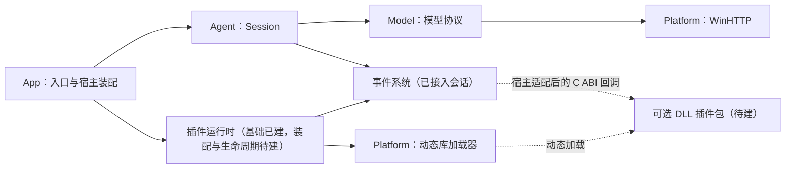

# 大肥鱼剩余基础开发指导

代码基线：`90309e7`（最小 Agent 会话与终端问答流程）。本文件面向后续逐次开发、提交和人工审查，配合 [AGENTS.md](../AGENTS.md) 使用。

**已确认的约束**来自现有项目规范与此前设计讨论；**建议方案**是本文件给出的实施细节，尚未实现，随对应阶段审查定稿。路线不是一次性开发授权，每完成一个审查点仍须验证、提交并停止。

## 1. 从哪里继续

| 已有能力 | 代码入口 | 当前边界 |
|---|---|---|
| VS2022、C++20、CMake 与职责分组 | [根构建](../CMakeLists.txt)、[预设](../CMakePresets.json) | 已有 App、Agent、Model、Platform、SDK、Plugins 和可选 Tests 目标；查询样例以 C11 编译 |
| DeepSeek / Qwen 配置与同步调用 | [模型接口](../model/include/dafeiyu/model_client.hpp)、[调用实现](../model/client.cpp) | 非流式、关闭思考；密钥取自环境变量；消息正文总量上限 1 MiB |
| HTTPS 传输 | [WinHTTP 实现](../platform/winhttp.cpp) | Windows；分阶段超时；不跟随重定向；成功响应正文上限 8 MiB |
| 平台 DLL 引用 | [DynamicLibrary](../platform/include/dafeiyu/dynamic_library.hpp) | 07a 已实现受控加载、导出查找和引用释放；不校验插件 ABI 或管理实例 |
| 最小 Agent | [Session](../agent/session.cpp) | 单线程同步；成功后成对提交问答，失败保留原历史；四类事件及同步重入保护已实现 |
| 独立同步事件 | [Bus](../events/include/dafeiyu/events.hpp)、[实现](../events/bus.cpp) | 按所有者订阅、取消和同步发布，已接入 Agent；不依赖模型或 DLL |
| 终端入口 | [启动分派](../app/main.cpp)、[会话循环](../app/chat.cpp) | `--check-config`、`--complete`、`--chat`；会话支持 `/clear`、`/exit` |
| 插件清单 | [清单接口](../plugins/runtime/include/dafeiyu/plugin_manifest.hpp) | 版本 1 格式、描述字段和包内文件校验；不扫描目录或加载 DLL |
| 插件发现 | [Registry](../plugins/runtime/include/dafeiyu/plugin_registry.hpp) | 单层扫描、坏包隔离、全部 ID 冲突拒绝、只读快照与显式刷新；不加载 DLL |
| 插件配置 | [配置接口](../plugins/runtime/include/dafeiyu/plugin_config.hpp) | 默认配置与独立用户设置按顶层键覆盖，输出只读 JSON 文本快照；不创建插件实例 |
| 插件模块查询 | [PluginModule](../plugins/runtime/include/dafeiyu/plugin_module.hpp) | 复核清单、受控加载和 ABI 校验，失败回收本次引用；不创建实例 |
| C ABI 契约 | [SDK](../sdk/include/dafeiyu/plugin_abi.h)、[契约说明](plugin-abi.md) | Windows x64 v1 类型与函数表、纯 C 查询 DLL；实例生命周期待建 |
| 离线测试 | [测试构建](../tests/CMakeLists.txt) | 平台加载与 ABI 查询在内共十项；包含真实 x64 依赖、Win32 拒绝及故障查询 DLL |

真实 DeepSeek / Qwen 成功回答及多轮联通仍待有效凭据验证。此前真实 HTTPS 的 HTTP 401 检查只验证鉴权失败路径，不能替代成功调用验收。

第 01 步实现提交：`23909d8`（`feat: 建立独立同步事件基础`）。当次 VS2022 Debug、Release 构建及四项离线 CTest 通过；仅验收独立总线。

第 02 步实现提交：`0bc9273`（`feat: 接入会话事件与同步重入保护`）。当次 VS2022 Debug、Release 构建及四项离线 CTest 通过，另完成双服务配置在两种构建下的 8 项离线命令行检查。会话测试使用真实事件总线及替身模型；未验收真实模型服务或 DLL。

第 03 步实现提交：`830a782`（`feat: 解析并校验插件包清单`）。当次 VS2022 Debug、Release 构建及五项离线 CTest 通过，清单测试覆盖真实文件及符号链接，未加载 DLL 或访问模型服务。

第 04 步实现提交：`f54eb65`（`feat: 建立插件发现与只读注册表`）。当次 VS2022 Debug、Release 构建及六项离线 CTest 通过，验证了坏包隔离、多包 ID 冲突、增删刷新、快照存活及根目录故障恢复；未加载 DLL 或接入终端管理命令。

第 05 步实现提交：`aab1213`（`feat: 合并插件默认配置与独立用户设置`）。当次 VS2022 Debug、Release 构建及七项离线 CTest 通过，验证了顶层覆盖、插件隔离、只读快照、文件和 JSON 边界；未加载 DLL 或改动模型配置。

第 06 步实现提交：`91ca301`（`feat: 定义插件 C ABI 与最小查询 DLL`）。当次 VS2022 Debug、Release 构建及八项离线 CTest 通过，C11 DLL 与 C++20 宿主验证了布局和实际导出查询；另通过 Debug 宿主查询 Release DLL。

第 07 步已整体完成，按 07a 与 07b 分别提交。07a 提交：`34cd195`（`feat: 封装受控 DLL 加载与模块引用`）；当次 Debug、Release 构建及九项离线 CTest 通过，验证了中文路径、引用归属、依赖搜索、缺失导出、架构拒绝及线程错误模式恢复。

07b 实现提交：`00a5b0c`（`feat: 完成插件 ABI 查询与兼容性校验`）。当次 Debug、Release 构建及十项离线 CTest 通过；真实 DLL 覆盖查询状态、返回表、全部必需函数、前置清单校验、关闭与失败回收，并确认未调用实例生命周期函数。

**当前下一审查点：资源归属与插件卸载讨论。** 类型反射与共享、默认观察责任、执行顺序、完成分层与 hook、容量调度，以及取消关闭和有界重试的已确认规则，集中记录在 [讨论记录第 0 节](async-event-stream-review.md#0-本轮已确认结论与讨论边界)；后续重点是运行期依赖和副作用回收。现有代码和下述同步契约仍描述已实现基线，不能视为异步化已完成；具体参数与接口待细化，第 08 步实例生命周期的实施顺序待新契约明确后重新对齐。

## 2. 基础建设完成的范围

以下约束已经确认，后续实现应保持：

1. 大肥鱼本体能够直接调用模型，默认 Provider 随程序发布；空插件目录不妨碍正常问答。
2. 插件通过指定目录中的包在运行时发现、安装、加载、卸载；本体构建不固定链接某个插件实现，也不靠配置把必需角色绑定给插件。
3. 插件描述和默认配置随包提供，用户配置按插件独立保存，程序启动后在内存中汇总管理。
4. 插件采用同进程可信原生 DLL 和 C ABI；忙碌时明确拒绝卸载，不强制终止插件执行。
5. 保持小步提交。通常以约 100～300 行手写代码为审查参考，测试也计入；复杂步骤继续拆分，不把行数当作必须凑满的指标。
6. `Old/` 只供参考，不成为新工程的构建、运行或测试依赖。

本轮基础建设的交付物是：**最小 Agent + 事件通知 + 可独立安装卸载的本地插件系统 + 可复现验收与运行目录**。

记忆、工作、工具循环、规划、会话持久化、流式输出、后台任务、插件商店、在线下载、自动升级和插件依赖求解不在这份路线中。模型 Provider 插件化也不是完成当前基础设施的前提；如后续需要，再扩展 SDK 能力。

## 3. 模块边界与线程模型

下图为建议的完成形态；标注“待建”的部分尚不存在。实线表示调用关系，虚线表示事件交付或动态加载，不表示本体静态链接插件。



| 职责 | 建议放置位置 / VS 分组 | 边界 |
|---|---|---|
| 入口、路径选择、组件创建和命令分派 | `app/` / App | 装配基础服务实例，不列举必需插件或固定插件角色 |
| 问答状态与通知发布 | `agent/` / Agent | 依赖模型接口和事件接口，不读取插件清单、不包含供应商 JSON |
| 事件订阅、取消、同步通知 | `events/` / Platform | 通用基础设施，不依赖 Agent、模型服务或插件 DLL |
| DLL 系统操作 | `platform/` / Platform | 封装平台句柄和加载路径，不负责业务状态或配置合并 |
| 插件发现、注册表、配置、生命周期及事件适配 | `plugins/runtime/` / Plugins | 管理可选插件；业务信息主要保存在运行时注册表中 |
| 对插件公开的 C 契约 | `sdk/include/dafeiyu/` / SDK | 只包含 ABI 所需类型与函数，不暴露宿主 C++ 实现 |
| 示例插件源码与包素材 | `plugins/examples/` / Plugins | 可独立构建、独立打包；本体不链接其实现 |

目录和目标名为建议。只在实际产生相应模块时加入 CMake；不能为了补齐分组创建空壳库。SDK 可以先是头文件接口目标。

当前实现采用单线程同步调用：App 在同一线程串行处理终端输入与会话调用，事件是当前调用栈上的通知，尚无异步订阅队列或宿主调度器。后续统一异步事件流的方向已确认，线程、缓冲和取消策略仍按 [讨论记录](async-event-stream-review.md) 待定。

这意味着模型请求期间管理命令要等请求结束后处理。忙碌拒绝卸载仍须通过直接调用和回调重入测试验证，不能因为终端暂时无法并发输入而省略保护。首版 SDK 不支持插件自建后台工作线程；如以后需要请求中即时处理管理命令，应另行设计并发、取消和资源归属。

## 4. 建议的基础契约

### 4.1 事件用于通知，不驱动新的业务循环

第 01 步已实现类型明确的事件数据，以及订阅、按标识取消、按所有者取消、发布四个操作。订阅标识仅在本总线内有效且不复用；所有者标识由调用方分配，必须非零。首版向全部订阅者交付事件，由回调按种类选择处理。

以下分发规则已实现并写入测试：

- 按订阅顺序同步通知；不承诺跨线程使用。
- 分发中新增的订阅从下一次发布生效；取消后尚未调用的订阅本次也跳过。
- 同一总线嵌套发布返回 `PublishStatus::reentrant`，不执行嵌套通知；外层分发继续。
- 单个回调抛出的 C++ 异常被捕获，继续通知其余订阅者。`PublishResult` 记录成功数、失败数和首个失败订阅及所有者，不保存异常对象或文本；正常遍历的状态为 `completed`，不表示全部回调成功。报告固定大小，事件层不通过同一总线发布诊断。
- 取消立即阻止后续调用；分发期间延至本次发布结束前销毁取消项，空闲时立即销毁。总线必须活到发布结束，回调对象析构不得重入总线；取消数量不代表 DLL 已可卸载。

第 02 步已实现以下会话规则：

- 会话创建与操作均限同一宿主线程；App 创建总线后注入会话，使用期内总线必须有效。会话不可复制或移动，避免复制身份与执行状态。
- 会话忙碌或共享总线正在分发时，`ask` / `clear` 抛出 `session: busy`，在修改历史和分配回合前拒绝；回调操作同一总线上的其他会话也被拒绝。正常和异常退出都会恢复会话空闲。
- 通知错误不把已经成功提交的问答变成失败，不回滚已提交历史；模型调用失败仍按原接口向 App 报告。
- `last_notifications()` 保留最近已接受操作的开始和结束通知报告，拒绝重入不覆盖报告；清空只有结束报告。`message_count()` 允许观察者检查已提交消息数，事件本身不携带对话内容。

执行中卸载自身的拒绝、插件 ABI 边界内异常转换仍留待插件阶段实现。

四类会话事件已接入，具体时机如下：

| 事件 | 触发位置 | 验收重点 |
|---|---|---|
| `turn.started` | 接受本轮请求后、构造请求及模型调用前 | 每个已接受的回合一次；携带会话标识与本轮序号 |
| `turn.completed` | 完整回答已成对写入历史后 | 观察者看到成功事件时，业务提交已经完成 |
| `turn.failed` | 本轮准备、调用或构造新历史失败，原历史保持不变时 | 与成功事件互斥，使用同一个回合序号 |
| `session.cleared` | 清空历史成功后 | 单独通知，不制造模型请求或成功回合 |

会话 ID 在进程内从 1 递增且不复用；各会话回合从 1 递增，失败回合也占用编号。清空事件使用回合号 0，不重置回合序号，空历史清空也通知一次。编号耗尽或重入导致的拒绝不创建新回合。首版事件只携带种类和关联标识，不广播 API Key、请求头或整段对话；首个示例只需观察生命周期即可证明插件可用。

### 4.2 插件包、用户配置与宿主配置分开

建议先使用普通目录包，不引入压缩包格式或在线仓库：

```text
<运行目录>/
  dafeiyu.exe
  plugins/
    example.observer/
      plugin.json
      observer.dll
      defaults.json
  userdata/
    plugins/
      example.observer/
        settings.json
```

插件根目录和用户数据根目录由宿主确定，可在后续入口中覆盖；默认路径相对程序所在目录解析，不依赖启动时的工作目录。只读部署可显式选择可写数据目录。

`plugin.json` 的版本 1 格式已在第 03 步实现：

```json
{
  "manifest_version": 1,
  "id": "example.observer",
  "name": "事件观察示例",
  "version": "0.1.0",
  "abi_version": 1,
  "entry": "observer.dll",
  "default_config": "defaults.json"
}
```

其中 `default_config` 可省略。清单最多 64 KiB，UTF-8 文本支持 BOM；当前 `manifest_version` 只能为整数 1，`abi_version` 只校验为正 uint32，兼容性留到加载阶段。`id` 最多 64 字节，格式为 `[a-z][a-z0-9]*([._-][a-z0-9]+)*`，并拒绝 Windows 保留设备名；`name` 最多 256 字节，`version` 最多 64 字节，均拒绝空串、纯 ASCII 空格和 ASCII 控制字符。版本先用于展示与核对，不做版本依赖求解。

第 03 步的 `load_manifest` 校验单个包，返回描述、规范化包目录及引用文件的绝对路径。`entry` 与 `default_config` 最多 1024 字节，支持中文、空格和子目录；入口必须以 `.dll` 结尾（不区分大小写），引用文件必须存在且为普通文件。不要求输入目录名等于 ID；第 04 步的注册表检查有效清单的跨包 ID 冲突，全部冲突包均被拒绝。

清单与配置读取规则已实现如下；插件初始化行为仍待后续阶段：

- 单包解析只读取清单，不加载 DLL；拒绝无效 JSON、重复字段、未知字段、错误类型、缺失字段和不支持的清单版本。
- 入口与默认配置路径必须位于包内；拒绝绝对路径、`.` / `..`、Windows 特殊字符、保留设备名及末尾点或空格。包目录、清单和引用路径拒绝符号链接及目录联接，并检查最终规范化位置。检查是当时的文件快照，不承诺抵抗并发替换；后续安装与加载须重新校验。第 04 步已加入坏包独立诊断和隔离。
- 未声明默认配置、尚无用户配置文件时，对应一侧按空对象处理；已声明的默认文件缺失，或已有文件格式非法时，明确报告错误。
- 包默认配置与用户覆盖分别读取为 JSON 对象，按顶层键覆盖，嵌套对象和数组整体替换，不做递归合并；`null` 是显式值，不表示删除字段。
- 每份配置最多 64 KiB（含 BOM），支持 UTF-8 BOM，最多 64 层容器；拒绝任意对象层级内的重复键、无效 JSON 和非对象根。宿主校验文件与对象结构，不限制插件自有字段；未来插件在初始化时校验字段含义。
- `load_config(manifest, user_data_root)` 先复核清单并拒绝描述变更，再读取默认文件及用户根下的 `plugins/<id>/settings.json`；用户根不得为空，路径逐段拒绝错误类型、链接和越界。不创建或写入任何配置文件。
- 结果为独立的 `shared_ptr<const EffectiveConfig>`，包含插件 ID 和 UTF-8 JSON 对象文本；重读成功或失败都不改变旧快照。注册表刷新不读取配置，未来实例持有自己的配置快照；新设置在后续实例加载时采用，暂不加入在线配置回调。
- 用户配置按 ID 独立存放；安装、更新清单或移除包都不自动删除用户配置。

当前 `config/*.json` 是模型配置，解析器拒绝未知字段。不能直接往其中塞入插件清单或全部插件设置。若以后增加宿主配置文件，它只管理宿主自身的路径等选项；插件注册表由扫描结果在内存中生成。

### 4.3 C ABI 与平台加载

第 06 步已提供 [ABI v1 契约](plugin-abi.md)和 [公开头文件](../sdk/include/dafeiyu/plugin_abi.h)。固定查询入口为 `dfy_plugin_query`，声明实例创建、启动、停止、销毁、事件回调以及宿主订阅、取消和诊断服务。Windows x64 的结构布局、调用约定、版本协商、错误缓冲所有权及生命周期规则已明确；模块查询已实现，实例和桥接继续按第 08～10 步建设。

当前纯 C 示例只验证查询，`create` 返回不支持且不产生实例；SDK 测试中的加载用于已知样例的 ABI 验证。07a 提供独立平台封装，07b 的 `PluginModule` 已将受控加载与 ABI 校验串联。配置与事件使用借用视图，错误文本使用调用方持有的 256 字节缓冲，所有接口均禁止异常跨越边界。

契约中已明确以下约束，后续实现须逐项遵守：

- 导出名、C 链接、调用约定、架构、ABI 版本、结构体大小及对齐方式、必需函数指针；宿主在创建实例前完成兼容性检查。
- 边界使用固定宽度整数、字节视图和不透明句柄；不传 STL 容器、C++ 对象、异常或宿主内部指针。
- 字符串使用 UTF-8，并明确长度和有效期。回调数据只在本次回调内有效，插件要保留就自行复制。
- 谁分配谁释放，跨模块分配需要配套释放函数；错误通过状态码和有明确所有权的文本返回。
- 插件实例、宿主服务表、配置快照及订阅的存活顺序；宿主服务必须活到插件停止与销毁完成。
- 首版宿主服务仅提供必要的事件订阅、取消和诊断输出，不顺带暴露任意会话操作或工具执行接口。

平台实现使用规范化后的 DLL 完整路径，并控制依赖库搜索范围；不能假设入口用了绝对路径，其依赖 DLL 就只会从同一目录解析。首版先限定依赖布局，使用唯一的私有依赖文件名，避免承诺同进程内任意同名库版本隔离。参见 [Windows DLL 搜索顺序](https://learn.microsoft.com/en-us/windows/win32/dlls/dynamic-link-library-search-order)。

07a 的 `DynamicLibrary` 要求绝对 `.dll` 路径，以 DLL 所在目录与 System32 作为文件系统依赖搜索范围，加载期间临时抑制当前线程的系统错误对话框并恢复原模式。它只拥有一次模块引用，可显式关闭或在作用域退出时尽力释放；关闭失败保留句柄供重试，导出查找失败不会自行清空仍被对象持有的引用。

07b 的 `PluginModule` 在加载前复核清单并拒绝不支持的 ABI。查询后先检查返回状态和错误长度，失败状态不读取其表指针或错误正文；成功时检查非空表、零错误长度、精确表大小、版本、架构、保留字段和全部函数。通过后保存只读表副本，构造失败由平台成员回收本次引用。显式关闭成功后接口失效，失败保留状态；调用方必须保证所有借用及调用在关闭前结束，本步不创建或停止实例，也不隔离违反 C ABI 内存约定的原生故障。

业务初始化和清理放在显式生命周期函数中，`DllMain` 保持最小；Windows 会在加载器锁下执行它，不适合承载完整插件初始化。参见 [DLL 开发约束](https://learn.microsoft.com/en-us/windows/win32/dlls/dynamic-link-library-best-practices)。

同进程可信 DLL 不提供进程级故障隔离；异常转换只能处理约定内的错误，不能据此宣称能隔离原生崩溃。

### 4.4 发现、安装、加载和卸载是不同操作

| 操作 | 含义 | 对现有会话的影响 |
|---|---|---|
| 发现 / 刷新 | 扫描目录并更新内存中的包目录信息 | 不执行插件代码，不替换已加载实例 |
| 安装 | 将校验通过的本地目录包放入受管理目录 | 默认不自动加载 |
| 加载 | 打开 DLL、校验 ABI、创建并启动实例 | 成功后插件可通过已授权宿主接口参与通知 |
| 卸载 DLL | 停止实例、撤销宿主注册、销毁实例、释放模块引用 | 包和用户配置仍保留 |
| 移除插件包 | 先完成必要的卸载，再移走并删除包目录 | 默认保留独立用户配置 |

首版建议启动时只发现，通过运行中的终端管理命令显式加载；手动刷新即可支持运行时发现，不先引入文件监听和自动重载。日后若需要自动加载，可再设计每包独立的启用偏好，不恢复为集中必需插件列表。

第 04 步已提供独立 `Registry`，尚未装配到 App。构造时只固定绝对根路径，显式 `refresh()` 扫描直接子项，忽略普通文件及点开头的保留子树。根目录缺失或为空是成功的空结果；根目录不是普通目录或枚举失败时抛错，旧快照保持不变。坏包和链接单独诊断，所有有效清单中的同 ID 包全部拒绝。

刷新完成后一次替换 `shared_ptr<const Catalog>`，包含按 ID 排序的有效描述、按路径排序的诊断和按 ID 排序的新增/移除/变更记录；旧快照可跨刷新及注册表销毁保留。差异比较以可用 ID 和清单描述为准，不追踪 DLL 或配置内容变更；每次重新检查引用文件。快照不保存加载实例、配置内容或 DLL 句柄，后续生命周期状态应与此目录快照分开。

卸载必须维护以下顺序与失败语义：

1. 所有进入插件的入口和回调均经过宿主管理的活动调用计数；有活动调用时立即返回 `Busy`，不调用停止函数、不改动实例。
2. 无活动调用时先关闭新的调用入口，再执行停止；插件停止失败时保留 DLL 和实例，记录故障，不能继续强制释放。
3. 停止成功后撤销该实例所有订阅及宿主登记项，销毁实例，最后释放宿主持有的模块引用；重新加载得到一个新实例。
4. 注册过的回调指针本身不等于“正在执行”。卸载前既要确保活动调用为零，也要移除全部可再次触发的回调入口。
5. 初始化或启动失败也要回收已登记资源；无法证明已停止的实例保持模块存活并报告故障，不冒险释放。停止失败后的重试规则须写入生命周期契约。

Windows 的 `FreeLibrary` 处理模块引用计数，不能代替宿主的活动调用管理，也不能仅凭一次调用就断言所有引用都已释放。参见 [FreeLibrary 语义](https://learn.microsoft.com/en-us/windows/win32/api/libloaderapi/nf-libloaderapi-freelibrary)。

注册表建议分别保存包描述、校验诊断、有效配置、实例状态、活动调用数和最近一次操作错误。刷新时外部包被删除或变更，应标记差异并保留已加载实例，不能直接销毁仍在使用的句柄。

## 5. 开发与提交顺序

以下每一行是一个候选审查点，不是一个大版本任务。需要更多代码时拆为 `08a / 08b` 等子步骤；不要把相邻阶段顺手合并。第 07～10 步先由隔离测试驱动，完成生命周期保护后再向终端开放管理命令。

| 步骤 | 本次交付与建议位置 | 最低验收条件 |
|---|---|---|
| 01 事件基础（已实现） | [events/](../events/include/dafeiyu/events.hpp)：类型、订阅标识、发布与取消；实现提交见第 1 节 | 无订阅者、多订阅者、分发中增删、异常隔离、嵌套发布拒绝已由 `events.bus` 验证；不依赖 Agent 或 DLL |
| 02 会话事件（已实现） | [Agent](../agent/session.cpp) 发布四类通知，增加同步重入保护；实现提交见第 1 节 | `agent.session` 验证先提交后通知、失败历史不变、唯一终态、问答与清空重入拒绝、通知失败不改业务结果 |
| 03 插件清单（已实现） | [解析器](../plugins/runtime/manifest.cpp)及版本 1 契约；实现提交见第 1 节 | `plugins.manifest` 验证合法包、缺失与重复字段、错误版本、路径越界和实际链接；全过程不加载 DLL |
| 04 发现与注册表（已实现） | [Registry](../plugins/runtime/registry.cpp) 扫描根目录并返回只读快照；实现提交见第 1 节 | `plugins.registry` 验证空目录、坏包隔离、全部 ID 冲突拒绝、增删和描述变更、快照存活及扫描故障恢复 |
| 05 插件配置（已实现） | [配置读取](../plugins/runtime/config.cpp)合并包默认值与独立用户设置；实现提交见第 1 节 | `plugins.config` 验证缺省、顶层覆盖、嵌套替换、显式空值、非法文件、路径链接、配置隔离和快照保持 |
| 06 C ABI 契约（已实现） | [SDK](../sdk/include/dafeiyu/plugin_abi.h)、[契约](plugin-abi.md)和最小查询 DLL；实现提交见第 1 节 | C11 / C++20 布局检查及 `sdk.abi` 实际查询通过；线程、长度、所有权、版本和生命周期规则明确 |
| 07a 平台 DLL 加载（已实现） | [平台封装](../platform/library.cpp)及真实 DLL 夹具；实现提交见第 1 节 | `platform.library` 验证中文路径、引用归属、重复关闭、导出缺失、依赖搜索、真实架构不匹配和错误模式恢复 |
| 07b ABI 查询校验（已实现） | [PluginModule](../plugins/runtime/module.cpp) 持有平台模块并校验接口表；第 07 步整体完成 | `plugins.module` 验证清单、查询状态、表大小、版本、架构、必需函数及关闭；查询或兼容性失败不留下本次模块引用 |
| 08 实例生命周期 | 创建、启动、停止、销毁和失败回收 | 配置正确传入；启动失败清理；成功只产生一个实例；停止失败保留模块；先不暴露终端加载入口 |
| 09 忙碌保护与卸载 | 活动调用保护、关闭入口、资源归属和卸载流程 | 执行中拒绝；空闲时按顺序释放；失败不强制释放；重复卸载、重新加载行为明确 |
| 10 事件桥接示例 | 宿主事件到 SDK 回调的适配；独立 observer 包 | 加载后收到通知；卸载后不再调用；回调期间卸载被拒绝；失败初始化无残留订阅；插件不修改模型输出 |
| 11 运行时管理入口 | App 接入插件目录与管理命令 | 同一进程内列出、刷新、加载、卸载；未知 ID 与无效操作有诊断；管理命令不发送给模型 |
| 12 安装本地目录包 | 校验、暂存、发布和刷新目录信息 | 不自动加载；重名拒绝；复制失败不留下可发现的半包；拒绝路径越界及绕出管理目录的链接 |
| 13 移除插件包 | 卸载后移除包目录，保留用户设置 | 忙碌时包与实例均不动；加载失败的包也能移除；删除失败可诊断、可重试；不影响其他包 |
| 14 离线集成验收 | 串联真实宿主、事件、DLL 与替身模型 | 在一个进程完成安装、刷新、加载、问答通知、卸载、再次问答和移除；空插件模式持续可用 |
| 15 可运行目录与指南 | 构建/安装规则、SDK 与示例包、第三方说明 | Release 从独立目录启动，改变工作目录仍能定位资源；产物不依赖源码树、Old、测试目录或真实密钥 |
| 16 双服务真实验收 | 使用有效凭据完成并记录 DeepSeek / Qwen 联通 | 空插件和加载 observer 时均能正常问答；两轮上下文有效；卸载 observer 后本体继续工作；无凭据则明确标为待验收 |

依赖关系按表中顺序推进。第 16 步的基础模型验证在获得有效凭据后可以提前开展，但事件及插件的真实联通仍须等待相应实现完成。

第 11 步的建议命令形式为 `/plugins list`、`/plugins refresh`、`/plugins load <id>`、`/plugins unload <id>`；第 12、13 步再增加 `install <目录>` 和 `remove <id>`。这些命令**目前均未实现**。命令解析必须覆盖带空格的中文路径，并继续保留现有 `/clear`、`/exit` 与单次调用入口。

本地安装建议采用“复制到不可发现的暂存目录 → 全部校验 → 在同一文件系统中发布为正式包目录”。首版拒绝覆盖已有 ID，不做加载中的原地更新。移除建议先将包移出可发现目录，再清理文件；清理失败须报告残留及后续处理状态，不把部分删除伪装成全部成功。所有移动和递归删除前都检查解析后的目标仍位于本次管理目录内。

第 15 步还应列明支持的 Windows 架构、运行库要求和私有依赖布局；本阶段提供可运行目录，不扩展为安装器工程。

## 6. 每个提交如何验收

每次开发前记录起始提交与工作区状态，只处理当前步骤；本地未跟踪文件不顺带纳入提交。延续 [中文注释规范](../AGENTS.md)：简单函数单行职责，复杂函数概要加一行执行步骤，函数内空行分段，仅关键边界补注释。

涉及编译或行为变化时使用现有预设，并执行与本步相关的测试；修改公共接口时执行完整离线 CTest：

```powershell
cmake --preset windows
cmake --build --preset windows-debug
cmake --build --preset windows-release
cmake --preset windows-tests
cmake --build --preset windows-tests
ctest --preset windows-tests
git diff --check
```

DLL 测试要覆盖实际加载和卸载，而不是全部用替身替代。网络模型可以使用替身保持离线测试可重复；真实服务验收单独记录。运行中卸载测试要确认取消订阅后没有残留入口，不以“这次没有崩溃”作为唯一证据。基础插件应可重复加载和卸载，释放失败要有可定位的状态。

纯文档改动检查链接、内容与代码一致性及 diff 即可，不为文档重跑无关构建。验收记录保留测试命令、结果与未验证边界；不保存 API Key 或认证请求头。

建议提交消息格式：

```text
feat: 实现本次单一功能点

内容：
- 用中文描述新增行为与模块边界。
- 用中文描述必要的测试和文档调整。

验证：
- 列出实际执行的检查及结果。
- 标明替身验证、真实 DLL 验证和真实服务验证的区别。
```

提交后的交付说明给出提交号、行为变化、验证结果、源码阅读顺序和下一个审查点，随后停止。若验收发现新的独立问题，应单独安排修复，避免把无关功能混入本步。

## 7. 基础阶段结束的判断

全部满足后，才进入记忆、工作等本体固有能力的讨论：

- [ ] DeepSeek、Qwen 的真实单次和多轮问答均有成功记录；缺少凭据时此项保持未完成。
- [ ] 空插件目录仍可启动和问答，插件失败不会成为本体模型调用的必需依赖。
- [ ] 事件通知具有明确顺序、异常边界、取消与重入规则，并有测试覆盖。
- [ ] 插件描述和默认设置随包保存，用户设置按插件隔离，宿主仅在内存整合运行时信息。
- [ ] 至少一个独立 DLL 示例能在进程运行期间被发现、安装、加载、卸载和移除。
- [ ] 忙碌卸载返回明确结果，停用后无残留回调，停止失败不会继续释放仍可能被使用的模块。
- [ ] 插件缺失、格式错误、ABI 不兼容和初始化失败有独立诊断，不破坏其他插件及当前会话。
- [ ] 离线集成测试覆盖整个插件生命周期，真实服务验收覆盖加载插件前后本体仍可工作。
- [ ] Release 运行目录、SDK、示例包、许可证说明和用户操作说明可从干净构建复现。
- [ ] 每个实现阶段已有独立提交并经过用户审查，文档中的建议已随实现更新为准确契约。

后续维护此文档时保留基线说明，并在已完成步骤旁记录实现提交及验收结果；不要把尚未实现的建议直接改写成现有能力。
