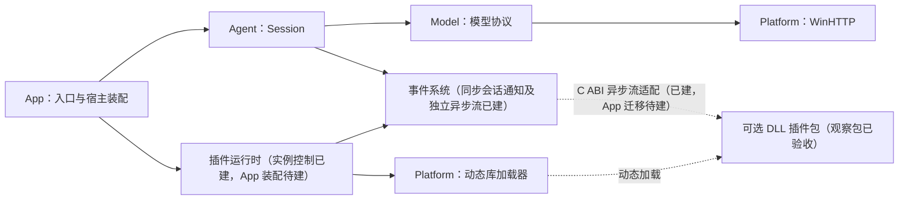

# 大肥鱼剩余基础开发指导

代码基线：`90309e7`（最小 Agent 会话与终端问答流程）。本文件面向后续逐次开发、提交和人工审查，配合 [AGENTS.md](../AGENTS.md) 使用。

**已确认的约束**来自现有项目规范与此前设计讨论；**建议方案**是本文件给出的实施细节，尚未实现，随对应阶段审查定稿。路线不是一次性开发授权，每完成一个审查点仍须验证、提交并停止。

2026-11-12 用户在前轮 21:00 截止后继续授权开发至北京时间 23:00，仍逐单元验证和提交；到期后恢复默认审查节奏。以下当前状态与阶段表以本轮验收更新，历史记录保留其当次范围和结果。

2026-11-14 用户再次授权依据本指导持续开发至北京时间 15:00；本轮从干净基线 `cc1ce89` 开始，保持每个单元独立验证和提交，到期恢复默认人工审查节奏。

2026-11-14 在 15:00 轮次结束后，用户继续授权持续开发至北京时间 17:00；新轮次从干净基线 `3d36d16` 开始，继续逐单元验证与提交，到期恢复默认人工审查节奏。

2026-11-14 在 17:00 轮次结束后，用户继续授权依据本指导持续开发，直到完成开发。本轮从干净基线 `c1ef0bc` 开始，不再沿用原时间截止；仍按独立功能验证和提交，阶段间继续推进，真实服务及最终人工审查据实记录。

2026-11-14 用户进一步要求开发期间每次只测试必要内容，仅在最终验收提交时运行全量测试。此要求覆盖下文旧的公共接口改动即全量复测规则；后续功能按影响范围选择构建目标和相关测试，最终再统一执行完整验收。

此前截至 15:00 的里程碑如下。每个提交范围均由独立小单元组成，表内测试数量是该里程碑完成时的 Debug／Release 完整 CTest 结果；该轮最后统一复核为 52／52。

| 里程碑 | 提交范围 | 当次完整 CTest | 阅读入口 |
|---|---|---|---|
| R09g 闭合枚举完整链路 | `3f7d146` ～ `c590515` | 44／44 | [枚举描述](../runtime/include/dafeiyu/enum_descriptor.hpp) |
| R09h 带标签联合完整链路 | `8c8c4b3` ～ `aaad765` | 47／47 | [联合描述](../runtime/include/dafeiyu/union_descriptor.hpp) |
| R09i 完整组合数组 | `b8a18d7` ～ `6f01162` | 49／49 | [匿名元素约束](../runtime/include/dafeiyu/element_descriptor.hpp)、[数组](../runtime/include/dafeiyu/array_value.hpp) |
| R09j 完整组合映射 | `5d61479` ～ `7379b85` | 50／50 | [映射](../runtime/include/dafeiyu/map_value.hpp)、[C 数据接口](../sdk/include/dafeiyu/data_abi_v2.h) |
| R10a 指定投递与真实 C 隔离 | `5a9e69c` ～ `e512db0` | 51／51 | [投递通道](../events/include/dafeiyu/broadcast_channel.hpp)、[C 目标验收](../tests/plugin_targets.cpp) |
| R10b-1／2 消费者组与共同接纳 | `15146ee` ～ `8d84d00` | 52／52 | [消费者组](../events/include/dafeiyu/consumer_group.hpp)、[组验收](../tests/consumer_group.cpp) |
| 中文职责注释与编码复核 | `7230b71` | 52／52 | 第 3.74 节 |

15:00 后授权轮次的里程碑如下，当前统一复核为 Debug／Release 58／58。各范围仍由独立、已验证的小提交组成。

| 里程碑 | 提交 | 当次完整 CTest | 阅读入口 |
|---|---|---|---|
| R10b-3a 成员有界异步读取 | `369dffd` | 53／53 | [成员读取控制器](../events/include/dafeiyu/group_reader.hpp) |
| R10b-3b 共享 C 读取及独立停止 | `c917204` | 54／54 | [真实 C 读取验收](../tests/plugin_group_reads.cpp) |
| R10b-4 显式 C 成员能力 | `b793412` | 55／55 | [组 ABI](../sdk/include/dafeiyu/group_abi_v2.h) |
| R10b-5／6 实际组消费、协商和活动边界 | `e726e00` ～ `3c507e1` | 56／56 | [观察包](../plugins/examples/observer/observer.c)、[组通知验收](../tests/plugin_group_notifications.cpp) |
| R10c-1／2 顺序域及等待恢复 | `3c9ce16` ～ `09fb6f4` | 57／57 | [顺序域](../runtime/include/dafeiyu/serial_domain.hpp)、[顺序验收](../tests/serial_domain.cpp) |
| R10c-3 显式等待环与边界 | `05ba66f`、`f177dfd` | 58／58 | [等待图](../runtime/include/dafeiyu/serial_wait_graph.hpp) |
| 职责、编码及跨配置复核 | `68b6e4a` | 58／58 | 第 3.85 节 |

持续开发轮次已完成真实事件处理记录、独立退出确认、C 处理协议、分层寿命预算及所有者公平调度。处理接纳顺序与事件发布身份分开，普通观察读取不自动承担业务完成责任。下一方向为 R12 结果策略及 hook；重试、插件依赖、App 异步迁移和安装管理继续按后续阶段推进。

## 1. 从哪里继续

| 已有能力 | 代码入口 | 当前边界 |
|---|---|---|
| VS2022、C++20、CMake 与职责分组 | [根构建](../CMakeLists.txt)、[预设](../CMakePresets.json) | 已有 App、Agent、Model、Platform、SDK、Plugins 和可选 Tests 目标；查询样例以 C11 编译 |
| DeepSeek / Qwen 配置与同步调用 | [模型接口](../model/include/dafeiyu/model_client.hpp)、[调用实现](../model/client.cpp) | 非流式、关闭思考；密钥取自环境变量；消息正文总量上限 1 MiB |
| HTTPS 传输 | [WinHTTP 实现](../platform/winhttp.cpp) | Windows；分阶段超时；不跟随重定向；成功响应正文上限 8 MiB |
| 平台 DLL 引用 | [DynamicLibrary](../platform/include/dafeiyu/dynamic_library.hpp) | 07a 已实现受控加载、导出查找和引用释放；不校验插件 ABI 或管理实例 |
| 最小 Agent | [Session](../agent/session.cpp) | 单线程同步；成功后成对提交问答，失败保留原历史；四类事件及同步重入保护已实现 |
| 独立同步事件 | [Bus](../events/include/dafeiyu/events.hpp)、[实现](../events/bus.cpp) | 按所有者订阅、取消和同步发布，已接入 Agent；不依赖模型或 DLL |
| 终端入口 | [启动分派](../app/main.cpp)、[会话循环](../app/chat.cpp) | `--check-config`、`--complete`、`--chat`；会话支持 `/clear`、`/exit` |
| 插件清单 | [清单接口](../plugins/runtime/include/dafeiyu/plugin_manifest.hpp) | 版本 1 格式、描述字段和包内文件校验；不扫描目录或加载 DLL |
| 插件发现 | [Registry](../plugins/runtime/include/dafeiyu/plugin_registry.hpp) | 单层扫描、坏包隔离、全部 ID 冲突拒绝、只读快照与显式刷新；不加载 DLL |
| 插件配置 | [配置接口](../plugins/runtime/include/dafeiyu/plugin_config.hpp) | 默认配置与独立用户设置按顶层键覆盖，输出只读 JSON 文本快照；不创建插件实例 |
| 插件模块查询 | [PluginModule](../plugins/runtime/include/dafeiyu/plugin_module.hpp) | 复核清单、受控加载和 ABI 校验，失败回收本次引用；不创建实例 |
| 宿主数据基础 | [引用表](../runtime/include/dafeiyu/handle_registry.hpp)、[基础值](../runtime/include/dafeiyu/value.hpp)、[结构描述](../runtime/include/dafeiyu/struct_descriptor.hpp)、[数组](../runtime/include/dafeiyu/array_value.hpp)、[映射](../runtime/include/dafeiyu/map_value.hpp) | 有界引用、嵌套结构、可选与可空、完整组合容器、枚举、带标签联合及版本化 C ABI 已实现 |
| 执行与完成 | [FIFO](../runtime/include/dafeiyu/fifo_executor.hpp)、[操作](../runtime/include/dafeiyu/operation.hpp)、[通知](../runtime/include/dafeiyu/completion_notifications.hpp)、[顺序域](../runtime/include/dafeiyu/serial_domain.hpp)、[等待图](../runtime/include/dafeiyu/serial_wait_graph.hpp) | 同宿主线程显式推进；唯一终态、协作取消、延后通知、顺序占用与显式等待环检查已实现；实际处理绑定和阻塞 I/O 异步化待建 |
| 资源与代码寿命 | [资源归属与使用](../runtime/include/dafeiyu/resource_owner.hpp)、[代码持有与活动保护](../platform/include/dafeiyu/code_module.hpp)、[实例控制](../plugins/runtime/include/dafeiyu/plugin_instance.hpp) | 已装配实例生命周期；忙碌拒绝、停止完成确认、单次销毁、失败保留和重试均已验收 |
| 最小事件流 | [事件存储](../events/include/dafeiyu/event_store.hpp)、[投递通道](../events/include/dafeiyu/broadcast_channel.hpp)、[读请求](../events/include/dafeiyu/subscription_reader.hpp)、[消费者组](../events/include/dafeiyu/consumer_group.hpp) | 有界接纳、指定投递、组共同接纳、成员异步读取及 C 适配已实现；正式 App 迁移仍待建设 |
| C ABI 契约 | [v1 SDK](../sdk/include/dafeiyu/plugin_abi.h)、[v2 SDK](../sdk/include/dafeiyu/plugin_abi_v2.h)、[v2 契约](plugin-abi-v2.md) | v1 冻结；v2 生产适配、生命周期及版本化组合数据访问已实现 |
| 实际观察插件 | [纯 C 实现](../plugins/examples/observer/observer.c)、[完整链路验收](../tests/observer.cpp) | 0.7.0 目录包只依赖 SDK；独立或组消费、完整类型预算、失败隔离、安全卸载及重新加载通过，App 尚未装配 |
| 离线测试 | [测试构建](../tests/CMakeLists.txt) | 当前 Debug、Release 均为 58／58；包含真实符号链接及 DLL 测试，历史权限失败记录不代表本次状态 |

真实 DeepSeek / Qwen 成功回答及多轮联通仍待有效凭据验证。此前真实 HTTPS 的 HTTP 401 检查只验证鉴权失败路径，不能替代成功调用验收。

第 01 步实现提交：`23909d8`（`feat: 建立独立同步事件基础`）。当次 VS2022 Debug、Release 构建及四项离线 CTest 通过；仅验收独立总线。

第 02 步实现提交：`0bc9273`（`feat: 接入会话事件与同步重入保护`）。当次 VS2022 Debug、Release 构建及四项离线 CTest 通过，另完成双服务配置在两种构建下的 8 项离线命令行检查。会话测试使用真实事件总线及替身模型；未验收真实模型服务或 DLL。

第 03 步实现提交：`830a782`（`feat: 解析并校验插件包清单`）。当次 VS2022 Debug、Release 构建及五项离线 CTest 通过，清单测试覆盖真实文件及符号链接，未加载 DLL 或访问模型服务。

第 04 步实现提交：`f54eb65`（`feat: 建立插件发现与只读注册表`）。当次 VS2022 Debug、Release 构建及六项离线 CTest 通过，验证了坏包隔离、多包 ID 冲突、增删刷新、快照存活及根目录故障恢复；未加载 DLL 或接入终端管理命令。

第 05 步实现提交：`aab1213`（`feat: 合并插件默认配置与独立用户设置`）。当次 VS2022 Debug、Release 构建及七项离线 CTest 通过，验证了顶层覆盖、插件隔离、只读快照、文件和 JSON 边界；未加载 DLL 或改动模型配置。

第 06 步实现提交：`91ca301`（`feat: 定义插件 C ABI 与最小查询 DLL`）。当次 VS2022 Debug、Release 构建及八项离线 CTest 通过，C11 DLL 与 C++20 宿主验证了布局和实际导出查询；另通过 Debug 宿主查询 Release DLL。

第 07 步已整体完成，按 07a 与 07b 分别提交。07a 提交：`34cd195`（`feat: 封装受控 DLL 加载与模块引用`）；当次 Debug、Release 构建及九项离线 CTest 通过，验证了中文路径、引用归属、依赖搜索、缺失导出、架构拒绝及线程错误模式恢复。

07b 实现提交：`00a5b0c`（`feat: 完成插件 ABI 查询与兼容性校验`）。当次 Debug、Release 构建及十项离线 CTest 通过；真实 DLL 覆盖查询状态、返回表、全部必需函数、前置清单校验、关闭与失败回收，并确认未调用实例生命周期函数。

**当前进度：R10 处理协议及 R11 分层预算、所有者调度已验收；后续为 R12 结果与 hook。** 详细范围与验收见下方阶段记录。

本次 21:00 后续开发从 `8283698` 的干净工作区开始，逐轮实现如下；表内结果为各次 Debug／Release 完整 CTest。

| 单元 | 提交 | 完整 CTest |
|---|---|---|
| R08a 独立纯 C 观察包 | `5509770` | 37／37 |
| R08b 完整异步链路与失败隔离 | `52707fa` | 37／37 |
| R09a 有界嵌套结构 | `e200968` | 38／38 |
| R09b 版本化 C 嵌套访问 | `8164077` | 39／39 |
| R09c 可选、显式空值与缺失 | `d1c83a3` | 40／40 |
| R09d-1 逻辑节点预算 | `10b329a` | 40／40 |
| R09d-2 标量数组 | `9aa0184` | 41／41 |
| R09d-3 C 数组访问 | `22db97c` | 41／41 |
| R09e-1 字符串键标量映射 | `e3a1d5e` | 42／42 |
| R09e-2 C 映射访问 | `c13df8c` | 42／42 |
| R09f 实际观察插件有界组合消费 | `2117c24` | 42／42 |
| R09f-2 消费预算精确边界 | `a03479c` | 42／42 |

R01a 当次验证：Debug、Release 主工程及 Debug 测试构建通过；新查询测试与 Debug 消费者调用 Release C DLL 通过。完整离线 CTest 为 8／11 通过，`plugins.manifest`、`plugins.registry`、`plugins.config` 在创建真实符号链接时因当前进程缺少权限而失败，未完成这些用例的全部断言；本次未修改这三项测试及其业务实现，也未跳过链接校验。复验命令见 [v2 验收记录](plugin-abi-v2.md#验收与下一单元)。

R01b 当次验证：Debug／Release 主工程、Debug 测试构建及 Debug 消费者调用 Release C DLL 通过；完整离线 CTest 为 9／12 通过，`sdk.handles_v2` 通过，上述三项测试仍因符号链接权限不足失败。正式引用运行时、业务完成及异步回收不在该步范围内。

R01c-1 本次从 `7275306` 的干净工作区开始，改动前重建后 12／12 CTest 通过；改动后 Debug／Release 主工程、Debug 测试构建及完整 13／13 CTest 通过，三个 Debug v2 消费者调用 Release C DLL 均通过。此前受权限影响的三项链接测试本次已通过，未修改或跳过相关校验。新增状态由隔离宿主手动结算，不验收生产异步执行、取消竞争或通知寿命。

## 2. 基础建设完成的范围

最近各单元的实现提交与当次完整 CTest 如下；详细边界见第 3 节和 v2 契约，隔离验收不等于生产异步运行时已经接入。

| 单元 | 提交 | 完整 CTest |
|---|---|---|
| R01c-2 取消请求与原因读取 | `03bf68e` | 13／13 |
| R01c-3a 通知接口与布局 | `d3a2481` | 13／13 |
| R01c-3b 通知行为隔离验收 | `13290cd` | 14／14 |
| R02a-1 宿主签发域 | `a76047f` | 15／15 |
| R02a-2 类型化引用表 | `e9ce8cf` | 16／16 |
| R02b-1 不可变数值 | `6c32013` | 17／17 |
| R02b-2 String／Bytes | `2b013cb` | 17／17 |
| R02c-1 结构描述快照 | `ccc7de4` | 15／18（三项真实符号链接受权限阻断） |
| R02c-2 有界类型目录 | `9aaf8e0` | 16／19（三项真实符号链接受权限阻断） |
| R02c-3 最小结构载荷 | `a07dc6f` | 17／20（三项真实符号链接受权限阻断） |
| R03a 有界 FIFO 执行器 | `96456cf` | 18／21（三项真实符号链接受权限阻断） |
| R03b 操作唯一终态 | `2d622dc` | 19／22（三项真实符号链接受权限阻断） |
| R03c-1 协作取消请求 | `2ef26ee` | 19／22（三项真实符号链接受权限阻断） |
| R03c-2a 通知登记与撤销 | `14729be` | 20／23（三项真实符号链接受权限阻断） |
| R03c-2b 通知 FIFO 调度 | `a6baba2` | 20／23（三项真实符号链接受权限阻断） |
| R04a 资源所有者登记 | `7142fae` | 21／24（三项真实符号链接受权限阻断） |
| R04b 资源使用凭证 | `f72a2f7` | 21／24（三项真实符号链接受权限阻断） |
| R04c-1 DLL 代码保持引用 | `11b1844` | 22／25（三项真实符号链接受权限阻断） |
| R04c-2 DLL 活动调用保护 | `0b770e0` | 22／25（三项真实符号链接受权限阻断） |
| R05a 有界事件接纳 | `6a9c577` | 23／26（三项真实符号链接受权限阻断） |
| R05b-1 有界订阅队列 | `6e0e5b0` | 24／27（三项真实符号链接受权限阻断） |
| R05b-2 原子广播接纳 | `6a881c6` | 25／28（三项真实符号链接受权限阻断） |

以下约束已经确认，后续实现应保持：

1. 大肥鱼本体能够直接调用模型，默认 Provider 随程序发布；空插件目录不妨碍正常问答。
2. 插件通过指定目录中的包在运行时发现、安装、加载、卸载；本体构建不固定链接某个插件实现，也不靠配置把必需角色绑定给插件。
3. 插件描述和默认配置随包提供，用户配置按插件独立保存，程序启动后在内存中汇总管理。
4. 插件采用同进程可信原生 DLL 和 C ABI；忙碌时明确拒绝卸载，不强制终止插件执行。
5. 保持小步提交。通常以约 100～300 行手写代码为审查参考，测试也计入；复杂步骤继续拆分，不把行数当作必须凑满的指标。
6. `Old/` 只供参考，不成为新工程的构建、运行或测试依赖。

本轮基础建设的交付物是：**最小 Agent + 事件通知 + 可独立安装卸载的本地插件系统 + 可复现验收与运行目录**。

记忆、工作、工具循环、规划、会话持久化、模型 token 流式输出、面向用户的后台作业、插件商店、在线下载、自动升级和安装时的软件包版本求解不在这份路线中。异步执行设施及运行期插件依赖属于已确认的基础设计，不能与上述扩展功能混淆。模型 Provider 插件化也不是完成当前基础设施的前提；如后续需要，再扩展 SDK 能力。

## 3. 模块边界与线程模型

下图为建议的完成形态；标注“待建”的部分尚不存在。实线表示调用关系，虚线表示事件交付或动态加载，不表示本体静态链接插件。



| 职责 | 建议放置位置 / VS 分组 | 边界 |
|---|---|---|
| 入口、路径选择、组件创建和命令分派 | `app/` / App | 装配基础服务实例，不列举必需插件或固定插件角色 |
| 问答状态与通知发布 | `agent/` / Agent | 依赖模型接口和事件接口，不读取插件清单、不包含供应商 JSON |
| 事件订阅、交付与取消 | `events/` / Platform | 同步会话总线与独立有界事件流并存，显式推进；不依赖 Agent、模型服务或插件实现 |
| 域、类型化引用、不可变值与结构描述 | `runtime/` / Platform | 不依赖 SDK、Agent、事件或插件；提供有界执行基础，生产 C ABI 适配位于插件运行时 |
| DLL 系统操作 | `platform/` / Platform | 封装平台句柄和加载路径，不负责业务状态或配置合并 |
| 插件发现、注册表、配置、生命周期及事件适配 | `plugins/runtime/` / Plugins | 管理可选插件；业务信息主要保存在运行时注册表中 |
| 对插件公开的 C 契约 | `sdk/include/dafeiyu/` / SDK | 只包含 ABI 所需类型与函数，不暴露宿主 C++ 实现 |
| 示例插件源码与包素材 | `plugins/examples/` / Plugins | 可独立构建、独立打包；本体不链接其实现 |

目录和目标名为建议。只在实际产生相应模块时加入 CMake；不能为了补齐分组创建空壳库。SDK 可以先是头文件接口目标。

当前正式 App 采用单线程同步调用：同一线程串行处理终端输入与会话，原事件仍在调用栈上通知。独立的生产 FIFO、事件队列与读请求已实现，但尚未装配到 App；其范围见第 3.8～3.20 节。后续统一异步事件流及调度、取消的基础规则已确认，具体线程模型、容器、算法和参数仍按 [讨论记录](async-event-stream-review.md) 细化。

当前模型请求期间管理命令要等请求结束后处理。忙碌拒绝卸载仍须通过直接调用和回调重入测试验证，不能因为终端暂时无法并发输入而省略保护。ABI v1 不支持插件自建后台工作线程；后续模型与终端异步适配分别审查，不能仅增加可等待接口外观而继续阻塞宿主调度线程。

### 3.1 宿主签发域标识（R02a-1）

R02a-1 新增实际目标 `dfy_runtime`，位于 `runtime/`、归入 Platform 分组，当次只实现[域标识签发](../runtime/include/dafeiyu/runtime_ids.hpp)及其[分配算法](../runtime/id_sequence.hpp)。该单元不依赖 SDK、Agent、事件或插件；后续引用表及基础值的实现见第 3.2～3.4 节，隔离异步夹具没有作为生产运行时引入。

`next_domain()` 在宿主内返回非零 uint64 域标识，同一进程中不复用，调用方对象销毁不会重置签发器。允许签发最大 uint64，耗尽后持续抛出 `std::overflow_error`，不回绕。宿主仅链接一份此运行库；插件通过 C ABI 宿主服务获得句柄，不能另行链接副本后自行签发域。

分配使用原子比较交换，允许不同宿主对象并发取得独立域；它仅保证标识唯一，不承担关联对象的发布同步，也不把其他服务升级为跨线程接口。已有 SDK 服务仍受各自的同宿主线程约束。

本轮起点 `13290cd`；Debug／Release 主工程、Debug 测试构建和完整 15／15 CTest 通过。`runtime.identifiers` 验证普通调用、四线程 512 次签发、调用方退出后不复用，并以同一内部算法验证最大值和重复耗尽拒绝；未通过改写生产全局计数器模拟边界。下一单元 R02a-2 建设引用槽位、代次及旧句柄拒绝。

### 3.2 类型化引用表（R02a-2）

[HandleRegistry<T>](../runtime/include/dafeiyu/handle_registry.hpp) 是已实现的宿主 C++ 引用基础，构造时显式指定正容量，分配独立域与固定槽位；构造失败不返回对象，已消耗域也不复用。`Handle` 以域、编号、代次组成非零三元组，全零是空值，数值复制只是同一引用的别名。它与 C ABI 具有相同的身份语义，但不是跨 DLL 传递的 C++ 对象；R06 再做显式适配，当前没有公布生产 C 引用服务。

`insert(shared_ptr<T>, shareable)` 登记非空对象并返回持有引用；`retain` 为可共享来源签发独立标识，多个引用指向同一个对象。`get` 仅借用只读对象，原引用释放后借用失效；不能以其他引用仍存在为由继续沿用旧借用。表操作限同一宿主线程，对象析构不得重入本表。表只管理引用，不定义业务状态、授权关系或异步清理责任。

`release` 对空值无操作；有效引用先移出对象、推进代次并更新引用数量，随后释放本次持有。槽位可以复用，但完整三元组不能复用；最大代次释放后将槽位置为永久停用，不回绕。表销毁释放其持有的引用，异步工作须由宿主另行保持。`size()` 是有效引用数，不是对象数。

错误域、编号、代次、过期或重复释放抛出 `ReferenceError(invalid_handle)`，不可共享来源抛出 `not_shareable`，容量或可签发槽位耗尽抛出 `exhausted`；拒绝保持既有记录。空对象和零容量为 `invalid_argument`，构造内存分配可能抛出标准分配异常。不同 `T` 和不同表各有独立域，跨表访问均拒绝；尚未建立可按宿主句柄反射的类型目录。

本轮起点 `a76047f`；Debug／Release 主工程、Debug 测试及 Release 引用测试构建通过，完整 CTest 16／16 与 Release 引用测试通过。`runtime.handles` 使用生产表验证独立引用、容量失败、共享限制、跨域拒绝、旧句柄与别名失效、槽位复用、最终释放和销毁后新域；最大代次由生产使用的同一推进函数验证，不通过篡改表内状态模拟。下一单元 R02b-1 实现最小基础值。

### 3.3 不可变数值（R02b-1）

[Value](../runtime/include/dafeiyu/value.hpp) 当前实现 Bool、Int64、UInt64、Float64，按明确命名的工厂创建；内容不可赋值修改，复制产生独立值。`ValueKind` 是宿主内部种类，不是 C ABI 数字或事件类型身份。读取须匹配准确种类，错误读取抛出 `std::bad_variant_access`，不自动做布尔、整数或浮点转换。

两个整数类型覆盖完整 64 位范围；Float64 使用 IEEE 754 双精度，只接受有限数，保留负零和非规格化值，拒绝 NaN 与正负无穷并抛出 `invalid_argument`。当前不提供结构字段、缺失、null 或组合类型占位；普通值可由 `HandleRegistry<const Value>` 保持独立引用，创建和释放均在宿主。

本轮起点 `e9ce8cf`；Debug／Release 主工程、Debug 测试与 Release 基础值测试构建通过，完整 CTest 17／17 和 Release 基础值测试通过，覆盖各类型边界、非法浮点、类型拒绝及引用寿命。下一单元 R02b-2 增加有长度限制的 String／Bytes。

### 3.4 String 与 Bytes（R02b-2）

`Value::from_string(text, max_bytes)` 与 `Value::from_bytes(bytes, max_bytes)` 要求调用方明确给出字节上限，先检查长度再校验或复制；超限抛出 `length_error`，非法 UTF-8 抛出 `invalid_argument`。零上限仅接受空输入。该限制是单值正文上限，不代表宿主全局存储预算已实现。

String 保存完整 UTF-8 标量编码，包括内嵌 U+0000；拒绝孤立连续字节、过长编码、代理项、截断及 U+10FFFF 以上内容。不做 Unicode 规范化、不去掉文本内的 BOM，也不静默截断。Bytes 接受任意字节及空值，两者均复制到宿主内存，输入缓冲之后修改或销毁不影响值。

`as_string()` 和 `as_bytes()` 返回只读借用视图，类型错误抛出 `bad_variant_access`。必须保持对应值或引用有效；释放一个引用后，应通过其他有效引用重新取得视图，不能继续使用旧借用。String、Bytes、空字符串、空字节与尚未实现的 null、缺失值互不混淆。

本轮起点 `6c32013`；Debug／Release 主工程、Debug 测试及 Release 基础值测试构建通过，完整 CTest 17／17 与 Release 基础值测试通过。新增用例覆盖 UTF-8 上下界、代理项、过长编码、截断、字节上限、内嵌零、输入独立性、类型拒绝及保留引用后的文本读取。下一单元为 R02c 结构字段描述与读取，需先细化类型身份、字段约束和注册快照，再分别实现。

### 3.5 结构描述快照（R02c-1）

[StructDescriptor](../runtime/include/dafeiyu/struct_descriptor.hpp) 在 `dfy_runtime` 中提供最小结构描述。`create(name, version, fields, limits)` 校验后复制名称和全部字段，返回不可赋值的独立快照；`name()`、`fields()` 只借用内部只读数据，`version()` 返回版本副本。快照可由 `HandleRegistry<const StructDescriptor>` 保留，借用仍受对应持有引用的有效期约束。

本次具体契约如下：

- 完整名称采用 `[a-z][a-z0-9_]*(\.[a-z][a-z0-9_]*)+`，至少两个点分段；字段名采用 `[a-z][a-z0-9_]*`。二者按字节精确匹配，拒绝大写、非 ASCII、内嵌零和空段，不做规范化。名称是机器标识，不限制 String 载荷中的中文。
- 契约版本为非零 uint32，允许最大值。名称与版本共同表达契约身份；本步只描述身份，不签发类型标识，也不检查全局定义冲突或命名权限。
- 每个 `FieldDescriptor` 包含名称、六种已实现基础值之一的 `ValueKind` 及 `max_bytes`。所有字段必填且不可为 null；String／Bytes 的上限零只允许空正文，数值字段必须填零。此处仅保存约束，载荷校验由 R02c-3 实现；不接受未知种类，不提供嵌套、可选或可空占位。
- 字段按声明顺序枚举，重复名称拒绝；索引只属于本快照。空结构允许。调用方显式提供 `DescriptorLimits` 的字段数和名称总字节上限；名称总量含类型名和所有字段名，不含终止符。逐次比较和扣减避免长度累计溢出；该预算加字段数限制约束单份描述规模，不是全局内存计费。
- 超限抛出 `length_error`；非法身份、字段、种类、约束或重复名称抛出 `invalid_argument`。内存分配仍可抛出标准异常；失败不返回快照，不改变输入或已有快照。描述中没有插件地址、校验回调或自定义析构函数。

R02c 已确认采用精确契约版本、严格字段校验、宿主描述快照和统一结构构造入口。后续 R02c-2 建设有界目录及定义／使用分离，同名同版本只能有一种正式定义；注册冲突及重复调用的具体回执在该单元定稿。R02c-3 再实现最小结构值及反射读取；嵌套、可选与可空分别审查。C ABI 映射仍在 R06，插件实例归属、撤销和资源依赖与 R04 对齐；本次不实现这些接口。

本轮起点 `0b03596`，工作区干净。Debug／Release 主工程、Debug 测试构建通过；完整 `ctest --preset windows-tests` 为 15／18 通过，新增 `runtime.struct_descriptors` 通过。`plugins.manifest`、`plugins.registry`、`plugins.config` 因创建真实符号链接失败，报告 `A required privilege is not held by the client`；当前进程无 `SeCreateSymbolicLinkPrivilege`。这些测试及业务实现未修改或跳过，须在具备权限的环境重跑完整预设，不能把本次记录视为全套通过。测试配置仍有既有 CMP0225 开发者警告。

另以 `cmake --build build/rebuild/windows-tests --config Release --target dfy_runtime_struct_descriptors_tests` 构建并运行 `build/rebuild/windows-tests/tests/Release/dfy_runtime_struct_descriptors_tests.exe`，均通过。[描述测试](../tests/runtime_struct_descriptors.cpp) 验证六种字段、顺序与版本、输入修改及销毁后的快照、生产引用表中的保留和最终回收，以及非法名称、重复字段、种类与预算边界。公开头文件 UTF-8 BOM、五份文档的 137 个本地链接与锚点及代码围栏检查通过；构建日志无新增编译警告。本次没有接入 DLL 或结构载荷。

### 3.6 有界类型目录（R02c-2）

[TypeCatalog](../runtime/include/dafeiyu/type_catalog.hpp) 在同一宿主线程内登记结构描述，以完整名称与精确 uint32 版本为键。构造显式指定正类型容量及每份描述的字段数／名称预算；每个版本分别占用一个名额。目录不提供隐式覆盖、兼容转换、撤销、插件命名权限或 C ABI 服务。

`define(descriptor)` 先检查同键记录：字段名称、种类、字节约束及声明顺序全部相同，抛出 `DefinitionError(already_defined)`；任一不同，抛出 `conflicting_definition`。没有同键记录时，满目录抛出 `exhausted`，否则按目录自身上限再次校验并复制快照，再提交记录；长度超限仍为 `length_error`，分配失败沿用标准异常。所有失败均不改变目录和旧快照，满目录也优先报告已有键的重复或冲突。

`find(name, version)` 精确匹配，返回共享只读快照；未知名称、版本零及其他未登记键均返回空值，不规范化名称、不自动选最新版本。定义者负责登记，使用者查询已有定义；重复定义不被当成新的成功登记。返回值持有自己的描述责任，目录销毁后仍可读取，最后一个持有者释放后回收。注册数量加单份描述限制控制目录保留规模，不等于进程全局内存预算；撤销与所有者资源归属留待 R04 的独立单元。

本轮从 `ccc7de4` 的干净工作区开始；本次持续开发授权允许逐单元验证提交后继续，仍保留独立审查粒度。Debug／Release 主工程和 Debug 测试构建通过，完整 CTest 为 16／19；三项真实符号链接测试仍因权限失败。新增 `runtime.types` 及 Release 的 `dfy_runtime_types_tests` 构建和执行通过，覆盖重复、各类冲突、精确版本、容量、失败无残留及目录退出后的快照寿命。下一单元为 R02c-3 结构值构造与字段读取。

### 3.7 最小结构载荷（R02c-3）

[StructValue](../runtime/include/dafeiyu/struct_value.hpp) 是独立的宿主结构载荷，字段仅包含六种基础 `Value`；尚不把嵌套结构加入基础值的种类。`create(descriptor, fields, max_payload_bytes)` 要求非空的共享只读描述，具名字段集合必须与描述完全一致，所有字段必填且不可空。输入顺序可以不同；名称精确匹配，重复、缺失、未知字段和错误种类抛出 `invalid_argument`，不执行隐式转换。

构造同时检查 String／Bytes 的描述上限和整份逻辑正文预算：Bool 计 1 字节，Int64／UInt64／Float64 各计 8 字节，文本及二进制计实际长度；字段名、描述、分配器与引用开销不计入这一正文限制，也不据此声称实现了全局内存预算。超限抛出 `length_error`，逐次扣减避免累计溢出。空结构允许零正文预算。全部校验通过后按描述顺序复制基础值，失败不改变输入或已存在的载荷。

`descriptor()` 返回描述的独立共享持有；`size()` 与描述字段数一致；`at(index)` 返回只读基础值借用并在越界时抛出 `out_of_range`；`find(name)` 精确查询并在未知名称时返回空指针。借用依赖对应结构载荷引用；通过另一个有效引用继续读取时须重新取得借用。载荷保持描述寿命，目录和输入退出后仍可反射读取；独立保留的描述可以比载荷存活更久。

本轮从 `9aaf8e0` 的干净工作区开始。Debug／Release 主工程、Debug 测试及 Release 的 `dfy_runtime_struct_values_tests` 构建和执行通过，完整 CTest 为 17／20；三项真实符号链接测试仍因权限失败，未改动或跳过。新增 `runtime.struct_values` 验证六种值、整数精度、负零、内嵌零、输入重排及销毁、两层字节预算、错误字段、类型、索引及生产引用寿命。R02 最小数据链路已具备，下一单元为 R03a 有界 FIFO 执行器；实际 C DLL 反射读取仍待 R06／R08。

### 3.8 有界 FIFO 执行器（R03a）

[FifoExecutor](../runtime/include/dafeiyu/fifo_executor.hpp) 在同一宿主线程中接纳和推进宿主 C++ 任务。构造要求正容量并分配固定环形槽位；容量只计排队项，另最多存在一个正在执行的调用，不约束捕获对象自身的内存。`post(task)` 只接纳非空任务，不调用任务正文；空任务抛出 `invalid_argument`，队列满抛出 `length_error`，拒绝不改变已接纳任务和顺序。

`run_one()` 每次至多执行一项，返回 `idle`、`executed` 或 `failed`；这是推进结果，不是业务操作终态。队首先移出并归还排队槽位，因此回调可以向队尾提交新任务，但新任务须由后续推进执行。回调内递归推进抛出 `logic_error`；单项异常被捕获，不保存异常对象，也不取消后续项。`running()` 覆盖调用和捕获资源释放，捕获全部释放后才恢复空闲。

执行器必须覆盖使用期，任务捕获资源的析构不得重入执行器。析构释放未执行任务但不调用其正文，外层服务必须先处理业务取消、终态及清理责任；执行器本身不提供操作登记、可取消等待或 DLL 代码依赖保护，也不创建线程或将阻塞 I/O 自动异步化。

本轮起点 `a07dc6f`。Debug／Release 主工程、Debug 测试与 Release 的 `dfy_runtime_executor_tests` 构建和执行通过；完整 CTest 为 18／21，三项真实符号链接测试仍受权限阻断。新增 `runtime.executor` 覆盖提交延后、FIFO、回调内追加、递归推进拒绝、满队列、槽位复用、异常后继续、调用及排队捕获寿命。下一单元为 R03b 操作终态。

### 3.9 操作唯一终态（R03b）

[OperationSource／Operation](../runtime/include/dafeiyu/operation.hpp) 分离宿主完成权与客户端只读状态。完成源创建 Pending 记录，`operation()` 返回独立持有的 `shared_ptr<const Operation>`；客户端不能直接构造或结算该记录。`state()` 返回独立枚举副本，不推进执行器，不表示相关资源已退出或释放。

`settle(terminal)` 只接受 Succeeded、Failed、Cancelled；Pending 或未知枚举抛出 `invalid_argument`。已结算记录再次结算，包括同一终态，抛出 `logic_error` 并保留原结果。状态是宿主内部枚举，后续 C ABI 必须显式映射，不能直接使用其数值。失败原因与结果载荷由对应能力另行定义，本步不增加通用无类型结果。

所有访问限同一宿主线程。宿主受理工作后必须独立保持完成源直至结算，不能依靠客户端引用；引用服务只控制读取寿命，释放全部客户端引用不取消排队任务。完成源析构不隐式结算，宿主在销毁前须结束已受理工作；这是一项外层装配责任，本步没有自动扫描或强制取消。结算后客户端仍持有的记录可以独立于完成源存活。

本轮起点 `96456cf`。Debug／Release 主工程、Debug 测试及 Release 的 `dfy_runtime_operations_tests` 构建执行通过，完整 CTest 为 19／22，三项真实符号链接测试仍受权限阻断。新增 `runtime.operations` 使用生产 FIFO 与引用表验证唯一终态、旧快照不变、非法状态拒绝、客户端全部释放后工作继续、最终回收及结果独立存活。下一单元 R03c-1 实现协作取消请求，随后 R03c-2 建设可撤销的延后完成通知。

### 3.10 协作取消请求（R03c-1）

`OperationSource(cancellable)` 在创建时固定取消支持性，缺省不支持，需显式传入 `true`。`Operation::cancellable()` 返回该属性；`cancellation_reason()` 返回首个原因副本，尚未请求时为 `none`，不支持时抛出 `domain_error`，不推进工作。

宿主通过 `request_cancel(reason)` 传递 user、owner_stop 或 deadline 请求。先拒绝 none／未知原因（`invalid_argument`），再检查支持性（不支持为 `domain_error`）。已有终态返回 `already_settled`，不会写入新原因；Pending 且已请求返回 `already_requested`，保留首个原因；首次有效请求记录原因并返回 `recorded`。已终态优先于重复请求，所有拒绝保持记录不变。

请求成功不等于 Cancelled，也不自动执行计时器、传播、任务退出或清理。宿主在实际业务提交边界读取原因并决定结果，请求后仍可成功或失败；正式终态和首个原因均不被迟到请求改写。只读操作引用、唯一完成源及同宿主线程约束保持不变；对外取消权限和 C ABI 映射仍由后续服务装配负责。

本轮起点 `2d622dc`。Debug／Release 主工程、Debug 测试及 Release 操作专项构建执行通过，完整 CTest 为 19／22，三项真实符号链接测试仍受权限阻断。`runtime.operations` 新增三种原因与三种终态组合、重复请求、无效原因、不支持拒绝、原因快照及生产 FIFO 中完成先到／取消先到的验证。下一单元为 R03c-2 可撤销的延后完成通知，取消某条通知不会取消底层操作。

### 3.11 有界通知登记与撤销（R03c-2a）

[CompletionNotifications](../runtime/include/dafeiyu/completion_notifications.hpp) 为同宿主线程提供有界通知登记与不可共享引用，登记槽与客户端引用表采用相同正容量。`subscribe(operation, callback)` 要求非空操作与回调，保持独立操作引用和回调捕获，再签发客户端句柄；容量或登记顺序号耗尽为 `ReferenceError(exhausted)`，失败不留下半登记。顺序号允许最大 uint64，之后停止签发，不复用。

`read` 返回状态副本；`retain` 对有效登记拒绝为 `not_shareable`，无效引用仍为 `invalid_handle`。`release` 只释放客户端引用，Pending 登记仍占用槽位并保持待通知责任。`revoke` 对 Pending 进入 Revoked，释放回调及操作持有，不取消底层操作或其他等待者；终结状态重复撤销返回 `already_inactive`。Running 返回 `busy` 的分支已固定，但本单元尚不派发，Running／Delivered 由下一单元的执行器推进产生。

池持有者与客户端引用分别结束；`collect()` 仅回收终结且只剩池持有的记录，`release` 和新登记也执行此回收。`size()` 是占用槽数，`references()` 是客户端持有数。析构释放剩余登记而不调用消费者；捕获析构不得重入池。池不发布生产 C ABI 通知能力，FIFO 调度、回调借用与代码寿命仍分别由 R03c-2b、R04／R06 完成。

本轮起点 `2ef26ee`。Debug／Release 主工程、Debug 测试及 Release 的 `dfy_runtime_notifications_tests` 构建执行通过，完整 CTest 为 20／23，三项真实符号链接测试仍受权限阻断。新增 `runtime.notifications` 验证不可共享、独立撤销、重复撤销、容量与引用拒绝、槽位复用、来源退出、释放引用不撤销及最终回收。下一单元为 R03c-2b 通知的 FIFO 调度。

### 3.12 通知的 FIFO 调度（R03c-2b）

`CompletionNotifications::schedule_one(executor)` 每次选择登记顺序最早、尚未排队且操作已有终态的一项，提交给生产 FIFO；没有可新排队项返回 `idle`，执行器满返回 `blocked` 并保持登记可重试，成功返回 `queued`。Pending 包含等待操作和已经排队两种情况；提交与状态查询都不调用消费者。槽位复用不改变登记顺序，新登记只能在后续执行器推进中调用。

执行包装独立保持登记，不捕获池地址；回调期间进入 Running，自撤销返回 Busy，释放客户端引用仍不取消这次调用。回调借用 `const shared_ptr<const Operation>&`，可以复制取得独立持有，不得保留这个引用本身；操作在进入回调前已终结。一次调用结束后先释放回调捕获与操作持有，再进入 Delivered；消费者抛错也完成该收尾并由 FIFO 返回 `failed`，Delivered 不代表消费者业务成功。每项至多调用一次。

排队后撤销立即移除消费者入口，宿主包装随后只跳过该项。池析构也撤销未开始项，已进入的调用由其独立持有继续收尾。排队包装执行完或被执行器销毁时解除排队标记；未交付登记因此可以在另一个存活执行器上重新调度，不永久滞留。终结记录在包装和客户端持有都结束后，通过 `collect()` 或下次登记／调度回收。

宿主须主动调用调度及 FIFO 推进；没有线程、阻塞等待、模型异步适配或自动 DLL 依赖保护。C ABI 的操作借用和状态需在 R06 显式适配，资源与代码寿命由 R04 建设。本轮起点 `14729be`；Debug／Release 主工程、Debug 测试及 Release 通知专项构建执行通过，完整 CTest 为 20／23，三项真实符号链接测试仍受权限阻断。新增验证覆盖顺序、一次交付、自撤销、借用保留、回调内新登记、执行器背压及销毁恢复、无客户端交付、异常及池销毁后的残留入口检查。下一单元为 R04a 资源所有者登记。

### 3.13 资源所有者登记（R04a）

[ResourceOwner](../runtime/include/dafeiyu/resource_owner.hpp) 表达一个宿主所有者实例的有界资源登记，使用独立签发域及槽位代次；实例重新创建不会复用旧域，旧资源句柄也不能访问新槽位。该域标识资源的签发来源，不是插件包 ID。登记句柄是宿主清理控制凭证，不作为插件可直接释放的普通数据引用发布。

宿主在执行受管副作用前调用 `prepare()`，成功取得 Preparing 登记后才能开始；实际建立成功后调用 `activate()`。准备阶段失败也可以进入清理。`stop_accepting()` 将 Open 推进到 Closing，之后拒绝新登记；已准备工作完成时仍可记录 Active，但不重新开放接纳。`begin_cleanup()` 进入 Cleaning，重复调用保持该阶段；`fail_cleanup()` 记录 CleanupFailed 并保留容量与责任；必须显式重新进入 Cleaning 才能在实际清理成功后调用 `finish_cleanup()`。完成后撤销登记并推进句柄代次，重复释放及旧别名拒绝。

只有停止接纳且所有登记结束后，`finish_close()` 才进入 Closed；重复关闭无副作用，不能重新启用，重新加载须建立新所有者。错误阶段抛出 `logic_error`，引用及容量错误沿用引用表分类。所有调用限同一宿主线程；本类记录进度而不执行副作用或释放实际资源，宿主须在析构前完成实际清理及关闭。使用关系、清理动作和 DLL 代码依赖继续分步建设。

本轮起点 `a6baba2`。Debug／Release 主工程、Debug 测试及 Release 的 `dfy_runtime_resources_tests` 构建执行通过，完整 CTest 为 21／24，三项真实符号链接测试仍受权限阻断。新增 `runtime.resources` 验证先登记、准备失败清理、失败保留与显式重试、关闭接纳、重复关闭、槽位代次及跨实例拒绝。下一单元为 R04b 资源使用凭证与清理阻挡。

### 3.14 资源使用凭证（R04b）

`ResourceOwner(resource_capacity, use_capacity)` 为入向和出向使用各设置同一个明确上限；缺省使用上限为零，不允许申请使用。`provider.acquire(resource, consumer)` 要求双方仍 Open 且资源 Active，检查提供方入向和消费者出向容量，再增加两侧及该资源的计量，返回不可复制、可移动的 `ResourceUse`。资源引用错误沿用引用表类别，状态拒绝为 `logic_error`，使用容量耗尽为 `length_error`，拒绝没有部分计费。

凭证固定提供方资源句柄、提供方域和消费者域；已有关系不因停止接纳或新实例出现而重新绑定。移动不重复计费，覆盖移动先归还旧关系，自移动及重复 `reset()` 安全。凭证的析构或 `reset()` 仅结束这一次使用关系，归还三处计量，不代表业务成功，也不释放提供方实际资源。自用同样分别计入入向和出向预算。

有使用者时 `begin_cleanup` 拒绝且不改变资源阶段；关闭接纳后双方均不能建立新使用。消费者即使没有自有资源，也须等待出向凭证全部结束才能 `finish_close`。实际资源的释放必须遵循这些检查；宿主须保持凭证直到最后一次访问及必要收尾结束，且在同宿主线程释放。凭证独立保持控制记录，尚未建立可枚举的全局依赖图、联动停止、重新绑定或 DLL 引用，这些属于后续单元。

本轮起点 `7142fae`。Debug／Release 主工程、Debug 测试与 Release 资源专项构建执行通过，完整 CTest 为 21／24，三项真实符号链接测试仍受权限阻断。新增测试覆盖零预算、双方容量、清理阻挡、消费者关闭、移动与覆盖、自用、具体实例和资源代次绑定。下一单元为 R04c-1 DLL 代码保持引用，随后独立验证活动调用保护。

### 3.15 DLL 代码保持引用（R04c-1）

Platform 的 [CodeModule／CodeLease](../platform/include/dafeiyu/code_module.hpp) 复用 `DynamicLibrary`，在宿主内管理一次真实模块引用及有界代码凭证。构造先检查正凭证容量再加载；`lease()` 取得移动式凭证，显式 `retain()` 产生另一份并计费，超限抛出 `length_error`。空凭证和关闭后获取抛出 `logic_error`。移动不重复计费，`reset()` 归还一次持有；只读普通数据引用不自动成为代码凭证。

凭证的 `symbol()` 返回借用导出地址，调用方须保持凭证直至调用、恢复或依赖 DLL 的析构代码全部返回。控制对象退出不使存活凭证失效；最后存储持有者由平台库尽力释放本次引用。需要报告系统释放错误时，宿主应保留控制对象并显式 `close()`：有凭证时返回 `in_use` 且不改变模块，释放失败抛错并保留重试状态，成功后禁止新借用，重复关闭成功。该结果不声称进程内其他独立模块引用也已释放。

本步只保持代码寿命，`leases()` 不是活动原生调用数；活动入口保护在 R04c-2 追加。当前 `PluginModule` 的 v1 查询路径未切换到新封装，未创建实例或提供卸载命令。

本轮起点 `f72a2f7`。Debug／Release 主工程、Debug 测试与 Release 的 `dfy_code_module_tests` 构建执行通过，完整 CTest 为 22／25，三项真实符号链接测试仍受权限阻断。新增 `platform.code_module` 使用真实 C DLL 与依赖验证容量、显式保留、移动、控制方退出、FIFO 捕获、调用结果及最后持有释放；Debug 测试另调用 Release 的 `dfy_loader_payload.dll` 通过，所有模块引用在各验收场景结束后回收。

### 3.16 DLL 活动调用保护（R04c-2）

`CodeModule(file, lease_capacity, call_capacity)` 增加独立活动保护容量，缺省为 1，两类容量都须为正且在加载前校验。`CodeLease::enter()` 取得不可复制、可移动的 `CodeCall`；超限为 `length_error`，空凭证为 `logic_error`，失败不增加计量。活动保护覆盖入口准备、原生执行及必要收尾，必须在对应 DLL 入口完全返回宿主后才结束。

`CodeCall::symbol()` 在保护内借用导出地址；该保护独立保持模块，因此普通代码凭证及控制对象退出后，已进入的调用仍能返回。`active_calls()` 是保护数量，`leases()` 仍只计算普通代码凭证。`close()` 先检查活动保护并返回 `busy`，再检查普通凭证返回 `in_use`，两种拒绝都不修改模块；两者均归零后才释放本次平台引用。此保护也须用于显式调用插件销毁、恢复和清理代码，不只用于普通业务函数。

本封装不会自动拦截任意原生函数调用；宿主所有进入 DLL 的适配入口必须使用保护。v1 的生产 `PluginModule` 尚未迁移，插件实例状态、资源与代码依赖的装配仍属 R06／R07；同进程原生故障隔离不在此保证内。

本轮起点 `11b1844`。Debug／Release 主工程、Debug 测试及 Release 代码模块专项通过，完整 CTest 为 22／25，三项真实符号链接测试仍受权限阻断；Debug 消费者调用 Release C DLL 也通过。真实 DLL 回调在原生栈内释放普通凭证并请求关闭，确认 Busy；另在栈内释放控制对象，DLL 返回后继续读取依赖并得到正确结果，最后活动保护结束后确认模块释放。还验证活动容量、移动及导出查找异常的收尾。下一单元为 R05a 有界事件接纳与稳定标识。

### 3.17 有界事件接纳（R05a）

新的 Platform 目标 `dfy_event_streams` 提供 [EventStore](../events/include/dafeiyu/event_store.hpp)，保留原 `dfy_events` 同步总线。存储限同一宿主线程，构造明确持有引用容量和单事件逻辑正文上限；`StructValue::payload_bytes()` 返回构造时已核定的正文大小，接纳时按宿主限制再次检查。

`accept(payload)` 要求非空宿主不可变结构载荷，按顺序分配 `EventId{domain, sequence}`，签发持有引用成功后才推进序号。接纳域独立于引用表域；同一事件的显式 `retain` 产生不同持有引用但保持事件身份，释放引用不代表投递或业务完成。输入失效不影响存储持有的载荷与描述。空载荷为 `invalid_argument`，正文超限为 `length_error`，引用容量不足沿用 `ReferenceError`，序号耗尽为 `overflow_error`；拒绝不消耗接纳序号。

序号允许最大 uint64，之后停止且不重新启用；用与生产相同的推进函数验证末值边界。`available_references()` 只计算仍可签发的空槽，排除代次耗尽的永久停用槽位，供后续原子广播接纳使用。引用容量约束本表持有，不等于进程全局内存预算；本步不建立订阅或广播，也不把接纳成功解释为消费者完成。

本轮起点 `0b770e0`。Debug／Release 主工程、Debug 测试及 Release 的 `dfy_event_store_tests` 构建执行通过，完整 CTest 为 23／26，三项真实符号链接测试仍受权限阻断。新增 `events.store` 覆盖事件与引用身份、顺序接纳、保留、容量拒绝、失败后序号、正文上限、跨域及旧句柄拒绝、载荷最终回收；既有结构值测试另核对正文计量。下一单元为 R05b-1 有界订阅队列，之后实现原子广播接纳。

### 3.18 有界订阅队列（R05b-1）

[SubscriptionQueue／EventLease](../events/include/dafeiyu/subscription_queue.hpp) 在同一宿主线程提供独立固定容量交付队列。队列共享持有 `EventStore`，`push(source)` 为事件保留一份独立引用后入队，调用方仍负责来源引用；队列满为 `length_error`，关闭接纳为 `logic_error`，存储引用不足沿用引用错误，拒绝不改变队列或消耗来源。

`poll()` 区分 Event、暂时 Empty 和 Closed。Event 将队首引用转交移动式 `EventLease`，不额外签发；凭证的 `get()` 只借用记录，`retain()` 显式产生独立持有，移动覆盖及 `reset()` 归还旧责任。凭证独立保持存储，队列退出或关闭不会使已经读出的数据失效。排队容量不包含已交付引用，但它们仍占用同一事件存储的有界引用名额。

`close(drain)` 停止新接纳并允许读完既有队列，排空后 Closed；`close(cancel)` 丢弃尚在队列中的引用并 Closed，不取消底层业务或已读出的数据。排空可以升级取消；已经 Closed 的结果不再改写，重复关闭安全，析构执行取消关闭。`close_mode()` 在 Open 时为空，其余返回固定模式。Closed 只表示交付流结束，不证明消费任务或 DLL 代码已退出，这些还须由所有者和活动保护收尾。

本轮起点 `6a9c577`。Debug／Release 主工程、Debug 测试及 Release 的 `dfy_subscription_queue_tests` 构建执行通过，完整 CTest 为 24／27，三项真实符号链接测试仍受权限阻断。新增 `events.subscription_queue` 验证空与结束区分、FIFO、两层容量、排空、升级取消、接收方隔离、独立保留、移动和队列退出后的数据寿命。下一单元为 R05b-2 原子广播接纳；异步等待读取仍待后续单元。

### 3.19 原子广播接纳（R05b-2）

[BroadcastChannel](../events/include/dafeiyu/broadcast_channel.hpp) 显式限制订阅数及各队列容量，保持每个订阅的独立队列。`subscribe()` 创建并由通道持有，调用方引用消失不自动取消；`remove()` 只移除属于本通道且已 Closed 的队列，其他实例为 `invalid_argument`，尚未关闭为 `logic_error`。旧队列对象可以继续观察 Closed，复用目录槽不会把旧对象重新绑定。

`publish(payload)` 在同一宿主调用中固定全部 Open 接收方并检查空槽，再调用 `EventStore::accept_batch` 原子签发同一事件的全部持有引用，最后以不分配内存的提交步骤转交队列。任一队列满、引用预算不足或准备失败均不交付半批、不推进接纳序号；没有接收方时仍生成接纳身份，并立即归还临时数据引用。Draining／Closed 不进入新目标集合，广播成功返回事件身份，不等待或汇总处理结果。

批量接纳在准备输出及事件后签发引用，异常回滚本次已签发项，全部成功才推进一次序号。已经读出的数据凭证仍占事件存储预算，因此消费者取走队列项不会提前归还实际引用名额。通道析构取消所持队列，外部队列对象仍能读到结束，已交付普通数据保持有效。本步没有指定接收方、消费者组或优先级策略。

本轮起点 `6e0e5b0`。Debug／Release 主工程、Debug 测试及 Release 的 `dfy_broadcast_channel_tests` 构建执行通过，完整 CTest 为 25／28，三项真实符号链接测试仍受权限阻断。新增 `events.broadcast` 验证慢接收方和引用背压的全量拒绝、批量容量、失败后序号、独立关闭、订阅替换、无接收方及通道退出后的数据寿命。下一单元为 R05c 有界可取消读请求。

### 3.20 有界可取消读请求（R05c）

[SubscriptionReader／ReadRequest](../events/include/dafeiyu/subscription_reader.hpp) 绑定一个交付队列并明确请求容量，每个控制器至多一项 Pending；客户端仍保留的终结结果也占槽位。`next()` 提交后尝试读取，有数据或流已结束时可以立即结算，但不内联调用消费者通知。已有 Pending 为 `logic_error`，请求容量不足为 `length_error`；无客户端持有的终结记录通过 `collect()` 或后续提交／推进回收。

宿主在数据、取消或关闭变化后显式调用 `advance()`，没有后台轮询线程。若取消原因在本次取数据前已登记，先结算本次读取 Cancelled，队列数据留给后续读取；已经成功交付后请求取消只返回已结算。`close(mode)` 关闭交付队列并推进等待：排空先交付已有事件，再返回 Closed；取消关闭丢弃排队项并返回 Closed。Closed 是成功读取到流结束，携带独立关闭模式，区别于只取消本次等待的 Cancelled。

`ReadRequest::result()` 返回确定结果副本，Pending 时拒绝；`event()` 借用事件，`retain_event()` 显式取得受事件存储预算约束的独立数据持有。操作状态视图可以单独存活，但读取结果须保留整个 `ReadRequest`；未来 R06 的类型化操作句柄必须保持完整请求，不能只保存状态视图。消费者通过既有 `CompletionNotifications` 和 FIFO 接收延后通知。控制器退出会以所有者停止原因结算尚未完成的等待，不关闭队列，也不改写已完成结果。

本轮起点 `6a881c6`。Debug／Release 主工程、Debug 测试与 Release 的 `dfy_subscription_reader_tests` 构建执行通过，完整 Debug CTest 为 26／29，三项真实符号链接测试仍受权限阻断。新增 `events.subscription_reader` 串联生产队列、操作、取消、完成通知及 FIFO，验证等待与结果容量、先取消保留事件、迟到取消、排空及取消关闭、客户端释放后工作继续、控制器退出和独立数据保留。R05 最小交付基础已具备；消费者任务退出、资源及 DLL 的完整装配仍待 R06～R08，下一单元为 R06a v2 查询加载与兼容校验。

本轮收束时另完成整个 `windows-tests` 的 Release 构建，并执行 `ctest --test-dir build/rebuild/windows-tests -C Release --output-on-failure`：同为 26／29，通过项与 Debug 一致，失败仍是三项真实符号链接权限检查。新旧公共头文件在独立 VS2022 C++20 消费者中共同编译及运行通过，该消费者没有继承项目 `/utf-8` 选项。完整 Release 和最终专项构建日志无新增编译警告；仍未进行真实模型成功回答或完整插件实例验收。

### 3.21 v2 引导加载与校验（R06a-1）

新增 [PluginModuleV2](../plugins/runtime/include/dafeiyu/plugin_module_v2.hpp)，保留 v1 的 `PluginModule` 与 ABI。v2 构造先拒绝不支持的声明版本，再复核完整清单；通过 `CodeModule` 加载，在 `CodeLease` 和 `CodeCall` 覆盖下查询独立导出。成功才复制精确大小、版本、架构及必需入口均正确的引导表；失败状态不解引用其表指针、不回显 DLL 错误正文。

`close()` 返回已关闭、仍持有或忙碌，只有实际释放本次模块引用后才清空表；重复关闭安全，失败保留状态。本单元不暴露无保护的原始函数表，不创建插件实例；能力查询及借用将在 R06a-2 接入。现有 v1 加载路径未迁移或改变语义。

本轮起点 `b9aa880`，工作区干净；重新建立的基线为 29／29，通过了此前受权限影响的三项真实符号链接测试，没有跳过或修改这些测试。新增真实 C11 故障 DLL 验收 12 种引导结果、过期描述、错误声明、缺失 v2 导出、关闭、重载及失败引用回收。Debug／Release 主工程和完整测试构建通过，完整 Debug／Release CTest 均 30／30；Debug 消费者调用 Release 故障 DLL 通过。下一单元 R06a-2 为能力协商与受控调用。

### 3.22 版本化能力与受控调用（R06a-2）

`PluginModuleV2::query<T>(name, version)` 接收有效 UTF-8 名称与非零精确版本，只接受以 `dfy_v2_api_header` 开头的标准布局可平凡复制表。未知能力返回空值；其余失败、错误长度、成功空表、大小及版本不符均拒绝，不读取失败指针或回显 DLL 正文。通用层校验前缀，具体能力的必需函数仍由对应调用方核对。

返回的 `Capability<T>` 复制静态表并持有独立 `CodeLease`；不可隐式复制，可移动或显式 `retain`。通过 `enter()` 取得 `CapabilityCall<T>` 后才访问表，活动保护独立覆盖调用；移动后的调用对象拒绝表访问。借用表和函数地址不得逃逸对应保护期。控制对象退出不破坏独立能力，`close()` 在活动调用时 Busy、持有能力时 InUse，全部结束后才可释放模块。

本轮起点 `b1418f4`；Debug／Release 主工程及完整测试构建、两种配置 30／30 CTest 通过。真实 C DLL 覆盖未知能力、精确大小／版本、失败无效指针、缺失结果、查询及能力原生栈内关闭、控制方退出、移动及显式独立持有；Debug 测试调用 Release 故障 DLL 通过。下一单元 R06b-1 建立生产宿主上下文与引用服务。

### 3.23 宿主上下文与生产引用服务（R06b-1）

[HostServices](../plugins/runtime/include/dafeiyu/host_services.hpp) 每实例创建有界引用域；宿主进入原生调用前取得不可复制、不可移动的 `Binding`，按同线程后进先出恢复。绑定保持当前调用的状态，嵌套绑定隔离彼此域；创建、操作和销毁仍限创建线程。服务静态表没有实例裸指针，函数按线程绑定定位宿主；表地址本身不延长上下文寿命。

`HostServices::query` 在绑定中按名称和精确版本提供实际能力，本轮只有 `dfy.references@1`。宿主 C++ 可暴露不可变 Value，C DLL 通过引用服务独立保留／释放；数据不依赖消费 DLL 寿命。未知能力为 Unsupported；未绑定为新增 `INVALID_CONTEXT=8`，未分类的宿主异常为 `FAILED=9`，其余引用、容量和参数错误显式映射。所有 C 边界捕获异常，失败清空可写输出，错误长度清零，不回显宿主异常文本。无有效上下文时包括空引用释放也返回 InvalidContext；有绑定时空引用释放仍成功。

该绑定是冻结的无 context 参数服务表的实例装配规则；宿主必须在每次插件入口和完成回调建立绑定，不能由插件调用 C++ 绑定类。跨实例传递普通数据时由宿主在接收方域重新暴露，不把另一实例句柄当作当前实例引用。实例停止、资源所有者和回调代码持有将在后续装配。

本轮起点 `4d6a8c8`；Debug／Release 主工程及完整测试构建通过，两种配置 31／31 CTest 通过。真实 C DLL 查询生产引用表，验证无上下文、嵌套恢复、跨域拒绝、错误线程、容量、过期引用、不可共享和卸载消费 DLL 后数据回收；Debug 消费者调用 Release C DLL 通过。下一单元 R06b-2 为描述与字段反射访问。

### 3.24 C 类型描述与字段反射（R06b-2a）

新增 [数据 ABI 扩展头文件](../sdk/include/dafeiyu/data_abi_v2.h)和 `dfy.types@1`，提供 `describe`、`field` 两个只读接口。类型和字段信息均为 32 字节、8 字节对齐，名称视图位于 0，版本或种类位于 16，保留字段 20，字段数或字节约束位于 24；函数表为 24 字节，header／describe／field 偏移 0／8／16。种类 1～6 显式对应 Bool、Int64、UInt64、Float64、String、Bytes，不使用宿主枚举的底层值。

类型引用由宿主暴露，不提供 C 端类型注册或兼容转换。名称借用依赖传入的类型引用，其他元数据是副本；保留后需从新引用重新取得借用。字段按声明顺序读取，全部必填且不可空；错误种类、越界或空输出为 InvalidArgument，过期／跨域引用为 InvalidHandle。失败清空输出，保留字段固定为零。类型目录、字段约束和数据存储继续复用 R02，不复制另一套语义。

本轮起点 `a61fda4`；Debug／Release 主工程及完整测试构建，两种配置 31／31 CTest 通过，Debug 宿主测试调用 Release C DLL 通过。纯 C 消费者不预编译事件名称或字段列表，枚举全部六种字段；另验证最大契约版本、字段顺序、字节约束、越界、错误对象和保留后的寿命。下一单元 R06b-2b 适配基础值和结构载荷读取。

### 3.25 C 基础值与结构载荷读取（R06b-2b）

数据扩展新增 `dfy.values@1` 和 `dfy.structures@1`。基础值视图为 24 字节、8 字节对齐，kind／reserved／data 偏移 0／4／8，联合存储 16 字节；只读对应种类成员，Bool 为 uint32 的 0 或 1，整数及 Float64 按原精度复制。String／Bytes 为依赖传入值引用的借用，不能由 DLL 释放；错误种类或失效引用不返回部分快照。

值表为 16 字节，提供 `read`；结构表为 24 字节，提供 `descriptor` 和按索引 `field`，每次成功返回新的持有引用。字段使用宿主别名持有父载荷，不复制字段且可以比原结构引用存活更久；描述则独立保持元数据，不强行延长整个载荷。输出失败全零，引用额度不足仍为 ResourceExhausted，不留下半引用。现阶段没有 C 端值构造或组合类型占位。

本轮起点 `b0166c9`；Debug／Release 主工程及完整测试构建，两种配置 31／31 CTest 和 Debug 宿主调用 Release C DLL 均通过。纯 C 枚举结构并读取全部六种测试正文，覆盖完整整数精度、内嵌零、任意字节、引用预算、错误种类／索引及释放父引用后的重新借用。下一单元 R06c-1 适配可取消读请求；事件结果暴露须保持完整 ReadRequest，继续承担事件存储与结果保留预算。

### 3.26 C 读请求提交与结果（R06c-1a）

新增 [事件 ABI 扩展](../sdk/include/dafeiyu/event_abi_v2.h)的 `dfy.reader@1`，32 字节表提供 next／result／payload；24 字节结果以 outcome、close_mode、event_domain、event_sequence 表达事件、流结束或读取取消。Pending 结果返回 Busy 且清空输出；事件身份与请求引用身份分开，只有 Closed 携带关闭模式。既有 `dfy.operation.state@1` 已映射到生产读取的只读操作状态。

宿主以有界槽独立保持预创建的 SubscriptionReader，默认一个控制器槽，构造可明确调整或禁用；释放客户端控制器引用不取消工作。`next` 在接受读取前预分配 C 引用记录，容量或重复 Pending 失败回收本次预留，不能先消耗事件再因输出分配失败丢失结果。请求引用保存完整 ReadRequest；`payload` 的共享别名也以整个请求为所有者，保证客户端保留数据继续占用事件存储和结果槽预算。

宿主仍显式 `advance()`，没有后台线程或内联 DLL 通知；控制器引用不可共享，请求和普通数据可以显式保留。该单元适配宿主预创建读取，插件订阅创建、取消调用、完成回调和关闭管理继续分步接入。

本轮起点 `a9dea8b`；Debug／Release 主工程和完整测试构建，两种配置 32／32 CTest 通过，Debug 读请求测试调用 Release C DLL 通过。纯 C 提交及读取结果覆盖 Pending、重复拒绝、容量回滚、独立事件身份、数据保留预算、释放控制引用后宿主推进及流结束。下一单元 R06c-1b 为生产读取的协作取消适配。

### 3.27 生产读取的 C 协作取消（R06c-1b）

`dfy.operation.cancel@1` 已适配到完整 ReadRequest，原因、回执及操作状态均显式映射。请求只登记原因，不推进队列或修改终态；后续宿主推进按 R05 规则裁定。无效原因、错误种类和失效引用拒绝并清空输出；重复请求保留首个原因，已经完成返回 AlreadySettled。

本轮起点 `a2c95a8`；Debug／Release 主工程及完整测试构建，两种配置 32／32 CTest 通过，Debug 读取测试调用 Release C DLL 通过。真实 C 消费者覆盖三种原因、错误原因／种类、重复请求、取消先到不消耗事件、迟到取消及结果容量回滚。下一单元 R06c-2 为绑定代码寿命和资源责任的 C 完成通知。

### 3.28 生产 C 完成通知与代码寿命（R06c-2）

宿主通过 `enable_notifications(code, capacity)` 显式绑定插件代码凭证及通知容量后，提供 `dfy.operation.notify@1`；未配置时不发布此能力。每份登记先取得独立 CodeLease、准备 ResourceOwner 记录和完整操作借用，再预留边界引用并调用生产 CompletionNotifications；任一步失败回收本次全部责任。登记不可共享，客户端 release 只归还原生客户端引用，不撤销待交付工作。

宿主显式 schedule_one/FIFO 推进。每次 C 回调重新建立正确宿主 Binding 和 CodeCall，C 借用句柄保持完整 ReadRequest，可显式 retain；原生入口返回后才结束活动保护。捕获退出同时释放操作借用、完成资源清理和代码持有；清理契约违约单独记录 cleanup_failed，不从析构传播异常，也不能据此强制释放实例。宿主须在销毁服务前完成注册清理，析构只在所有者已空时关闭其记录。

撤销排队项清空消费者入口，后续 FIFO 包装仅跳过；C 回调自撤销返回 Busy。回调中新登记仍由后续推进执行。普通数据引用不成为代码持有，通知回收与读取取消仍相互独立。

本轮起点 `09d3af7`；Debug／Release 主工程及完整测试构建，两种配置 33／33 CTest 通过，Debug 通知测试调用 Release C DLL 通过。真实 C 回调验证上下文、活动 Busy、子登记、容量失败回滚、排队撤销、客户端释放后交付、完整请求保留及最终资源／引用回收。下一单元 R06d 为订阅创建、关闭与实例服务收尾入口。

### 3.29 C 订阅创建与关闭（R06d-1）

`enable_events(channel, request_capacity)` 为宿主实例绑定共享广播通道和单控制器读取预算，随后提供 `dfy.subscriptions@1`。32 字节表提供 subscribe／close／read，16 字节队列快照提供状态、关闭模式和排队数。订阅控制引用与读取接口共用，不可共享；客户端释放不自动关闭，宿主仍保持有界槽和资源登记。

创建在队列副作用前 prepare 资源，依次建立独立接收方、读控制器及边界引用，成功才激活；任何失败回收本次队列、引用和资源。关闭分别映射 drain／cancel，非法模式拒绝；排空中保留队列数据，Closed 后关闭模式不改写。宿主推进或关闭确认队列 Closed 后移除通道登记并完成资源清理；客户端已经取得的请求和载荷继续有效。流结束仍不代表消费任务或 DLL 已退出。

本轮起点 `a6b2531`；Debug／Release 主工程与完整测试构建、两种配置 34／34 CTest 通过。新增测试验证独立广播接收方、两种关闭、流结束原因、资源归还、保留数据以及引用预算不足时无半订阅；C11／C++20 编译验证布局。下一单元 R06d-2 增加宿主停止接纳及最终收尾入口，为实例生命周期装配准备。

### 3.30 宿主停止接纳与最终收尾（R06d-2）

`begin_shutdown()` 在通知仍 Running 时返回 false 且不改变接纳；否则停止新资源，撤销包括已排队在内的通知，并对全部读取执行取消关闭。读取及普通数据的客户端引用暂时保留，供插件自己的停止和销毁入口使用；其他原生入口的活动保护由外层模块控制器在调用前检查。

插件销毁且不会再访问服务后调用 `finish_shutdown()`；清理失败、未完成资源、回调代码持有或活动通知仍存在时拒绝。成功销毁静止通知池、清空引用并推进代次、关闭所有者、释放宿主代码凭证。重复完成安全。已撤销的 FIFO 包装只包含宿主代码，可在 DLL 模块释放后安全跳过；不依赖“等待队列恰好为空”判断原生入口已撤销。

本轮起点 `559dd36`；Debug／Release 主工程与完整测试构建、两种配置 34／34 CTest 通过。真实 C 回调证明活动期关停被拒绝且不破坏子登记；另验证带排队包装的关停、插件模块释放后包装不进入 DLL、重复收尾、引用清空和旧标识失效。R06 适配基础已具备，下一单元 R07a 定义并验收 v2 实例生命周期能力。

### 3.31 v2 实例生命周期能力（R07a）

新增 [生命周期 ABI](../sdk/include/dafeiyu/lifecycle_abi_v2.h)的 `dfy.lifecycle@1`，48 字节、8 字节对齐，header 后依次为 create／start／request_stop／poll_stop／destroy，五个函数均必需。实例由插件分配和释放，宿主不解引用；配置只在创建调用内借用，宿主查询函数由插件保存并在后续有效绑定中使用。

创建失败清空输出并回收插件私有部分分配；启动失败仍需停止收尾。request_stop 成功只表示请求受理，poll_stop 每次非阻塞推进或查询，分别返回 Pending=1、Stopped=2；停止失败保留实例及宿主服务，重复停止不得重放已成功副作用。只有 Stopped 且宿主注册已静止才允许 destroy 一次，该入口无可恢复错误返回且不得抛出异常。v1 同步 stop 的含义保持不变。

本轮起点 `dc28136`。真实 C DLL 创建实例并建立生产订阅／读取，注入部分启动失败、一次停止失败和一次 Pending，确认最终停止后恰好销毁一次。Debug／Release 主工程及完整测试构建、两种配置 35／35 CTest 和 Debug 生命周期测试调用 Release C DLL 均通过。此单元固定并验收插件侧契约，宿主实例控制器在 R07b 装配。

### 3.32 宿主实例控制器与失败保留（R07b）

[PluginInstance](../plugins/runtime/include/dafeiyu/plugin_instance.hpp) 在执行 create 前完成清单／配置读取、v2 生命周期能力核对及 HostServices 装配。create 和 start 各只接受一次；启动部分失败先关闭宿主入口，保留插件实例供停止。所有生命周期调用均持有 Binding 和 CapabilityCall，错误以固定状态保存，不保留 DLL 文本或异常对象。

shutdown 每次非阻塞推进同一记录：活动调用返回 Busy、外部代码持有返回 InUse，均不改变实例；然后停止宿主接纳、请求停止、查询 Pending／Stopped，确认后才单次 destroy、完成服务收尾并释放模块。成功阶段不重放，停止失败保留实例与代码；destroy 已进入但违反异常契约时标记 Broken，不冒险再次调用或释放模块。模块释放失败只重试余下释放阶段。当前提供显式推进和阶段查询，不包装为协程。

控制器析构只尝试一次有界推进；未完成时用对象内预留链节点转入宿主保留表，继续持有实例、服务和 DLL。`retained()` 可查询 ID、阶段和错误，`retry_retained()` 按固定本轮边界显式重试，不自动轮询；禁止递归重试。正常和保留状态共同受 64 个宿主实例状态上限约束，满额在加载前拒绝。所有控制与保留表操作限同一主宿主线程。保留表不在进程退出时调用不安全的强制卸载。

默认单实例预算为 32 个引用、1 个订阅、4 个读请求、8 个通知、16 个代码凭证及 1 个活动入口，可由宿主构造参数明确调整；这些不是本体必需插件列表或全局调度策略。

本轮起点 `371982c`；Debug／Release 主工程及完整测试构建、两种配置 36／36 CTest 和 Debug 实例测试调用 Release C DLL 通过。真实实例覆盖活动及依赖拒绝、Pending、重复关停、部分启动失败、持续停止失败、控制器退出后的可查询保留与显式恢复、创建失败及最终模块引用释放。下一单元 R08 为独立观察插件及完整异步链路集成验收；现有生命周期夹具不等于正式观察插件交付。

### 本轮后续提交与验收

| 单元 | 提交 | Debug／Release 完整 CTest |
|---|---|---|
| R06a-1 引导加载 | `b1418f4` | 各 30／30 |
| R06a-2 能力与受控调用 | `4d6a8c8` | 各 30／30 |
| R06b-1 宿主上下文和引用 | `a61fda4` | 各 31／31 |
| R06b-2a 类型反射 | `b0166c9` | 各 31／31 |
| R06b-2b 值与结构读取 | `a9dea8b` | 各 31／31 |
| R06c-1a 读取提交与结果 | `a2c95a8` | 各 32／32 |
| R06c-1b 协作取消 | `09d3af7` | 各 32／32 |
| R06c-2 完成通知与代码寿命 | `a6b2531` | 各 33／33 |
| R06d-1 订阅创建与关闭 | `559dd36` | 各 34／34 |
| R06d-2 服务收尾 | `dc28136` | 各 34／34 |
| R07a 生命周期能力 | `371982c` | 各 35／35 |
| R07b 实例控制与失败保留 | `62aeaec` | 各 36／36 |

这些结果包含此前受权限影响的三项符号链接用例，未修改或跳过校验。真实模型成功回答、正式 App 异步接入和独立观察插件交付仍未验收。

### 3.33 独立纯 C 观察插件（R08a）

新增 [example.observer](../plugins/examples/observer/observer.c)，只依赖公开 SDK，以 C11 编译；普通构建在 `plugins/examples/observer/<Config>/example.observer/` 生成 DLL、plugin.json 和 defaults.json 目录包。本体不链接或自动加载它。示例不声明可配置字段，只接受空 JSON 对象（允许 JSON 空白），用户配置仍按插件 ID 独立由宿主读取。

插件查询并核对八类实际宿主服务，start 建立独立订阅及一项可取消读取，以完成通知驱动纯 C 状态机。按运行时描述枚举六种基础字段并读取数值／正文长度，不预编译事件名称或字段顺序，不保存借用视图。回调归还中间引用并等待下一事件；消费失败关闭并释放自身接收方，避免持续占用共享事件预算。停止在活动回调期间拒绝，之后取消等待、撤销通知、关闭队列并归还句柄，poll_stop 确认没有自身持有才报告 Stopped。

插件额外提供 `example.observer.stats@1` 模块累计统计，计数饱和、不返回地址或对话正文；failures 记录回调消费或续订失败。统计表是示例自有能力，不是宿主必需角色。查询和配置检查不执行事件业务。

本轮起点 `8283698`；Debug／Release 主工程及完整测试构建、两种配置 37／37 CTest 通过，Debug 宿主消费 Release 观察包通过。实际包串联实例创建、订阅、事件接纳、延后通知、六种字段反射、精度与内嵌零、数据回收及真实卸载。下一单元 R08b 补齐取消等待、排队时卸载、重复加载和失败隔离的完整链路验收。

### 3.34 完整观察链路与失败隔离（R08b）

使用同一实际观察目录包补齐集成场景：发布后先排队通知，在回调尚未执行时通过实例控制器卸载，确认 DLL 已不在进程，再执行剩余宿主包装；随后重新加载，统计与实例重新开始，事件身份仍由原宿主顺序推进。正常等待中的卸载同样完成订阅、请求、通知、实例及模块收尾。

另由隔离宿主在插件停止入口主动取消等待后再关闭宿主服务，验证取消结果与流结束不同、重复停止不重放取消计数。真实纯 C 插件完成创建、订阅、等待、反射读取、取消、停止、销毁和模块释放，宿主引用计量归零；R07 的受控实例路径和插件侧取消路径均使用生产组件。

两个同包实例共享广播通道时，一个实例的字段读取预算不足会关闭并释放自己的接收方，另一个仍能读取当前和后续事件。还覆盖通知预算不足造成的部分启动失败、未知配置字段拒绝以及全部插件卸载后仍可空接收方发布。测试不会修改模型输出，也不进行真实模型网络调用。

本轮起点 `5509770`；Debug／Release 主工程及完整测试构建、两种配置 37／37 CTest、Debug 宿主消费 Release 观察包均通过，无新增编译警告。R08 最小真实 DLL 异步链路已验收；正式 App／Agent 仍留在 R15 迁移，本地安装与管理命令仍属 R16。下一阶段 R09 按类型逐项补齐，先实现有界嵌套结构，并保持现有 v1 数据能力对不支持种类的明确拒绝。

### 3.35 有界嵌套结构（R09a）

`ValueKind::structure` 和 `Value::from_structure` 保持非空不可变 StructValue，`as_structure()` 返回借用；复制只共享不可变内容。结构字段必须提供 `FieldDescriptor::structure`，基础字段不能携带该指针，结构字段 max_bytes 必须为零。父载荷按完整嵌套定义匹配，不能以同名同版本或指针巧合代替字段约束一致；逻辑正文包含各次出现的子载荷正文。

DescriptorLimits 新增 max_depth，默认 1，嵌套须显式增加。硬上界为深度 64、展开字段 65536、展开名称正文 4 MiB；实际字段和名称预算取配置值与硬上界的较小者，共享子描述仍按每次出现计费，避免小 DAG 隐藏指数遍历。所有计算先比较再扣减。拒绝根类型身份在后代回返，以及同一快照闭包内同名同版本的不同定义。

TypeCatalog 要求先显式定义嵌套依赖，未知依赖返回 unknown_dependency，已登记的子定义不符返回冲突；不自动登记子类型。目录预算再次检查整个展开规模。基础 v1 C 类型、值和结构能力保持冻结，对结构种类明确返回 Unsupported 并清空输出，尚不自动兼容新内容。

本轮起点 `52707fa`；Debug／Release 主工程及完整测试构建，两种配置 38／38 CTest 通过。新增测试覆盖展开计量、最大深度、共享子描述计费、递归／冲突身份、目录依赖、严格载荷匹配、正文预算、最后持有者回收以及旧 C 能力拒绝。下一单元为版本化 C 嵌套反射与数据访问。

### 3.36 版本化 C 嵌套访问（R09b）

`dfy.types`、`dfy.values`、`dfy.structures` 增加精确能力版本 2。类型表为 32 字节，新增 nested 为结构字段描述签发独立引用；值表为 24 字节，新增 structure 为值中的结构内容签发别名持有；结构表保持 24 字节函数签名，但版本 2 的 field 可返回组合值。版本 1 表及语义保持不变。

版本 2 使用独立 32 字节 `dfy_v2_field_info_v2`，flags 位于 20，当前实际字段标志为零。kind 与 flags 是可扩展分类／约束标记，消费者遇到未知标记须明确拒绝。基础 kind 1～6 保持原值，Structure 为 7；组合值 read 只返回分类且 data 全零，实际内容由专用能力取得，不分配隐式引用。未来新种类仍须有实际读取能力才能发布对应支持。

结构内容使用原值作为共享别名所有者；从事件读取依次取得父载荷、结构字段、子结构、叶字段后，任一叶数据持有都继续保持原 ReadRequest 及事件／结果预算。普通类型描述则独立保持元数据，不必延长整个事件。递归失败归还所有中间持有。

本轮起点 `e200968`；Debug／Release 主工程及完整测试构建、两种配置 39／39 CTest 和 Debug 嵌套消费者调用 Release C DLL 均通过。纯 C 递归枚举未预编译结构，验证精确版本、显式深度预算、失败无残留、子数据寿命及预算链。下一单元为可选字段、显式 null 与缺失的独立表达。

### 3.37 可选字段、显式 null 与缺失（R09c）

FieldDescriptor 的 optional 与 nullable 默认为 false 且相互独立；它们参与完整定义比较和目录冲突检查。Value::null 是独立值分类，不能作为字段声明种类，字段仍须声明具体类型再允许 null。StructValue 按声明顺序保存可缺失槽位，不补默认值；必填缺失、未知字段、错误种类或不允许的 null 均拒绝。缺失及 null 不计逻辑正文，空字符串／字节仍是存在的实际值。

`presence(index)` 明确区分 missing／null_value／value；`at` 对缺失抛出 bad_optional_access，对越界抛出 out_of_range。find 对未知和缺失都返回空指针，调用方可结合描述和 presence 区分。Nullable 结构仍保留其非空时的完整子定义约束。

C 能力版本 2 的 flags 增加 OPTIONAL=1、NULLABLE=2；NULL 分类为 8，data 全零。结构 field 对已声明但缺失返回新增 NOT_FOUND=4，对越界仍返回 InvalidArgument；显式 null 返回真实持有引用。版本 1 对可选／可空字段和 null 明确返回 Unsupported。未知分类或标记仍必须拒绝，不能按已有字段解释。

本轮起点 `8164077`；Debug／Release 主工程与完整测试构建、两种配置 40／40 CTest 和 Debug C 嵌套／存在性消费者调用 Release DLL 均通过。覆盖四种约束组合、未知字段、空正文、目录冲突和 C 三态表达，无引用残留。下一单元先为容器扩展增加独立逻辑节点预算，再逐项实现数组等类型。

### 3.38 独立逻辑节点预算（R09d-1）

Value 提供 payload_bytes 与 node_count；基础值、null 和空正文各占一个逻辑节点，结构含根节点并按每次出现累计实际字段内容，缺失字段不计节点。组合值直接使用已核定缓存，不在每次读取时重新遍历。逻辑正文预算保持原规则，不包含分配器开销。

StructValue::create 可显式指定 max_nodes，缺省及硬上界为 1048576，实际使用配置与硬上界的较小者；零预算不能容纳根节点。按节点和字节分别先比较再扣减，空正文和共享子值不能绕过遍历规模限制。这是容器扩展的单值基础，不等于全局资源调度预算已经实现。

本轮起点 `d1c83a3`；Debug／Release 主工程与完整测试构建、两种配置 40／40 CTest 通过。测试区分缺失、null、空内容和嵌套空结构的节点数，并覆盖精确预算及拒绝；下一单元实现有界标量元素数组。

### 3.39 有界标量元素数组（R09d-2）

[ArrayDescriptor／ArrayValue](../runtime/include/dafeiyu/array_value.hpp) 提供有序不可变数组。第一版元素类型限定为六种基础值，元素是否允许 null 独立声明；结构、数组及 null 本身作为声明元素类型均明确拒绝，尚不宣称支持任意组合元素。元素数上限最大 65536，零仅允许空数组；数值元素不能设置字节上限，String／Bytes 单元素正文按约束检查。

构造同时检查实际数量、单元素与聚合正文、包含容器根的逻辑节点预算，校验完成后复制输入。空数组占一个节点，null 元素占位置及节点但无正文。Value::from_array 保持非空不可变数组，元素借用依赖对应持有引用。数组可放入结构字段，FieldDescriptor::array_field 明确数组约束；父载荷要求完整约束一致，目录把约束变化视为同键冲突。

结构内数组使描述深度至少为二。逻辑节点按共享数组每次出现计费；测试用一个共享的 65536 元素空正文数组重复嵌入，确认不能绕过整体硬上限。当前 C 数据能力仍明确拒绝数组，专用 C 访问在下一单元提供。

本轮起点 `10b329a`；Debug／Release 主工程及完整测试构建，两种配置 41／41 CTest 通过。覆盖六种元素、null、顺序、类型、两层正文、节点和数量边界、输入独立性、持有回收、定义冲突及共享结构预算绕过。下一单元 R09d-3 为版本化分类与 C 数组访问。

### 3.40 C 数组反射与元素访问（R09d-3）

数据能力版本 2 增加 ARRAY 分类 9，read 的组合数据区保持全零。独立 `dfy.arrays@1` 表为 32 字节，提供 field_type、describe、element；24 字节约束信息描述基础元素种类、ELEMENT_NULLABLE=1、元素数和单元素正文上限，32 字节实际信息另含真实数量。未知标记须拒绝，本版本不支持结构或容器元素。

声明约束与实际数组约束分别可查询，空数组有真实数组分类和零数量；null 元素占据索引且返回真实值引用，越界为 InvalidArgument，不解释为缺失。元素以父值为别名持有，保持原始 ReadRequest 和事件预算；失效或错误种类失败清空输出。数据能力版本 1 对数组仍明确 Unsupported。

本轮起点 `9aa0184`；Debug／Release 主工程及完整测试构建、两种配置 41／41 CTest 和 Debug C 数组消费者调用 Release DLL 均通过。验证约束匹配、null、完整 UInt64、空数组、版本拒绝、越界、所有中间引用回收及保留叶元素的预算链。下一单元为有界字符串键标量映射。

### 3.41 有界字符串键标量映射（R09e-1）

[MapDescriptor／MapValue](../runtime/include/dafeiyu/map_value.hpp) 以 UTF-8 字符串为键，第一版值限定为六种基础种类，可独立允许 null。数量最多 65536，键和值正文分别受约束；空键合法，按完整字节匹配，内嵌零不截断，不做大小写或 Unicode 规范化。重复键拒绝，条目按 UTF-8 字节排序以便确定枚举和二分查找。

构造先验证全部输入再复制，不修改调用方容器。总正文包含键和值的实际字节；节点包含根、每个键及每个值，空键和 null 仍计节点。未知键返回空指针，已存在 null 返回真实值；空映射与 null 不混同。结构字段通过 map_field 声明，完整约束参与父载荷匹配及目录冲突；组合值映射尚未实现，C 访问继续单独发布。

本轮起点 `22db97c`；Debug／Release 主工程与完整测试构建，两种配置 42／42 CTest 通过。覆盖排序、重复、UTF-8、内嵌零、空键、精确查询、规范化隔离、两层预算、节点、null、输入副本、定义冲突和最终持有回收。下一单元为 C 映射反射、按序访问与精确键查询。

### 3.42 C 映射反射与精确查询（R09e-2）

数据能力版本 2 增加 MAP 分类 10，组合数据区仍全零。`dfy.maps@1` 为 40 字节表，提供 field_type／describe／entry／find；32 字节约束信息包含标量值种类、可空标记、条目、键及值字节上限，40 字节实际信息另含条目数。版本 1 基础数据能力仍不接受映射。

entry 按确定字节序返回键借用和独立值引用，两个输出均必需；先完成值引用签发，再写键借用，失败没有部分输出。键依赖传入映射引用，保留子值不会自动延长旧键借用期。find 按完整长度精确查询，空键合法，未知键为 NotFound，存在 null 返回真实值；值别名持续保持原事件和读取预算。

本轮起点 `e3a1d5e`；Debug／Release 主工程及完整测试构建、两种配置 42／42 CTest 和 Debug C 消费者调用 Release DLL 均通过。验证声明、枚举、重复查键、内嵌零、空键、null、版本拒绝、越界、容量失败全输出清空及叶值预算链。下一步升级实际观察插件，以版本 2 在有界遍历中消费当前已实现的组合类型。

### 3.43 实际观察插件的有界组合消费（R09f）

观察包版本更新为 0.2.0，实际查询 `dfy.types`、`dfy.values`、`dfy.structures` 的版本 2 及数组、映射的独立版本 1 能力，按描述消费嵌套结构、可选字段、显式 null、标量数组与字符串键标量映射。不预编译事件名称或字段布局；未知分类和标志明确拒绝，缺失字段不计入已观察字段数，映射动态键计入正文统计。

插件为每份事件设独立的 32 层容器深度和 4096 次访问预算：结构本身、每个声明字段（含缺失字段）、数组／映射容器及其实际元素／条目分别占一次访问。该消费预算与宿主构造时的逻辑节点预算含义不同。所有子句柄在退出对应层时归还；任一消费失败沿既有收尾路径关闭自身接收方并释放请求，避免失败观察者持续保留事件或阻塞其他接收方。

阅读入口：[真实 C 插件](../plugins/examples/observer/observer.c)、[完整链路测试](../tests/observer.cpp)。新测试从真实目录加载 DLL，组合验证嵌套文本内嵌零、可选缺失、容器 null、空映射键及完整 UInt64；另以 4100 字段和 34 层结构触发两个独立遍历边界，确认失败后事件引用和订阅归零、模块实际卸载。

本轮起点 `c13df8c`；Debug／Release 主工程及完整测试构建、两种配置 42／42 CTest 和 Debug 宿主消费 Release 观察包均通过。R09 已完成上述子集，枚举、带标签联合及任意组合容器元素仍待逐项实现；本轮不宣称整个类型体系已经完成。

### 3.44 观察消费预算的精确边界（R09f-2）

从 `2150a09` 的干净工作区补验实际消费者的临界输入，不修改生产行为。4095 个声明字段加根结构恰好占满 4096 次访问，可以完成消费；字段全部缺失时仍按声明数量计费，4100 个可选缺失字段不能用零正文绕过消费预算。32 层结构可以消费，34 层被拒绝。单字段数组共享同一份事件访问预算：根结构、字段和数组容器共用三次，4093 个元素成功，4094 个元素失败。

每个成功或失败场景都核对完整事件计数、字段数、事件引用释放、接收方回收及 DLL 实际卸载。Debug／Release 主工程和测试构建、两种配置 42／42 CTest、Debug 宿主消费 Release 观察包均通过。宿主构造预算与观察消费预算继续分别表达，不修改已发布能力表。

### 3.45 组合值职责注释与阶段分段核对

从 `a03479c` 开始整理本轮组合值相关注释：区分基础正文复制与组合快照共享，明确可选字段槽位、节点预算和已登记子定义的职责；数组、映射构造及对应验收按实际阶段补充分段。本单元仅修改注释与空行，逐文件比对后代码标记及预处理指令保持不变，不新增测试。

公开头文件及独立 C 消费者保持 UTF-8 BOM，源码可按严格 UTF-8 解码；本轮累计 14 份此类边界源码已核对。Debug／Release 主工程与完整测试构建通过，完整 CTest 两种配置均为 42／42。功能范围仍为 R08 完整链路和 R09 已实现子集，后续计划见第 5.1 节。

### 3.46 有界闭合枚举描述（R09g-1）

[EnumDescriptor](../runtime/include/dafeiyu/enum_descriptor.hpp) 以完整名称和正整数版本标识契约，复用结构描述的小写 ASCII 命名规则。底层只接受 Int64 或 UInt64，保留完整范围和符号；成员数字显式指定，按声明顺序反射，索引不充当稳定数字。成员名称和数字分别唯一，不支持别名、未声明的位组合或未知值；空成员集拒绝。

调用方明确成员数和名称总字节预算，另有 65536 成员、4 MiB 名称硬上限。名称预算含类型名与每个成员名。快照复制输入名称，完整等价比较包含身份、底层种类、顺序、成员名及数字。此步只提供宿主描述，尚未接入 Value、结构字段、目录或 C ABI。

本轮起点 `cc1ce89`；改动前 Debug CTest 42／42。改动后 Debug／Release 主工程及完整测试构建通过，完整 CTest 两种配置均为 43／43，无新增编译警告。验收包括两种整数极值、符号拒绝、重复规则、名称与容量边界、输入隔离及完整定义比较。下一单元 R09g-2 为不可变枚举值与结构字段。

### 3.47 不可变枚举值（R09g-2）

[EnumValue](../runtime/include/dafeiyu/enum_value.hpp) 通过精确整数选择已声明成员，未知数字、符号不符或空描述均抛出 `invalid_argument`。它独立保持描述，`Value::from_enum` 再保持不可变选择；不允许裸整数与枚举隐式互读。枚举正文计 8 字节、逻辑节点计 1，描述名称不计入数据正文。复制或来源退出不改变成员选择，最后持有释放后回收。

本轮起点 `3f7d146`；此单元尚不支持枚举结构字段或 C 枚举读取，现有数据能力返回 `UNSUPPORTED`，不把枚举误读为整数。测试覆盖有符号双极值、无符号最大值、未知数字与符号拒绝、正文与节点计量、错误种类读取及最后持有回收。下一单元 R09g-3 为字段描述、定义目录和身份冲突处理。

Debug／Release 主工程及完整测试构建通过，完整 CTest 两种配置均为 43／43，无新增编译警告。

### 3.48 枚举字段与统一类型身份（R09g-3）

`FieldDescriptor::enum_field` 指定不可变枚举定义，并独立声明字段可选或可空；正常值须与声明的完整枚举定义一致，裸整数拒绝。枚举是数据叶节点，不增加结构深度；其全部成员数及名称字节纳入结构描述展开预算，共享描述按每次出现计费。`total_fields()` 因而包含枚举成员，不仅是可读取的结构字段数；反射字段数量仍使用 `fields().size()`。

结构快照在全部嵌套路径上检查枚举及结构身份，拒绝同名同版本的跨种类冲突、不同成员定义及根身份回返。`TypeCatalog` 增加枚举登记和精确查询，与结构共享容量和身份空间；先登记枚举依赖，再登记结构。失败不改变目录，快照可独立存活。

本轮起点 `a0ba6dd`；Debug／Release 主工程及完整测试构建、两种配置 43／43 CTest 通过，无新增编译警告。覆盖字段缺失／null／成员、必填与不可空拒绝、完整定义匹配、共享展开边界、双向跨种类冲突、先定义依赖、同键重复和共享目录容量。下一单元 R09g-4 为独立版本化 C 枚举能力。

### 3.49 C 枚举反射服务（R09g-4）

新增 `dfy.enums@1` 的 48 字节函数表，提供字段枚举描述、描述元数据、成员反射、实际值描述与选中成员读取。`dfy.types@2`、`dfy.values@2`、`dfy.structures@2` 支持新增分类 11，版本 1 仍返回 `UNSUPPORTED`。描述及成员名称借用依赖传入描述引用，整数保持精确符号和 64 位范围；独立描述不保持数据预算。布局与完整契约见 [数据 ABI](plugin-abi-v2.md#生产数据能力与组合访问)。

本轮起点 `0a028a0`；Debug／Release 主工程及完整测试构建、两种配置 44／44 CTest 通过，无新增编译警告。纯 C 和 C++ 编译验证布局；生产服务行为覆盖三种整数极值、分类、旧版本拒绝、错误对象／索引／输出、引用耗尽、过期引用及描述独立寿命。本单元的行为调用方为 C++，下一单元以真实 C DLL 验收枚举消费与事件预算链。

### 3.50 真实 C 枚举消费与预算链（R09g-5）

[纯 C 消费者](../tests/fixtures/query_v2/enums.c) 不预编译类型或成员，使用明确成员预算反射声明和实际描述，逐项核对名称及完整整数，再验证选中索引与数字一致。成功转交一份枚举字段持有；中途失败清空输出并归还所有临时引用。保留叶字段后，即使原结构和读请求客户端引用均已释放，原事件及读取结果预算仍不能归还；单独描述可在数据回收后继续读取。

本轮起点 `94915b6`；Debug／Release 主工程及完整测试构建、两种配置 44／44 CTest、Debug 宿主消费 Release C DLL 均通过，无新增编译警告。真实 DLL 覆盖有符号双极值、无符号最大值、成员预算精确通过与少一拒绝、部分引用获取失败回收及事件完整释放。首次测试夹具把引用容量误设为单个事件数，修正为可同时容纳源及队列持有的两份引用后通过；生产计量规则未改变。下一单元 R09g-6 升级实际观察包。

### 3.51 实际观察包的枚举消费（R09g-6）

实际观察包升级为 0.3.0，增加 `dfy.enums@1` 的查询与完整函数检查。枚举数据为叶值；通过独立描述反射全部成员，并核对选中索引和数字，再按底层精确种类记录统计。所有枚举成员与结构／容器访问共用 4096 步预算，每个成员占一步；只有完整事件成功才增加事件计数。枚举不额外消耗组合深度，定义名称不计入数据正文统计。

本轮起点 `5541310`；Debug／Release 主工程与完整测试构建、两种配置 44／44 CTest、Debug 宿主消费 Release 观察包均通过，无新增编译警告。真实包覆盖有符号双极值、无符号最大值、单字段枚举 4094 成员精确通过／4095 成员拒绝、消费失败回收、受限与正常实例隔离和逐次卸载。R09 枚举链路已完成，下一单元为有界带标签联合；容器元素仍只支持基础标量。

### 3.52 有界带标签联合描述（R09h-1）

[UnionDescriptor](../runtime/include/dafeiyu/union_descriptor.hpp) 是非空闭合分支集，使用显式 UInt64 标签（零及最大值合法），标签和分支名称分别唯一；索引只用于声明顺序，不替代稳定标签。分支内容复用已经实现的字段约束，不支持缺失内容；`nullable` 允许选中分支内容为 null，未知标签没有默认分支。纯 null 分支类型暂不提供，外层联合值的 null 与带标签的 null 内容将分别表达。

所有分支共同纳入描述深度、展开数量及名称预算，不按实际选择提前豁免其他分支。复用独立保存的结构描述验证器，但不暴露或注册其内部结构身份；联合与结构是不同契约种类。当前支持已有标量、枚举、结构、标量数组和映射分支；递归联合、联合结构字段、联合目录登记及 C 读取尚未接入。

本轮起点 `c590515`；Debug／Release 主工程与完整测试构建、两种配置 45／45 CTest 通过，无新增编译警告。覆盖标签极值、未知标签查询、重复标签及名称、可选分支拒绝、独立名称快照、分支顺序与约束比较、共享枚举展开及嵌套深度。下一单元 R09h-2 为不可变联合值。

### 3.53 不可变联合值（R09h-2）

[UnionValue](../runtime/include/dafeiyu/union_value.hpp) 必须以已声明 UInt64 标签选择分支，校验实际内容的精确种类、完整子定义、可空及正文约束。结构字段与联合分支共用同一内容验证器，字段缺失和容器聚合预算仍由各自所有者处理。联合本身计一个根节点、标签计 8 字节正文，再加实际分支的节点和正文；未选中分支只参与描述预算。选中内容为 null 时仍有标签，合计 2 节点、8 字节，区别于外层 `Value::null()`。

`Value::from_union` 保持不可变联合，空指针拒绝；尚未接入结构字段和 C 读取，现有 C 数据能力明确返回 `UNSUPPORTED`。本轮起点 `8c8c4b3`；Debug／Release 主工程及完整测试构建、两种配置 45／45 CTest 通过，无新增编译警告。覆盖未知标签、错误数字种类、可空分支、内嵌零文本、精确正文及节点边界、空指针与最后持有回收；已有结构内容校验用例继续全部通过。

### 3.54 联合字段、嵌套与类型目录（R09h-3）

`FieldDescriptor::union_field` 支持外层可选／可空，不改变分支内容约束。结构、联合可以相互嵌套，每层结构或联合计一层描述深度，全部分支按逻辑展开计费。完整定义比较包含标签、分支顺序和内容约束；实际值只携带选中分支。统一身份遍历器覆盖结构、枚举、联合，拒绝根身份回返及同名同版本的跨种类或不同定义冲突。

`TypeCatalog` 增加联合定义和精确查询，三个命名类型共用容量；登记联合前必须先登记所有分支引用的命名依赖。联合内部用于验证的结构视图不作为另一个类型登记。失败保持原目录和已发布快照。

本轮起点 `4ea2386`；Debug／Release 主工程及完整测试构建、两种配置 45／45 CTest 通过，无新增编译警告。验收外层 null／缺失、选中内容完整匹配、共享预算、结构与联合双向冲突、三种类型目录冲突、依赖先后及 64 层精确深度边界。下一单元新增可独立持有的 C 字段约束反射，以复用已有种类描述读取联合复杂分支，再提供联合选择及内容访问。

### 3.55 独立 C 内容约束反射（R09h-4）

新增 `dfy.constraints@1`，以 48 字节表提供结构字段约束持有、元数据、命名子类型及数组／映射约束读取。约束引用通过宿主别名保持不可变描述，名称借用只依赖传入约束引用；不保持数据或事件预算。结构及枚举的 `named_type` 返回真实对应描述种类，容器约束返回现有固定布局副本，不把命名类型伪装为结构。

这是后续联合分支与组合容器复用的反射入口；此单元联合仍返回 `UNSUPPORTED`，未发布不可读取的占位联合约束。所有输出必需，失败清零；引用耗尽、跨域、过期、错误种类和精确版本遵循现有边界。

本轮起点 `242940b`；Debug／Release 主工程及完整测试构建、两种配置 46／46 CTest 通过，无新增编译警告。纯 C／C++ 校验布局，生产服务测试覆盖六类字段、独立名称借用、可选与可空、两类命名描述、数组与映射完整约束、错误清空及父描述释放后的寿命。下一单元在这套约束接口上提供联合分支反射与实际内容持有。

### 3.56 联合 C 反射与实际内容访问（R09h-5）

新增 `dfy.unions@1` 的 48 字节表，提供描述元数据、分支标签与约束持有、实际值描述、选择副本及内容独立引用。分类 12 通过数据能力版本 2 发布，版本 1 继续拒绝。`dfy.constraints` 现在可取得联合命名描述；分支约束可用相同接口读取结构、枚举、联合和标量容器信息，不暴露内部结构验证视图。

分支返回标签及约束两个输出，约束签发失败时二者均清空。内容引用保持原联合及整个父数据链；选中 null 内容也返回有效值引用，单独描述和约束则不保持事件预算。选择的索引与标签分别表达，不做数字转换。

本轮起点 `3cbeb17`；Debug／Release 主工程和完整测试构建、两种配置 47／47 CTest 通过，无新增编译警告。C／C++ 校验布局，生产服务测试覆盖全部分支元数据、结构分支描述、最大标签与整数、内嵌零及 null 内容、旧版本拒绝、双输出失败原子性、引用耗尽、过期及父数据寿命。真实 C DLL 消费与事件存储预算链留在下一单元。

### 3.57 真实 C 联合消费与事件预算链（R09h-6）

[纯 C 联合消费者](../tests/fixtures/query_v2/unions.c) 在显式分支预算内反射全部分支，通过约束能力读取标量容器及结构、枚举、联合的真实描述。消费方不预编译类型、分支名或标签；核对实际选择的标签和种类，成功转交一份实际内容持有，失败清空输出并回收中间引用。

[真实 DLL 验收](../tests/plugin_unions.cpp) 分别选择文本、null、UInt64、枚举、结构、数组、映射和内层联合，再取得叶内容并释放原结构／读请求客户端引用，确认事件和读取结果预算仍被叶数据保持。最后数据释放后预算归还，独立联合描述继续可读。

本轮起点 `082b43c`；Debug／Release 主工程及完整测试构建、两种配置 47／47 CTest、Debug 宿主调用 Release C DLL 均通过，无新增编译警告。覆盖完整标签及数字、内嵌零、分支预算少一拒绝和精确通过、全部复杂分支反射、部分引用获取失败回收与描述／数据责任分离。下一单元升级实际观察包。

### 3.58 实际观察包的联合消费（R09h-7）

观察包升级为 0.4.0，查询联合及内容约束能力，反射全部分支后核对选中标签、种类、可空及文本约束，再递归消费实际内容。联合根和每个分支声明各占共享访问预算的一步；联合占一层组合深度，沿实际选择继续递减。复杂分支复用现有结构、枚举、数组、映射及联合消费，不按标签或名称硬编码行为。

本轮起点 `b6e1026`；Debug／Release 主工程与完整测试构建、两种配置 47／47 CTest、Debug 宿主消费 Release 观察包均通过，无新增编译警告。实际包覆盖复杂分支与带标签 null、单字段联合 4093 分支精确通过／4094 拒绝、总深度 32 通过／33 拒绝、受限实例独立退出、正常实例继续消费及真正卸载。R09 枚举与带标签联合链路均已完成；下一阶段将数组和映射的元素约束扩展为完整组合约束，仍按容器分步验收。

### 3.59 共用命名描述验证器（R09i-1a）

将结构及联合已经共用的身份、字段和展开预算检查移入 [内部描述验证器](../runtime/descriptor_validation.cpp)，返回深度、展开数量及名称字节计量；`StructDescriptor::create` 在验证完整通过后保存原有不可变快照。校验规则、字段顺序、异常类别和公开接口保持原行为，此提交不新增容器类型能力。

本轮起点 `aaad765`；Debug／Release 主工程及完整测试构建、两种配置 47／47 CTest 通过，无新增编译警告。沿用已有描述、身份冲突、预算及完整 DLL 链路验收，不增加重复验证实现的测试。下一单元让匿名元素约束使用同一验证器，避免数组和映射另建一套类型判断规则。

### 3.60 有界匿名元素约束（R09i-1b）

[ElementDescriptor](../runtime/include/dafeiyu/element_descriptor.hpp) 复用完整字段内容约束，但名称必须为空、`optional` 必须为 false；`nullable` 可独立允许 null。所有已实现种类均可作为约束，包括结构、枚举、联合及当前标量容器，不为容器引入保留类型名。匿名元素和命名字段共用身份、约束验证及完整等价比较。

冻结后续容器计量：容器层计一层描述深度，匿名元素约束本身计一个描述条目，再加其全部子描述展开数量及名称字节；不按声明容量或实际长度乘开描述。实际数据仍按每个出现的值逐项累计节点和正文，共享内容重复计费。数组及映射接入时，父结构的描述预算将因此包括匿名元素条目，须同步调整既有紧预算调用点；本单元尚未改变现有容器的构造和计量。

本轮起点 `b8a18d7`；Debug／Release 主工程与完整测试构建、两种配置 48／48 CTest 通过，无新增编译警告。验证匿名规则、可空与缺失区分、精确子类型、正文约束、嵌套计量、无保留名称及验证预算不改变契约等价性。下一单元先将完整元素约束接入数组，C 旧能力对组合元素继续明确拒绝。

### 3.61 宿主组合数组与完整计量（R09i-2）

`ArrayDescriptor::create(ElementDescriptor, max_elements)` 接受全部已实现内容约束；基础种类工厂仍限定六种标量，组合类型必须明确提供完整定义。数组构造逐项比较完整子定义，聚合实际正文和逻辑节点；共享同一结构或数组按每次出现计费，空数组只占根节点。节点硬上限仍为 1048576，元素数量硬上限仍为 65536。

数组和当前标量映射的描述计量均纳入各自匿名元素／值条目，父结构的紧预算调用点已同步更新；字段反射数量不变。身份遍历与目录依赖检查穿过容器约束，拒绝经数组返回根身份或携带冲突定义，先登记命名元素依赖再登记父类型。映射值的实际构造仍仅限标量。

本轮起点 `ac86023`；Debug／Release 主工程和完整测试构建、两种配置 48／48 CTest 通过，无新增编译警告。验收结构数组、联合数组、数组嵌套、正文与节点精确边界、共享预算、64 层匿名数组描述、类型冲突和依赖先后。现有 `dfy.arrays@1` 及 `dfy.constraints@1.array` 对组合声明返回 `UNSUPPORTED`，实际元素为 null 也不能绕过；下一单元提供精确版本 2 的数组与完整元素约束访问。

### 3.62 版本化完整元素约束反射（R09i-3a）

`dfy.constraints@2` 使用独立的 56 字节表，保留字段、描述和命名子类型入口，容器信息可返回完整组合分类；新增 `element` 取得数组元素或映射值的匿名约束引用。匿名约束名称为空，缺失标志固定关闭，可空用字段标志表达；可继续取得结构、枚举、联合描述或内层容器约束。持有只保持元数据链，不占事件正文预算。

版本 1 的 48 字节表和标量容器语义保持不变；新版不会让旧容器接口隐式接受组合元素。当前 C 数据数组接口仍为版本 1，实际组合内容访问留在下一单元。

本轮起点 `3f08e2b`；Debug／Release 主工程及完整测试构建、两种配置 48／48 CTest 通过，无新增编译警告。纯 C／C++ 校验布局；生产行为验证映射标量约束、可空枚举数组约束、匿名名称及标志、独立命名描述、引用耗尽与父约束释放后的重新读取，旧版拒绝继续通过。

### 3.63 版本化 C 组合数组数据访问（R09i-3b）

`dfy.arrays@2` 使用独立 40 字节表，提供完整元素分类、实际数量、任意已实现元素的数据引用，以及实际数组的匿名 `element_type` 描述引用。空数组同样保留完整元素声明。元素数据引用沿父链保持整个载荷；元素描述直接保持数组描述，不保留数据预算。旧 32 字节表继续只接受标量声明，包括对组合声明中实际 null 的拒绝。

本轮起点 `0b0c07e`；Debug／Release 主工程及完整测试构建、两种配置 49／49 CTest 通过，无新增编译警告。C／C++ 校验表布局，生产服务测试验证可空结构数组、完整匿名结构描述、内嵌零叶文本、容量失败清空、错误对象与索引、父链释放后的数据持有和空数组声明。下一单元用真实 C DLL 验收各类组合元素及事件存储预算链。

### 3.64 真实 C 组合数组消费与预算链（R09i-4）

[纯 C 组合数组消费者](../tests/fixtures/query_v2/composite_arrays.c) 精确查询数组及约束版本 2，比较声明、实际分类、匿名约束和可空标志，按显式访问预算枚举内容；成功转交最后一个非 null 元素，空数组保留完整声明并返回空数据持有。未知种类、标志及保留区明确拒绝，失败清空输出和回收中间引用。

[真实 DLL 验收](../tests/plugin_arrays.cpp) 覆盖文本、结构、枚举、联合、数组和映射元素，分别取得嵌套叶数据，再释放原结构／读请求客户端持有，验证事件及结果预算继续由叶引用承担；独立元素描述在数据回收后继续可读。另验证每种空数组声明、预算少一拒绝与精确通过、部分引用获取失败回收。

本轮起点 `2d7358e`；Debug／Release 主工程与完整测试构建、两种配置 49／49 CTest、Debug 宿主消费 Release C DLL 均通过，无新增编译警告。下一单元将实际观察包切换到数组及约束版本 2，并验收组合深度和共享访问预算。

### 3.65 实际观察包的组合数组消费（R09i-5）

观察包升级为 0.5.0，精确查询数组和约束版本 2，核对实际匿名元素声明后递归消费全部已实现种类。数组根占一次访问，每个槽位另占一次，进入组合内容时继续计入对应访问与深度；null 仅计槽位，空组合容器仍计容器访问。元素描述在开始迭代前归还，不随递归保留额外元数据引用。

本轮起点 `60afdf9`；Debug／Release 主工程及完整测试构建、两种配置 49／49 CTest、Debug 宿主消费 Release 观察包均通过，无新增编译警告。验收结构、枚举、联合、数组和映射元素及对应空数组，2047 槽位中一个 null 加 2046 空数组精确耗尽 4096 步，而改为全空数组多一步则拒绝；总深度 32 通过、33 拒绝。受限实例独立退出，正常实例完成消费，所有事件和模块引用回收。组合数组链路已完成，下一单元单独扩展映射值。

### 3.66 宿主组合映射与完整值计量（R09j-1）

`MapDescriptor::create(ElementDescriptor, max_entries, max_key_bytes)` 接受完整匿名值约束，基础工厂继续只接受六种标量。键的 UTF-8、精确字节、空键、内嵌零、排序和重复拒绝规则保持不变；正常值必须匹配完整子定义，null 只在值约束允许时接受。节点计量为根加每个键及每个实际值的完整节点，正文包括键字节和全部实际值，所有共享内容按出现次数计费。

已有描述身份与目录依赖遍历已覆盖映射值，组合值接入后继续拒绝根身份回返和同键冲突，并要求先登记命名依赖。`dfy.maps@1` 及旧约束能力对组合声明返回 `UNSUPPORTED`，实际值为 null 或使用查询接口也不能绕过；版本 2 约束已经能够反射完整映射值定义，实际数据访问留待下一单元。

本轮起点 `6f01162`；Debug／Release 主工程与完整测试构建、两种配置 49／49 CTest 通过，无新增编译警告。验收可空结构映射、完整子定义、精确键、嵌套映射的正文与节点边界、64 层描述、命名依赖，以及共享 65536 条空值大映射时七份可用、八份超过逻辑节点硬上限且不能用 `SIZE_MAX` 放宽。旧 C 拒绝及新版约束反射同时通过。

### 3.67 版本化 C 组合映射访问（R09j-2）

`dfy.maps@2` 使用独立 48 字节表，允许全部已实现值种类，并新增 `value_type` 取得实际映射的完整匿名值约束。条目访问同时返回依赖映射引用的键借用与保持完整父数据链的值持有；精确查询仍支持空键及内嵌零，未知键保持 `NOT_FOUND`。空映射保留完整值声明，元数据与数据寿命分别计量。版本 1 的 40 字节表继续拒绝组合值声明。

本轮起点 `5d61479`；Debug／Release 主工程及完整测试构建、两种配置 50／50 CTest 通过，无新增编译警告。C／C++ 校验布局，生产服务测试覆盖可空结构映射、空键及内嵌零键、独立查找持有、旧版拒绝、双输出失败原子性、容量、叶值父链及空映射完整声明。下一单元使用真实 C DLL 验收全部组合值和事件预算链。

### 3.68 真实 C 组合映射消费与预算链（R09j-3）

[纯 C 组合映射消费者](../tests/fixtures/query_v2/composite_maps.c) 精确查询映射和约束版本 2，比较声明与实际值约束，按明确预算枚举并用完整键重复查询，成功转交非 null 值持有。空键和内嵌零键完整传递，不保存越过借用期的键指针；未知种类、标志和保留区拒绝，失败回收全部临时持有并清空输出。

[真实 DLL 验收](../tests/plugin_maps.cpp) 覆盖文本、结构、枚举、联合、映射及数组值，包含映射→数组→映射→结构的交替嵌套。取得最终叶数据后释放原结构和读请求客户端引用，事件及结果预算仍被叶引用保持；最后数据释放后预算归还，匿名值元数据继续可读。每种空映射声明、预算少一和精确通过、部分引用获取失败也分别验证。

本轮起点 `b3340d0`；Debug／Release 主工程及完整测试构建、两种配置 50／50 CTest、Debug 宿主消费 Release C DLL 均通过，无新增编译警告。下一单元将实际观察包切换为映射版本 2，完成 R09 已规划类型的完整消费链路。

### 3.69 实际观察包的完整映射消费（R09j-4）

观察包升级为 0.6.0，精确查询映射版本 2，核对完整匿名值声明后递归消费所有已实现种类。映射根占一步访问，每个条目另占一步，进入组合值继续计费；动态键计入正文统计。进入递归前归还临时值描述引用，实际数据借用和持有仍遵循原父链约束。

本轮起点 `37eadd9`；Debug／Release 主工程及完整测试构建、两种配置 50／50 CTest、Debug 宿主消费 Release 观察包均通过，无新增编译警告。验收完整值矩阵、映射与数组交替嵌套及对应空映射，2047 条目中一个 null 加 2046 空映射精确通过 4096 步预算，全为空映射多一步则拒绝；总深度 32 通过、33 拒绝。受限实例失败后其他实例继续消费，事件、回调和 DLL 均回收。R09 已规划的类型族及其当前契约完成，下一阶段 R10 先提供指定接收方投递。

### 3.70 指定接收方原子投递（R10a-1）

`BroadcastChannel::publish_to(payload, targets)` 在同一宿主线程内显式选择本通道的一组订阅队列。目标必须非空、唯一、非空指针且仍登记为 Open；目标数量不能超过通道容量。空目标、重复、未知／外来／已移除目标为 `invalid_argument`，仍登记但关闭或排空中的目标为 `logic_error`，目标队列满或目标数量超预算为 `length_error`，事件引用不足沿用 `ReferenceError`。

所有目标固定并完成状态、队列预算检查后才准备事件引用，全接纳或全拒绝；其他队列的满或关闭不影响本次指定投递。每次成功只产生一个事件身份，目标各自取得独立数据持有；失败不推进事件序号。普通广播与指定投递复用相同提交路径，广播继续跳过非 Open 接收方，并保留无接收方接纳的原语义。接收队列对象身份不随槽位复用，旧队列持有不能定位到替换接收方。

本轮起点 `7379b85`；Debug／Release 主工程及完整测试构建、两种配置 50／50 CTest 通过，无新增编译警告。验收非目标背压隔离、多个目标共享身份、目标背压及引用耗尽的原子拒绝、全部非法目标、排空／关闭与替换、失败后序号保持及广播混合顺序。此单元是宿主交付入口，尚未增加插件发布能力或终端管理命令；下一单元通过真实 C 读取链路验收目标隔离。

### 3.71 指定投递的真实 C 隔离链路（R10a-2）

[真实 C 目标验收](../tests/plugin_targets.cpp) 使用同一个通道和两个独立宿主上下文，通过纯 C DLL 提交读取并查询结果。向第一个接收方投递时，第二个仍为 Pending，外来宿主域的请求不可读取；第三个非目标队列满时仍可分别定向交付。接纳不推进消费者，结果须由宿主显式推进后可见。

目标队列关闭并移除后，已交付的载荷引用继续保持原事件及读取结果预算，并可反射读取；最后数据释放后才归还预算。指定投递与普通广播共用连续事件序号，失败和移除不重放旧交付，全部读取、资源登记和事件引用最终归还。

本轮起点 `5a9e69c`；Debug／Release 完整测试构建和两种配置 51／51 CTest 通过，Debug 宿主消费 Release C DLL 通过，无新增编译警告。本单元未修改生产实现或新增插件发布能力；下一单元建设消费者组的原子领取及成员退出语义。

### 3.72 消费者组成员与单次领取（R10b-1）

[ConsumerGroup](../events/include/dafeiyu/consumer_group.hpp) 在同一宿主线程内提供固定成员容量和共享交付队列。成员使用独立签发域、槽位及代次标识，撤销、过期或其他组的身份不能领取。每个事件在组内只占一份存储引用，`poll(member)` 原子移出队首，另一成员不能重复领取；当前由宿主调用顺序决定领取，不承诺轮转或公平调度。

组可在无成员时有界接纳，最后成员退出不丢弃未领取数据；成员退出不关闭共享队列，也不重放其已领取交付。关闭后拒绝发布和新成员加入，已有成员仍可排空；无人排空时可以升级取消。组销毁取消尚未领取的交付，但已经交出的普通数据持有继续有效。领取及数据释放均不表示业务成功，结果、重试和顺序域仍属后续单元。

本轮起点 `e512db0`；Debug／Release 主工程与完整测试构建、两种配置 52／52 CTest 通过，无新增编译警告。验证成员容量、代次与跨组拒绝、单次领取、无成员排队、独立退出、两层背压与序号保持、排空升级取消、组销毁后的数据及共享存储序号。此单元为宿主组基础，尚未接入 C 组读取；下一单元将组作为通道的一个交付目标，与普通广播共同接纳。

### 3.73 消费者组与广播共同接纳（R10b-2）

`BroadcastChannel::subscribe_group(member_capacity)` 将一个消费者组登记为一个通道目标，共用既有订阅容量和每队列容量。通道以组控制器的共享持有别名管理组队列，调用方释放组指针不会提前移除该组。普通广播对独立队列和组共同原子接纳：每个组只取得一份事件引用，同一事件身份保持不变，具体成员在领取时确定，后来加入的成员也能领取此前已经接纳的组交付。

`publish_to_group` 复用明确目标的归属、状态和容量校验；其他满队列不妨碍只向该组交付。`remove_group` 仅允许本通道已经关闭的组，成员仍存在不等于交付队列仍开放；已交付数据继续独立存活。通道退出关闭仍登记的组，但外部组控制持有与普通事件数据各自保留自身寿命。

本轮起点 `15146ee`；Debug／Release 主工程及完整测试构建、两种配置 52／52 CTest 通过，无新增编译警告。验收一个独立订阅与两个组共同接纳、组内单次领取、无成员时组目标保持、慢组与全局预算的原子拒绝、定向组交付、非法归属、关闭移除、通道持有和销毁后数据。组当前提供宿主同步领取，下一单元单独实现成员级异步读取及 C 适配，顺序域仍待建设。

### 3.74 本轮职责注释与编码复核

补齐版本化数组／映射适配的执行步骤，并对齐完整内容验证、观察包和测试编排的职责说明；在参数校验与绑定调用、独立构造与目录提交之间补充空行。15 份源码只调整注释和空行，已逐文件核对代码标记序列和预处理指令与修改前一致，未增加测试或改变作用域。

本轮起点 `8d84d00`；Debug／Release 主工程及完整测试构建、两种配置 52／52 CTest 通过，无新增编译警告。本轮累计 66 份变更文本按严格 UTF-8 解码通过，21 份公开头文件或独立 C 消费源码的 UTF-8 BOM 已核对。枚举、联合、组合数组、组合映射、定向读取和观察包六组 Debug 宿主消费 Release DLL 均通过；双服务两种配置的四项离线配置检查及 Release 终端 `/exit` 检查通过，未将离线检查当作真实模型联通验收。

### 3.75 组成员有界异步读取（R10b-3a）

[GroupReader](../events/include/dafeiyu/group_reader.hpp) 独占一个自动加入的成员登记及固定请求槽，复用完整 `ReadRequest`，每个控制器至多一项 Pending，客户端保留的终态结果也计入容量。提交后尝试结算，宿主显式推进后续数据／取消／关闭；不创建线程或内联调用消费者通知。成员领取仍由宿主推进顺序决定，尚不承诺公平调度。

读取取消优先于本次领取，不退出成员或消费队列事件。显式关闭只结束本成员流，返回 Closed／Cancel，不关闭共享组；析构把尚未结算的读取取消为 owner_stop。外部撤销成员或槽位复用会结束旧控制器，不会误删替换成员。组排空最后事件时仍返回 Event，随后读取返回 Closed／Drain，成员登记自动归还；已交付数据可跨控制器及组寿命继续存活。

本轮起点 `3d36d16`；改动前 Debug 52／52 通过。改动后 Debug／Release 主工程及完整测试构建、两种配置 53／53 CTest 通过，无新增编译警告。覆盖取消、重复等待、结果预算、独立退出、外部撤销、成员代次、排空、无客户端 Pending 和析构取消。新增无分配引用有效性查询用于观察成员撤销；下一单元将两类读取控制器接入共用宿主适配，再提供组 C 能力。

### 3.76 组成员共享 C 读取适配（R10b-3b）

宿主以内部 `ReaderReference` 转发两类读取控制器，统一读取、推进及取消接收方的调用，同时保留精确种类。`HostServices::expose(GroupReader)` 可以把预创建成员授予当前上下文；既有读取、结果、载荷和操作取消能力直接复用完整 `ReadRequest`。旧 `dfy.subscriptions@1` 的关闭和状态入口只接受独立订阅，组成员仍明确拒绝，避免把成员控制误当作整个共享组。

宿主停止会结束本成员等待并归还成员登记，不关闭其他成员的共享组；已交付数据与读取结果继续按原持有链计费。数据与客户端引用可在资源登记归还后继续读取，最终宿主收尾清空自身引用。控制器相同的重复登记仍拒绝。

本轮起点 `369dffd`；Debug／Release 主工程及完整测试构建、两种配置 54／54 CTest、Debug 宿主消费 Release C DLL 均通过，无新增编译警告。[真实 C 验收](../tests/plugin_group_reads.cpp) 覆盖两个成员取消与领取、普通广播共存、旧能力种类拒绝、成员结果容量、首个宿主停止后另一成员继续，以及最终收尾不关闭组。成员创建目前由宿主注入，下一单元提供独立版本化 C 加入和退出能力。

### 3.77 版本化 C 组成员能力（R10b-4）

[组 ABI](../sdk/include/dafeiyu/group_abi_v2.h) 新增 `dfy.groups@1` 的 32 字节表，提供 `join`、`leave`、`read`。宿主以 `enable_group(group, request_capacity)` 在运行时授予当前上下文一个组；未授权时查询不提供该能力，停止接纳或组已关闭时加入返回 BUSY。成员接收方不可共享，与独立订阅共用当前上下文的读取控制器预算，实际事件仍使用既有读取、取消和通知能力。

加入前预登记资源，成员或引用容量失败均回滚，不关闭共享组、不消耗排队数据。仅释放客户端引用不退出成员，宿主持续承担登记责任；`leave` 或宿主停止才结束该成员，已完成读取与数据持有不改写。成员状态为 16 字节副本，关闭后的本地 queued 为零；最终宿主收尾撤销组授权。该能力不提供共享组的全局关闭或发布权。

本轮起点 `c917204`；Debug／Release 主工程及完整测试构建、两种配置 55／55 CTest 通过，无新增编译警告。C／C++ 校验布局；生产服务验证条件授权、跨域拒绝、两层容量、空引用／错误种类、重复退出、无客户端成员责任、关闭组拒绝及收尾撤销授权。当前行为调用方为 C++，下一单元由真实观察 DLL 使用该能力，并验收延后通知和安全停止。

### 3.78 实际观察包的组消费与生命周期（R10b-5）

`PluginInstance` 可接受运行时传入的可选组授权，实例装配时绑定到宿主上下文，不写入插件设置或固定本体角色。观察包升级为 0.7.0：提供兼容组能力时加入组，否则使用原独立订阅；仅明确的未提供能力可使用缺省路径，错误状态、错误布局或加入失败不能降级为独立订阅。成员退出后调用状态接口核对本地 Closed，不关闭共享组。

实际 C DLL 通过已有延后通知消费组事件，广播独立接收方与组共享同一事件身份，组内不重复消费。停止一个实例后其他成员继续；排队通知撤销后宿主包装不再进入旧消费者。消费失败退出自身成员，已领取事件不自动交给其他成员重放；领取不等于业务完成，重试策略仍属于后续阶段。

本轮起点 `b793412`；Debug／Release 主工程及完整测试构建、两种配置 55／55 CTest、Debug 宿主消费 Release 观察包均通过，无新增编译警告。覆盖两成员及独立广播、指定组交付、成员容量失败、排队回调撤销、失败成员隔离、关闭组拒绝、最后成员退出和真实 DLL 卸载。下一单元针对可选能力错误协商及活动回调中的停止拒绝补齐验收。

### 3.79 可选组能力错误协商（R10b-6a）

实际观察包通过受控宿主查询验证九类错误：失败状态附带无效指针、成功空表、过小／过大表、错误版本、三个必需入口分别缺失，以及 Unsupported 附带非空表。所有错误均拒绝创建，不把失败伪装为能力缺省；失败状态下不解引用返回指针。只有明确 Unsupported 且空表才进入独立订阅路径。

本轮起点 `e726e00`；Debug／Release 测试构建和两种配置 55／55 CTest、Debug 宿主消费 Release 观察包通过，无新增编译警告。错误路径没有成员、订阅、引用或已创建实例残留；缺省路径实际创建、启动、停止并卸载。下一单元验收组读取完成回调中的代码活动和宿主停止拒绝。

### 3.80 组完成通知的活动与退出边界（R10b-6b）

[组通知验收](../tests/plugin_group_notifications.cpp) 使用真实 C 回调，在活动原生栈内退出成员后尝试关闭模块与宿主。成员退出成功，但模块返回 Busy、宿主停止拒绝；拒绝不改变接纳状态，回调仍可加入并归还临时成员。回调自撤销为 Busy，借用请求可显式保留，成员退出不改写已经交付的结果。

回调结束后，宿主代码持有仍阻止模块提前释放。另一份排队组通知在宿主停止时被撤销，成员与数据清理后模块可以关闭，剩余宿主包装执行不会进入已卸载 DLL。共享组始终保持独立生命周期。

本轮起点 `43232f2`；Debug／Release 测试构建和两种配置 56／56 CTest、Debug 宿主调用 Release C 回调 DLL 均通过，无新增编译警告。R10b 的组等待、C 接入、实际观察及停止边界已验收；下一单元为独立顺序域，先明确授予、占用、取消等待和实际处理结束的分离，再安排调度接入。

### 3.81 独立有界顺序域（R10c-1）

[SerialDomain](../runtime/include/dafeiyu/serial_domain.hpp) 在同一宿主线程内有界接纳顺序请求，使用独立域和非零接受序号。序号复用已验收的非回绕签发算法，在完整分配后才签发。提交只排队，`advance` 先结算等待取消，再在没有活动占用时授予最早请求；不同域可独立推进。等待、活动占用及客户端保留的终态记录共同占容量，客户端释放不取消已接受责任。

授予操作 Succeeded 只表示取得顺序占用，记录阶段 Granted 不表示处理结束。异步等待期间占用仍保持；宿主确认实际处理结束后显式 `finish`，随后仍须单独推进才能授予下一项。取消请求只影响尚未授予等待，授予后不取消业务处理。关闭可排空或取消等待，活动占用仍须显式归还；析构取消等待但不会伪造已授予处理的完成，宿主必须持有控制器直至活动处理结束。

本轮起点 `3c507e1`；Debug／Release 主工程及完整测试构建、两种配置 57／57 CTest 通过，无新增编译警告。覆盖 FIFO 与槽位复用、接受失败序号保持、跨域拒绝、等待取消、重复完成拒绝、终态预算、排空及取消升级、客户端和控制器寿命。此步仅提供独立宿主顺序机制，尚未将读取成功当作业务结束，也未接入事件顺序键或 C 工作完成协议；下一单元验收通知和 FIFO 上的等待恢复。

### 3.82 顺序域等待恢复与通知联测（R10c-2）

以实际 `CompletionNotifications` 和有界 FIFO 串联授予、独立域处理及原处理恢复。首项获准并开始后仍保持占用，等待期间另一域可以处理；外部完成信号只使恢复通知就绪，不内联执行。原处理恢复并显式归还占用后，仍需单独推进，随后同域下一项才能执行，轨迹保持“首项 → 其他域 → 原项恢复 → 同域下一项”。

授予通知被撤销或执行回调抛错都不能证明处理已结束，因此不会自动归还顺序占用；宿主确认实际结束后再显式 `finish`。本轮起点 `3c9ce16`；Debug／Release 测试构建及两种配置 57／57 CTest 通过，无新增编译警告。验证通知延后、队满背压、等待恢复、异常和撤销后的责任保持及全部通知回收。下一单元检查显式登记的同域及跨域等待环。

### 3.83 显式顺序等待依赖图（R10c-3）

[SerialWaitGraph](../runtime/include/dafeiyu/serial_wait_graph.hpp) 在同一宿主线程内登记已授予处理的显式等待，按顺序域检查可达性。持有本域时等待本域后续请求立即拒绝，加入跨域闭环也在提交前拒绝；失败保持已有登记和处理阶段。相同依赖可以有多个独立登记，归还其中一个不会解除其他登记。

来源不再持有域或目标已释放／取消后，旧边不参与后续环检查；等待已结束目标直接返回空登记。图以弱引用观察请求，不延长终态记录预算；未归还的依赖登记仍占固定容量，调用方结束等待后须显式归还。身份使用独立域和代次，错误或过期登记拒绝。该机制只检查当前图中显式声明的关系，相关顺序域须使用同一图，不能据此推断外部锁、I/O 或未声明依赖无死锁。

本轮起点 `09fb6f4`；Debug／Release 主工程及完整测试构建、两种配置 58／58 CTest 通过，无新增编译警告。验证同域等待、三域环、重复依赖、完成请求与新轮次、来源释放、取消目标、容量、跨图／过期身份及弱引用。后续须将顺序请求在合适的交付接纳点登记，并以明确的实际处理结束协议归还占用；当前未将读取成功当作处理完成，也未宣称 C 工作顺序协议已接入。

### 3.84 授予前取消与终态容量边界

补充队首在授予前取消后直接放行下一项、尚未授予时排空与取消关闭、首个取消原因保持，以及仅由客户端终态快照占满容量的情形。释放完整终态记录后可复用槽位，单独保留授予操作状态不继续占用记录预算，失败接受不消耗序号。

本轮起点 `05ba66f`；Debug／Release 测试构建及两种配置 58／58 CTest 通过，无新增编译警告。本单元只补充边界验收，不扩大顺序域与实际业务处理的绑定范围。

### 3.85 成员与顺序控制职责复核

对齐成员退出、读取结算、宿主授权撤销及顺序请求提交的职责和实际执行阶段，并补充分段。6 份源码仅整理注释、空行及必要语句断行，已核对代码标记序列和预处理指令与修改前一致，未增加测试或改变作用域。

本轮起点 `f177dfd`；Debug／Release 主工程及完整测试构建、两种配置 58／58 CTest 通过，无新增编译警告。33 份变更文本按严格 UTF-8 解码通过，12 份公开头文件或独立 C 源码的 BOM 已核对。组读取、组通知、指定投递、枚举、联合、组合数组、组合映射及观察包八组 Debug 宿主调用 Release DLL 均通过；双服务两种配置的四项离线配置检查与 Release 终端退出通过，真实模型联通仍独立待验收。

### 3.86 顺序请求独占绑定与实际开始（R10c-4a）

顺序请求增加单次处理绑定以及 `running` 阶段。绑定不授予，授予不自动开始；宿主取得占用后明确 `begin`，实际结束后 `finish`。同一请求拒绝重复绑定，未绑定或未授予不能开始。开始前可 `withdraw`：等待记录取消并保留首个原因，已授予记录归还占用且保留授予成功事实；两种撤回均不推进后续请求。运行后拒绝撤回，关闭域也不伪造处理结束。

等待图在实际开始后继续保留依赖和环检查。测试覆盖重复绑定、错误域、非法取消原因、等待撤回、授予撤回、运行中拒绝撤回及显式结束。本单元起点 `c1ef0bc`；Debug／Release 主工程和测试构建、两种配置 58／58 CTest 通过，无新增编译警告。下一单元为绑定真实事件数据的处理记录，独立表达处理结果和退出。

### 3.87 真实事件处理记录与独立退出（R10c-4b）

新增 `ProcessingSource`／`ProcessingRecord`，独立保持真实事件，按需绑定已经接纳的顺序请求。完整准备失败不消耗调用方事件或绑定权。实际开始前，取消可撤回等待或已授予占用；运行后的取消仅记录意图。`complete` 只固定唯一业务结果，`finish` 在宿主确认实际退出后才归还域并发布退出确认。结果确定后仍可以请求退出取消，事件数据可在实际退出后独立保留。

完成源必须由宿主持有到退出；释放客户端记录不会结束处理。销毁尚未开始的完成源会撤回并取消，销毁运行中的源属于宿主违约，不能把析构冒充实际完成。本单元固定完成边界；下一单元以有界宿主登记承接这些责任，在处理接纳时固定顺序，防止客户端释放丢失在途工作。

本轮起点 `101cfc4`；Debug／Release 主工程和测试构建、两种配置 59／59 CTest 通过，无新增编译警告。新增测试覆盖真实事件、结果早于退出、取消竞争、数据独立持有、重复绑定及引用预算失败回滚。

### 3.88 有界处理接纳与宿主责任（R10c-4c）

`ProcessingQueue` 在接受真实事件处理时固定顺序，默认单队列串行，也可明确选择无顺序约束；业务键或接收方隔离由宿主选择独立队列。此处处理接纳序不同于事件存储发布序，两种身份分别保留。全部数据及完成源准备先于顺序签发，失败不消耗处理顺序。宿主队列保持所有未退出的完成源，即使客户端释放记录也可通过 `ready` 取回执行责任。

等待、运行和外部仍持有的终态共同占固定槽；业务结果不归还槽或顺序占用。排空只停止新处理接纳，取消会撤回未开始项并向运行项登记停止原因；全部实际退出后才逻辑关闭，数据仍能独立保留。开始、业务结算和退出均按精确记录身份验证。宿主仍须持有队列至实际关闭，不能析构运行队列来强行完成工作。

本轮起点 `3c772fe`；Debug／Release 主工程和测试构建、两种配置 59／59 CTest 通过，无新增编译警告。覆盖客户端释放、顺序恢复、终态容量、取消与排空、错误队列及明确并行模式。下一单元为 C 处理协议及宿主忙碌保护。

### 3.89 C 处理控制与宿主忙碌保护（R10c-5a）

新增可选 `dfy.processing@1`，由宿主显式启用独立有界处理队列，并在 `submit_processing` 接纳真实事件时预留不可复制的 C 控制引用。表提供状态、开始、业务结算、实际退出、取消及载荷；不改动冻结的读取或操作表。48 字节快照分别保存业务结果、实际退出、取消首因、事件身份和处理顺序身份，56 字节表只支持精确版本。

运行中的处理使宿主停止无副作用地拒绝，实例卸载返回 busy，业务结果已确定仍属于忙碌；等待处理则可由正常停止撤回。载荷引用保持完整处理记录和预算，退出后数据保持有效。缓存能力在上下文关闭后不会解引用已销毁的队列。此单元不自动把普通读取判作业务处理，也不赋予处理消费者发布或管理其他插件的权力。

本轮起点 `d1008ff`；Debug／Release 主工程和测试构建、两种配置 60／60 CTest 通过，无新增编译警告。新增宿主 C 调用测试覆盖错误实例、不可复制控制权、非法及重复结算、取消不改写结果、忙碌拒绝和停止回收。下一单元以真实纯 C DLL 验收处理协议及跨配置调用。

### 3.90 真实 C DLL 分步处理验收（R10c-5b）

独立 C11 DLL 仅通过 SDK 查询 `dfy.processing@1`，完整核对版本、大小和所有必需入口，分两次调用报告业务成功和实际退出。宿主验证未授予不能开始、业务成功后仍拒绝停止、实际退出后才允许后续处理；保留载荷会继续占用处理容量，释放载荷后恢复接纳。停止撤回未开始项，释放宿主代码持有后仍尊重调用方独立代码凭证。

本轮起点 `28bbb61`；Debug／Release 测试构建、两种配置 61／61 CTest、Debug 宿主调用 Release 处理 DLL 均通过，无新增编译警告。C11 同时核对 48／56 字节布局及外部打包恢复。R10 的交付、组、顺序及显式处理结束链路完成，普通观察读取仍不自动承担业务参与责任。下一方向为 R11 分层预算和有界公平调度。

### 3.91 分层条目和字节预算（R11a-1）

新增同宿主线程的 `Budget` 与移动式计费凭证。固定父链最多 16 层，允许宿主、所有者及接收方逐层限制条目和字节；申请先检查所有层，再无失败点加计费。任一层不足整体拒绝，使用减法检查剩余额度避免整数回绕。父级不可重绑，不存在预算依赖环或未限层数的元数据链。

移动凭证不重复计费，重置同步归还整条链。预算对象先退出也不会提前归还仍存活凭证；控制块保持到最后占用结束。这是明确登记的资源计量，不是同进程插件的任意内存或 CPU 隔离。本轮起点 `317ed85`；Debug／Release 主工程和测试构建、两种配置 62／62 CTest 通过，无新增编译警告。下一单元将计费凭证绑定真实处理与共享事件寿命。

### 3.92 真实事件及处理的寿命计费（R11a-2）

事件存储为每个接受的事件申请一次条目和正文计费，多份广播引用共享该计费；全部引用释放前不会归还存储额度。存储可接入共享父预算，默认仍受引用数量及单事件上限约束。预算拒绝不消耗事件序号。正文计量采用已有逻辑正文大小，不宣称测量分配器或共享描述的全部实际内存。

每个处理队列具有自身条目上限，可挂接所有者及宿主父预算；每份处理按一条记录和所持载荷正文计费。处理接纳前完成全部计费，失败不消费数据或顺序号。处理退出后保留结果仍占额度，最后结果归还时释放；独立事件持有继续占存储预算。存储预算与处理持有预算使用各自树，避免把共享正文实际存储和多份持有关系混为一种计量。宿主处理服务可直接接入所有者预算。

本轮起点 `d80b0b0`；Debug／Release 主工程和测试构建、两种配置 63／63 CTest 通过，无新增编译警告。验证共享正文只计一次、跨队列所有者上限、失败后序号连续、终态持有与独立事件寿命。下一单元为带执行资格筛选的有界加权调度及控制预留。

### 3.93 有界所有者加权轮转（R11b-1）

新增 `OwnerScheduler`，固定所有者目录和各自任务容量，权重取 1～64。先检查前置操作是否终结，再按所有者加权轮转选择可执行步骤；同所有者当前按接纳顺序取出。没有可执行工作时放弃未用份额，不长期积攒额度。前置取消或失败仍允许执行自己的收尾步骤，调用者按前置结果决定行为。

排队、等待和运行中的步骤均计费，当前步骤退出前不能借空槽绕过容量。停止新接纳不丢弃任务，移除要求已停止且全部排空；外部旧身份立即失效。每次只执行一个步骤并隔离异常，递归推进明确拒绝，不抢占任意 DLL 代码。本轮起点 `b424b7c`；Debug／Release 主工程和测试构建、两种配置 64／64 CTest 通过，无新增编译警告。持续竞争测试确认 3∶1 权重在 40 次调用中得到 30∶10 的执行机会；下一单元加入有预算的优先级和控制预留。

### 3.94 优先级份额与控制预留（R11b-2）

每个所有者的普通通路按高、普通、低优先级 4∶2∶1 的循环份额选择，同级保持接纳先后；只在已满足前置条件的候选中选择，优先级不能越过顺序或等待条件。控制通路具有独立固定预留，普通任务不能借用；两条通路分别保留所有者加权轮转位置。控制连续最多执行四步后，只要普通工作就绪就给其一次机会；没有竞争时可使用全部可用执行机会。

普通、控制的容量都包含活动步骤；停止新接纳后全部可用名额报告为零，已有步骤仍可排空。该控制通路用于显式取消唤醒和必要收尾，不承诺抢占或硬实时。验证持续普通竞争的 4∶2∶1 份额、同级顺序、满普通队列仍接受控制、控制自身满额、四步控制上限、未知优先级和前置阻挡。

本轮起点 `cc9a106`；Debug／Release 主工程和测试构建、两种配置 64／64 CTest 通过，无新增编译警告。下一单元接入完成通知及真实插件调用，既有 FIFO 作为基础执行器保留。

### 3.95 完成通知与真实观察包接入公平调度（R11b-3）

完成通知、宿主服务和实例控制增加所有者调度入口，保留既有 FIFO 基础执行器。两条路径复用相同登记、延后交付、活动保护、代码持有和撤销责任；普通通路满或停止接纳时返回 blocked，宿主可明确选择有预留的控制通路。没有把优先级编码进插件私有配置或供应商协议。

新增联测验证 3∶1 通知份额、控制通路异常隔离和排队撤销。实际观察包在普通队列已满时通过控制预留消费事件，再次排队后关闭和卸载；旧宿主包装随后只能跳过被撤销入口，未进入已卸载 DLL。注册和发布位置始终不内联调用消费者。

本轮起点 `f693dd4`；Debug／Release 主工程和测试构建、两种配置 65／65 CTest、Debug 宿主调用 Release 观察包均通过，无新增编译警告。R11 的预算及调度基础完成，正式 App 的统一装配仍按 R15 推进；下一方向为 R12 结果策略及 hook。

### 3.96 显式业务结果与汇总策略（R12a）

`ResultGroup` 固定参与者数量（1～65536）、总正文上限和完成策略，提供单一结果、全部成功、任一成功及首个报告终态。全部成功在首个非成功时确定结果；任一成功在首个成功时确定结果，全部报告且无成功时有失败则 Failed，否则 Cancelled。首个终态按同宿主线程接受报告的先后裁定，不推测外部线程实际结束时刻。普通观察者不自动进入参与者集合。

完成条件和剩余工作策略独立：可保持其运行，或标记尚未报告的参与者需要协作取消；此标记不确认实际退出。主动取消确定组结果并标记未完成参与者，迟到报告可补充自身事实但不能改写组终态或胜出者。每个参与者只接受一次正式报告，所有参数及正文预算检查在提交前完成。

可选父预算在创建时预留全部参与者槽和正文额度，结果值引用保持整个结果和预留寿命。该预留是保守上限，并非每次报告重新扩容。本轮起点 `9e22475`；Debug／Release 主工程和测试构建、两种配置 66／66 CTest 通过，无新增编译警告。下一单元连接观察失败隔离和具有期限的控制决策。

### 3.97 观察隔离与有期限控制决策（R12b）

普通观察使用 `observe` 返回独立接纳回执，区分已接纳、超量、非法输入与其他失败，不将观察接纳异常传播到已经确定的业务结果。已接纳仅证明投递进入通道，消费者实际失败仍沿其自身处理和生命周期报告。原事件不可变，观察者不进入必要业务参与者集合。

`ControlGate` 显式绑定互异、非空的真实处理记录，全部成功才允许继续；失败、取消、超时均不得解释为许可。截止时刻由宿主单调时钟推进，在达到截止的裁定点，尚未确定的决策先超时，再接纳迟到参与者事实；此前已确定的允许不被后来时钟覆盖。否决或超时只传播取消意图，`exited` 另行检查每项实际退出。实际调用前和提交前可以各建独立边界，不自动回滚外部效果。

本轮起点 `dea2202`；Debug／Release 主工程和测试构建、两种配置 67／67 CTest 通过，无新增编译警告。覆盖真实事件观察背压、有调度的全部允许、否决取消、截止边界、迟到许可、显式用户取消、重复参与者和时钟倒退。清理沿用已有资源状态及失败保留机制；下一方向为 R13 显式有界重试。

### 3.98 显式安全的有界重试（R13a）

`RetryController` 默认一次尝试，上限 64；每次失败只有调用方明确报告 `safe_to_retry` 且次数、期限仍允许时才重试。此声明须依据幂等、查询确认等业务条件，不能把网络超时等同于远端未执行。控制器预分配全部尝试和就绪操作，可预留父级元数据预算；每次尝试使用同一业务域内的新序号，拒绝旧尝试或重复结算。

退避按初始延迟倍增并受最大延迟限制，参数上限一天；到期只提供执行资格，必须重新经过调度机会，不能内联重放调用。只有明确确认当前尝试实际退出后才进入退避，禁止新旧尝试并行。取消退避会终结就绪等待并阻止新尝试；运行中超时先确定业务取消，但保持 running，直到实际尝试退出。迟到成功记录为尝试事实而不覆盖业务截止结果。

本轮起点 `53fd1b2`；已启动的 Debug／Release 主工程和测试构建、两种配置 68／68 CTest 通过，无新增编译警告。该轮构建在用户补充精简测试要求前启动，后续只进行必要定向验证，最终统一全量验收。新增测试覆盖默认策略、明确安全条件、次数耗尽、可取消退避、重新调度、独立所有者推进、截止、迟到结果及旧身份拒绝。下一单元联测原处理顺序与重试寿命。

### 3.99 原处理跨重试的顺序与退出联测（R13b）

真实事件处理与重试控制联测确认：退避只让出执行线程，不归还原处理的顺序占用、不重新发布事件；其他所有者仍可推进。下一尝试需要新的调度机会且沿用同一事件，尝试身份独立。运行中超时可以先确定处理的业务取消，但只有尝试实际退出后宿主才确认原处理退出并放行后一顺序项。迟到成功保留为尝试事实，不覆盖原业务结果。

补充元数据父预算耗尽、退出退避时的唤醒与归还、最大时刻附近的退避饱和边界。本轮起点 `52303d6`；仅构建 Debug 的两个相关目标并运行 `runtime.retry`、`events.retry_processing`，2／2 通过，无新增编译警告；未运行全量测试。R13 基础完成，下一方向为 R14 运行时插件依赖策略。

### 3.100 具体插件实例依赖与原子重新绑定（R14a）

`PluginDependencies` 以运行中的具体实例建立有界关系，不按包 ID 自动替换实例，也不在配置中固定角色。接纳依赖前检查自依赖、间接环和容量，随后持有提供方代码；默认实例卸载因此返回 in_use，活动调用期间仍返回 busy。调用方必须保持绑定视图覆盖代码使用，目录也必须保持至实际依赖使用结束。

重新绑定先建立新的独立关系，失败保留旧路径，成功也不自动结束旧使用；新旧关系分别计费，宿主完成切换后才归还旧关系。仍存活的旧视图继续保持旧实例代码，不会因目录关系归还而失效。首次定向测试发现测试目录配置使用了未定义路径变量，已改为实际构建目标目录并补齐目标依赖。

本轮起点 `f49c87c`；仅构建 Debug 依赖测试及其真实观察包依赖，`plugins.dependencies` 1／1 通过，无新增编译警告；未运行全量。验证同包独立实例身份、循环、外部图身份、容量拒绝、重新绑定失败和旧视图卸载保护。下一单元为明确选择的联动停止与部分完成重试。

### 3.101 默认依赖拒绝与联动停止（R14b）

依赖目录的停止入口默认拒绝有使用者的提供方，返回具体阻挡实例且不改变运行状态。显式选择联动后，先在无副作用阶段固定依赖闭包和消费者优先的停止计划，再逐项推进实例自身生命周期。只有实例确认 unloaded 后才归还其出向关系；遇到 busy、in_use、pending 或 failed 立即保留剩余责任，返回已完成数量和阻挡项。再次调用从剩余关系继续，不重放已经完成的销毁。

真实观察包验证分叉依赖中部分实例先退出、外部代码持有阻挡中途停止以及归还后继续；真实生命周期夹具另验证 request_stop 失败时提供方及关系保持，恢复后只完成未结束阶段。旧外部绑定视图仍有自己的代码持有，联动停止也不能强行撤销。

本轮起点 `166bebf`；只构建 Debug 的两个相关目标并运行 `plugins.dependencies`、`plugins.instance`，2／2 通过，无新增编译警告；未运行全量。R14 基础完成，下一方向为 R15 模型与终端异步接入、会话事件迁移。

### 3.102 有界完整文本模型异步适配（R15a）

`AsyncClient` 使用固定请求槽在后台调用既有内置 Provider，工作线程只持有独立输入、配置和调用函数，不访问操作状态、事件队列或插件对象。宿主 `advance` 非阻塞接受完整文本或异常，并唯一结算业务及实际退出；相同推进中先裁定取消，迟到回复不恢复已取消业务。输入总量在发起后台调用前限制为 1 MiB，完整响应不超过 8 MiB。

后台运行和客户端保留的结果都占请求槽，释放客户端不会丢失宿主责任。关闭停止接纳并请求取消，实际网络调用仍按既有系统超时返回；当前适配不强行终止 I/O，不把业务取消当作线程已经退出。正常交互通过推进等待关闭，析构兜底等待真实线程完成。默认 Provider 仍随本体发布，不依赖插件。

本轮起点 `c644718`；只构建 Debug 相关目标并运行 `model.async`，1／1 通过，无新增编译警告。测试使用真实后台线程和可控离线模型，验证宿主继续调度、取消与实际退出分离、结果容量、异常传播、输入限制及提前释放客户端；未访问模型服务。下一单元为会话事件迁移和历史提交边界。

### 3.103 异步会话与不可变事实事件（R15b）

`AsyncSession` 使用有界回合结果和单个实际在途模型调用，发布 `dfy.session.event@1` 不可变结构，包含 kind、session、turn、messages。开始、成功、失败、取消和清空分别形成事实通知；发布只接纳队列，观察失败独立记录，不内联执行插件。回合接纳全部准备成功后才增加回合号，保留结果继续占槽。

成功回答和完整新历史在提交前准备，历史正文总量不超过 1 MiB；随后一次交换提交成对问答，成功通知读取提交后的消息数。失败或取消不改变旧历史。取消可先确定业务结果，但实际模型未退出前仍忙碌，不能开始下一轮或清空；迟到回复不能提交历史。正常关闭可持续非阻塞推进，析构兜底等待实际模型退出后确认外部回合的退出状态。

本轮起点 `c51e28c`；只构建 Debug 的相关目标并运行 `agent.async_session`、`model.async`，2／2 通过，无新增编译警告。当前同步终端暂作为可运行基线，新异步会话完成终端接入后移除旧正式路径，不长期维持两套业务语义。下一单元为可取消的终端输入适配。

### 3.104 可取消的有界终端输入（R15c）

`LineInput` 使用专用线程读取终端、管道或文件，宿主只非阻塞轮询。固定排队行数和单行上限（最多 1 MiB）；满队列等待可被关闭唤醒，超过单行上限明确失败而不截断。终端采用 `ReadConsoleW` 保留系统编辑与回显，严格转为 UTF-8 并保留跨块代理对；重定向输入按字节组装行，支持跨块 CRLF 和 EOF 前末行。输入句柄为借用，回收线程不关闭调用方句柄。

停止设置独立标志、唤醒满队列等待并请求 `CancelSynchronousIo`；宿主持续推进以覆盖两次读调用之间的取消竞争，只有实际 join 后才确认退出。该处理依据微软关于[同步 I/O 取消竞争与实际完成](https://learn.microsoft.com/en-us/windows/win32/fileio/canceling-pending-i-o-operations)和[系统行编辑模式](https://learn.microsoft.com/en-us/windows/console/getconsolemode)的说明，不将一次取消返回当作线程已经退出。

本轮起点 `10ccd60`；只构建 Debug 输入目标及测试，`platform.line_input` 1／1 通过，无新增编译警告。使用真实匿名管道验证中文字节跨块、精确行长、CRLF、背压、EOF、超量、即时取消竞争及借用句柄保持；未操作用户终端。下一单元为正式终端循环切换到异步会话。

### 3.105 正式终端切换到异步会话（R15d）

`--chat` 现已使用异步会话和后台输入。终端控制器在模型等待期间继续接受 `/cancel`、`/clear`、`/exit` 及宿主提供的本地管理命令；忙碌时新的普通问答明确拒绝，不另建隐藏问答队列。管理命令不会发给模型，问答结果只输出一次，已取消回合继续保留到网络实际退出。

正常 EOF 停止输入但允许已接纳回答完成；显式 `/exit` 请求取消当前问答。主循环交替推进宿主事件、模型和输入回收，结束条件包含实际线程退出。提供宿主推进和本地命令入口供 R16 管理层装配，当前尚未提供插件命令实现。

本轮起点 `2d15bd1`；只构建 Debug 终端测试和正式 App，`app.async_chat` 1／1 通过，并以真实标准输入管道启动 `--chat`、执行 `/exit` 正常退出；未访问模型服务、未运行全量。测试验证等待期间管理、取消、唯一输出、真实管道 EOF 保留回答及宿主持续推进。下一单元移除旧同步业务路径，再装配插件管理。

### 3.106 收敛为唯一正式异步会话路径（R15e）

将已验收的异步实现移入正式 `session.hpp`／`session.cpp` 和 `chat.hpp`／`chat.cpp`，移除旧同步会话、旧终端循环及其针对旧语义的测试目标。过渡头只提供名称或包含路径兼容，不保留第二套执行逻辑。新的定向测试继续覆盖历史提交、通知隔离、取消、输入和终端命令；同步 Provider 函数仍作为后台线程的调用基础以及单次 `--complete` 入口，不构成第二套 Agent 行为。

本轮起点 `11f6e70`；仅构建 Debug 正式 App 与迁移相关目标，`agent.async_session`、`app.async_chat` 2／2 通过，无新增编译警告；未运行全量。该提交单独承担机械路径收敛和旧实现移除。R15 正式路径完成，下一方向为 R16 插件管理入口及本地包操作。

### 3.107 统一插件目录、实例与调度管理（R16a-1）

`PluginManager` 固定包目录、独立用户数据目录、共享事件通道和实例容量。启动只扫描描述，发现不会自动加载；明确加载才预留管理与调度名额、装配实例并创建启动。坏包保留独立目录诊断，目录刷新不替换当前实例。普通通知使用所有者公平调度，每次只运行一个步骤。

卸载沿既有实例和依赖协议，忙碌或外部使用保持当前状态。正常 Pending 停止继续轮询并保留原先的默认或联动策略，失败留待明确重试。只有实际卸载并排空宿主包装后才归还管理名额。管理器离开作用域仍未完成时，将整个状态（包括依赖、调度及事件通道）转入保留链，不通过字段析构丢弃代码责任；保留状态受实例全局上限约束并可重试。

本轮起点 `559ce49`；仅构建 Debug 管理测试及其真实 DLL 依赖，`plugins.manager` 1／1 通过，无新增编译警告。验证空目录、坏包隔离、重复加载、实际观察消费、外部代码持有、联动 Pending 及管理器整体失败保留。下一单元接入终端管理命令。

### 3.108 本地插件管理命令（R16a-2）

新增本地 `/plugins list`、`refresh`、`load <id>`、`unload <id> [--linked]` 分派。目录状态和具体实例状态同时展示，缺失或改变的磁盘包不会隐藏仍存活实例；坏包诊断独立显示。加载失败区分已清理与仍需回收，卸载明确区分完成、正常等待、忙碌、依赖占用和停止失败，不能把停止已请求显示为卸载成功。

命令词法支持双引号组合中文及空格路径，反斜杠保持原样，不执行 shell 转义或命令替换；输入最多 64 KiB、八个参数，未闭合引号明确拒绝。普通问答与管理分流，非插件命令族返回给外层处理。路径解析先作为后续安装、移除的必要基础，当前本单元不修改包文件。

本轮起点 `5565267`；仅构建 Debug 命令目标及真实观察包，`app.plugin_commands` 1／1 通过，无新增编译警告。验证空目录、刷新不加载、真实加载消费准备、依赖拒绝、卸载、未知 ID 及中文路径；未运行全量。下一单元把命令和管理器装配进正式入口。

### 3.109 正式入口装配插件管理（R16a-3）

`--chat CONFIG` 已装配共享事件通道、插件管理器及本地命令，并支持 `--plugins DIR`、`--data DIR`。默认包目录位于实际程序目录下，默认用户配置位于 Windows 本地应用数据的 DaFeiYu 子目录；定位不依赖工作目录，重复或缺少路径的参数拒绝。目录根扫描失败仅保留插件诊断，本体仍可启动空插件问答；坏包和实例推进错误各自隔离，不传播到模型结果。

退出时尝试有序关闭插件，正常停止等待可继续推进，失败或超过五秒仍保留完整责任并返回诊断，不强行释放模块。正式命令链已用真实标准输入管道完成列表、刷新、加载观察包、清空会话、检查运行状态、卸载和退出；另验证把普通文件误作插件根时仍可启动和退出。

本轮起点 `ac12268`；仅构建 Debug 正式入口及管理、命令相关目标，`plugins.manager`、`app.plugin_commands` 2／2 通过，真实进程命令链通过，无模型请求；未运行全量。下一单元为本地目录包的安全暂存和发布。

### 3.110 本地包目录边界与私有清理基础（R16b-1）

新增包文件操作基础，限定本地盘根以下的普通目录，逐层拒绝符号链接、目录联接及其他 Windows 重解析点，并拒绝设备名、控制字符和尾部别名。整树默认最多 4096 个子项、512 MiB 文件正文和 32 层深度；检查失败不进入发布。私有暂存目录以点开头，不参与注册表发现。

移动前重新解析来源和目标，要求均为管理根的直接子项，使用不覆盖已有目标的目录改名。清理只允许根内私有目录，先校验整树，再逆序逐项重验实际路径后删除，不以无边界递归删除清理未知目录。普通已发布包不能直接传入私有清理接口。文件管理按单宿主流程执行；外部进程同时替换文件不构成可保证的原子目录快照。

本轮起点 `61aadaf`；仅构建 Debug 文件操作测试，`plugins.package_files` 1／1 通过，无新增编译警告。覆盖中文路径、条目／字节／深度上限、越界移动及删除拒绝、真实文件和目录链接，以及私有发布和清理；未运行全量。下一单元使用该基础完成本地安装。

### 3.111 本地目录包暂存安装与命令接入（R16b-2）

`install_package` 完整检查源树后，拒绝源与管理根重叠、已有目标及任意目录别名中的同 ID 包，再复制到根内私有暂存。复制后重新检查树、清单定义和默认 JSON 配置，准备全部发布路径后，以不覆盖目标的目录改名发布。发布不加载 DLL；二进制和生命周期兼容性仍在显式加载时验证。失败清理私有暂存，若实际清理失败则报告保留路径，不把半包暴露给发现。

管理器安装拒绝替换尚有运行责任的同 ID 实例；发布后的目录刷新失败单独记录，不回滚已成功发布的事实。新增 `/plugins install "目录"`，成功后提示显式加载。用户配置目录不参与包复制及默认配置校验，也不被修改。

本轮起点 `3342df4`；仅构建 Debug 相关目标，`plugins.install`、`app.plugin_commands` 2／2 通过，无新增编译警告。覆盖中文空格路径的实际命令、重名和目录别名、输入重叠前拒绝、超量、非法默认配置回滚、额外真实链接以及用户设置保持；未运行全量。下一单元为卸载后的包移除及失败清理重试。

### 3.112 卸载后移除与可重试私有清理（R16c）

新增 `/plugins remove <id>`。管理器先按默认依赖策略卸载，忙碌、使用中、停止等待或失败时包文件保持不动；确认卸载后才检查唯一包，将其改名到根内私有移除目录，再逐项清理。用户设置目录始终不参与移除。可解析但二进制加载失败的包也可独立移除，重复 ID 则明确拒绝猜测目标。

私有残留名称编码 ID 长度与完整 ID，较短 ID 不能匹配其他包。部分清理失败时包已退出发现目录，但返回具体残留路径并提示重试同一 remove 命令；即使清单或 DLL 已部分清理，也可继续按私有身份回收。只读文件不会被擅自清除属性，失败保留到用户修复后重试。每次清理继续执行已建立的实际路径和重解析点检查。

本轮起点 `b964482`；仅构建 Debug 相关目标，`plugins.remove`、`app.plugin_commands` 2／2 通过，无新增编译警告。覆盖真实加载实例的使用中原样拒绝、卸载后移除、用户设置保持、只读残留及重试、相近 ID 隔离、坏二进制包移除和本地命令链；未运行全量。下一单元为一个进程中的完整离线集成验收。

### 3.113 单进程完整离线生命周期（R16d）

新增一个真实宿主进程内的完整集成验收：空插件完成问答，安装本地包但不自动加载，显式加载独立观察 DLL，在后台模型仍被可控替身阻塞时实际消费开始事件；随后完整回答、观察成功事件，再验证模型失败不污染上下文也不停止观察插件。卸载后继续基于原历史问答，最后移除包并检查事件引用、订阅、实例及管理保留链全部结束。

本轮起点 `3db3e54`；仅构建 Debug 集成目标及真实观察包，`app.lifecycle` 1／1 通过，无新增编译警告。该测试使用真实线程、文件操作、宿主运行时及 DLL，只有外部模型服务采用离线替身；不能代替真实供应商验收。下一方向为可运行 Release 目录、SDK 和双服务真实调用，最终统一运行全量检查。

### 3.114 独立 Release 目录与可构建 SDK（R16e）

CMake 安装规则提供独立 Release 目录：程序、编译器提供的 x64 Release 运行库、无密钥配置、初始空包目录、可安装观察示例、公开 C SDK、独立示例构建文件、用户说明及第三方许可。默认启动改为使用程序自身目录下的 DeepSeek 配置，增加 `--help`；构建产物同时复制两家服务示例配置。用户数据仍独立保存在本地应用数据目录，不随分发复制。

SDK 示例只依赖分发目录自身的公开头文件，用 VS2022／C11 可独立构建，不引用宿主源码、`Old` 或测试目录。运行库依赖检查确认程序只需要附带的 MSVC 运行库及 Windows 系统组件；分发保留 nlohmann/json 原始 MIT 许可。具体运行和包管理说明见 [运行说明](run-guide.md)，插件开发说明见 [SDK](../sdk/README.md)。

本轮起点 `81ee157`；只构建 Release 正式程序和观察包并安装到独立目录。另从分发 SDK 单独配置、构建观察 DLL，在限制为系统目录的 PATH 下，以分发程序完成安装、加载、会话清空事件、卸载、移除和退出；改变工作目录后默认启动及帮助均正常。该轮未执行全量测试。两家服务的真实单次调用均已成功；DeepSeek 最初 401 在用户更新本机凭据后复验成功，未将密钥写入项目。下一单元为分发程序的真实多轮验收及最终统一检查。

### 3.115 重定向终端的本地回执刷新修复

真实交互式进程验收发现，本地命令写入标准输出后没有明确刷新；当输入输出经管道重定向、调用方等待回执再发送下一命令时，回执可能留在缓冲中。该问题与模型服务无关，已在每条终端输入分派后刷新标准输出及错误流，不再依赖后续回答或进程退出。

新增真实管道回归：只发送一个本地命令，必须观察到输出同步才发送 `/exit`，不调用模型；旧行为会在有界时间内失败。本轮起点 `e9bc45b`；仅构建 Debug 终端目标，`app.async_chat` 1／1 通过，无新增编译警告，随后重新构建分发程序继续真实多轮验收；未运行全量。

### 3.116 分发程序双服务真实多轮验收（R16f）

新增显式运行的 [真实进程验收脚本](../scripts/verify-live.ps1)，不加入离线 CTest。脚本启动独立 Release 分发程序，使用隔离包及用户目录、系统目录 PATH 和固定非敏感提示：空插件记住随机验收标记，安装并加载观察包后只凭上下文复述标记，卸载后再次复述，最后移除、核对空目录并退出。凭据只通过子进程环境传递，不写入参数、配置或日志；需要使用刚更新的 Windows 用户／系统环境时显式选择 `-RefreshEnvironment`。

2026-11-14 两家服务均成功完成此链路，进程退出码均为 0：DeepSeek `deepseek-flash`、Qwen `qwen-plus`。各自均完成三轮真实回答，第二、三轮提示没有包含验收标记本身。单次 `--complete` 也已分别成功返回 OK。DeepSeek 首次鉴权失败已在用户更新本机凭据后恢复，更新值未展示或写入项目。

该轮基线 `310f421`，使用已修复回执刷新的分发程序。真实记录仅保存在忽略的 `build/live-acceptance` 下，不包含密钥。两项均通过后不重复发起同类请求；随后只进行最终代码核对、全量离线 Debug／Release 检查及分发打包。

## 4. 基础契约与接口演进

### 4.1 事件用于通知，不驱动新的业务循环

第 01 步已实现类型明确的事件数据，以及订阅、按标识取消、按所有者取消、发布四个操作。订阅标识仅在本总线内有效且不复用；所有者标识由调用方分配，必须非零。首版向全部订阅者交付事件，由回调按种类选择处理。

以下分发规则已实现并写入测试：

- 按订阅顺序同步通知；不承诺跨线程使用。
- 分发中新增的订阅从下一次发布生效；取消后尚未调用的订阅本次也跳过。
- 同一总线嵌套发布返回 `PublishStatus::reentrant`，不执行嵌套通知；外层分发继续。
- 单个回调抛出的 C++ 异常被捕获，继续通知其余订阅者。`PublishResult` 记录成功数、失败数和首个失败订阅及所有者，不保存异常对象或文本；正常遍历的状态为 `completed`，不表示全部回调成功。报告固定大小，事件层不通过同一总线发布诊断。
- 取消立即阻止后续调用；分发期间延至本次发布结束前销毁取消项，空闲时立即销毁。总线必须活到发布结束，回调对象析构不得重入总线；取消数量不代表 DLL 已可卸载。

第 02 步已实现以下会话规则：

- 会话创建与操作均限同一宿主线程；App 创建总线后注入会话，使用期内总线必须有效。会话不可复制或移动，避免复制身份与执行状态。
- 会话忙碌或共享总线正在分发时，`ask` / `clear` 抛出 `session: busy`，在修改历史和分配回合前拒绝；回调操作同一总线上的其他会话也被拒绝。正常和异常退出都会恢复会话空闲。
- 通知错误不把已经成功提交的问答变成失败，不回滚已提交历史；模型调用失败仍按原接口向 App 报告。
- `last_notifications()` 保留最近已接受操作的开始和结束通知报告，拒绝重入不覆盖报告；清空只有结束报告。`message_count()` 允许观察者检查已提交消息数，事件本身不携带对话内容。

执行中卸载自身的拒绝、插件 ABI 边界内异常转换仍留待插件阶段实现。

四类会话事件已接入，具体时机如下：

| 事件 | 触发位置 | 验收重点 |
|---|---|---|
| `turn.started` | 接受本轮请求后、构造请求及模型调用前 | 每个已接受的回合一次；携带会话标识与本轮序号 |
| `turn.completed` | 完整回答已成对写入历史后 | 观察者看到成功事件时，业务提交已经完成 |
| `turn.failed` | 本轮准备、调用或构造新历史失败，原历史保持不变时 | 与成功事件互斥，使用同一个回合序号 |
| `session.cleared` | 清空历史成功后 | 单独通知，不制造模型请求或成功回合 |

会话 ID 在进程内从 1 递增且不复用；各会话回合从 1 递增，失败回合也占用编号。清空事件使用回合号 0，不重置回合序号，空历史清空也通知一次。编号耗尽或重入导致的拒绝不创建新回合。首版事件只携带种类和关联标识，不广播 API Key、请求头或整段对话；首个示例只需观察生命周期即可证明插件可用。

### 4.2 插件包、用户配置与宿主配置分开

建议先使用普通目录包，不引入压缩包格式或在线仓库：

```text
<运行目录>/
  dafeiyu.exe
  plugins/
    example.observer/
      plugin.json
      observer.dll
      defaults.json
  userdata/
    plugins/
      example.observer/
        settings.json
```

插件根目录和用户数据根目录由宿主确定，可在后续入口中覆盖；默认路径相对程序所在目录解析，不依赖启动时的工作目录。只读部署可显式选择可写数据目录。

`plugin.json` 的版本 1 格式已在第 03 步实现：

```json
{
  "manifest_version": 1,
  "id": "example.observer",
  "name": "事件观察示例",
  "version": "0.1.0",
  "abi_version": 1,
  "entry": "observer.dll",
  "default_config": "defaults.json"
}
```

其中 `default_config` 可省略。清单最多 64 KiB，UTF-8 文本支持 BOM；当前 `manifest_version` 只能为整数 1，`abi_version` 只校验为正 uint32，兼容性留到加载阶段。`id` 最多 64 字节，格式为 `[a-z][a-z0-9]*([._-][a-z0-9]+)*`，并拒绝 Windows 保留设备名；`name` 最多 256 字节，`version` 最多 64 字节，均拒绝空串、纯 ASCII 空格和 ASCII 控制字符。版本先用于展示与核对，不做版本依赖求解。

第 03 步的 `load_manifest` 校验单个包，返回描述、规范化包目录及引用文件的绝对路径。`entry` 与 `default_config` 最多 1024 字节，支持中文、空格和子目录；入口必须以 `.dll` 结尾（不区分大小写），引用文件必须存在且为普通文件。不要求输入目录名等于 ID；第 04 步的注册表检查有效清单的跨包 ID 冲突，全部冲突包均被拒绝。

清单与配置读取规则已实现如下；插件初始化行为仍待后续阶段：

- 单包解析只读取清单，不加载 DLL；拒绝无效 JSON、重复字段、未知字段、错误类型、缺失字段和不支持的清单版本。
- 入口与默认配置路径必须位于包内；拒绝绝对路径、`.` / `..`、Windows 特殊字符、保留设备名及末尾点或空格。包目录、清单和引用路径拒绝符号链接及目录联接，并检查最终规范化位置。检查是当时的文件快照，不承诺抵抗并发替换；后续安装与加载须重新校验。第 04 步已加入坏包独立诊断和隔离。
- 未声明默认配置、尚无用户配置文件时，对应一侧按空对象处理；已声明的默认文件缺失，或已有文件格式非法时，明确报告错误。
- 包默认配置与用户覆盖分别读取为 JSON 对象，按顶层键覆盖，嵌套对象和数组整体替换，不做递归合并；`null` 是显式值，不表示删除字段。
- 每份配置最多 64 KiB（含 BOM），支持 UTF-8 BOM，最多 64 层容器；拒绝任意对象层级内的重复键、无效 JSON 和非对象根。宿主校验文件与对象结构，不限制插件自有字段；未来插件在初始化时校验字段含义。
- `load_config(manifest, user_data_root)` 先复核清单并拒绝描述变更，再读取默认文件及用户根下的 `plugins/<id>/settings.json`；用户根不得为空，路径逐段拒绝错误类型、链接和越界。不创建或写入任何配置文件。
- 结果为独立的 `shared_ptr<const EffectiveConfig>`，包含插件 ID 和 UTF-8 JSON 对象文本；重读成功或失败都不改变旧快照。注册表刷新不读取配置，未来实例持有自己的配置快照；新设置在后续实例加载时采用，暂不加入在线配置回调。
- 用户配置按 ID 独立存放；安装、更新清单或移除包都不自动删除用户配置。

当前 `config/*.json` 是模型配置，解析器拒绝未知字段。不能直接往其中塞入插件清单或全部插件设置。若以后增加宿主配置文件，它只管理宿主自身的路径等选项；插件注册表由扫描结果在内存中生成。

### 4.3 C ABI 与平台加载

第 06 步已提供 [ABI v1 契约](plugin-abi.md)和 [公开头文件](../sdk/include/dafeiyu/plugin_abi.h)。固定查询入口为 `dfy_plugin_query`，声明实例创建、启动、停止、销毁、事件回调以及宿主订阅、取消和诊断服务。Windows x64 的结构布局、调用约定、版本协商、错误缓冲所有权及生命周期规则已明确；模块查询已实现。下文借用期等条款描述 v1，实例与异步桥接按第 4.6、5.1 节的新路线建设，不沿旧第 08～10 步直接扩展同步 ABI。

当前纯 C 示例只验证查询，`create` 返回不支持且不产生实例；SDK 测试中的加载用于已知样例的 ABI 验证。07a 提供独立平台封装，07b 的 `PluginModule` 已将受控加载与 ABI 校验串联。配置与事件使用借用视图，错误文本使用调用方持有的 256 字节缓冲，所有接口均禁止异常跨越边界。

契约中已明确以下约束，后续实现须逐项遵守：

- 导出名、C 链接、调用约定、架构、ABI 版本、结构体大小及对齐方式、必需函数指针；宿主在创建实例前完成兼容性检查。
- 边界使用固定宽度整数、字节视图和不透明句柄；不传 STL 容器、C++ 对象、异常或宿主内部指针。
- 字符串使用 UTF-8，并明确长度和有效期。回调数据只在本次回调内有效，插件要保留就自行复制。
- 谁分配谁释放，跨模块分配需要配套释放函数；错误通过状态码和有明确所有权的文本返回。
- 插件实例、宿主服务表、配置快照及订阅的存活顺序；宿主服务必须活到插件停止与销毁完成。
- 首版宿主服务仅提供必要的事件订阅、取消和诊断输出，不顺带暴露任意会话操作或工具执行接口。

平台实现使用规范化后的 DLL 完整路径，并控制依赖库搜索范围；不能假设入口用了绝对路径，其依赖 DLL 就只会从同一目录解析。首版先限定依赖布局，使用唯一的私有依赖文件名，避免承诺同进程内任意同名库版本隔离。参见 [Windows DLL 搜索顺序](https://learn.microsoft.com/en-us/windows/win32/dlls/dynamic-link-library-search-order)。

07a 的 `DynamicLibrary` 要求绝对 `.dll` 路径，以 DLL 所在目录与 System32 作为文件系统依赖搜索范围，加载期间临时抑制当前线程的系统错误对话框并恢复原模式。它只拥有一次模块引用，可显式关闭或在作用域退出时尽力释放；关闭失败保留句柄供重试，导出查找失败不会自行清空仍被对象持有的引用。

07b 的 `PluginModule` 在加载前复核清单并拒绝不支持的 ABI。查询后先检查返回状态和错误长度，失败状态不读取其表指针或错误正文；成功时检查非空表、零错误长度、精确表大小、版本、架构、保留字段和全部函数。通过后保存只读表副本，构造失败由平台成员回收本次引用。显式关闭成功后接口失效，失败保留状态；调用方必须保证所有借用及调用在关闭前结束，本步不创建或停止实例，也不隔离违反 C ABI 内存约定的原生故障。

业务初始化和清理放在显式生命周期函数中，`DllMain` 保持最小；Windows 会在加载器锁下执行它，不适合承载完整插件初始化。参见 [DLL 开发约束](https://learn.microsoft.com/en-us/windows/win32/dlls/dynamic-link-library-best-practices)。

同进程可信 DLL 不提供进程级故障隔离；异常转换只能处理约定内的错误，不能据此宣称能隔离原生崩溃。

### 4.4 发现、安装、加载和卸载是不同操作

| 操作 | 含义 | 对现有会话的影响 |
|---|---|---|
| 发现 / 刷新 | 扫描目录并更新内存中的包目录信息 | 不执行插件代码，不替换已加载实例 |
| 安装 | 将校验通过的本地目录包放入受管理目录 | 默认不自动加载 |
| 加载 | 打开 DLL、校验 ABI、创建并启动实例 | 成功后插件可通过已授权宿主接口参与通知 |
| 卸载 DLL | 停止实例、撤销宿主注册、销毁实例、释放模块引用 | 包和用户配置仍保留 |
| 移除插件包 | 先完成必要的卸载，再移走并删除包目录 | 默认保留独立用户配置 |

首版建议启动时只发现，通过运行中的终端管理命令显式加载；手动刷新即可支持运行时发现，不先引入文件监听和自动重载。日后若需要自动加载，可再设计每包独立的启用偏好，不恢复为集中必需插件列表。

第 04 步已提供独立 `Registry`，尚未装配到 App。构造时只固定绝对根路径，显式 `refresh()` 扫描直接子项，忽略普通文件及点开头的保留子树。根目录缺失或为空是成功的空结果；根目录不是普通目录或枚举失败时抛错，旧快照保持不变。坏包和链接单独诊断，所有有效清单中的同 ID 包全部拒绝。

刷新完成后一次替换 `shared_ptr<const Catalog>`，包含按 ID 排序的有效描述、按路径排序的诊断和按 ID 排序的新增/移除/变更记录；旧快照可跨刷新及注册表销毁保留。差异比较以可用 ID 和清单描述为准，不追踪 DLL 或配置内容变更；每次重新检查引用文件。快照不保存加载实例、配置内容或 DLL 句柄，后续生命周期状态应与此目录快照分开。

卸载必须维护以下顺序与失败语义：

1. 所有进入插件的入口和回调均经过宿主管理的活动调用计数；有活动调用时立即返回 `Busy`，不调用停止函数、不改动实例。
2. 无活动调用时先关闭新的调用入口，再执行停止；插件停止失败时保留 DLL 和实例，记录故障，不能继续强制释放。
3. 停止成功后撤销该实例所有订阅及宿主登记项，销毁实例，最后释放宿主持有的模块引用；重新加载得到一个新实例。
4. 注册过的回调指针本身不等于“正在执行”。卸载前既要确保活动调用为零，也要移除全部可再次触发的回调入口。
5. 初始化或启动失败也要回收已登记资源；无法证明已停止的实例保持模块存活并报告故障，不冒险释放。停止失败后的重试规则须写入生命周期契约。

Windows 的 `FreeLibrary` 处理模块引用计数，不能代替宿主的活动调用管理，也不能仅凭一次调用就断言所有引用都已释放。参见 [FreeLibrary 语义](https://learn.microsoft.com/en-us/windows/win32/api/libloaderapi/nf-libloaderapi-freelibrary)。

注册表建议分别保存包描述、校验诊断、有效配置、实例状态、活动调用数和最近一次操作错误。刷新时外部包被删除或变更，应标记差异并保留已加载实例，不能直接销毁仍在使用的句柄。

后续异步运行时另外独立登记资源归属、实际使用关系及 DLL 代码依赖，绑定具体实例与代次。默认拒绝仍被依赖的卸载，联动停止和重新绑定由请求显式选择；使用者收尾及销毁所需的提供方资源保持有效。重试只推进未完成阶段，不重放已成功销毁；完整确认范围见 [讨论记录](async-event-stream-review.md#资源登记与插件卸载已确认的基础规则)。

### 4.5 C++ 接口与异步操作

**已确认：C++ 便利接口与 C ABI 映射到同一套宿主类型、投递、任务和资源记录，异步完成及寿命语义一致。** 本节描述接口职责，名称和签名仍在 R01 及对应能力的审查中确定，不代表头文件已经实现。

| 能力 | C++ 接口方向 | 必须表达的边界 |
|---|---|---|
| 类型与数据 | 类型描述、只读值、事件构造器、本地强类型适配 | 动态反射与强类型访问使用同一契约，普通数据由宿主持有 |
| 发布 | 接纳回执；等待容量时返回可等待操作 | 接纳成功不等于消费者处理或业务完成 |
| 订阅读取 | 类似 `co_await subscription.next(...)` 的接口 | 区分事件、读取取消、流结束，并规定事件引用寿命 |
| 业务请求 | 独立的业务结果句柄 | 仅由显式参与者及本次完成契约决定结果 |
| 关闭与回收 | 可查询、可等待的生命周期操作 | 停止接纳、已有处理退出及资源释放分别可观察 |
| 资源使用 | 作用域、注册项及使用凭证封装 | 绑定实例和代次，明确复制、移动、释放及异步清理责任 |

释放事件引用或销毁包装对象不能隐式表示处理成功。析构不承担需要等待的关闭流程；调用方显式等待关闭，未完成清理和失败记录继续由宿主管理，不能随局部对象析构而丢失。只读数据可以共享，订阅与使用凭证如何复制或延长寿命必须声明；多个调用方可以共同等待同一次生命周期操作。

R01b 已固定 [句柄与借用契约](plugin-abi-v2.md#r01b-句柄与借用)：数值复制不增加引用，显式 `retain` 返回独立持有标识，`release` 仅释放这一引用；返回视图依赖明确的持有引用，引用释放后须从其他有效引用重新读取。不可共享对象明确返回不支持，普通数据寿命与 DLL 代码寿命分开；当前仅由隔离宿主验收，正式 C++ 包装和注册表在后续对应单元实现。

C ABI 的异步适配方向为“提交操作 → 返回受理状态和操作句柄 → 宿主推进 → 完成通知唤醒消费者 → 取得结果 → 释放操作引用”。C++ 适配层恢复本模块的协程，纯 C 插件可以用状态机消费；不跨 DLL 传递 STL、异常、C++ 对象或协程句柄类型。

对应能力定稿时必须验证：

- 同步调用状态与异步结果分开；“已受理”不冒充读取完成、停止成功或资源已释放。
- 完成通知不在提交调用中重入消费者，即使立即有结果也按约定调度；通知登记与完成竞争有确定结果。
- 每次操作有唯一正式终态；取消、迟到结果及重复通知不制造第二个终态。
- 借用视图说明依赖哪个持有句柄、何时失效，以及延长寿命的方式。
- C 回调和用户上下文受宿主生命周期管理；排队通知、活动调用及销毁路径结束后才解除相关 DLL 引用。
- 仅发布实际可用的能力；未实现部分明确返回不支持，不以占位成功代替实现。

### 4.6 ABI v2 与能力表版本演进

**已确认：ABI v1 保持冻结，v2 使用明确的新查询入口和版本化能力表，不隐式兼容旧同步语义。** 当前 v1 查询输出为 `const dfy_plugin_api**`，加载器严格检查 v1 表大小；不能直接追加字段，也不能把 v1 的 `stop()` 成功返回改成“停止请求已受理”。

R01a 已固定独立导出 `dfy_plugin_query_v2`、24 字节引导表及静态能力查询，详见 [v2 查询契约](plugin-abi-v2.md)。v1 头文件、宏和查询签名保持不变。R01b、R01c 的引用、操作状态、取消和通知先通过隔离验收，再由 R06 装配为生产宿主服务；R07 提供生命周期，R09 扩展数据能力。已实现能力以公开 SDK 和对应验证为准，测试专用能力不属于生产功能。

已发布的每版能力表布局固定。新增能力或不兼容变更使用明确版本协商，不能仅凭较大的 `struct_size` 假定兼容。保留 v1 查询示例与验证，不自动将旧回调适配成新异步生命周期；未来若需要兼容层，另行设计与验收。查询与兼容性检查仍先于实例创建，不产生业务初始化副作用。

| 版本 | 管理对象 | 与其他版本的关系 |
|---|---|---|
| 清单版本 | 插件包描述文件格式 | ABI 升级不必自动改变清单格式 |
| 插件版本 | 插件自身发布版本 | 升级插件不必改变事件契约或 ABI |
| ABI／能力表版本 | 函数签名、布局、调用和寿命约定 | 主 ABI 入口和具体能力版本分别明确协商 |
| 事件契约版本 | 字段、约束及业务含义 | 不因 SDK 升级自动变化，兼容规则单独确定 |

清单解析器允许正 uint32 的 `abi_version`，`PluginModule` 仍只接受 v1；独立 `PluginModuleV2` 已实现 v2 入口、引导校验及精确能力查询。v2 实例由 `PluginInstance` 装配，二者都有真实 DLL 验收，不进行隐式版本回退。

## 5. 开发与提交顺序

### 5.1 重排后的阶段组与验收

**已确认：先完成最小真实 DLL 异步链路，再按能力扩展；每次仍只完成一个可独立审查的功能点。** 首个集成里程碑是纯 C DLL 创建实例、订阅并等待事件、读取宿主反射数据、取消等待、关闭订阅、停止销毁及安全释放模块引用；不以单纯查询成功代替这条链路。

下表是依赖顺序的阶段组，R 编号不改写原 01～07 的完成记录，也不把整行视为一次提交。单元列中以分号分隔的内容分别审查；基础类型、组合类型及结果策略按种类继续拆分。通常以约 100～300 行手写变更为参考，测试计入，超出时继续拆成 R02a 等子步骤，不为凑行数合并功能或省略验收。

| 阶段组 | 可独立审查的单元 | 关键验收 |
|---|---|---|
| R01 最小接口契约 | R01a 查询与协商（已实现）；R01b 句柄与借用、R01c-1 操作状态与读取（契约及隔离验收已完成）；R01c-2 取消请求（契约及隔离验收已完成）；R01c-3 完成通知（布局及隔离验收已完成） | 真实 C DLL 验证查询、引用、操作状态、取消请求及延后通知；生产执行与寿命管理仍由后续单元实现 |
| R02 最小数据能力 | R02a 域与引用表、R02b 基础值（已实现）；R02c-1 结构描述快照（已实现）；R02c-2 有界类型目录、注册与查询（已实现）；R02c-3 结构值与字段读取（已实现） | 旧句柄拒绝、类型错误、未预编译类型的字段枚举、数据独立存活 |
| R03 执行基础 | R03a 有界 FIFO 执行器（已实现）；R03b 操作终态（已实现）；R03c-1 取消请求（已实现）；R03c-2a 通知登记与撤销（已实现）；R03c-2b 通知的 FIFO 调度（已实现） | 提交不重入消费者、唯一终态、完成与取消竞争 |
| R04 资源基础 | R04a 所有者登记（已实现）；R04b 使用凭证（已实现）；R04c-1 DLL 保持引用（已实现）；R04c-2 活动调用保护（已实现） | 部分初始化失败可追踪，挂起、恢复和销毁期间引用有效 |
| R05 最小事件交付 | R05a 顺序接纳（已实现）；R05b-1 有界队列及取消／排空关闭（已实现）；R05b-2 原子广播（已实现）；R05c 有界可取消读请求（已实现） | 接纳顺序、接收方隔离及读取关闭唤醒已验收；消费任务退出随 R08 完整链路验收 |
| R06 C ABI 适配（已实现） | 独立 v2 加载；宿主绑定及引用；类型和值；读取与取消；通知及代码寿命；订阅与收尾 | 版本拒绝、真实 C DLL 消费、跨 Debug／Release，借用期及通知寿命明确 |
| R07 最小插件生命周期（已实现） | R07a 生命周期能力及真实 C 验收；R07b 实例控制与失败保留 | 忙碌拒绝、停止失败保留、销毁一次、释放失败仅重试释放 |
| R08 首个完整链路（已验收） | R08a 独立 C 观察包；R08b 取消、重载与失败隔离 | 收事件、取消等待、关闭、卸载、重新加载；卸载后排队包装不进入旧 DLL |
| R09 类型体系补齐（已验收） | 嵌套、可选／可空、节点预算、完整组合数组与映射、枚举、带标签联合、版本化 C 访问和真实观察均已完成 | 每种类型独立验证反射、约束、空值、预算、失败回收及跨 Debug／Release；递归契约继续拒绝 |
| R10 交付与顺序扩展（已完成） | 指定接收方、消费者组、顺序与等待图、真实处理及 C 结束协议已验收 | 原子领取、成员退出、授予与处理结束分离、同域顺序及跨域推进 |
| R11 容量与调度（已完成） | 分层条目与字节预算、共享存储计费、优先级份额、所有者加权公平、独立控制预留及实际插件联测 | 在途资源计费、持续竞争下的调度机会、过载时仍可回收 |
| R12 结果与 hook | 单一结果；各聚合策略；观察 hook；控制 hook | 完成条件明确、错误隔离、迟到结果不覆盖终态；清理动作沿用资源基础 |
| R13 有界重试 | 退避等待；尝试记录；取消与重新调度 | 取消后不再重试，预算有效，不重放已成功业务 |
| R14 插件依赖策略 | 默认拒绝；联动停止；重新绑定 | 使用者先退出、旧绑定保持、部分失败及逐阶段重试 |
| R15 App／Agent 接入 | 模型异步适配；终端输入适配；会话事件迁移 | 请求期间可消费事件，保持历史提交约束，取消与实际退出分开 |
| R16 后续交付 | 管理命令；安装；移除；运行目录；真实服务验收 | 延续原 11～16 的交付目标，各功能单独审查 |

R02 先提供最小链路所需类型，其余已确定类型由 R09 逐项补齐；R08 只证明实际提供的能力。R04～R07 可用隔离宿主和真实 DLL 夹具验证，不提前向正式 App 暴露不完整生命周期。R05 已须有界接纳和必要关闭通路，R11 再扩展分层计量、公平策略等能力，不能在最小链路中建立无界缓冲。

开发各组前先定稿该单元所需的契约、数值和失败结果；表中方向不能代替具体验收条件。R01～R09 已完成当前规划的基础能力，R10 交付、组链路和独立顺序机制已验收，下一审查方向为实际交付与处理结束协议绑定，仍逐单元验证和提交。取消与通知使用独立版本化能力，不向已冻结的操作状态表追加函数；复杂单元继续拆分。只在模块实际实现时增加目标，保留既有职责分组，不创建空壳库。

建设期间保留现有同步问答作为可用基线。新模块先通过隔离测试和真实 DLL 夹具验收，达到可运行条件后，再单独提交 Agent／App 切换，避免长期保留两套正式业务语义。模型继续返回完整文本，默认 Provider 随本体发布，空插件目录仍可问答。

R09 按以下顺序细化，已实现单元的契约以上述验收记录为准：

1. 枚举已完成：完整 Int64／UInt64、唯一名称及数字、闭合成员、宿主描述／值、C 反射和实际观察消费均已验收。
2. 带标签联合已完成：显式 UInt64 标签、已声明分支与独立 null 语义、有界描述和值、完整分支约束反射和独立内容引用均已验收。
3. 组合容器元素已完成：完整匿名元素描述、容器层与实际内容计量、版本化 C 访问和真实消费均已验收；深度、共享计费、递归契约及身份冲突规则明确。
4. 每种新增类型均已覆盖真实 C 读取、旧能力明确拒绝、叶数据预算链及观察失败隔离；后续类型扩展继续保持相同验收要求，不把仅有分类编号当作已交付支持。

### 5.2 历史审查点与后续交付目标

下表保留原路线的完成记录和交付目标。原 08～10 的实施顺序由第 5.1 节替代，不能沿旧同步回调路线连续实现；原 11～16 待新运行时具备相应条件后接入。已完成的第 07 步验收不因重排失效。

| 步骤 | 本次交付与建议位置 | 最低验收条件 |
|---|---|---|
| 01 事件基础（已实现） | [events/](../events/include/dafeiyu/events.hpp)：类型、订阅标识、发布与取消；实现提交见第 1 节 | 无订阅者、多订阅者、分发中增删、异常隔离、嵌套发布拒绝已由 `events.bus` 验证；不依赖 Agent 或 DLL |
| 02 会话事件（已实现） | [Agent](../agent/session.cpp) 发布四类通知，增加同步重入保护；实现提交见第 1 节 | `agent.session` 验证先提交后通知、失败历史不变、唯一终态、问答与清空重入拒绝、通知失败不改业务结果 |
| 03 插件清单（已实现） | [解析器](../plugins/runtime/manifest.cpp)及版本 1 契约；实现提交见第 1 节 | `plugins.manifest` 验证合法包、缺失与重复字段、错误版本、路径越界和实际链接；全过程不加载 DLL |
| 04 发现与注册表（已实现） | [Registry](../plugins/runtime/registry.cpp) 扫描根目录并返回只读快照；实现提交见第 1 节 | `plugins.registry` 验证空目录、坏包隔离、全部 ID 冲突拒绝、增删和描述变更、快照存活及扫描故障恢复 |
| 05 插件配置（已实现） | [配置读取](../plugins/runtime/config.cpp)合并包默认值与独立用户设置；实现提交见第 1 节 | `plugins.config` 验证缺省、顶层覆盖、嵌套替换、显式空值、非法文件、路径链接、配置隔离和快照保持 |
| 06 C ABI 契约（已实现） | [SDK](../sdk/include/dafeiyu/plugin_abi.h)、[契约](plugin-abi.md)和最小查询 DLL；实现提交见第 1 节 | C11 / C++20 布局检查及 `sdk.abi` 实际查询通过；线程、长度、所有权、版本和生命周期规则明确 |
| 07a 平台 DLL 加载（已实现） | [平台封装](../platform/library.cpp)及真实 DLL 夹具；实现提交见第 1 节 | `platform.library` 验证中文路径、引用归属、重复关闭、导出缺失、依赖搜索、真实架构不匹配和错误模式恢复 |
| 07b ABI 查询校验（已实现） | [PluginModule](../plugins/runtime/module.cpp) 持有平台模块并校验接口表；第 07 步整体完成 | `plugins.module` 验证清单、查询状态、表大小、版本、架构、必需函数及关闭；查询或兼容性失败不留下本次模块引用 |
| 08 实例生命周期（已重排） | 创建、启动、停止、销毁和失败回收，按 R07 分拆 | 配置正确传入；启动失败清理；停止失败保留模块；先不暴露终端加载入口 |
| 09 忙碌保护与卸载（已重排） | 按 R04、R07、R14 分拆引用、生命周期及依赖策略 | 活动调用时拒绝；按条件回收；失败不强制释放；逐阶段重试 |
| 10 事件桥接示例（已重排） | 按 R06、R08 实现新 C ABI 异步流及独立 observer | 接收与读取反射事件；关闭及卸载后无残留入口；失败初始化回收；不修改模型输出 |
| 11 运行时管理入口 | App 接入插件目录与管理命令 | 同一进程内列出、刷新、加载、卸载；未知 ID 与无效操作有诊断；管理命令不发送给模型 |
| 12 安装本地目录包 | 校验、暂存、发布和刷新目录信息 | 不自动加载；重名拒绝；复制失败不留下可发现的半包；拒绝路径越界及绕出管理目录的链接 |
| 13 移除插件包 | 卸载后移除包目录，保留用户设置 | 忙碌时包与实例均不动；加载失败的包也能移除；删除失败可诊断、可重试；不影响其他包 |
| 14 离线集成验收 | 串联真实宿主、事件、DLL 与替身模型 | 在一个进程完成安装、刷新、加载、问答通知、卸载、再次问答和移除；空插件模式持续可用 |
| 15 可运行目录与指南 | 构建/安装规则、SDK 与示例包、第三方说明 | Release 从独立目录启动，改变工作目录仍能定位资源；产物不依赖源码树、Old、测试目录或真实密钥 |
| 16 双服务真实验收 | 使用有效凭据完成并记录 DeepSeek / Qwen 联通 | 空插件和加载 observer 时均能正常问答；两轮上下文有效；卸载 observer 后本体继续工作；无凭据则明确标为待验收 |

具体依赖与实施顺序以第 5.1 节为准。原第 16 步的基础模型验证在获得有效凭据后可以提前开展，但事件及插件的真实联通仍须等待相应实现完成。

第 11 步的建议命令形式为 `/plugins list`、`/plugins refresh`、`/plugins load <id>`、`/plugins unload <id>`；第 12、13 步再增加 `install <目录>` 和 `remove <id>`。这些命令**目前均未实现**。命令解析必须覆盖带空格的中文路径，并继续保留现有 `/clear`、`/exit` 与单次调用入口。

本地安装建议采用“复制到不可发现的暂存目录 → 全部校验 → 在同一文件系统中发布为正式包目录”。首版拒绝覆盖已有 ID，不做加载中的原地更新。移除建议先将包移出可发现目录，再清理文件；清理失败须报告残留及后续处理状态，不把部分删除伪装成全部成功。所有移动和递归删除前都检查解析后的目标仍位于本次管理目录内。

第 15 步还应列明支持的 Windows 架构、运行库要求和私有依赖布局；本阶段提供可运行目录，不扩展为安装器工程。

## 6. 每个提交如何验收

每次开发前记录起始提交与工作区状态，只处理当前步骤；本地未跟踪文件不顺带纳入提交。延续 [中文注释规范](../AGENTS.md)：简单函数单行职责，复杂函数概要加一行执行步骤，函数内空行分段，仅关键边界补注释。

涉及编译或行为变化时，只构建受改动影响的必要目标，并运行相关测试；公共接口改动也依据实际影响选择必要覆盖，不在每个功能后重复全量。下面的完整构建及 CTest 流程只用于最终验收提交：

```powershell
cmake --preset windows
cmake --build --preset windows-debug
cmake --build --preset windows-release
cmake --preset windows-tests
cmake --build --preset windows-tests
ctest --preset windows-tests
git diff --check
```

DLL 测试要覆盖实际加载和卸载，而不是全部用替身替代。网络模型可以使用替身保持离线测试可重复；真实服务验收单独记录。运行中卸载测试要确认取消订阅后没有残留入口，不以“这次没有崩溃”作为唯一证据。基础插件应可重复加载和卸载，释放失败要有可定位的状态。

时间与调度测试优先使用可控时钟和执行器，覆盖取消／完成竞争、关闭唤醒、顺序占用和预算归还。C ABI 使用纯 C 与 C++ 消费者验证布局、版本拒绝、跨 Debug／Release 和数据借用期；DLL 生命周期使用真实模块验证挂起、排队恢复、协程销毁及失败保留。新增能力只运行与改动相关的必要检查，全量保留到最终验收；不以纯单测替代首个完整 DLL 链路。

纯文档改动检查链接、内容与代码一致性及 diff 即可，不为文档重跑无关构建。验收记录保留测试命令、结果与未验证边界；不保存 API Key 或认证请求头。

建议提交消息格式：

```text
feat: 实现本次单一功能点

内容：
- 用中文描述新增行为与模块边界。
- 用中文描述必要的测试和文档调整。

验证：
- 列出实际执行的检查及结果。
- 标明替身验证、真实 DLL 验证和真实服务验证的区别。
```

提交后的交付说明给出提交号、行为变化、验证结果、源码阅读顺序和下一个审查点，随后停止。若验收发现新的独立问题，应单独安排修复，避免把无关功能混入本步。

## 7. 基础阶段结束的判断

全部满足后，才进入记忆、工作等本体固有能力的讨论：

- [ ] DeepSeek、Qwen 的真实单次和多轮问答均有成功记录；缺少凭据时此项保持未完成。
- [ ] 空插件目录仍可启动和问答，插件失败不会成为本体模型调用的必需依赖。
- [ ] 事件通知具有明确顺序、异常边界、取消与重入规则，并有测试覆盖。
- [ ] 插件描述和默认设置随包保存，用户设置按插件隔离，宿主仅在内存整合运行时信息。
- [ ] 至少一个独立 DLL 示例能在进程运行期间被发现、安装、加载、卸载和移除。
- [ ] 忙碌卸载返回明确结果，停用后无残留回调，停止失败不会继续释放仍可能被使用的模块。
- [ ] 插件缺失、格式错误、ABI 不兼容和初始化失败有独立诊断，不破坏其他插件及当前会话。
- [ ] 离线集成测试覆盖整个插件生命周期，真实服务验收覆盖加载插件前后本体仍可工作。
- [ ] Release 运行目录、SDK、示例包、许可证说明和用户操作说明可从干净构建复现。
- [ ] 每个实现阶段已有独立提交并经过用户审查，文档中的建议已随实现更新为准确契约。

后续维护此文档时保留基线说明，并在已完成步骤旁记录实现提交及验收结果；不要把尚未实现的建议直接改写成现有能力。
