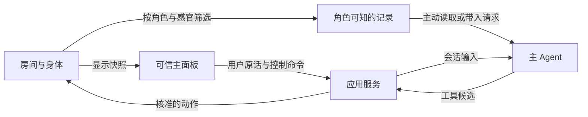

# 大肥鱼本体主面板与内置房间开发方案

2026-11-19，依据 `26eb36b` 的工程和本轮产品讨论编制。交付对象是一位用户、一个主 Agent、一间随本体提供的房间，以及观察和操作它们的桌面主面板。插件目录可以为空。

首个完整场景是**用户说“去窗边等我”，大肥鱼从书桌旁走到窗边，确认到达后回应，随后一边等候一边继续听用户说话**。第二个场景是“隔着屏风问台灯”，用来检查她究竟有依据知道什么。两者都应在关闭房间视图后继续成立，只要本体进程仍在运行。

## 1. 已对齐的产品边界

| 已确认的约定 | 对首版的要求 |
|---|---|
| 面板服务于本体，主要观察主 Agent | 打开就能看到能否接话、当前请求及其进展。房间视图和完整对话进入同一会话。插件注册的界面留待主体完成后讨论。 |
| 房间是默认环境，表现形式可以更换 | 地点、物件、身体位置、感知条件和动作结果由本体持有。文字视图和图形视图能读取同一个正在进行的动作。 |
| 她熟悉家的固定布局 | 认识书桌、窗边、台灯及其用途。物件当前怎样、刚才发生了什么，依据自己的观察或可归属的报告作答。 |
| 既有被动感知，也有主动查询 | 环境按角色当时所处位置、距离、条件及隔离范围投递感知。主 Agent 可以调用内置读接口查看自身、动作和周围可感知的信息。 |
| 一次行动有持续行为和结果 | 接单、途中、到达、受阻、停止可分别观察。房间动态、身体行为、主 Agent 的对话状态分别记录。一次回复结束后可以继续在窗边等人。 |
| 忙时可追加本轮、排到下一轮或停止本轮 | 前两项决定消息送往哪一轮。停止是宿主控制操作，取消请求与实际退出分别显示。 |

首页保留房间感。需要用户决定的事项放在对话旁，点开可查看原委托、完整步骤和判断依据。底部直接输入、对话可展开和收起、忙时默认追加本轮，作为首稿评审的默认值。书桌、窗边、台灯和屏风构成首间房。固定斜视角与分层绘制用于先验证体验，角色造型、画风、房间占比均可调整。

**独立议题**包括空闲时哪些信号能唤醒模型、能否主动发起动作，以及自主性策略由谁提供。首版只要求感知事实可接收、可供查询或进入获准的模型请求。长期记忆、跨进程恢复和插件页面另行设计。

## 2. 从现有工程接续

| 阅读入口 | 已有能力 | 本次需要补的部分 |
|---|---|---|
| [桌面容器](ui-probe-run-guide.md)、[主文档消息入口](../ui/host/probe_host.cpp)、[Vue 主面板](../ui/web/src/MainPanel.vue) | 可信主面板可收发、停止、清空并管理下一轮队列。状态探针发布无正文运行摘要。 | 接通本轮追加，再接入房间。 |
| [应用服务](../app/application.hpp)、[会话服务](../app/conversation.cpp)、[桌面业务线程](../app/gui/run_status_host.cpp) | 发送、取消、空闲清空及结果与退出已有应用接口。原生业务线程推进应用并发布本进程的对话记录。 | 扩展忙时消息接纳，维持一个活动主回合。 |
| [工具目录](../agent/include/dafeiyu/tool_catalog.hpp)、[执行器](../agent/include/dafeiyu/tool_executor.hpp)、[运行上下文](../agent/include/dafeiyu/run_context.hpp) | 工具可按运行授予，支持调用校验、有界执行、取消及工具结果成批提交。应用现有工具准备入口按已加载插件实例组装。 | 本体为房间签发实例身份并绑定本地工具实现。沿用同一执行约束，普通问答和内置房间都可在空插件环境工作。 |
| [观察收件](../agent/include/dafeiyu/observation_inbox.hpp)、[运行记录](../agent/include/dafeiyu/run_journal.hpp) | 已有来源、代次、修订、时效、重复、断档及重采样语义。 | 在进入角色可读记录前判定空间与感官可达性，复用已有记录与水位机制。 |

本方案细化 UI 总体方案中 U02 的命令桥接、U04 的主会话与 U07 的内置房间。主体面板的里程碑可以用本地宿主和可控模型替身完成。游戏伙伴有自己的交互方案和评审顺序。[UI 总体方案](ui-framework-design.md) · [MC 伙伴交互方案](mc-companion-development-plan.md)

主面板 01～05 已交付。忙碌时可把消息排到下一轮，刷新可找回待发项，接下来处理追加到正在运行的本轮。MC 单独按伙伴计划推进。两个入口首次联调的拟议场景是让玩家在主面板回答游戏里的问题，两处引用同一问题号和修订，桌面重发沿用原命令号，分别展示宿主授权和游戏接单的回执。[面板步骤与验收](#7-分步开发顺序) · [MC 当前进度](mc-companion-development-plan.md#最近一次验收)

## 3. 谁保存事实，谁能看到什么

| 事实与所有者 | 最少记录 | 读取与推进方式 |
|---|---|---|
| 房间环境 | 房间实例及代次、布局版本、具名地点、可走的连接、物件及用法、动态值与修订 | 业务线程上的房间服务是唯一写入者，用可注入的单调时钟推进。给受信主面板提供显示快照，给角色提供受限的感知与查询。 |
| 房间中的身体 | 角色绑定、实际位置、目标、当前行为、动作编号、阶段、开始和结束依据 | 同一身体同一时刻只有一个移动目标。动作回执始终可以按原身份查询，即使用户已切换视图。 |
| 主 Agent 所知 | 固定布局、当前亲见或亲闻、最后确认、具名来源告诉她的事、观察时间及修订 | 来源随记录进入上下文。对话中的一条报告记录为“谁告诉我什么”。物件真实状态要由环境命令或采样更新。 |
| 应用会话 | 当前回合、命令与消息编号、投递去向、已发模型请求、结果、实际退出及待办队列 | `Application` 协调，`Session` 持有模型上下文。只给受信主文档提供本会话的可见正文，公共诊断继续使用无正文摘要。 |
| 页面 | 当前视图、展开状态、键盘焦点、未发送草稿、已收到的快照修订 | Vue 消费值副本并提交用户意图。动画可在两个位置样本之间插值，抵达、物件效果和退出均以原生回执为准。 |

原生窗口线程接收 WebView 消息，验证实际主文档来源和视图代次，经有界队列交给业务线程。业务线程更新房间、身体和会话后发布快照或增量。刷新时重新取当前值，落后游标报告缺口。用户看见的房间全景与模型可读的角色视图使用各自的入口。模型提供方只收到通用消息及本轮获准的工具定义，房间规则归本体。

实现时，房间模型及其本地工具工厂随应用服务装配。通用 Agent 层只扩展消息投递和步骤边界。桥接放在 `ui/host` 与 `app/gui`，Vue 展示放在 `ui/web`。使用[现有工具工作接口](../agent/include/dafeiyu/tool_work.hpp)分别交付结果与退出，首版可以先在同一应用目标内实现房间。

## 4. 首间房与感知规则

首个确定性布局包含书桌到窗边的一条可走路径、书桌上的台灯，以及能遮住直接视线的屏风。地点和物件使用稳定身份，布局中定义逻辑距离、遮挡与可达条件。页面把逻辑位置映射到画面。改变窗口大小、镜头、画风或隐藏图层时，感知判定使用同一份布局。

| 输入 | 接收条件 | 大肥鱼获得的信息 |
|---|---|---|
| 台灯状态改变，可看见台灯 | 事件发生时角色与灯处于同一实例，距离在可视范围内且视线可达 | “台灯从亮变灭”，记录地点、时刻及来源。只有确实能辨认操作者时才带身份。 |
| 听到开关声，视线被挡 | 同一实例、听距与隔断条件允许 | “书桌方向传来一声开关响”。听觉载荷只含可判知的声响和方向。 |
| 超距、两种感官都被阻隔、或其他实例发生变化 | 按发生时的姿态与环境修订核对 | 本角色没有这条感知。事后走近可以取得新的当前读数，先前不可感知的事件仍属原范围。 |
| 用户从主面板告诉她“灯亮着” | 由已绑定的用户会话接收，保留发送者和消息身份 | “用户刚才说灯亮着”。直接消息按会话投递，可与亲见事实并存，冲突时能说明各自的时间与来源。 |
| 自身动作回执 | 匹配房间代次、身体和原动作编号 | “我已抵达窗边”或“我停在途中”。迟到回执归原动作，新的动作保持自己的状态。 |

**首版读能力**为查询自身位置与行为、列出熟悉的布局和物件用法、查看周围当前可感知的状态、查看自己的动作回执。主动看周围按查询时的条件取样，与被动消息使用同一套距离、感官和隔离规则。在屏风后问台灯，可以返回“最后一次在书桌旁看见它亮着，目前无法确认”。查询自身或打开面板都只读，走近查看属于另一次明确动作。

感知先进入本体内、按角色隔离的有界记录。一般位置更新可合并，动作终态由独立回执保留。重复事件只接纳一次，乱序、过期及断档有明确结果。断档后，重采样只补角色此刻有权看见的对象。在未配置唤醒或自主行动策略的首版场景中，空闲收件只更新记录，验收检查模型调用数和新动作数均维持为零。

在用户发起的运行中，宿主在本来就要发出的模型请求前，按角色游标取一批相关感知，以观察来源带入，并在实际分派后记录消费水位。工具执行中到达的信号留到下一个可用步骤。主动查询返回这次调用的读回，两条途径都可检查具体来源。只听到声响时，工具结果、感知载荷和上下文都只能提供这条声音证据。

## 5. 身体动作与“到达后再回应”

首版候选动作是去具名地点、留在此处等候、停下当前身体动作、开灯或关灯。等待是一种可持续的身体行为，开始等候即可归还原工具调用。它不会一直占用主会话。台灯采用“设为亮／灭”的明确目标，便于重复请求核对原结果。

1. **建立委托。** 正常对话入口收到用户原话。模型可先查布局、再提出动作候选。宿主将候选和原用户要求绑定到角色、房间代次、目标地点、动作及到达后行为。固定首例中的明确地点和要求可直接核对，目标有歧义或授权无法确定时，请用户确认具体候选。模型文本和环境信号都不能自行扩大授权。
2. **开始与途中。** 宿主核对目标、可达性、身体是否占用及调用预算，签发动作编号。房间按时钟推进，保存实际位置、目的地和阶段。工具通过非阻塞轮询等待移动终态，原生线程继续接收感知、用户消息及停止命令。页面可随时读取身体状态，途中无需模型反复询问位置。
3. **确认到达。** 宿主核对同一房间代次、同一角色、同一有效动作，以及目标到达区域内的新位置。在同一次更新中登记“已到达”和约定的“在窗边等候”，再把实际结果带入回复请求。用户可以立即看见“已接纳／正在移动”的宿主状态。正式到达答复只在到达核验后交付。模型跳过调用、改去别处或提前声称完成时，界面保留“尚未执行／未证实”的真实结果。
4. **受阻、改约及停止。** 路径受阻时保留最后实测位置和原因。改目标先停止旧动作并确认实际退出，再按新授权出发。停止本轮会向该轮仍在执行的移动请求停止，已经发生的位移或开灯效果保留。原回合结束后，等候持续到用户明确解除、约定的可验证条件成立或新的获准身体动作接替。收起对话或重建渲染器只改变视图。

普通重投复用原动作回执，相同编号配不同参数报告冲突。取消与到达竞争时，业务线程按已提交事实裁定。已抵达就保留抵达事实，先停止则原动作以实际停点结算。切换房间实例后撤销旧绑定。错实例、超期许可、旧动作回包均不能推动新身体。关闭应用时停止接纳、推进实际退出，再释放房间及工具注册。

## 6. 主面板与运行中的消息

**首次打开。** 展示房间、主 Agent 是否可接话、直接输入框和可展开的对话。已有回合时恢复本进程的当前请求及进展。点选角色可获得交互反馈，点书桌可查看本轮详情，同一功能保留文字与键盘入口。在窄窗口优先保留消息、输入和停止操作。主 Agent 的就绪状态与上一轮成功、失败或取消分别显示。

**对话区。** 显示用户已发送的原话、已交付的完整回复、失败或未送达原因。只有宿主登记了待答问题才显示相应的待处理状态。读状态、清空空闲会话和显式重试由不同命令处理，重试形成新请求。查看当前模型配置和最近一次结果沿用现有公开字段。

| 用户意图 | 本体接纳与执行 | 界面回执 |
|---|---|---|
| 空闲时发送 | 接纳一条用户消息并开始新轮。 | 已接纳、正在处理、回复或失败。 |
| 追加本轮 | 核对期望回合，在下一次组装模型请求前按接收顺序并入。若正执行工具，先完整提交已有调用与结果。本轮已发出的模型请求保持原上下文。 | 先显示“已接收，待带入本轮”，实际分派到模型请求后才显示“已带入”。 |
| 排到下一轮 | 按会话排队，当前轮结算且实际退出后，按先进先出逐条开启新轮，每条保留自己的身份。 | 已排队、已开始并关联新回合，或等待恢复。 |
| 停止本轮 | 独立的控制命令直接通知宿主，停止新步骤并请求在途模型及该轮动作收尾。 | 已请求停止、正在收尾、已停止。已经发生的动作结果可查。 |

普通一次性文本响应也有追加边界。提交最终答复前，由宿主在同一业务线程检查待带入消息。若追加先获接纳，在原轮预算内保留阶段结果并组装后续请求。若原轮已经封闭，明确返回“本轮已结束”，让用户决定是否另发。模型、工具次数、字节或期限耗尽时逐条显示未带入原因。追加一段文字不会自动变更计划授权，涉及行动的改约仍须核对原委托。

**队列收尾的试行默认值**是普通完成后继续发下一条，用户停止或运行失败时暂停队列，保留内容供恢复或移除。已经接纳但未带入的本轮补充显示“可重新发送”。要求清空而仍有草稿、未发送项或在途工作时，界面给出对应去向，只有空闲且用户确认后才清空本次上下文。消息数量与正文大小沿用应用预算并设队列上限。拥堵时显式拒绝，给停止命令留出独立容量。

消息、命令、回合、身体动作分别有身份。页面失联后向仍活着的应用查询原回执，同号同参复用，同号异参冲突，保留期外明确过期。重新连接使用新视图代次，旧页面回包丢弃。受信页面可复原已提交会话正文和队列，可见记录限于本进程。导出诊断只写身份、修订、阶段、原因和结果类别。

## 7. 分步开发顺序

步骤 01 已提供空闲和忙碌两份空插件固定样本，附显式预览入口。步骤 02 已在主会话保留最近 16 个主动对话，正文合计至多 2 MiB。用户原话、一次性业务结果与实际退出按原回合关联，随进程保留，公开运行诊断沿用无正文摘要。步骤 03 的 `--main-panel` 从可信主文档经原业务线程进入正式对话，同号同文复用回执，使用不同正文时返回冲突。 [桌面主面板](ui-probe-run-guide.md#桌面主面板) · [打开首屏预览](ui-probe-run-guide.md#房间首屏预览)

步骤 04 已接入原回合停止与空闲清空。页面从宿主快照读取取消和实际退出，清空确认绑定打开时看到的回合，保留当前草稿。正式面板空白时展示书房插画，对话时把正文、发送和独立停止入口留在可用区域。[业务线程](../app/gui/run_status_host.cpp) · [主面板](../ui/web/src/MainPanel.vue) · [原生验收](../tests/ui_main_panel.cpp)

步骤 05 的应用队列最多保留八条待发消息，单条上限 1 MiB，合计上限 2 MiB。前一轮成功结算并退出后，应用从原对话信箱逐条启动新轮，显示记录保留原排队消息号。取消或失败会暂停待发项，清空空闲对话后仍可恢复或移除。[应用队列](../app/dialogue_queue.cpp) · [生命周期验收](../tests/application_lifecycle.cpp)

序号只在本方案内使用。每个单元定向验证并独立提交，复杂项按表中行为继续拆小，约 100～300 行手写改动作为审查参考。

| 步骤 | 依赖 | 独立交付物 | 当步验收 |
|---|---|---|---|
| 01 首屏预览 | U01 | 在现有前端用固定公开样本展示房间、输入与可收起对话。 | 空闲首屏能直接输入。工作中同时看见一条待带入、一条排队和独立停止入口。预览使用显式入口。 |
| 02 会话显示记录 | 现有会话 | 在原业务推进点保留一次性结果和受信会话的有界消息快照。 | 正常、失败、取消各有可追溯条目，公开诊断无正文。 |
| 03 主面板发送 | 01、02 | 可信主文档经业务线程发起普通问答并读回正文。 | 空包目录中页面提交得到固定回复，重复请求只产生一轮，非主文档命令被拒。 |
| 04 停止、退出与清空 | 03 | 接入原生取消、实际退出状态与空闲清空。 | 停止后迟到回复保持原取消结果，清空后从空上下文发问。 |
| 05 下一轮队列 | 04 | 有界排队、关联新轮、暂停与显式恢复。 | 两条依次各开一轮，停止或失败后可找回待发消息，队满时仍可停止。 |
| 06 一次性问答的追加 | 03 | 对活动回合签收补充，在封闭前检查并带入下一次请求。 | 固定传输分别卡在提交前后，核对真实请求消息、回合号及未送达回执。 |
| 07 工具步骤中的追加 | 06 | 同步到已有工具批次、预算与取消边界。 | 工具调用与结果保持配对、补充只入一次、超限有明确结算。 |
| 08 消息操作与重连 | 05、07 | 桌面接通三种忙时操作，刷新后取回真实回执。 | 原页面失效、命令回执丢失、重复点击及末刻追加均能核对唯一去向。 |
| 09 内置房间与自身查询 | 现有应用 | 在宿主创建房间、熟悉地点和身体，提供只读布局及位置查询。 | 无页面、空插件也有初始位置。另一个同名测试房间实例有独立身份。 |
| 10 感官与范围 | 09 | 原生规则计算不同距离、遮挡和感官可知字段。 | 用同一台灯检查近远、阈值两侧及边界、看得见、只听见和完全不可达。 |
| 11 被动感知与主动查询 | 10 | 事件按发生时条件筛选，查询按当前条件取样，保留观察的时间与来源。 | 走近后能取得新读数。重报、过期、断档重读和迟到事件均保持角色边界。 |
| 12 消息来源与知情范围 | 11 | 区分用户告知、亲自感知、可信设备报告和历史值，按角色游标带入获准的模型请求。 | 检查固定传输实际收到的字段。同名异实例事件、不可见操作者和面板全景均不会泄入上下文。空闲收件零新动作。 |
| 13 移动与抵达 | 09 | 可控时钟推进具名地点间移动，提供在途位置与原动作回执。 | 快慢两种推进节奏均经过途中并在同一目标区域抵达。无路径明确受阻。 |
| 14 停止与等候 | 13 | 接入停止、改向、到达后等候及结束等候。 | 途中停止保留实位，旧回执不能覆盖新目标。移动结算并退出后，身体仍在目标处等候。 |
| 15 可交互台灯 | 10、11 | 用户命令设定灯的状态并发出环境变化。 | 同一命令仅生效一次，读回与实际值一致，可见者和只听见者获得不同内容。 |
| 16 内置只读工具 | 12、13 | 在正式主 Session 中授予自身、周围、动作回执读口，绑定本体实例。 | 固定模型指定读口能得到受限事实。使用同名旧绑定被拒，普通空插件问答仍可用。 |
| 17 有界房间动作工具 | 14～16 | 绑定原用户要求，接入移动、等候、停下、台灯的原生候选及回执。 | 越范围、换目标、撤销或过期保持零新动作。合法重复调用复用原回执。 |
| 18 到达后回复 | 07、17 | 把移动终态和实际位置核验接入原委托的回复条件。 | “去窗边等我”先有到达证据再有最终答复。模型跳过、途中受阻或取消均有各自结算。 |
| 19 接入真实房间视图 | 08、15、18 | 主面板以原生快照驱动图形，并提供同源文字详情及物件操作。 | 移动途中切换或重建视图后动作号、位置和目标一致。收起对话继续移动，窗口退出有序收尾。 |
| 20 空插件联合验收 | 19 | 从正常启动和分发入口执行下表，汇总 Debug、Release 及离线证据。 | 区分宿主、UI 协议、分发和仅记录项，可从用户命令追到原回合、动作及实际退出。 |

其中 17 先接一项有目标约束的移动，再分别接身体停止、等候和台灯设值，各自提交。19 先接同源文字视图，再用同一输入驱动图形位置与物件，最后检验视图切换。步骤 01 先给用户评审，02～08 与 09～15 的接续可按表中依赖安排。

## 8. 验收场景与证据

| 场景 | 必须能核对的证据 |
|---|---|
| 首次进入与普通问答 | 空插件目录、打开时模型调用数为零。页面真实提交后观测固定模型输入与完整回答，窗口刷新能恢复本进程会话。 |
| 去窗边等我 | 原指令、获准参数、动作号、至少一次在途查询、同一角色的到达读回、等候状态、最终答复按顺序关联。回合退出后继续等待，再发消息可正常交谈。 |
| 隔着屏风问台灯 | 离开前亲见亮，之后灯灭。被遮挡且超听距时只可返回上次确认及其时刻。处于听距内仅有声音，重新走近才可见当前灯态。检查工具输出和实际送给模型的上下文。 |
| 被告知与环境隔离 | 用户说“灯亮了”可收到并标明来源，环境原值不随消息改变。另一个同名房间及已撤销来源产生的事件，在被动记录和主动查询里均不可见。 |
| 忙时消息与停止 | 慢模型、在途工具和刚好结算三种时机分别发送。逐条核对已接收、已带入请求、排队到新轮或未带入。停止时已发生效果可查、迟到完成不重启旧轮。 |
| 受阻、断开与重建 | 阻塞路径、途中停下、旧视图重复命令、观察断档和实例更换均有明确结果。重连沿用进程内回执，重新采样保持相同感知限制。 |
| 表现可替换 | 图形与文字视图使用同一组房间事实。隐藏窗口、减少动效、中文组合输入、键盘操作及窄布局均保留相同业务行为。 |

开发使用固定模型响应、可控传输、可注入时钟和原生测试。UI 通过隐藏 WebView2 与固定浏览器协议操作真实主文档，沿用[桌面验证方式](ui-probe-run-guide.md)。定向测试优先大肥鱼自己的正式入口，复用[会话测试](../tests/async_chat.cpp)、[有界循环测试](../tests/session_tool_loop.cpp)和[桌面状态探针](../tests/ui_run_status_probe.cpp)。仅最终验收运行完整 Debug／Release 测试与分发检查，确认安装后的普通入口可用、测试替身只用于验收、默认包目录为空。全程无真实模型、无 Computer Use，主体验收无需实际 MC。

“不同措辞能否自然听懂”“会不会恰好选对工具”“回复是否像大肥鱼”均**仅记录，不执行**，与确定性用例分表。判断到达、动作授权、感知范围和输入投递是否正确，以宿主事实与实际请求内容取证。可复现的合成场景和必要美术按相对路径随源码提交。凭据、个人配置、缓存、存档和本地验收记录留在本地。

## 9. 参考实现与评审点

### 角色与房间的视觉参考

大肥鱼的形象首选蓝发鲸鱼娘，以 feiyu-room-template 的角色气质和房间比例作参考。2D 立绘和 3D 模型均可作为前端表现，切换时继续使用同一份身体位置、行为与动作回执。当前首屏沿用位置标记，具体资产及其分发许可在选材时逐项确认。

| 看哪一张 | 本轮想确认什么 | 素材边界 |
|---|---|---|
| feiyu-room-template 的[待机立绘](https://github.com/sh2234113/feiyu-room-template/blob/201a4ecad48e7e77cfdd6422fb8f55a77a7b9f5f/public/room/assets/pet/idle.png)与[桌前工作帧](https://github.com/sh2234113/feiyu-room-template/blob/201a4ecad48e7e77cfdd6422fb8f55a77a7b9f5f/public/room/assets/pet/desk_code.png) | 比较同一 Q 版人物的长蓝发、鳍状侧饰、白色头饰、深蓝女仆裙与鲸纹围裙。工作帧用姿态和道具交代动作；去窗边这一幕应取相应的移动姿态。 | 2D 帧改编自 PC2005-cloud/dsh-pet，模板列为 CC BY-NC-SA 4.0。另附的 3D 模型限随模板个人、非商业展示，独立移植或改作需另查作者许可。[逐项声明](https://github.com/sh2234113/feiyu-room-template/blob/201a4ecad48e7e77cfdd6422fb8f55a77a7b9f5f/THIRD_PARTY_NOTICES.md) |
| DSH-cozy-room 的[日间房间实景](https://github.com/Frey-Good/DSH-cozy-room/blob/8c2b17ac9d7b0dc395d9ab9303e60dbb9a931846/anime-room/preview/my-room-day.png) | 看人物在等距房间里的身高、落脚点和家具比例。可借鉴角色生活在房间里的感觉，首页仍把对话和待决定事项放在玩家手边。 | 房间代码为 MIT，角色动画另列上游和非商业、公开署名要求。两套房间的这组 2D 动画同源。[NOTICE](https://github.com/Frey-Good/DSH-cozy-room/blob/8c2b17ac9d7b0dc395d9ab9303e60dbb9a931846/NOTICE) · [素材清单](https://github.com/Frey-Good/DSH-cozy-room/blob/8c2b17ac9d7b0dc395d9ab9303e60dbb9a931846/anime-room/CREDITS.md) |

上游将形象原型归于上善无形的「溟月」，女仆鲸鱼娘二创设计归于 ZipZipPipe。dsh-pet 的代码采用 MIT，素材另见其形象授权和公开二创署名说明。若选用非商业素材，逐件保留来源、署名、许可及修改记录。造型一致性还可以看六视图；房间的桌椅可独立选用有明确 CC0 声明的家具包。[上游许可与作者说明](https://github.com/PC2005-cloud/dsh-pet/tree/fb38ce620576f5ed3735a99536d2b1a4a9eb313f#许可) · [六视图与许可](https://github.com/xiaoweigen/deepseek-dafeiyu-assets) · [Kenney Furniture Kit](https://kenney.nl/assets/furniture-kit)

### 实现参考

- Cabin World 的房间把路径、家具和身体分开管理，到达和动作各有回执。借鉴这一点来定义书桌、窗边和台灯的可验证行为。[房间绘制](https://github.com/BabyBus2022/cabin-world/blob/4fac686768b73dfa1875d3f54d3912475f514e6a/game/entities/room.gd) · [动作协议](https://github.com/BabyBus2022/cabin-world/blob/4fac686768b73dfa1875d3f54d3912475f514e6a/docs/PROTOCOL.md)
- feiyu-room-template 将房间事实、行为与 Three.js 表现分开，聊天可在房间中展开和收起。此处的会话统一由大肥鱼本体持有。[房间状态](https://github.com/sh2234113/feiyu-room-template/blob/201a4ecad48e7e77cfdd6422fb8f55a77a7b9f5f/src/home-state.js) · [房间交互](https://github.com/sh2234113/feiyu-room-template/blob/201a4ecad48e7e77cfdd6422fb8f55a77a7b9f5f/public/room/app.js#L1868)
- 忙时输入参考 Codex 的本轮引导、下一轮队列与独立中断，以及 DeepSeek Harness 的步骤边界。此处由共享应用服务和 Session 实现，适配已有的完整文本响应。[Codex 忙时输入](https://learn.chatgpt.com/docs/prompting#steering-and-queuing) · [Codex 中断接口](https://learn.chatgpt.com/docs/app-server#interrupt-a-turn) · [DeepSeek Harness 的 Agent 接口](https://github.com/deepseek-ai/deepseek-harness/blob/2e39e70496aa02986ca6a820c5d497e816b69d7e/packages/core/agent/src/runtime-types.ts)

第一次界面评审看空闲首屏和忙时主面板，确认房间与对话的关系、默认发送去向及停止后待发项的处理。感知实现前用同一张布局对照三种观察位置，确定距离和遮挡的首组测试值。其余开放议题可在关联单元审查，此次交付为开发方案。
