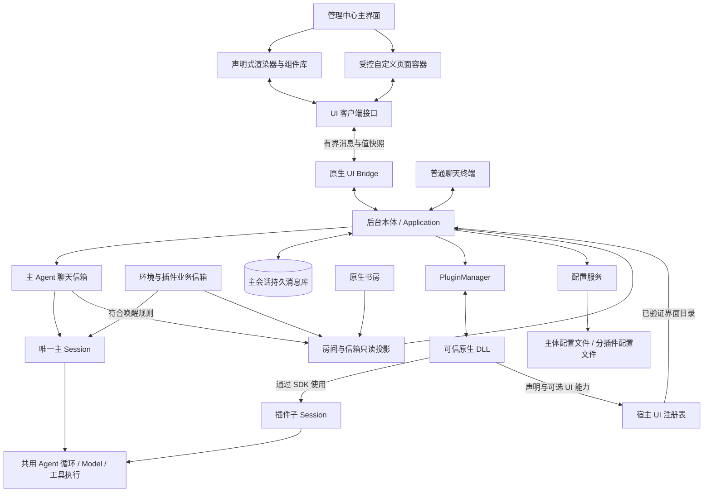
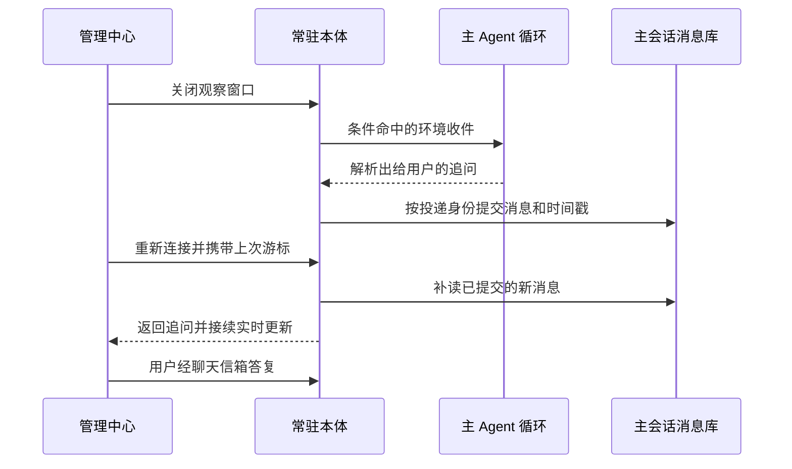

# 大肥鱼管理中心首版开发方案

**首版目标 · 2026-11-24 已授权分步开发。** 用户打开管理中心时，可以看到大肥鱼此刻的状态、最近发生的变化，以及和她的同一段对话。关闭窗口后，本体继续工作。实际交付进度见[分步实施与验收](#10-分步实施与验收)。

以下现有实现一栏记录方案起点，当前进度见第 10 节。工程基线为 `29ced0b`，最近的功能提交为 `6c4afe0`。桌面容器、主文档命令桥、收发与忙时控制、刷新恢复、原生书房位置和感知判定已经接通。下表列出本轮从哪里接续。[当前架构与业务流程](architecture.md) · [实际运行入口](ui-probe-run-guide.md) · [内置房间步骤 01～10](main-agent-room-development-plan.md#7-分步开发顺序)

## 1 首版范围与现有约束

| 现有实现 | 首版交付 |
|---|---|
| 桌面业务线程、普通终端各自创建 `Application`。桌面主窗口关闭时会停止业务线程。 | 同一用户数据目录只有一个后台本体和一个逻辑主 Session。管理中心和普通聊天终端连接它，关闭或重开窗口都能找到原会话。 |
| `Conversation` 保留最近 16 轮、正文合计至多 2 MiB 的显示记录。Trace 可选。 | 主 Agent 与用户共用一份长期保留的消息库。页面分页读取旧消息并同步新消息。记录有时间戳，关闭 Trace 仍可正常收发和查阅。 |
| 空闲发送经过对话信箱，追加本轮直达 `Session`，排队项在启动新轮时才进入信箱。房间及插件已有定向信箱与条件唤醒。 | 三种用户文字去向统一经过主 Agent 的聊天信箱，再按原语义交给本轮或下一轮。给管理中心提供无消费副作用的信箱读口。 |
| 原生书房能给出角色位置。正式页和固定样本预览仍引用同一张书房插画。 | 空插件下即可用纯文本核对房间和回合状态。已接入的插件来源和组件动态出现。清理旧图属于获批后的前端改动。 |
| 主体已有模型配置读取，插件在实例创建时合并包内默认值和独立的用户覆盖文件。 | 主体和插件分别持有配置文件，通过同一设置界面契约登记只读、可写字段，并由宿主执行保存与校验。 |
| 主会话与插件子会话已使用 `Session / RunLoop`，SDK 已能托管插件子会话。 | 核对两条实际入口的共用循环和输出归属，补齐通用 SDK 能力。用一个独立测试插件验证 UI 注册、双窗口和卸载。 |

宿主继续采用 C++20、CMake、VS2022 x64 和可信同进程原生 DLL。内置 Provider 支持空插件目录。模块、现有命令和插件 ABI 的实现可从以下位置核对。[应用装配](../apps/host/src/application.cpp) · [会话显示记录](../apps/host/src/conversation.cpp) · [下一轮队列](../apps/host/src/dialogue_queue.cpp) · [桌面业务线程](../apps/host/src/management/host.cpp) · [插件配置读取](../modules/plugin_host/src/config.cpp) · [现有 SDK](../sdk/README.md)

| 当前事实 | 对设计的约束 |
|---|---|
| 会话一次只接纳一轮问答 | 界面保持单活跃回合；新的普通输入明确报告忙碌 |
| 取消结果与实际退出分开 | “已取消，正在收尾”必须是可显示状态，不能提前显示空闲 |
| 普通观察通知可能未被接纳 | UI 可主动查询状态，通知用于刷新提示，不作为唯一事实来源 |
| 插件设置在实例创建时固定 | 保存期望配置与应用到当前实例是两个操作 |
| 宿主服务仅在所属线程及有效绑定中调用 | 渲染回调不直接访问 Session、插件函数表或资源句柄 |
| 包清单版本 1 拒绝未知字段 | UI 描述使用独立可选文件，保持现有 `plugin.json` 字段集合 |
| C ABI 精确版本协商，忙碌拒绝卸载 | UI 能力独立协商，页面消失不构成 DLL 可卸载的证明 |

对应实现入口：[会话与诊断](../modules/agent/include/dafeiyu/session.hpp)、[包清单校验](../modules/plugin_host/src/manifest.cpp)、[配置快照](../modules/plugin_host/include/dafeiyu/plugin_config.hpp)、[SDK 线程和生命周期约定](../sdk/README.md)。

## 2 管理中心的界面组织

板块是侧栏右侧的整个展示区。切换板块会替换这一区域。房间内的状态区和聊天区共享一行，进入设置或插件板块后，聊天随房间收起，当前板块获得完整宽度。

```text
┌────────────────────────────────────────────────────────────────┐
│ 大肥鱼管理中心                                                 │
├────────┬──────────────────────────────┬────────────────────────┤
│ 房间   │ 最新状态                     │ 大肥鱼的消息　时间     │
│        │ 房间、位置、当前回合         │         我的消息　时间 │
│        │ 最近变化                     │                        │
│        │ 信箱（查看来源）             │ 输入框　　　发送       │
│ 设置   │                              │ 工具栏                 │
└────────┴──────────────────────────────┴────────────────────────┘
```

| 区域 | 首版内容 | 管理规则 |
|---|---|---|
| 顶栏与左栏 | 简洁顶栏显示产品或当前板块名称。侧栏上组从上向下排，默认只有「房间」。下组从下向上排，「设置」固定在最底端。 | 侧栏常驻。已选项有可见焦点与文字名称。首版插件管理入口在「设置」内。 |
| 房间中央 | 文本分组展示「最新状态」「最近变化」与一个「信箱」入口。 | 预留可替换的房间展示组件。未来的角色、房间画面可读取同一数据接口。 |
| 房间右侧 | QQ 式消息区，大肥鱼头像和气泡靠左，用户的靠右。每条消息可核对发送时间。底部先是输入框与发送按钮，再下一行是工具栏。 | 工具栏按本轮可用性提供追加、排队、停止等操作。发送回执附于原消息或控件。切换板块保留草稿和会话订阅的恢复位置。 |
| 信箱详情 | 点开同一入口，可按内置或插件注册的来源查看分类、收件状态和可公开的回执。 | 只读。读取使用独立投影，系统持有消费游标和回信权。关闭、打开及重复查看均不会取走信件、启动回合或回信。 |
| 设置与插件板块 | 设置按主体配置、插件管理分组。可检查包、管理加载与卸载、进入已注册的设置及插件板块。 | 建议测试插件的整页板块从「设置 → 插件管理」打开，可返回原插件条目。测试插件加载前后，左栏均只显示「房间」与「设置」。 |

**最新状态**先显示房间、身体、位置，主 Agent 的就绪或工作阶段、当前回合、在途工作与队列，以及信箱各来源的可用性。字段由拥有事实的服务提供，带来源、实例、修订和可用的采样时间。尚未接入、过期、读取失败与确认为空分别显示。例如按下停止后，用户先看到「已请求停止」，收到取消结果但工作未退出时显示「已取消，正在收尾」，收到退出回执后再更新就绪状态。面板按用户的观察权限读值，送给角色的感知仍由原生房间按位置、距离和遮挡筛选。

**最近变化**只列出本窗口观察到的字段变化，显示前后值、来源、来源修订和本窗接收时间。首次快照建立基线。断档后标出缺口并补读最新值。窗口重开可补齐持久聊天，房间变化区从新快照开始。Trace 沿用现有诊断入口，摆放位置暂按默认。聊天过程中的系统提示消息留待后续设计。

视觉上以留白和细分隔线区分三区，当前值比字段名醒目，时间、来源使用次级文字，状态始终带文字。设置用一致的分组标题、字段行、访问模式和保存反馈。窄窗保留房间与聊天的可达入口，消息区独立滚动，输入区保持可见。中文输入法选字、键盘切换、焦点返回、系统缩放和减少动效纳入验收。

布局采用用户草图的导航和聊天关系。设置的层级与留白参考 Codex、DeepSeek Harness。插件接入借鉴 Harness 由宿主声明插槽、贡献随注册者销毁的做法。审核通过后清理 `apps/desktop/web/src/art/study.png`、正式页和预览的导入、图像样式与依赖图片加载的断言，分发包复查旧图。预览改用明确标注的文本样本。[Harness 插槽契约](https://github.com/deepseek-ai/deepseek-harness/blob/5badb15009ae1756c3afe0ae0cef1faafc290ccc/docs/subsystems/slots.zh.md) · [正式面板](../apps/desktop/web/src/MainPanel.vue) · [房间预览](../apps/desktop/web/src/RoomPreview.vue)

## 3 软件边界与线程



工程目录按下列职责划分，实施到对应单元时才建立目标；UI 相关构建归入 App，公开 C ABI 仍归 SDK。

| 拟定位置 | 职责 |
|---|---|
| `apps/host/` | 本体常驻、主会话、消息持久化、配置、只读投影及实例的 UI 注册目录。复用现有 Application、Conversation、MailboxIntake |
| `apps/desktop/` | 原生窗口、UI 线程、客户端连接与视图回收 |
| `apps/desktop/src/host/` | WebView2 消息来源校验、授权绑定、视图及资源回收，经本地连接读取注册目录 |
| `apps/desktop/web/` | 主界面、组件库、声明式渲染器和自定义页面客户端接口 |
| `sdk/` 与 `modules/plugin_host/` | 新 UI 能力的 C 契约及受控原生调用适配，不依赖前端框架 |

**常驻与重开。** 实现建议采用一个原生后台宿主进程，按规范化用户数据目录取得唯一写入权。普通终端和管理中心通过仅限当前用户的 Windows 本地命名管道连接。首次启动可拉起宿主，再次启动连接原宿主。并发启动时由持有者发布端点，客户端等待握手并核对数据目录与启动配置。连接失败或配置冲突时显示原因。专用 MC 宿主和离线测试继续使用隔离的运行目录，接入同一生产数据目录的入口必须遵守同一所有权。`--complete` 沿用单次模型调用入口。

采用 Win32 原生窗口与 WebView2，默认使用 Evergreen Runtime；前端采用 Vue 3、TypeScript、Vite 与 Reka UI 基础组件。GUI 保留独立入口，CLI 不依赖 WebView2。WebView2 需要带消息循环的 STA UI 线程，不能从其他线程任意调用其对象。[官方线程模型](https://learn.microsoft.com/en-us/microsoft-edge/webview2/concepts/threading-model)

Win32 窗口线程只管理窗口、WebView2、焦点和消息收发。后台宿主的业务线程持有 Application、Session、PluginManager 和 DLL 回调。跨线程和进程只传版本化命令、回执与值快照。各客户端可独立断开，CLI 保留无 WebView2 的运行方式。无可见窗口期间，宿主继续处理收件、已满足条件的唤醒、在途工作和消息入库。

后台模型调用继续沿用现有异步路径。UI 回调不得同步等待业务完成，也不得在 WebView2 回调中进入嵌套消息循环。可信原生插件仍须快速返回并协作推进，界面分线程不提供对任意 DLL 的强 CPU 或内存隔离。

关闭管理中心只释放其视图、订阅和窗口资源。再次打开先读当前快照，再按消息游标补读。另设明确的「退出大肥鱼」操作，停止新接纳、请求在途工作收尾、核对实际退出并关闭插件和存储。收尾失败保留实例及可核对的原因。打开管理中心本身只产生观察读取。

后台图标随本体运行。用户从设置、托盘或终端请求退出当前本体时，原实例的退出结果应到达已连接的管理窗口。软件运行日志在默认启动时记录这些动作，并提供跨进程核对入口。[后台图标、退出与软件运行日志](#后台图标退出与软件运行日志)

**Agent 循环与 SDK。** 开发先对照主会话与 MC 子会话的输入、上下文装配、模型输出、工具执行、取消、投递与实际退出。共同部分复用 Agent 层的 Session / RunLoop，提炼缺失的共用接口供主体和 SDK 适配层调用。DLL 沿现有版本化 C ABI 托管子会话，新增公共能力另行协商版本。主 Agent 的用户发言、插件的领域发言及给上级的内部结算各有输出路由。每个会话独立持有上下文、当轮工具和权限，MC 继续拥有局内事实及游戏回执。[主会话](../apps/host/src/conversation.cpp) · [通用循环](../modules/agent/src/run_loop.cpp) · [子会话宿主](../apps/host/src/subagents.cpp) · [现有 Agent ABI](../sdk/include/dafeiyu/agent_abi_v2.h)

## 4 组件库

### 4.1 公共规范

组件共享颜色、字体、间距、圆角、焦点、动效和密度标记。默认明暗主题都必须覆盖成功、警告、错误、不可用和等待状态，状态不得仅靠颜色表达。支持中文、键盘操作、系统缩放和减少动效偏好；隐藏页面暂停装饰动效。

组件的稳定边界是名称、版本、输入数据与用户意图，不是 Vue、Reka 或 DOM 对象。宿主用 Vue 单文件组件包装 Reka 基础交互及自有业务组件；普通插件不用携带前端框架，也不能向宿主注入脚本或全局样式。导航采用 Vue Router 的 hash 模式，宿主快照与本地编辑草稿分别管理。

| 层次 | 组件组 | 首版职责 |
|---|---|---|
| 基础 | 文本、图标、徽标、按钮 | 文本与状态表达、明确的操作入口 |
| 基础 | 文本框、数字框、开关、选择器 | 有标签、校验与只读状态的字段编辑 |
| 基础 | 分组、页签、键值列表、分页列表 | 组织内容，保持稳定条目 ID |
| 基础 | 抽屉、对话框、加载、空状态、错误区 | 页面容器及局部异常恢复 |
| 业务 | 模型配置、凭据状态 | 展示供应商、模型和环境变量引用；不向插件返回密钥 |
| 业务 | 聊天输入、消息列表、回合状态 | 按游标读取用户与主 Agent 的时间戳消息，按原命令查询发送状态 |
| 业务 | 诊断时间线、通知回执 | 复用现有诊断，明确接纳与处理完成的区别 |
| 业务 | 能力条目、插件详情、停止进度 | 安装、加载、忙碌、停止、失败保留及移除 |
| 业务 | 设置表单、保存状态、生效状态 | 区分草稿、已保存配置与运行实例配置 |
| 场景 | 房间状态、变化记录、信箱来源 | 读取可替换展示组件共用的投影，展示每个值的依据 |

### 4.2 声明式组件契约

| 字段组 | 约定 |
|---|---|
| `id`、`kind`、`version` | 组件在页面内身份稳定，种类与精确版本必须受支持 |
| `label`、`description`、`icon` | 提供可读标签；图标来自宿主目录或包内只读图像资源，不内联执行插件 SVG |
| `binding` | 只能引用已声明、获准的状态主题与字段路径；路径采用 JSON Pointer 语义 |
| `value_type`、`constraints` | 类型、必填、长度、范围和选项引用；最终校验仍由宿主执行 |
| 配置字段 `access_mode` | 注册设置界面时同时提交有效的只读或可写模式。主体与插件使用同一字段契约 |
| `action` | 引用注册的操作 ID，提交参数映射；组件不包含函数地址或可执行表达式 |
| `visible_when`、`enabled_when` | 仅支持受限的相等、集合与逻辑组合，限制节点与深度；不执行 JavaScript |
| `children` | 容器子项有界，禁止循环引用和无限嵌套 |

表单字段绑定草稿，只有明确提交才写入。校验失败定位到字段，保存失败保留草稿；离开存在未保存编辑的页面时由宿主处理提示。隐藏或禁用按钮只是界面表现，宿主每次仍校验调用权限、参数、实例状态和容量。

缺失、显式空值和具体值保持区分；枚举使用稳定身份，不使用显示顺序作为值。64 位整数保留十进制字符串表示，浮点数拒绝非有限值。正文按文本渲染；需要 Markdown 的宿主组件使用受限渲染规则，不把模型输出或状态字符串当作 HTML 模板执行。

统一页面状态为加载中、可用、数据已过期、不可用、停止中、局部错误。刷新失败保留最后一次快照并标记过期；操作错误放在操作附近。状态过期时，需要最新前提的写操作保持禁用，读取、重新同步、取消和关闭入口仍可用，最终可执行性由宿主裁定。

## 5 UI 接口

### 5.1 连接与消息

UI Bridge 是版本化消息边界，连接握手返回协议版本、组件能力、桥接会话身份、当前授权和容量。界面实例另外获得视图身份与代次；插件页面的绑定还包含插件实例代次与注册版本。页面不能通过消息中的 `plugin_id` 自行选择身份，身份由宿主根据实际消息来源绑定。

请求包含协议、请求身份、视图上下文、操作名和参数；响应回显请求身份并携带结果或稳定错误码。所有宿主 ID、代次、序号和修订号都作为字符串传输，禁止把 C ABI 句柄或内存地址当作前端资源标识。未知协议与不支持的必需能力明确拒绝，不猜测布局。

首版接口分组如下，名称用于表达职责，实际签名在各自实现单元冻结：

| 接口 | 输入与返回要点 |
|---|---|
| `ui.catalog.read` | 查询当前可见的页面、摘要、场景入口、可用性及目录修订号 |
| 房间与信箱只读主题 | 房间字段、来源清单与获准的信件摘要。读取和订阅均使用宿主投影，系统消费仍走原信箱 |
| 主会话消息读取与订阅 | 可信聊天视图取得一页消息及游标，按游标向前翻页或向后补读。新提交提示驱动刷新 |
| `state.open` | 申请一个获准主题的订阅，原子返回订阅身份、初始快照与修订号 |
| `state.read` | 读取主题完整快照与当前修订号，用于手动刷新和缺失更新恢复 |
| `state.close` | 幂等关闭订阅，不取消底层业务 |
| `action.invoke` | 提交注册操作与参数；明确返回拒绝或接纳身份 |
| `action.read` | 查询已接纳操作的业务状态、取消原因、结果和实际退出 |
| `action.list` | 在当前授权范围内查询本进程在途及有界保留操作，用于页面恢复 |
| `action.cancel` | 请求协作取消，返回原取消回执，不伪造终态或退出 |
| `settings.read`、`settings.save` | 查询设置及版本；以基准版本提交草稿，返回保存和生效状态 |
| `resource.read` | 按获准的临时资源令牌有界读取大文本，令牌不含磁盘路径 |
| `resource.upload.begin/append/seal` | 创建临时文本、按偏移写入并封存；同偏移内容冲突拒绝，封存后只读 |
| `resource.release` | 归还视图持有的临时资源；不取消已经接管该数据的业务 |

`action.invoke` 不提供任意函数调用能力。操作必须事先登记参数、结果、取消支持和数据访问范围；宿主验证后才在业务线程调度。`settings.save` 等专用写入入口复用同一接纳、去重、结果和退出协议。内置问答、取消、配置和插件管理使用同样的应用服务，但内置权限不会因组件复用而授予插件。

### 5.2 状态同步

`state.open` 在同一宿主串行边界内建立订阅并读取快照，避免先查询后订阅的空隙。提供方负责快照与修订的一致性，查询必须快速、只读；后台状态变化交由宿主线程结算。每个主题按所属实例维护单调修订号；更新提示允许合并，首版不要求发送连续增量补丁。UI 收到提示后读取最新快照，只接纳当前视图、当前实例且不倒退的版本。

可见页面还进行低频修订检查，初始建议为每两秒一次；发生队列溢出、桥接重连、重新可见或版本不连续时，进入重新同步。该周期是恢复策略，不承诺两秒内必然恢复。宿主拥堵时继续显示过期状态，不能把最后一次快照冒充当前状态。

普通事实广播保持原契约。UI 订阅故障不修改问答结果，通知接纳失败继续有独立诊断；跨页面和后台来源的错误不合并成一个无法定位的全局红点。订阅关闭后停止投递，晚到的消息按视图代次丢弃。

### 5.3 操作与超时

操作始终分别表达：是否接纳、业务结果、实际退出。界面等待超时只表示尚未取得确定结果，不能据此显示“操作未发生”。首版不自动重发写命令；用户可查询原操作，或在明确支持时请求取消。

请求身份由桥接会话与连续递增序号组成，序号在业务调度前按接收顺序核验，接纳和明确拒绝都会消费该序号；控制操作使用独立调度预留。重发旧序号只返回原回执或“回执已过期”，绝不重新执行。回执仍保留时，相同序号配不同参数返回冲突；跳号返回期望序号。宿主有界保留终态回执，在途记录不能为腾出容量而驱逐；已退休序号用会话高水位拒绝重执行。桥接重连更换会话身份，旧请求只能在仍存活的应用操作目录中查询，不能重放。

前端重开后可查询当前提供方实例登记的在途工作。业务操作的进程内回执保留原有期限。聊天可以按跨宿主重启有效的消息和投递身份核对中断前的结果。[主会话消息与持久化](#55-主会话消息与持久化)

### 5.4 数据与容量

以下是建议初始上限，实施时需测量并确认；它们只限制 UI 入口，不能扩大原有业务上限。

| 对象 | 建议上限与超量行为 |
|---|---|
| 单插件界面描述 | 256 KiB UTF-8；超量整批拒绝注册 |
| 单插件贡献 | 8 个页面、4 个摘要、4 个房间入口；更多内容在页面内部组织 |
| 单页面组件树 | 256 个节点、12 层；未知组件或非法绑定拒绝该批注册 |
| 单视图 | 8 个主题订阅、8 个在途普通请求；达到容量明确拒绝 |
| 桥接会话 | 32 个在途普通请求、64 个终态回执；取消、关闭和退出有独立控制预留 |
| 常规状态消息 | 256 KiB；列表分页，大文本通过临时资源按块读取，禁止静默截断 |
| 进程内 UI 临时文本 | 64 个资源、总正文 16 MiB；计费持续到所有业务和视图持有实际归还 |

大文本上传与读取分开计费，沿用问答输入 1 MiB 的业务上限，单块原始 UTF-8 最多 16 KiB，编码后仍须通过消息总量校验。临时文本上传完成后才允许问答接纳；未提交上传在关闭视图或到期后回收，已接纳输入由业务责任接管。UI 临时资源的数量与总字节还需受进程级父预算约束，不能靠创建新视图绕过限额。

宿主仅向绑定主会话的可信聊天客户端交付消息正文。插件视图只可读获准的来源和字段。公开诊断使用无正文的回合摘要。

### 5.5 主会话消息与持久化

主 Agent 跨启动沿用一个持久会话标识，运行时的 Session、回合和插件实例另有各自的身份。建议在用户数据目录使用一份 SQLite 消息库，由后台宿主负责版本迁移和写入。每条记录有稳定消息号、来源渠道与来源消息号、发送方、正文、时间戳、单调提交序号，可关联原消息、回合和投递号。宿主记下 UTC 收发时间，渠道另有原始时间时单独保存。排序及断点续读使用提交序号，界面按本地时间显示。旧消息按页读取，内存上限只约束当前加载量。旧版本首次升级从可核实的消息开始，Trace 保持独立。

**用户发送。** 聊天入口携带稳定的提交身份、原话和去向。宿主校验容量、当前回合和目标，把已接纳消息与待投递记录一并提交，再按原身份交付聊天信箱，回报已接纳、已排队、已带入或失败。追加和排队沿用既有执行时机。回执丢失先查原提交，同号异文报冲突。崩溃后可证明尚未投递的记录可续办，实效未知的记录沿原身份查证并显示待核对。已接受的原话即使后来取消也可查阅。

**大肥鱼发言。** 用户消息和符合规则的环境事件都可触发同一主循环。输出适配器按入口契约解析面向用户的「回复」，包括对话入口的纯文本回答、明确发言或追问。显式发言与最终文本经过同一投递流程，按原回合与投递身份防重。两条独立消息可以文字相同。工具结果、内部结算、静默输出均留在各自路径。主 Agent 一句「这批材料要交给谁？」可以在没有新用户输入、管理中心已关闭时写入同一消息库。

**同步与恢复。** 入库提交后才通知已连接窗口。打开、刷新或重连时，宿主在同一串行步骤内登记订阅并返回当前提交序号。窗口从已有游标补到该序号，再按期间收到的新修订继续取数，按消息号去重，漏通知可补读。若以后其他平台接入主 Agent，通过同一入口登记来源、写同一库并刷新窗口，对外投递遵循该消息的目标渠道。MC 子会话的游戏聊天继续走其自身渠道。清空本轮上下文、移除待发项、裁剪 Trace 都保留已入库的消息。

消息库保存交互事实。主 Agent 的记忆系统、上下文压缩、跨重启送模历史的选择与装配另立议题，后续比较 Claude、Codex 和 DeepSeek Harness 再定。首版沿用可控的当轮上下文预算，打开聊天或读取历史均不会把整库正文送模。

#### 常驻本体已提供的消息读协议

已握手的客户端通过既有本地管道的 `op=request` 发送业务请求。`body` 共用 `version:"1"`、`type` 和窗口自定的 `request`。回复回显 `request`，包含逻辑会话号 `conversation`、原后台 `instance` 和采样时的 `watermark`。消息号、游标、水位和修订号均为十进制字符串。[管理分派](../apps/host/src/management/message_protocol.cpp)

| 业务请求 | 附加字段 | 成功结果 |
|---|---|---|
| `messages.subscribe` | 无 | `messages.subscribed`。为当前窗口登记订阅并取得已提交水位。后续 `dialogue.read` 的 `messageWatermark` 可提示补读，即使对话显示修订未变也会返回。重连须重新订阅。 |
| `messages.read` | `conversation, direction, cursor, through, limit` | `messages.page`。固定订阅取得的 `through`，整数 `limit` 取 1～64。`history` 按消息号倒序，从 `cursor:"0"` 取最新一页，回执为该水位时的版本。`changes` 按修订正序，读取 `(cursor, through]`。有后页时用 `next` 续读，`more` 为假时结束。 |
| `messages.receipt` | `conversation, source, submission` | `messages.receipt`。返回原提交的最新 `record`，未找到为 `null`。 |

记录包含稳定的 `message`、本次 `revision`、宿主 UTC 毫秒时间 `utcMs`、`source`、`submission` 和该修订的 `receipt`。窗口按逻辑会话和消息号更新同一行，一页实际交付后再保存游标。多窗读取互不消费。数据库位于数据目录下的 `main-conversation.sqlite3`。[双窗口与断点验收](../apps/host/tests/message_protocol.cpp)

新追加和待发项在入库前按已发布的原回合、条数和字节余量检查，分派时再核对当前条件。已结束回合的追加返回 `stale`，超出对应容量返回 `full`。这两种预先拒绝的提交没有 `storedMessage`。单页还受字节预算约束，即使记录数小于 `limit`，只要 `more` 为真，窗口就按 `next` 继续读取。

提交正文沿用 `dialogue.submit`、`dialogue.append`、`dialogue.enqueue`。窗口在第一次发送前生成并保留 `submission`（1～128 个 UTF-8 字节），三种请求仍带原有的 `command` 和 `text`。追加、排队另带订阅返回的 `instance` 及原 `session`、`turn`，也可附来源时间 `sourceUtcMs`。同一 `submission` 重试时保持原字段值。新连接使用自己的 `command` 空间，可用 `messages.receipt` 按 `source:"desktop"` 与原 `submission` 复查。相同提交号改动原文、去向或目标会返回 `conflict`。

成功入库后，命令回执附加 `storedMessage`。它是持久消息号，原 `message` 仍表示回合内补充号或待发项号。初始持久回执为 `pending`，开始交付前写为 `dispatching`。已接纳的新回合为 `accepted`，追加等待带入为 `waiting`，待发项为 `queued`。终端正文来源为 `terminal`，沿用同一持久库。[后台接纳与回执](../apps/host/src/main_messages.cpp)

原窗口以同一 `command` 再读 `dialogue.read` 或重发相同提交，都按已绑定的 `storedMessage` 返回最新命令结果。写锁解除后，原窗口和用同一 `submission` 重连的窗口可分别查到实际接纳。持久回执中的 `submitted` 附带实际的 `modelStep`，`removed` 保留已移除的待发项，`unknown` 表示原交付实效仍待核对。[写锁与重连验收](../apps/host/tests/message_recovery.cpp)

直接对话和原生书房点名产生的非空白最终文本进入主聊天。普通结构化对话还可调用 `main_reply({"text":"…"})` 提前发言或追问。成功回执的 `delivery` 和 `message` 分别标识本次投递和已写入的消息。同一回合末尾再次给出已显式发过的相同文字时复用原投递。独立回合、不同显式调用各有自己的投递号。内部入口的结算、工具回包和纯空白结算保持在原路径。[输出适配器](../apps/host/src/main_output.cpp) · [送模记录与渠道回执验收](../apps/host/tests/persistent_dialogue.cpp)

发言首次写入后，在线终端即可读到正文，回合仍可继续运行。旧窗口的回合快照同步最近一条已写入的发言，持久历史保留每条发言。终端批处理读到 EOF 时，会等待自己发起的回合和待写答复。若持续无法写入，它以失败退出并显示原投递号，后台继续按该号补写。[正式终端验收](../tests/application/terminal_entry.ps1)

### 5.6 管理信箱只读协议

已握手的管理窗口沿用本地管道的 `op=request`。首次可发送 `{"version":"1","request":"dir-1","type":"mailbox.list"}`。回包的 `event` 为 `mailbox.directory`，回显 `request`，并带有后台 `instance`、目录 `revision`、采样时刻 `sampledUtcMs`、`state` 和 `sources`。绑定后的请求可附 `instance`，与当前后台不符时返回 `stale` 和空来源表。

每个来源有 `id`、`label`、`kind`（`builtin` 或 `plugin`）和字符串 `generation`。插件来源另带包标识 `plugin`，`label` 取自该运行代次加载的清单显示名。刷新磁盘包目录后，当前代次仍显示原名，重载才使用新名。主聊天、书房和实际接入信箱的各插件分别占一个来源。插件双向地址和它登记的主 Agent 业务地址归同一代次。窗口应保存服务端给出的来源 `id`，卸载后重新加载同包会签发新的来源。目录修订随地址绑定及撤销改变。读取已发布的目录不会触发收件或模型调用。[宿主投影](../apps/host/src/mailbox_view.cpp) · [管理分派](../apps/host/src/management/mailbox_protocol.cpp)

目录请求在绑定 `instance` 后也可加 `revision`。该目录修订仍有效时返回原样本，地址已经改变则返回 `stale` 和空来源表。

`{"version":"1","request":"box-1","type":"mailbox.read","instance":"原后台","source":"目录给出的 id"}` 返回 `mailbox.snapshot`，回显原请求、后台及来源，并给出来源自己的 `revision`、`sampledUtcMs`、`state`、`mailboxes` 和 `messages`。同一份采样可由多个窗口重复读取。该来源入箱、实际取件或地址绑定改变才更新来源修订，其他来源可继续沿用原采样。编号、修订及累计水位使用十进制字符串，UTC 毫秒和分类版本使用 JSON 整数。

每封信的 `id` 由原信箱与序号组成，作为不透明字符串保存。`category`、`categoryVersion` 给出分类，`direction` 为 `toHost` 或 `toPlugin`，`state` 为 `pending` 或 `received`。嵌套的 `receipt` 带有原 `mailbox`、`sequence`、`acceptedUtcMs` 和 `acceptedRevision`。回执最初为 `state=accepted`，原接收方实际取走后才出现 `state=received`、`receivedUtcMs` 与 `receivedRevision`。原生载荷缺少可公开的分类名时，`category` 为空字符串。业务正文留在原系统。回信在自己的目标信箱中有独立编号，可分别观察入箱与实收。

消息按最近入箱顺序返回。每个地址另列 `id`、`direction`、累计 `accepted`、累计 `received` 和最早保留序号 `firstRetained`（无记录为 `"0"`）。后台保留全部待收信及有界的近期回执。窗口可在原请求加 `message` 查一封详情，加 `revision` 核对所见版本。当前有效的空来源返回 `ready` 和空信件表。后台或来源失效、指定修订已变、选中信件已离开保留区间时返回 `stale` 和空信件表。读取失败沿用 `management.error`。取得新目录及当前来源快照后可重新选择原件。[原生收发回执](../modules/events/src/mailboxes.cpp) · [管理信箱验收](../tests/plugins/management_mailboxes.cpp)

### 5.7 设置页的插件管理协议

初次查询发送 `{"version":"1","request":"p1","type":"plugins.list"}`。已握手窗口可指定 `instance`，并以 `revision` 核对原目录。响应 `plugins.directory` 回显请求，带有后台实例、十进制字符串修订、`ready` 或 `stale`、`packages` 和无效目录项数 `unavailableCount`。旧后台或旧修订返回空行集和 `stale`。有效空目录返回 `ready`。根目录扫描失败按管理错误上报。读取只使用业务线程已发布的目录。

每行有包 `id`、`name`、`version`、`installed`、`loaded`、`generation`、`state`、`canLoad` 和 `canUnload`。`installed` 表示最近一次成功扫描可发现该包，`loaded` 表示宿主仍持有具体实例。代次为十进制字符串，无实例为 `"0"`。状态为 `installed`、`active`、`stopping` 或 `failed`。有实例时另带实际加载的 `loadedName`、`loadedVersion` 和 `errorCode`，磁盘包已移出目录时仍列出其运行责任。操作字段表示可以提交，实际执行仍复核依赖、忙碌和停止状态。[业务目录](../apps/host/src/management/plugin_directory.cpp) · [双管道验收](../tests/plugins/management_plugins.cpp)

已安装包的加载请求形如 `{"version":"1","request":"w1","type":"plugins.load","instance":"原后台","command":"1","id":"test.directory","revision":"原目录修订","generation":"0"}`。每个已握手窗口的插件命令独立从 `"1"` 连续递增。宿主返回 `plugins.operation`，初始 `state=queued`、`effect=unconfirmed` 和不透明的 `operation`。窗口可发送 `{"version":"1","request":"q1","type":"plugins.receipt","instance":"原后台","operation":"原操作号"}`，重新连接也能查询。

操作回执带有原 `command`、`action`、`id`、`revision`、`targetGeneration` 和核实的 `generation`。实际成功加载为 `succeeded/loaded`，有底层返回码时提供 `nativeCode`。同一窗口重发原命令可读回原结果，改目标或参数返回 `conflict`，跳号返回 `outOfOrder` 和 `expectedCommand`。旧修订或代次返回 `stale/notApplied`。同一后台有界保留 64 项，进行中的记录受保护，已退休的命令号返回 `expired`。原操作号已不可查时返回 `unknown`。[业务线程与原操作回执](../apps/host/src/management/plugin_actions.cpp)

## 6 插件 UI 注册规范

### 6.1 描述文件与贡献类型

约定可选文件为包内 `ui/manifest.json`，资源位于包内 `ui/assets/`。现有 `plugin.json` 保持不变，旧宿主忽略额外 UI 文件；未提供 UI 的插件沿用原行为。发现阶段只检查元数据，不加载 DLL、不运行前端脚本，也不因用户打开能力列表而启动插件。

| 描述字段 | 约定 |
|---|---|
| `ui_schema_version` | 首版为 1，与原生 ABI 版本独立 |
| `plugin_id` | 必须匹配所在包的 ID，不能借用其他插件或宿主命名空间 |
| `requires` | 必需组件与 UI 协议能力；必须满足后才激活 |
| `contributions` | 在宿主声明的插槽追加组件、替换指定组件、注册窗体或注册整页板块。设置界面随贡献注册字段及读写模式 |
| 贡献 `id`、`kind`、`title` | 本插件内稳定且唯一，完整身份为插件 ID 与本地 ID 的组合 |
| `renderer` | `declarative` 或 `custom`；前者提供组件树，后者引用包内资源入口 |
| `bindings`、`actions` | 引用业务提供方登记的状态和操作契约，不另建一套业务参数规则 |
| `access` | 声明所需数据、操作与资源范围；声明不等于授权，宿主决定实际授予集合 |
| `placement` | 目标插槽、追加或替换、顺序或打开位置。板块路由与侧栏入口分别登记 |
| `fallback` | 不可用说明与宿主可显示的摘要；不允许用回退绕过必需能力检查 |

UI 定义和业务操作契约分别拥有版本。UI 变更不改变原生 ABI；参数语义变更必须升级相应操作契约。显示名称可翻译，路由与字段身份不依赖显示名称。未知必需组件、重复 ID、越权绑定、非法资源路径和版本不兼容都产生可定位的注册错误。

状态摘要和房间入口使用宿主组件；即使插件包含自定义页面，也不能借摘要位置运行任意页面或覆盖全局导航。操作目录来自提供方的统一契约，UI 只绑定字段；注册时检查引用和类型，执行时再次进行业务校验。首版默认范围限自身实例的已登记状态、操作与设置；其他插件和宿主业务数据不因清单声明而自动开放。

宿主声明每个插槽的标识、输入类型、可用模式及默认组件。多项追加按声明的顺序和稳定贡献 ID 排列。单项替换只对明确开放的插槽生效，已有替换时拒绝冲突的注册批次。撤销有效替换后立即恢复宿主默认组件。以信箱为例，系统按已绑定的业务信箱登记来源，即使插件没有界面也可在同一入口查看默认摘要。具备 UI 的插件可替换自己来源的只读详情，观察组件始终使用无消费副作用的读口。

### 6.2 原生能力与激活

拟增加独立可选能力 `dfy.ui.provider@1`，通过现有 v2 查询机制协商，不能扩写现有能力表布局。它承担界面契约核对、状态查询、异步操作接纳及结果查询、取消与 UI 绑定分离。具体 C 结构和函数签名在 SDK 单元单独审查；现有 SDK 以消费能力为主，不能假定已具备通用 UI 操作生产接口。

所有能力调用发生在业务宿主线程、有效绑定和代码活动保护内。描述及状态按调用边界复制到宿主拥有的存储，跨 ABI 使用明确长度、宿主引用或约定缓冲区，禁止跨 CRT 释放对象。耗时操作快速返回接纳信息，结果和实际退出仍使用现有操作语义，不创建另一套互不关联的运行任务框架。

后台宿主发现元数据，在用户加载插件、原生实例启动成功后协商可选 UI 能力。文件、状态、操作和字段模式都通过后，注册表整批发布该实例的贡献及修订。失败时只报告本次注册错误，业务实例和原有注册按各自状态继续运行。注册目录随本体生命周期维护，窗口后来连接也能取得当前目录。仅提供业务服务的宿主允许 UI 能力缺席。

注册记录关联插件实例代次和注册版本，客户端只取得宿主签发的视图上下文。同一插件 ID 重新加载后，旧视图、旧请求及旧资源令牌不能自动绑定新实例。首版运行中的描述保持不变，改版通过明确重新加载生效，暂不提供任意热替换注册树。

### 6.3 页面与卸载

页面生命周期为创建、打开、可见、隐藏、关闭。普通页面隐藏时暂停装饰更新和非必要订阅，恢复时重新同步；关闭时归还页面订阅、计时器、资源令牌和 UI 绑定。业务操作由应用服务持有，因此关闭页面不代表业务已经结束。

UI 注册的静态副本不应长期持有插件函数表。打开视图与在途操作需要代码时，通过 UI 适配器显式取得并计量代码凭证；静态元数据与代码持有分别管理。

用户请求卸载时，由宿主按以下顺序处理：

1. 预检活动调用、业务工作、依赖关系和未保存编辑；明确拒绝时保持原注册与界面，不先删除入口。
2. 可进入停止准备时，关闭新的 UI 业务接纳；撤销或停止页面订阅，分离页面回调，将显示切换为宿主拥有的停止状态。
3. 等待 UI 适配器的活动回调结束，归还其代码凭证；仍在运行的业务保持独立代码持有与退出责任，不能为卸载提前释放。
4. 继续调用现有插件停止协议，只有实际退出、引用归还和模块关闭全部满足，才移除活动贡献并显示已卸载。
5. 停止失败保留实例、必要代码和可查看的失败状态；只能重试收尾，不能把旧运行页直接重新开放为正常状态。

UI 适配器的分离必须发生在现有卸载检查之前，否则它自己持有的代码引用会导致永久“仍被使用”。适配器不得绕开其他依赖造成的 `busy` 或 `in_use`；预检后的状态若发生变化，保留已经安全关闭的视图并报告等待或拒绝，不强行卸载。

页面挂载、数据读取或可捕获的自定义页面脚本错误只使该视图进入错误状态。注册仍有效时可重新打开；实例已停止时只展示宿主保存的概要，不能继续调用旧提供方。底层渲染进程故障的边界见下一节。

## 7 自定义页面规范

第二级页面适用于画布、播放器、复杂可视化等标准组件难以表达的内容，仍使用同一套状态、操作、错误和生命周期协议。它可以自由组织自己的内部布局；宿主保留导航、插件身份、窗口边界及全局操作区域。

自定义资源必须随包提供，初始加载不依赖 CDN。资源入口、相对路径、文件数量与大小沿用包校验，并加入 UI 专项限制；不能跳出包目录、访问重解析点或直接暴露用户数据目录。资源地址区分包内容版本，避免重新加载后命中旧资源。

自定义页面使用独立来源、带 sandbox 限制的 iframe。原生宿主把实际 Frame、视图代次、实例代次和授权绑定。外部导航、弹窗、下载等使用宿主专门入口。

同一窗体贡献可在主界面内以抽屉或对话框打开，也可由宿主创建可独立移动、缩放、关闭的 Win32 顶层窗口与 WebView2 控件。两种载体可以同时订阅同一实例的状态，各自有视图 ID、订阅和焦点。关闭其中之一只回收本视图。另一窗口继续显示新修订，原业务工作继续结算。重开取得新的视图身份和当前快照。

WebView2 支持本地内容映射到具备来源身份的虚拟主机，可用于包资源服务；映射必须限制在经过验证的资源根目录。[官方本地内容说明](https://learn.microsoft.com/en-us/microsoft-edge/webview2/concepts/working-with-local-content)

消息应使用明确契约并校验来源与参数，不开放通用宿主对象代理。这与 WebView2 的官方安全建议一致；UI 的约束不改变现有原生 DLL 为可信同进程代码的事实。[官方消息边界建议](https://learn.microsoft.com/en-us/microsoft-edge/webview2/concepts/security)

自定义页面支持打开、可见性改变、主题与语言改变、关闭通知；宿主可以撤销消息通道，不依赖页面主动合作才能解除 UI 权限。桥接失效后显示断开状态，业务操作仍由宿主跟踪。普通页面错误可以局部恢复；原生 DLL 崩溃和底层渲染进程故障不承诺完全隔离，需有主界面重建或明确退出策略。

## 8 配置与状态所有权

| 数据 | 权威拥有方 | 保存与生命周期 |
|---|---|---|
| 业务状态、操作结果、实际退出 | Session、应用服务或对应插件 | UI 只能查询或通过业务命令修改 |
| 主会话消息 | 应用服务 | 同一会话的时间戳消息长期入库，页面只保留当前加载的记录 |
| 主体配置 | 本体配置服务 | 主体独立用户配置文件。首次运行可取随包默认值，修改只写用户文件 |
| 插件默认配置与 UI 定义 | 插件包 | 只读，不因界面编辑写回安装目录 |
| 插件用户设置 | 插件定义、宿主配置服务校验与保存 | 沿用用户目录的 `plugins/<id>/settings.json`，覆盖包内默认值，移除包保留用户配置 |
| 布局、主题、常用入口 | 宿主界面设置 | 与插件业务设置分开，保存稳定 ID，不保存实例代次 |
| 未提交表单与临时资源 | 页面及 UI Bridge | 有界草稿；关闭按明确规则保留草稿提示或释放，不偷偷应用 |

**注册。** 主体与插件各自定义字段类型、约束和默认值。注册设置界面时一并登记每个绑定字段的有效模式 `read_only` 或 `writable`。建议未单独指定的字段取界面声明的默认模式，内置默认模式为只读。注册器先展开默认策略，宿主再核对有效模式，拒绝未知值。界面按模式显示文字或可编辑控件，原生保存入口按同一注册复核。写命令只接收所属配置的字段与值，文件路径由宿主定位。

**保存与生效。** `settings.read` 返回有效值、默认或用户覆盖来源、读写模式、已保存修订和运行中采用的修订。`settings.save` 按基准修订提交变更。宿主逐字段核对来源、写权限和类型，保留未编辑的原值，按配置所有者串行、原子写回相应文件。任一字段非法则整批拒绝，冲突返回最新修订并保留草稿。只有落盘成功才显示「已保存」。建议主体模型配置在下次本体启动采用，插件配置在下次成功加载实例时采用，中间显示「已保存，待生效」。忙碌拒绝重载时继续显示当前实例实际采用的值。

**首版建议默认值。** 用现有主体配置中的 `provider` 作只读示例，`timeout_ms` 作可写示例，沿用模型层的取值校验。测试插件用一个只读配置项「来源类型」和可写配置项「显示名称」。重载后名称反映在该来源的状态摘要中。验收直接向宿主提交一次只读写入并核对拒绝，再核对两方文件互不改写，重启后保存值及应用值一致。[模型配置解析](../modules/model/src/config.cpp) · [插件有效配置装配](../modules/plugin_host/src/config.cpp)

模型配置继续使用环境变量名称引用凭据，显示未配置、未验证、最近请求成功或失败等有依据的状态。新凭据保险库、跨插件密钥共享以及自动连接检测均不属于首版组件的隐含能力。

## 9 示例与关键流程

**插件联调场景。** 单独构建测试 DLL 和包，经正常安装、加载与 SDK 注册一项可控状态、一对业务信箱地址、一个可控异步工作和带读写模式的设置。依次验证下表。主界面按目录渲染，正式安装保持默认空插件目录。

| 插件贡献 | 用户应能核对的结果 |
|---|---|
| 追加组件 | 房间多一行该插件的状态，修订随原生状态改变。通过同一个信箱入口能找到新来源。 |
| 替换组件 | 新来源的默认详情切换为插件提供的只读详情。卸载时注册表恢复插槽默认实现，来源随业务解绑移出活动列表。 |
| 注册窗体 | 同一状态既能在内嵌弹层查看，也能在独立桌面窗口查看。两者同时打开时都刷新，独立移动、缩放和关闭可核对。 |
| 注册板块 | 从设置的插件条目进入插件整页板块，房间聊天随之收起，返回可继续原对话。 |

**后台主动追问。** 用户先发出一条委托，再关闭管理中心。环境满足已登记的触发条件，主循环产出面向用户的追问。重新打开后可从原会话看到原委托和追问并直接回答。选择信箱来源查看触发依据，全程由系统收取和处理信件。下图展示用户离开期间的路径。



## 10 分步实施与验收

下表从第一条可见的数据通路排到正式分发。U01～U09 沿用框架能力分组，数字步骤表示本轮实施顺序。每个可独立核对的行为定向验证、独立提交，复杂步骤继续拆小，通常以约 100～300 行手写改动为审查参考。

步骤 1 已交付。正式入口已有两个板块、右侧聊天及输入区工具栏，能核对原生书房与主会话的最新值、来源修订、接收时间和本窗最近变化。丢失房间快照时保持旧值并标记过期，恢复后重新同步。固定预览改用文本，旧图已从源码和当前前端产物移除。房间中的信箱入口已接入步骤 6 的只读协议。

步骤 6 的信箱读口和正式窗口已合入主线。原生双窗验收用真实插件产生一封待收回信，反复查看时模型调用和实际取件均为零。独立接收方取件后，两窗可查看同一封信的取件时间。关窗重连和插件换代分别验证原件和旧来源。下一项为步骤 7，先接入真实包目录及加载状态。[协议字段](#56-管理信箱只读协议) · [双窗验收](../tests/desktop/ui_history_windows.ps1)

步骤 2 已将正式管理窗口及普通聊天终端接入同一后台。首次打开可启动本体，之后的窗口和终端复用原实例，离开只解除自己的连接。后台在唯一目录所有权内维护托盘寿命。轮询的同类错误、次数、首末时间及恢复结果写入独立的软件日志。`--host-status [DATA]` 查询实例，`--stop-host [DATA [INSTANCE]]` 可向已经核实的原实例请求退出。Release 终端包验收持有隔离后台的进程句柄，检查插件安装与卸载后显式停止它，并等待实际退出。[正式终端验收](../tests/application/terminal_entry.ps1) · [安装包验收](../scripts/verify-agent-package.ps1)

步骤 3、4 的本体收发与存储已接通。主聊天信箱按原去向接纳普通输入、追加及排队，SQLite 保留原文、实际送模步骤、下一轮及主会话回答。运行时界面快照继续保留最近 16 轮，持久历史单独分页。后台重启后，未交付的普通输入可以续办，待发队列恢复为暂停，实效未知的工作沿原消息号保留。双窗口补读及收发接口见[第 5.5 节](#55-主会话消息与持久化)。[关闭 Trace 的长历史验收](../apps/host/tests/persistent_dialogue.cpp) · [旧库重开及写入失败](../apps/host/tests/message_recovery.cpp)

| 步骤与依赖 | 实现入口与交付 | 当步验收 |
|---|---|---|
| 1 · 空插件首屏，接现有 U01／02 | 在 `apps/desktop/web` 接两个板块和房间右侧聊天，以 `room.read` 和已有回合查询绘制第一份文字状态。更新固定样本并独立清理旧图与引用。 | 正式入口能读到「书房 · 书桌旁」，切到设置占满内容区，返回继续同一对话。断开能看到数据过期。定向检查前端产物已清理旧图，最终分发再核对。 |
| 2 · 本体常驻，接现有 App | 后台宿主与桌面连接已接通。优先补齐软件运行日志、全局退出回执和后台图标，再接普通聊天终端。 | 普通关窗后原工作继续。显式退出能从日志追到原进程和各窗口实际结束。有桌面时，一个本体对应一个托盘图标。 |
| 3 · 统一聊天信箱与存储，依赖 2 | 先接消息库、稳定身份与分页，再将普通发送、本轮追加和下一轮排队绑定到同一入口。为提交与入信箱之间的中断保留投递记录。 | 超过 16 轮及旧显示字节上限仍可翻到首条。相同提交只入库一次，同文不同提交各保留。注入写盘失败、回执丢失及重启，检查原号和实际去向。 |
| 4 · 循环与输出归属，依赖 3 | 对照主、子入口，在 Agent／SDK 复用已验证的共同行为。将用户回复、内部结算和插件领域发言接到各自出口。 | 固定响应覆盖普通文本、显式发言后重复的最终文本、工具调用和静默结算。对照 `model.prepared` 的实际消息与工具清单、主聊天消息条数、游戏发言和上级收到的结果。 |
| 5 · 聊天窗口，依赖 1、3、4 | 用消息分页与提交通知接回 Vue，保留当前回合补充、下一轮队列及独立停止的真实回执。 | 关闭 Trace、关闭窗口，触发一次已登记的环境事件。重开可见带原时间的主动追问。模拟另一主 Agent 渠道，在线窗口自动刷新，断线重连无漏项或重项。 |
| 6 · 房间与信箱投影，依赖 1、2 | 在 App 提供按实例和来源的房间状态、信箱目录及只读详情。页面对比修订记录本窗口看到的变化。建立测试插件，先只登记业务信箱。 | 取得快照、变化、断档、重采样和取消后收尾。加载该插件，同一入口增加来源。反复查看时系统消费游标、回信数和模型调用数均不变。 |
| 7 · 设置与插件管理，依赖 1、2、6 | 先接设置中的真实包目录、安装／加载／卸载回执。建立宿主注册表与设置注册通路，给该测试插件增加设置贡献，再分别接主体、插件的字段读写和独立文件保存。 | 两方各有一项可写与一项只读。分别检查正常保存、绕过按钮的写入、并发修订冲突与保存失败。重启主体、重载插件，核对磁盘与运行值。 |
| 8 · 注册与视图，依赖 6、7 | 用同一个独立测试包逐项接入 UI 注册、追加组件、替换组件、整页板块、内嵌窗体、独立原生窗体。分别验证声明式组件与包内自定义页。 | 正式 SDK 与真实 DLL 走完第 9 节四项。双窗同时更新，关一窗另一窗继续。错误版本、争用替换位、卸载忙碌、成功卸载和重载后的旧回调分别有可核对的结果。 |
| 9 · 联合验收，依赖 1～8 | 在正式管理中心用空插件安装与显式安装测试插件各走一遍，再作 Debug／Release 全量离线测试与分发核对。 | 从用户原话或环境触发到实际发言、消息落盘、窗口补读均可按身份对应。中文输入、缩放、键盘焦点、窄窗和正常退出通过原生容器验收。 |

实现时分别从[前端主面板](../apps/desktop/web/src/MainPanel.vue)、[原生命令桥](../apps/desktop/src/host/probe_host.cpp)、[桌面生命周期](../apps/desktop/src/main.cpp)、[本体信箱](../apps/host/src/mailbox_intake.cpp)、[事件信箱](../modules/events/src/mailboxes.cpp)、[插件管理器](../modules/plugin_host/src/manager.cpp)进入。房间感知与后续动作沿用[内置房间计划](main-agent-room-development-plan.md#7-分步开发顺序)。

### 后台图标、退出与软件运行日志

**现场与复现。** 2026-11-25 用户确认操作入口是「设置 → 退出大肥鱼」。按截图时间核对本机 00:31～00:38 的仓库、默认数据目录和 Windows 应用程序事件，未找到该次运行的应用 Trace 或崩溃、挂起记录。正式面板启动后台时只传模型配置、插件目录和数据目录，应用收到显式 Trace 目录后才创建 `RunLog`。现有 Trace 能记录模型、工具和信箱，窗口退出和 Windows 进程退出缺少默认落盘的记录。原运行的退出耗时和当时的在途任务无法还原。[启动参数](../apps/host/src/management/client.cpp) · [Trace 创建条件](../apps/host/src/application.cpp) · [现有 Trace 格式](../apps/host/src/run_log.cpp)

用 `2750514` 对应的 Release 程序做了单窗和双窗两次复现。使用独立数据目录、空插件目录和离线配置，未提交聊天。在本地页面副本附加固定观测脚本，点击正式设置按钮并读取页面状态。外部观察者在确认退出前持有原后台进程句柄。双窗用例中，页面于 00:47:38.273 收到 `host.stopping`，00:47:38.353 观测到原进程以退出码 0 结束。约 7.9 秒后发起窗口仍显示「本体正在收尾」，另一窗口显示「本体连接中断」。单窗用例在进程结束约 7.8 秒后仍显示收尾。两个用例中，残留窗口均能响应 Win32 消息，显式关闭测试窗口后 WebView2 进程和临时目录正常回收。

**原因。** 后台接纳退出时返回 `stopping`。桌面客户端只转交这次回执，页面随即停止轮询并忽略后续消息，原生窗口也没有等待该后台进程结束的路径。原验收在看到「已接收退出请求」时就由测试回调发送 `WM_CLOSE`，所以旧用例通过与用户看到窗口滞留可以同时成立。后台图标是另一处功能缺口。常驻入口以隐藏进程启动，当前源码未向 Windows 通知区域注册图标。[后台退出](../apps/host/src/management/resident.cpp) · [页面状态](../apps/desktop/web/src/MainPanel.vue) · [测试断言](../apps/desktop/tests/ui_main_panel.cpp) · [测试关窗回调](../apps/desktop/src/main.cpp)

以下各项排在步骤 2 的普通终端适配之前，按独立功能点交付。

**2a · 默认记录软件运行日志。** 后台、管理窗口和普通终端按进程启动实例分别写入当前数据目录的 `logs/`。默认位置为 `%LOCALAPPDATA%\DaFeiYu\logs`，设置的诊断区提供「打开日志目录」。每条记录包含 UTC 时间、进程内单调时间与序号、级别、组件、PID 和结果，并按事件附上构建标识、本体实例、窗口号、请求或退出操作号、耗时及系统错误码。

验收时关闭 Agent Trace，在两个窗口操作后重启，仍能从磁盘串起上一次启动到退出的全过程。日志在界面线程外写入，关键边界及时写出，按大小和保留预算轮转。磁盘不可写时应能看到记录失败的原因，业务和窗口仍可收尾。

后台、管理窗口和普通聊天终端已默认在各自的数据目录下分进程写入启动与准备退出记录。每条带 UTC 毫秒、相对启动的纳秒数、进程序号和 PID，首条带构建标识。后台的实际退出继续由外部进程句柄核对。[软件运行日志](../apps/host/src/software_log.cpp) · [正式进程验收](../tests/desktop/ui_resident_windows.ps1)

写入线程已接入按完整记录换段和目录保留预算。定向验收覆盖同目录另一写入者持续换段、活动文件仍可读取，以及日志目录不可写时业务保留原退出码。[分段存储](../apps/host/src/software_log_files.cpp) · [预算与故障验收](../tests/application/software_log.cpp)

步骤 2a 的设置诊断入口已接通。进入设置后能看到本窗口的实际写入状态和数据目录下的日志位置。点击「打开日志目录」后，原生工作线程核对目录并返回 Shell 的接纳结果。以普通文件占住 `logs` 时，页面分别显示写入和打开失败的错误码，关窗与后台退出仍能完成。[设置读口](../apps/host/src/log_settings.cpp) · [原生页面验收](../apps/desktop/tests/ui_main_panel.cpp)

**2b · 记录软件各阶段。** 本体记录启动、目录占用、配置与存储错误、插件加载与实际卸载、停止接纳、在途工作收尾和准备退出。窗口记录启动或连接、设置确认、IPC 交付或失败、原后台的实际退出码、WebView2 和窗口回收。托盘接入后记录图标注册、恢复、菜单命令和注销。普通轮询只记状态变化与汇总错误。

验收时，用同一个退出操作号查到请求方、仍在等待的工作，以及观测到实际退出的进程。使用可控任务或 DLL 延迟收尾，日志能定位原工作或插件实例及等待时长。日志只保留允许的诊断字段，用合成的聊天正文、提示词和密钥核对脱敏。需要追查模型或工具时，通过回合号与工作号关联已有 Trace。

后台与窗口已按握手所得的本体、客户端身份记录连接，设置和终端显式退出共用 `stop-<本体实例>` 操作号。提交、后台接纳和请求方得到的 IPC 回执分别落盘，普通状态轮询不产生逐条日志。同一目录重启后可以分别核对两次退出。[退出请求](../apps/host/src/management/resident.cpp) · [跨进程记录验收](../tests/desktop/ui_resident_windows.ps1)

显式退出期间，`--host-status` 可查当前收尾阶段、阶段耗时及仍在退出的原会话与回合。后台在原会话和插件分别收尾后才记录该阶段的结果。固定响应验收阻塞原模型调用，重复退出仍得到同一操作，释放后从磁盘核对等待对象和耗时。[业务线程收尾](../apps/host/src/management/host.cpp) · [管道验收](../apps/host/tests/management_resident.cpp)

插件管理器已按实例代次报告加载、停止受阻与实际卸载。代码租约占用、已接纳但需继续轮询、原生模块已经释放在日志中各有证据，显式退出后的记录带同一操作号。受控 DLL 验收核对了上述三个边界和实际等待时长。[实例管理](../modules/plugin_host/src/manager.cpp) · [软件日志验收](../tests/application/software_log.cpp)

**2c · 将原本体的退出结果交给所有关联窗口。** 设置与终端共用针对原实例的退出操作，后续托盘入口也沿用这条路径。每个管理窗口在握手时核对管道对端并保留该进程的同步句柄。本体按实例创建 Windows 事件，接纳显式退出后持续置位，观察者持有只可等待的句柄。这样即使发起窗口丢失回执、另一窗口错过通知，后台退出后仍能核对原意图。原生窗口异步等待，确认该实例收到退出请求且以正常退出码结束后，各窗口进入已有的原生关闭流程。

验收覆盖普通关窗、取消确认、重复退出和多窗口同时操作。普通关窗保留后台，确认退出后后台与关联窗口自行结束。收尾较慢时展示最近核实的等待对象，窗口仍可操作。意外断连、异常退出或等待超时时显示对应状态和日志入口，允许用户关闭当前窗口。补查只针对原实例，另一次启动须由用户发起。

正式窗口已在握手回执确认前保留管道对端的进程同步句柄和原实例的退出事件。显式退出后，各窗口从内核读到原进程退出码 0，再进入原有 WebView2 与临时目录回收流程。退出验收点击正式设置按钮后只观察，分别检查原后台、发起窗口及旁观窗口的进程退出和磁盘回执。[原实例观察](../apps/host/src/management/resident_watch.cpp) · [双窗口验收](../tests/desktop/ui_resident_exit.ps1)

窗口在正常对话读取中发现退出意图后改为每秒观察一次。收尾状态按原实例号查询，设置显示最近核实的回合或插件卸载阶段。等待超过 10 秒时可从该页查看日志或自行关窗。原进程意外终止时，页面显示原进程号和实际退出码，刷新仍能查看日志。[管理客户端](../apps/host/src/management/client.cpp) · [界面验收](../apps/desktop/tests/ui_main_panel.cpp)

真实管道验收在置位退出意图后断开连接，客户端收到 IPC 错误仍能核实原意图。另一端点返回的新实例进度会被丢弃。跨进程用例在相同目录启动替代本体，再刷新原窗口，核对显示的原进程号与退出码一致，并确认新本体仍在运行。[缺失回包验收](../apps/host/tests/management_resident.cpp) · [同目录替换验收](../tests/desktop/ui_resident_exit.ps1)

**2d · 由常驻本体持有通知区域图标。** 交互桌面上的本体使用隐藏的 Win32 顶层窗口和适配小尺寸、高 DPI 的应用图标，通过 `Shell_NotifyIconW` 注册。收到 `TaskbarCreated` 后恢复图标，退出收尾结束时注销。建议左键打开或唤回绑定原数据目录的管理中心，右键提供「打开管理中心」「打开日志目录」「退出大肥鱼」。退出沿用同一确认和收尾流程。[Windows 通知区域](https://learn.microsoft.com/en-us/windows/win32/shell/notification-area) · [任务栏重建通知](https://learn.microsoft.com/en-us/windows/win32/shell/taskbar#taskbar-creation-notification)

验收覆盖冷启动、多开窗口和关闭全部管理窗口。同一个本体都只有一个图标，从托盘能回到原会话。通过 Win32 原生集成核对注册与菜单，在隔离环境模拟任务栏重建并核对图标只恢复一次，显式退出后图标移除。图标的固定或折叠位置遵从用户的 Windows 设置。无交互桌面时后台可继续运行，注册失败可查软件日志。

**回归方式。** 通过固定浏览器协议点击正式面板的确认按钮，随后测试驱动只观察。分别持有原后台和管理窗口的进程句柄，核对正常退出码、WebView2 实际结束、临时目录回收及软件日志。夹具清理放在断言之后。另用固定响应或可控 DLL 覆盖在途工作、回执丢失和意外断连。制造旧实例结束后新实例接管同一目录的情况，核对旧退出请求及迟到回调只作用于原实例。[现有跨进程验收](../tests/desktop/ui_resident_windows.ps1)

### 桌面发行验收环境

2026-11-26，关闭测试入口的默认 Release 包在系统 C 盘安装，七种 WebView2 模式、资源缺失、正式启动及托盘恢复全部通过。独立入口用例也在系统默认临时目录完成恢复和正常退出。安装包脚本为各个场景传入本轮临时目录。可选 CLI 包完成示例插件安装、加载、卸载、移除和退出原后台。[安装包验证](../scripts/verify-ui-package.ps1) · [正式启动用例](../tests/desktop/desktop_entry.ps1) · [后台包验证](../scripts/verify-agent-package.ps1)

同机从项目 E 盘启动新旧版本的桌面程序，两者在系统临时目录创建浏览器配置时均收到 Windows 的拒绝访问。当前包使用 E 盘专用临时目录后窗口已启动，后台仍报告托盘注册失败。同一可执行文件的 SHA-256 在两处一致，C 盘安装也能以 E 盘测试数据完成原窗口恢复、关窗及从托盘重开。该对照将项目盘运行的限制保留为本机待查项。[托盘状态](../apps/host/src/management/resident.cpp) · [浏览器配置目录](../apps/desktop/src/host/browser_lifetime.cpp)

### 已有桥接与回归入口

U02 已接入首个桌面只读查询。业务线程推进 [共享运行状态查询](../apps/host/src/application.hpp) 并发布值副本，终端 `/task-status` 继续复用该入口。主文档以 `state.read` 请求 `topic: "run"`，协议 `version` 为字符串 `"1"`，宿主通过 `state.snapshot` 回显 `request`。可同时指定字符串 `session` 和 `turn` 查询原运行。收到 `run: null` 表示保留窗口中没有匹配运行，`available` 表示当前通道是否绑定应用宿主。非空快照分别返回业务结果、实际退出、待审批数量和读回判定。运行状态页可主动刷新。[主文档消息入口](../apps/desktop/src/host/probe_host.cpp) · [隐藏窗口验收](../apps/desktop/tests/ui_run_status_probe.cpp)

功能验收用固定模型响应、传输替身、真实线程、DLL、临时文件、原生窗口与固定浏览器协议。开发和全量均禁止调用真实模型，UI 测试禁用 Computer Use。模型在真实场景能否自主选对工具、恰当地追问属「仅记录，不执行」。[项目测试原则](../AGENTS.md#测试原则)

可信主文档用 `dialogue.submit` 提交，由业务线程调用 `Application::submit_dialogue`，再用 `dialogue.read` 读取后台本体的回合正文和本窗口的命令回执。`dialogue.cancel` 与 `dialogue.clear` 使用同一命令编号空间，执行前复核原会话和回合。取消与实际退出分别显示，清空只在空闲时执行。[桌面业务线程](../apps/host/src/management/host.cpp) · [正式主面板验收](../apps/desktop/tests/ui_main_panel.cpp)

下一轮消息由 `dialogue.enqueue` 绑定用户所见的原回合，应用为每条原话签发消息号。`dialogue.resume` 核对会话和队首，`dialogue.remove` 只作用于仍待发的原项。受信快照在修订变化时一起交付对话和队列，停止命令有独立槽位。[队列桥接验收](../apps/desktop/tests/ui_dialogue_queue.cpp)

`dialogue.append` 只向原活动回合收件，后续模型请求实际提交后才展示「已带入本轮」。位置使用单独的 `room.read` 查询，由业务线程发布本体书房、身体和地点的对应关系。两类正文或位置查询均限于专用面板来源。[原生书房](../apps/host/src/builtin_room.cpp) · [可信主文档](../apps/desktop/src/host/probe_host.cpp)

首版必须覆盖以下场景，而不只检查页面是否显示：

- 慢观察者或更新丢失后，界面可以重新同步，原问答结果保持正确。
- 保存设置后明确显示待生效；重载失败不会冒充新配置已应用。
- 对回合分别观察停止请求、取消结果和实际退出。关闭管理窗口后本体继续，显式退出时能等到资源实际释放。
- 操作接纳后页面失联，不重复执行；过期回执、参数冲突与未知结果可区分。
- 插件未加载、UI 版本不兼容或资源损坏时，其他页面和内置问答仍可使用。
- 页面切换、实例重载及插件卸载后，旧消息不能更新新页面，UI 自身引用不永久阻塞卸载。
- 声明式页面和自定义页面经过相同的宿主校验，跨插件状态、凭据和原生句柄不可通过界面接口取得。
- 大文本、频繁更新、多个页面与未释放临时资源达到预算时，有明确拒绝和可验证回收。

## 11 技术决策与后续审查

本次待审的工程默认包括后台宿主与本地命名管道、SQLite 消息库、设置字段示例及生效时机、从插件管理打开扩展板块。单主会话、持久消息、主体和插件均支持只读与可写、两类窗体及四种插件扩展是首版交付要求。Trace 的界面位置暂按现状。现有 Win32／WebView2 与 Vue／TypeScript 路线继续使用，设置组件沿用 Reka UI 的设计选型。[UI 技术选型](ui-technology-decisions.md)

后续主面板按实施顺序逐项评审，插件页面容量、C ABI 签名及页面关闭细节在对应单元验证。iframe 和 WebView2 的隔离依据是来源校验与受限消息通道。[当前运行入口](ui-probe-run-guide.md) · [内置房间计划](main-agent-room-development-plan.md)
