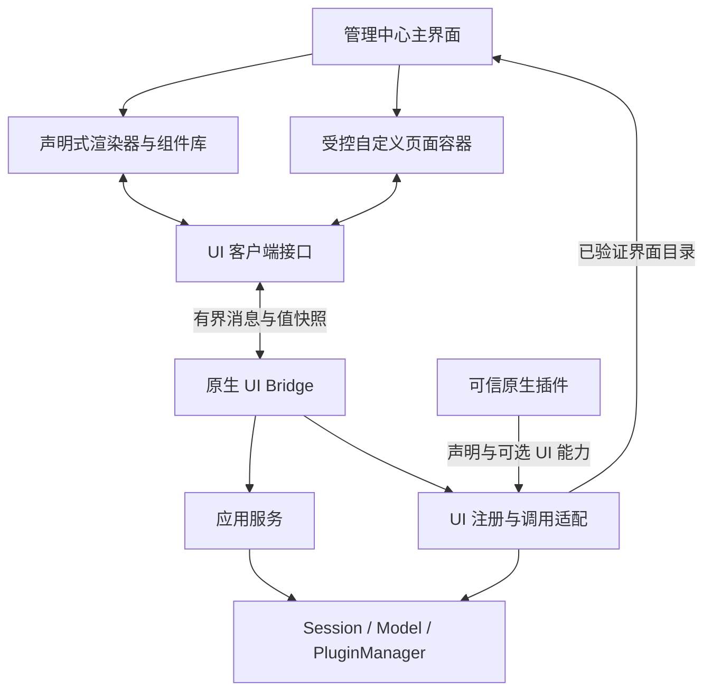
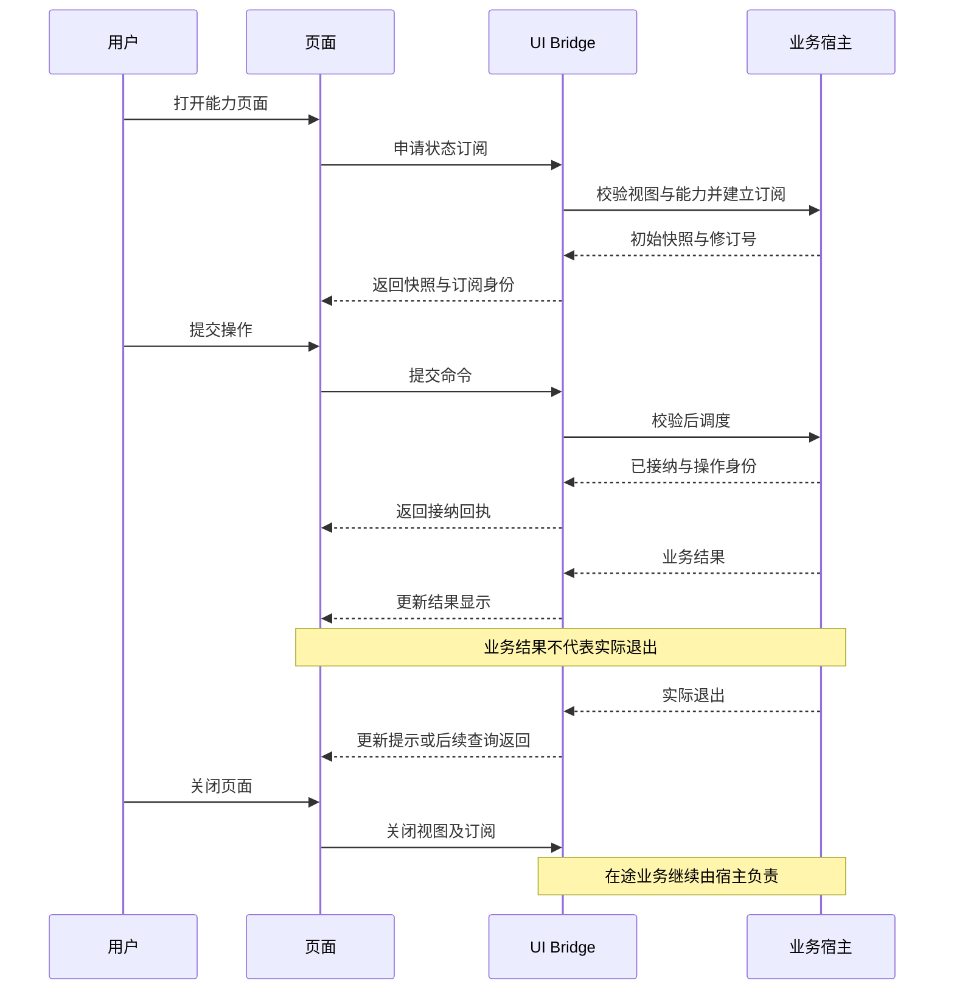

# 大肥鱼管理中心 UI 框架设计方案

版本：V0.2，技术选型已收敛，接口与实施单元待审查。代码基线：`2116b75`。本方案覆盖产品界面、组件库、UI 接口、插件注册与生命周期；接口名称与容量仍是实现前的设计约定，不表示已有代码能力。技术比较与取舍见 [UI 技术选型](ui-technology-decisions.md)。

已经确认的方向是：主界面命名为“大肥鱼管理中心”，采用房间式首页与清晰管理面板；普通插件使用宿主提供的声明式组件，复杂功能允许提供自定义页面。房间、功能栏和插件页面共用同一应用服务与状态，插件数量增加时仍保持入口可发现、操作可追踪、停止可解释。

2026-11-19 主体先行的细化见[本体主面板与内置房间开发方案](main-agent-room-development-plan.md)。空插件下的环境感知、身体动作、到达后回应及忙时消息投递按该方案分步审查。普通发送保留忙碌拒绝，用户可在正式面板明确排到下一轮。

U01 原生容器已交付。U02 已接入运行摘要查询和普通对话。桌面主面板可收发本进程的正文，房间预览另用空闲、忙碌两份固定样本。[桌面运行说明](ui-probe-run-guide.md)

## 1 首版范围与现有约束

首版面向 Windows x64 本地桌面，保留 C++20、CMake、VS2022 和可信同进程 DLL。默认房间、问答、模型配置、能力管理、运行诊断和系统设置属于内置界面，空插件目录仍能使用。GUI 与终端复用应用服务；UI 框架不进入 Agent、Model 或 Runtime 的反向依赖。

本轮 UI 建设不包含工具循环、自动规划、记忆、会话磁盘持久化、远程浏览器控制台、插件商店或自动升级。房间布局与显示偏好可以独立保存，它们属于界面设置，不是 Agent 记忆。首版只需一套房间场景，不建设通用场景编辑器。

工具循环、受控规划与观察行动由 Agent 和应用服务推进。UI 通过宿主提供的命令与状态契约接入。[当前 Agent 流程](architecture.md#agent-会话与工具流程)

| 当前事实 | 对设计的约束 |
|---|---|
| 会话一次只接纳一轮问答 | 界面保持单活跃回合；新的普通输入明确报告忙碌 |
| 取消结果与实际退出分开 | “已取消，正在收尾”必须是可显示状态，不能提前显示空闲 |
| 普通观察通知可能未被接纳 | UI 可主动查询状态，通知用于刷新提示，不作为唯一事实来源 |
| 插件设置在实例创建时固定 | 保存期望配置与应用到当前实例是两个操作 |
| 宿主服务仅在所属线程及有效绑定中调用 | 渲染回调不直接访问 Session、插件函数表或资源句柄 |
| 包清单版本 1 拒绝未知字段 | UI 描述使用独立可选文件，保持现有 `plugin.json` 字段集合 |
| C ABI 精确版本协商，忙碌拒绝卸载 | UI 能力独立协商，页面消失不构成 DLL 可卸载的证明 |

对应实现入口：[会话与诊断](../agent/include/dafeiyu/session.hpp)、[包清单校验](../plugins/runtime/manifest.cpp)、[配置快照](../plugins/runtime/include/dafeiyu/plugin_config.hpp)、[SDK 线程和生命周期约定](../sdk/README.md)。

## 2 管理中心的界面组织

房间提供角色存在感和常用功能入口。完整操作保留可读的文字导航，房间里的物件与导航打开同一个目标页面。点击物件先展开详情面板；表单较长、需要列表比较或涉及复杂编辑时，进入完整工作区，并保留返回房间的位置。

| 区域 | 首版内容 | 管理规则 |
|---|---|---|
| 顶部 | 产品名、真实运行状态、需要处理的问题 | 由宿主拥有，插件只提交符合约定的状态摘要 |
| 房间 | 大肥鱼形象、书桌入口、能力展示位置、状态提示 | 用户选择放置常用能力，安装插件不自动占据房间 |
| 功能栏 | 房间、对话、能力、运行、设置 | 顶层分类固定；插件页面归入能力，不新增任意顶层导航 |
| 详情面板 | 选中对象的状态、主要操作、进入完整页面 | 同时聚焦一个对象，关闭后恢复原入口焦点 |
| 完整工作区 | 对话、模型配置、插件维护、诊断和插件业务页面 | 支持返回与未保存编辑提示，页面异常不清空整个管理中心 |

房间只表现可验证的业务事实：模型请求进行中、回答完成、取消收尾、插件停止或错误。日夜光照属于装饰，不表示 Agent 自主工作或存在尚未实现的人格状态。模型“配置已加载”与“最近请求成功”分别显示，打开配置页不自动发送测试请求。

房间主题定义书桌、展示架等语义位置及其坐标；插件声明适合的语义位置和目标页面，不提交屏幕绝对坐标。宿主处理缩放、重叠、入口数量和排序；窄窗口切换为同一组入口的列表。鼠标悬停只能提供补充信息，键盘与文字导航可以完成全部主要操作。

房间布局按稳定的插件与贡献 ID 保存；隐藏入口不停止插件，卸载实例可显示暂不可用状态，删除包后移除可交互入口并保留用户布局偏好。重装时只恢复仍兼容的入口，不恢复旧实例绑定。

Coopanion 的页面契约为每次挂载提供独立生命周期，并在离开时清理资源；这里借鉴该职责划分。[参考页面契约](https://github.com/Pal-AI-Lab/Coopanion/blob/8829fd4fd0916f2c65f824daa63e503eff042b8a/console/base/page.ts)

房间采用底图、少量场景层和热区的方式起步；物件与详情面板的关系参考 whale-room-guide。实际房间风格与角色素材另作视觉评审。[参考房间模板](https://github.com/2013668436/whale-room-guide/blob/3b710ba1bbb7b9a171230232c920faa0adc8e7e2/模板/README.md)

## 3 软件边界与线程

工程目录按下列职责划分，实施到对应单元时才建立目标；UI 相关构建归入 App，公开 C ABI 仍归 SDK。

| 拟定位置 | 职责 |
|---|---|
| `app/application/` | CLI 与 GUI 共用的应用服务和只读显示投影 |
| `app/gui/` | 原生窗口、UI 线程与进程退出协调 |
| `ui/host/` | 消息桥接、授权、UI 注册、视图和资源生命周期 |
| `ui/web/` | 主界面、组件库、声明式渲染器和自定义页面客户端接口 |
| `sdk/` 与 `plugins/runtime/` | 新 UI 能力的 C 契约及受控原生调用适配，不依赖前端框架 |

应用服务负责问答、取消、配置、插件命令和查询，先从终端中的编排职责提取；GUI 不解析终端输出。它只管理一个本地进程的业务实例，不引入通用工作流引擎。会话状态仍由 Session 决定，UI 侧只保留显示快照与编辑草稿。

采用 Win32 原生窗口与 WebView2，默认使用 Evergreen Runtime；前端采用 Vue 3、TypeScript、Vite 与 Reka UI 基础组件。GUI 保留独立入口，CLI 不依赖 WebView2。WebView2 需要带消息循环的 STA UI 线程，不能从其他线程任意调用其对象。[官方线程模型](https://learn.microsoft.com/en-us/microsoft-edge/webview2/concepts/threading-model)

本方案建议 GUI 线程只管理窗口、渲染容器和消息收发；独立业务宿主线程创建并持有应用服务、Session、PluginManager 及其资源，在原有单线程约束下推进。线程之间传递有界、已复制的消息，不传可借用的 C 指针或直接调用插件。CLI 可以在自己的主线程运行同一应用服务，无需创建 GUI 线程。

后台模型调用继续沿用现有异步路径。UI 回调不得同步等待业务完成，也不得在 WebView2 回调中进入嵌套消息循环。可信原生插件仍须快速返回并协作推进，界面分线程不提供对任意 DLL 的强 CPU 或内存隔离。

主窗口关闭默认进入明确的退出流程：停止新接纳、请求取消、继续处理退出状态，完成实际回收后结束进程；停止失败显示原因并保留重试入口。关闭详情面板仅关闭视图。首版不隐式转入托盘后台运行。

## 4 组件库

### 4.1 公共规范

组件共享颜色、字体、间距、圆角、焦点、动效和密度标记。默认明暗主题都必须覆盖成功、警告、错误、不可用和等待状态，状态不得仅靠颜色表达。支持中文、键盘操作、系统缩放和减少动效偏好；隐藏页面暂停装饰动效。

组件的稳定边界是名称、版本、输入数据与用户意图，不是 Vue、Reka 或 DOM 对象。宿主用 Vue 单文件组件包装 Reka 基础交互及自有业务组件；普通插件不用携带前端框架，也不能向宿主注入脚本或全局样式。导航采用 Vue Router 的 hash 模式，宿主快照与本地编辑草稿分别管理。

| 层次 | 组件组 | 首版职责 |
|---|---|---|
| 基础 | 文本、图标、徽标、按钮 | 文本与状态表达、明确的操作入口 |
| 基础 | 文本框、数字框、开关、选择器 | 有标签、校验与只读状态的字段编辑 |
| 基础 | 分组、页签、键值列表、分页列表 | 组织内容，保持稳定条目 ID |
| 基础 | 抽屉、对话框、加载、空状态、错误区 | 页面容器及局部异常恢复 |
| 业务 | 模型配置、凭据状态 | 展示供应商、模型和环境变量引用；不向插件返回密钥 |
| 业务 | 问答输入、消息列表、回合状态 | 展示单活跃回合及当前内存上下文 |
| 业务 | 诊断时间线、通知回执 | 复用现有诊断，明确接纳与处理完成的区别 |
| 业务 | 能力条目、插件详情、停止进度 | 安装、加载、忙碌、停止、失败保留及移除 |
| 业务 | 设置表单、保存状态、生效状态 | 区分草稿、已保存配置与运行实例配置 |
| 场景 | 房间、语义位置、物件入口、角色状态 | 入口布局与状态反馈，不执行插件业务 |

### 4.2 声明式组件契约

| 字段组 | 约定 |
|---|---|
| `id`、`kind`、`version` | 组件在页面内身份稳定，种类与精确版本必须受支持 |
| `label`、`description`、`icon` | 提供可读标签；图标来自宿主目录或包内只读图像资源，不内联执行插件 SVG |
| `binding` | 只能引用已声明、获准的状态主题与字段路径；路径采用 JSON Pointer 语义 |
| `value_type`、`constraints` | 类型、必填、长度、范围和选项引用；最终校验仍由宿主执行 |
| `action` | 引用注册的操作 ID，提交参数映射；组件不包含函数地址或可执行表达式 |
| `visible_when`、`enabled_when` | 仅支持受限的相等、集合与逻辑组合，限制节点与深度；不执行 JavaScript |
| `children` | 容器子项有界，禁止循环引用和无限嵌套 |

表单字段绑定草稿，只有明确提交才写入。校验失败定位到字段，保存失败保留草稿；离开存在未保存编辑的页面时由宿主处理提示。隐藏或禁用按钮只是界面表现，宿主每次仍校验调用权限、参数、实例状态和容量。

缺失、显式空值和具体值保持区分；枚举使用稳定身份，不使用显示顺序作为值。64 位整数保留十进制字符串表示，浮点数拒绝非有限值。正文按文本渲染；需要 Markdown 的宿主组件使用受限渲染规则，不把模型输出或状态字符串当作 HTML 模板执行。

统一页面状态为加载中、可用、数据已过期、不可用、停止中、局部错误。刷新失败保留最后一次快照并标记过期；操作错误放在操作附近。状态过期时，需要最新前提的写操作保持禁用，读取、重新同步、取消和关闭入口仍可用，最终可执行性由宿主裁定。

## 5 UI 接口

### 5.1 连接与消息

UI Bridge 是版本化消息边界，连接握手返回协议版本、组件能力、桥接会话身份、当前授权和容量。界面实例另外获得视图身份与代次；插件页面的绑定还包含插件实例代次与注册版本。页面不能通过消息中的 `plugin_id` 自行选择身份，身份由宿主根据实际消息来源绑定。

请求包含协议、请求身份、视图上下文、操作名和参数；响应回显请求身份并携带结果或稳定错误码。所有宿主 ID、代次、序号和修订号都作为字符串传输，禁止把 C ABI 句柄或内存地址当作前端资源标识。未知协议与不支持的必需能力明确拒绝，不猜测布局。

首版接口分组如下，名称用于表达职责，实际签名在各自实现单元冻结：

| 接口 | 输入与返回要点 |
|---|---|
| `ui.catalog.read` | 查询当前可见的页面、摘要、场景入口、可用性及目录修订号 |
| `state.open` | 申请一个获准主题的订阅，原子返回订阅身份、初始快照与修订号 |
| `state.read` | 读取主题完整快照与当前修订号，用于手动刷新和缺失更新恢复 |
| `state.close` | 幂等关闭订阅，不取消底层业务 |
| `action.invoke` | 提交注册操作与参数；明确返回拒绝或接纳身份 |
| `action.read` | 查询已接纳操作的业务状态、取消原因、结果和实际退出 |
| `action.list` | 在当前授权范围内查询本进程在途及有界保留操作，用于页面恢复 |
| `action.cancel` | 请求协作取消，返回原取消回执，不伪造终态或退出 |
| `settings.read`、`settings.save` | 查询设置及版本；以基准版本提交草稿，返回保存和生效状态 |
| `resource.read` | 按获准的临时资源令牌有界读取大文本，令牌不含磁盘路径 |
| `resource.upload.begin/append/seal` | 创建临时文本、按偏移写入并封存；同偏移内容冲突拒绝，封存后只读 |
| `resource.release` | 归还视图持有的临时资源；不取消已经接管该数据的业务 |

`action.invoke` 不提供任意函数调用能力。操作必须事先登记参数、结果、取消支持和数据访问范围；宿主验证后才在业务线程调度。`settings.save` 等专用写入入口复用同一接纳、去重、结果和退出协议。内置问答、取消、配置和插件管理使用同样的应用服务，但内置权限不会因组件复用而授予插件。

### 5.2 状态同步

`state.open` 在同一宿主串行边界内建立订阅并读取快照，避免先查询后订阅的空隙。提供方负责快照与修订的一致性，查询必须快速、只读；后台状态变化交由宿主线程结算。每个主题按所属实例维护单调修订号；更新提示允许合并，首版不要求发送连续增量补丁。UI 收到提示后读取最新快照，只接纳当前视图、当前实例且不倒退的版本。

可见页面还进行低频修订检查，初始建议为每两秒一次；发生队列溢出、桥接重连、重新可见或版本不连续时，进入重新同步。该周期是恢复策略，不承诺两秒内必然恢复。宿主拥堵时继续显示过期状态，不能把最后一次快照冒充当前状态。

普通事实广播保持原契约。UI 订阅故障不修改问答结果，通知接纳失败继续有独立诊断；跨页面和后台来源的错误不合并成一个无法定位的全局红点。订阅关闭后停止投递，晚到的消息按视图代次丢弃。

### 5.3 操作与超时

操作始终分别表达：是否接纳、业务结果、实际退出。界面等待超时只表示尚未取得确定结果，不能据此显示“操作未发生”。首版不自动重发写命令；用户可查询原操作，或在明确支持时请求取消。

请求身份由桥接会话与连续递增序号组成，序号在业务调度前按接收顺序核验，接纳和明确拒绝都会消费该序号；控制操作使用独立调度预留。重发旧序号只返回原回执或“回执已过期”，绝不重新执行。回执仍保留时，相同序号配不同参数返回冲突；跳号返回期望序号。宿主有界保留终态回执，在途记录不能为腾出容量而驱逐；已退休序号用会话高水位拒绝重执行。桥接重连更换会话身份，旧请求只能在仍存活的应用操作目录中查询，不能重放。

前端刷新或关闭不结束已经接纳的业务，宿主继续承担结果和退出责任。新页面可以通过获准的操作列表找回同一提供方实例仍在进行的工作，不能继承其他插件或旧实例的访问权；此恢复仅限本进程，不承诺崩溃后的恢复或外部副作用恰好一次。

### 5.4 数据与容量

以下是建议初始上限，实施时需测量并确认；它们只限制 UI 入口，不能扩大原有业务上限。

| 对象 | 建议上限与超量行为 |
|---|---|
| 单插件界面描述 | 256 KiB UTF-8；超量整批拒绝注册 |
| 单插件贡献 | 8 个页面、4 个摘要、4 个房间入口；更多内容在页面内部组织 |
| 单页面组件树 | 256 个节点、12 层；未知组件或非法绑定拒绝该批注册 |
| 单视图 | 8 个主题订阅、8 个在途普通请求；达到容量明确拒绝 |
| 桥接会话 | 32 个在途普通请求、64 个终态回执；取消、关闭和退出有独立控制预留 |
| 常规状态消息 | 256 KiB；列表分页，大文本通过临时资源按块读取，禁止静默截断 |
| 进程内 UI 临时文本 | 64 个资源、总正文 16 MiB；计费持续到所有业务和视图持有实际归还 |

大文本上传与读取分开计费，沿用问答输入 1 MiB 的业务上限，单块原始 UTF-8 最多 16 KiB，编码后仍须通过消息总量校验。临时文本上传完成后才允许问答接纳；未提交上传在关闭视图或到期后回收，已接纳输入由业务责任接管。UI 临时资源的数量与总字节还需受进程级父预算约束，不能靠创建新视图绕过限额。

插件页面通过 UI 接口只能读取获准的数据。对话正文只向内置对话界面开放，诊断继续使用不含正文的回合快照；首版不向插件 UI 提供密钥读取或任意文件访问。显示对话需要新增有界、只读的会话投影，保留当前成功上下文，失败或取消的输入单独标记未进入模型上下文，不写入磁盘，也不倒灌为新的模型历史。

## 6 插件 UI 注册规范

### 6.1 描述文件与贡献类型

约定可选文件为包内 `ui/manifest.json`，资源位于包内 `ui/assets/`。现有 `plugin.json` 保持不变，旧宿主忽略额外 UI 文件；未提供 UI 的插件沿用原行为。发现阶段只检查元数据，不加载 DLL、不运行前端脚本，也不因用户打开能力列表而启动插件。

| 描述字段 | 约定 |
|---|---|
| `ui_schema_version` | 首版为 1，与原生 ABI 版本独立 |
| `plugin_id` | 必须匹配所在包的 ID，不能借用其他插件或宿主命名空间 |
| `requires` | 必需组件与 UI 协议能力；必须满足后才激活 |
| `contributions` | 页面、设置面板、状态摘要与房间入口组成的有界集合 |
| 贡献 `id`、`kind`、`title` | 本插件内稳定且唯一，完整身份为插件 ID 与本地 ID 的组合 |
| `renderer` | `declarative` 或 `custom`；前者提供组件树，后者引用包内资源入口 |
| `bindings`、`actions` | 引用业务提供方登记的状态和操作契约，不另建一套业务参数规则 |
| `access` | 声明所需数据、操作与资源范围；声明不等于授权，宿主决定实际授予集合 |
| `placement` | 能力分组、建议排序、可选语义位置；最终位置由宿主和用户决定 |
| `fallback` | 不可用说明与宿主可显示的摘要；不允许用回退绕过必需能力检查 |

UI 定义和业务操作契约分别拥有版本。UI 变更不改变原生 ABI；参数语义变更必须升级相应操作契约。显示名称可翻译，路由与字段身份不依赖显示名称。未知必需组件、重复 ID、越权绑定、非法资源路径和版本不兼容都产生可定位的注册错误。

状态摘要和房间入口使用宿主组件；即使插件包含自定义页面，也不能借摘要位置运行任意页面或覆盖全局导航。操作目录来自提供方的统一契约，UI 只绑定字段；注册时检查引用和类型，执行时再次进行业务校验。首版默认范围限自身实例的已登记状态、操作与设置；其他插件和宿主业务数据不因清单声明而自动开放。

### 6.2 原生能力与激活

拟增加独立可选能力 `dfy.ui.provider@1`，通过现有 v2 查询机制协商，不能扩写现有能力表布局。它承担界面契约核对、状态查询、异步操作接纳及结果查询、取消与 UI 绑定分离。具体 C 结构和函数签名在 SDK 单元单独审查；现有 SDK 以消费能力为主，不能假定已具备通用 UI 操作生产接口。

所有能力调用发生在业务宿主线程、有效绑定和代码活动保护内。描述及状态按调用边界复制到宿主拥有的存储，跨 ABI 使用明确长度、宿主引用或约定缓冲区，禁止跨 CRT 释放对象。耗时操作快速返回接纳信息，结果和实际退出仍使用现有操作语义，不创建另一套互不关联的运行任务框架。

激活顺序为：发现元数据 → 用户明确加载插件 → 原生实例启动成功 → 协商可选 UI 能力 → 核对文件、状态及操作契约 → 原子发布该实例的整批贡献。失败不留下半注册导航、悬空房间入口或半挂载页面；可用的业务实例保持其业务状态，能力列表单独显示“UI 不兼容”或“UI 注册失败”。无 GUI 的宿主不授予 UI 服务，插件必须允许这项可选能力缺席。

注册记录关联插件实例代次和注册版本，客户端只取得宿主签发的视图上下文。同一插件 ID 重新加载后，旧视图、旧请求及旧资源令牌不能自动绑定新实例。首版运行中的描述保持不变，改版通过明确重新加载生效，暂不提供任意热替换注册树。

### 6.3 页面与卸载

页面生命周期为创建、打开、可见、隐藏、关闭。普通页面隐藏时暂停装饰更新和非必要订阅，恢复时重新同步；关闭时归还页面订阅、计时器、资源令牌和 UI 绑定。业务操作由应用服务持有，因此关闭页面不代表业务已经结束。

UI 注册的静态副本不应长期持有插件函数表。打开视图与在途操作需要代码时，通过 UI 适配器显式取得并计量代码凭证；静态元数据与代码持有分别管理。

用户请求卸载时，由宿主按以下顺序处理：

1. 预检活动调用、业务工作、依赖关系和未保存编辑；明确拒绝时保持原注册与界面，不先删除入口。
2. 可进入停止准备时，关闭新的 UI 业务接纳；撤销或停止页面订阅，分离页面回调，将显示切换为宿主拥有的停止状态。
3. 等待 UI 适配器的活动回调结束，归还其代码凭证；仍在运行的业务保持独立代码持有与退出责任，不能为卸载提前释放。
4. 继续调用现有插件停止协议，只有实际退出、引用归还和模块关闭全部满足，才移除活动贡献并显示已卸载。
5. 停止失败保留实例、必要代码和可查看的失败状态；只能重试收尾，不能把旧运行页直接重新开放为正常状态。

UI 适配器的分离必须发生在现有卸载检查之前，否则它自己持有的代码引用会导致永久“仍被使用”。适配器不得绕开其他依赖造成的 `busy` 或 `in_use`；预检后的状态若发生变化，保留已经安全关闭的视图并报告等待或拒绝，不强行卸载。

页面挂载、数据读取或可捕获的自定义页面脚本错误只使该视图进入错误状态。注册仍有效时可重新打开；实例已停止时只展示宿主保存的概要，不能继续调用旧提供方。底层渲染进程故障的边界见下一节。

## 7 自定义页面规范

第二级页面适用于画布、播放器、复杂可视化等标准组件难以表达的内容，仍使用同一套状态、操作、错误和生命周期协议。它可以自由组织自己的内部布局；宿主保留导航、插件身份、窗口边界及全局操作区域。

自定义资源必须随包提供，初始加载不依赖 CDN。资源入口、相对路径、文件数量与大小沿用包校验，并加入 UI 专项限制；不能跳出包目录、访问重解析点或直接暴露用户数据目录。资源地址区分包内容版本，避免重新加载后命中旧资源。

自定义视图默认采用独立来源、带 sandbox 限制的 iframe，不把插件脚本动态导入主界面文档。原生宿主将具体 Frame 与视图代次、实例代次和授权绑定，不能只信任消息自报身份；外部导航、弹窗、下载、文件选择和其他系统能力经宿主专门入口处理。首版只保留一个活动自定义页，离开时处理草稿并销毁视图。独立 WebView2 控件或进程组仅在明确需要独立窗口或更强故障隔离时另行评审，不作为首版默认容器。

WebView2 支持本地内容映射到具备来源身份的虚拟主机，可用于包资源服务；映射必须限制在经过验证的资源根目录。[官方本地内容说明](https://learn.microsoft.com/en-us/microsoft-edge/webview2/concepts/working-with-local-content)

消息应使用明确契约并校验来源与参数，不开放通用宿主对象代理。这与 WebView2 的官方安全建议一致；UI 的约束不改变现有原生 DLL 为可信同进程代码的事实。[官方消息边界建议](https://learn.microsoft.com/en-us/microsoft-edge/webview2/concepts/security)

自定义页面支持打开、可见性改变、主题与语言改变、关闭通知；宿主可以撤销消息通道，不依赖页面主动合作才能解除 UI 权限。桥接失效后显示断开状态，业务操作仍由宿主跟踪。普通页面错误可以局部恢复；原生 DLL 崩溃和底层渲染进程故障不承诺完全隔离，需有主界面重建或明确退出策略。

## 8 配置与状态所有权

| 数据 | 权威拥有方 | 保存与生命周期 |
|---|---|---|
| 业务状态、操作结果、实际退出 | Session、应用服务或对应插件 | UI 只能查询或通过业务命令修改 |
| 当前对话显示投影 | 应用服务 | 有界内存；正文与无正文诊断分开授权 |
| 插件默认配置与 UI 定义 | 插件包 | 只读，不因界面编辑写回安装目录 |
| 插件用户设置 | 宿主配置服务 | 按插件独立保存，移除包保留设置 |
| 布局、主题、常用入口 | 宿主界面设置 | 与插件业务设置分开，保存稳定 ID，不保存实例代次 |
| 未提交表单与临时资源 | 页面及 UI Bridge | 有界草稿；关闭按明确规则保留草稿提示或释放，不偷偷应用 |

`settings.read` 返回有效配置、字段来源、保存修订与当前实例应用修订。`settings.save` 携带基准修订，只提交用户覆盖值；同插件由宿主串行保存，完整校验后原子替换文件。发现版本变化返回冲突，保留草稿，不静默覆盖。外部程序直接修改配置不属于宿主事务，检测到变化后需要重新载入和核对。

首版保存按钮明确标注“下次加载生效”。应用更改由用户另行触发空闲实例的重新加载；忙碌或停止失败时，保留运行实例及已保存期望配置，展示尚未生效。热更新只在插件将来提供专门契约并单独验收后启用。

模型配置继续使用环境变量名称引用凭据，显示未配置、未验证、最近请求成功或失败等有依据的状态。新凭据保险库、跨插件密钥共享以及自动连接检测均不属于首版组件的隐含能力。

## 9 示例与关键流程

以一个假设的语音能力插件说明两级界面，不代表语音能力已纳入当前实现：它可以注册宿主渲染的音量设置、播放状态摘要和一个房间音箱入口；需要波形编辑时，再注册自定义页面。音箱与能力列表引用同一页面身份，关闭波形页面只释放视图，停止播放和卸载插件使用明确业务操作。

首版验收插件使用更小的“示例状态面板”：提供一个枚举状态、一个配置字段和一个可控异步动作；同一份数据分别供声明式页面与最小自定义页面显示，用于验证两级界面的协议一致性。

## 10 分步实施与验收

以下单元按依赖逐项审查和提交，复杂单元继续拆分，通常以约 100～300 行手写变更为审查参考。开发只运行影响范围内的必要检查，首版交付前再统一全量验收。

| 单元 | 可独立交付的结果 | 重点验收 |
|---|---|---|
| U01 容器可行性 | 原生窗口显示本地静态页，明确运行库分发方式 | 无网络加载、缩放、键盘焦点、关闭与资源回收 |
| U02 应用服务与桥接 | CLI 与 GUI 共用问答服务；先只读诊断，再接命令 | 线程归属、查询无副作用、取消与退出、桥接断开 |
| U03 组件与声明校验 | 最小组件目录、表单草稿、错误和状态展示 | 非法组件、类型精度、空值、局部失败及键盘操作 |
| U04 内置管理页面 | 问答、模型配置、插件管理、诊断可用 | 空插件运行、忙碌提示、正文权限与完整回合显示 |
| U05 插件 UI 注册 | 独立描述文件、可选 C ABI、原子注册与示例面板 | 旧包兼容、版本拒绝、跨实例拒绝、回滚及代码持有 |
| U06 设置保存与应用 | 独立设置读写及明确重新加载 | 草稿保留、冲突、保存未生效、停止失败不替换实例 |
| U07 房间入口 | 内置场景、语义位置与用户选择的能力入口 | 缩放、入口冲突、窄布局、插件缺失及重装恢复 |
| U08 自定义页面 | 受控容器与同协议示例视图 | 来源验证、越权拒绝、晚到消息、异常及卸载 |
| U09 首版验收 | 独立分发与开发者注册说明 | Debug／Release 全量、真实 DLL、两级 UI 完整生命周期 |

U03 组件和 U06 设置可独立推进。U04 的执行视图读取宿主的运行、审批与验证快照，U05／U08 的能力命令复用工具授权和执行入口，U07 的房间感知与动作依赖本体的原生房间实例。[Agent 与工具流程](architecture.md#agent-会话与工具流程) · [内置房间实施顺序](main-agent-room-development-plan.md#7-分步开发顺序)

U02 已接入首个桌面只读查询。业务线程推进 [共享运行状态查询](../app/application.hpp) 并发布值副本，终端 `/task-status` 继续复用该入口。主文档以 `state.read` 请求 `topic: "run"`，协议 `version` 为字符串 `"1"`，宿主通过 `state.snapshot` 回显 `request`。可同时指定字符串 `session` 和 `turn` 查询原运行。收到 `run: null` 表示保留窗口中没有匹配运行，`available` 表示当前通道是否绑定应用宿主。非空快照分别返回业务结果、实际退出、待审批数量和读回判定。运行状态页可主动刷新。[主文档消息入口](../ui/host/probe_host.cpp) · [隐藏窗口验收](../tests/ui_run_status_probe.cpp)

所有 UI 验收也不调用真实模型；预设响应驱动业务状态，原生事件与固定浏览器协议验证界面，不使用 Computer Use。模型选择工具、生成计划等表现仅记录，不作为 UI 验收门槛。

可信主文档用 `dialogue.submit` 提交，由业务线程调用 `Application::submit_dialogue`，再用 `dialogue.read` 读取本进程的回合正文和命令回执。`dialogue.cancel` 与 `dialogue.clear` 使用同一命令编号空间，执行前复核原会话和回合。取消与实际退出分别显示，清空只在空闲时执行。[桌面业务线程](../app/gui/run_status_host.cpp) · [正式主面板验收](../tests/ui_main_panel.cpp)

下一轮消息由 `dialogue.enqueue` 绑定用户所见的原回合，应用为每条原话签发消息号。`dialogue.resume` 核对会话和队首，`dialogue.remove` 只作用于仍待发的原项。受信快照在修订变化时一起交付对话和队列，停止命令有独立槽位。[队列桥接验收](../tests/ui_dialogue_queue.cpp)

`dialogue.append` 只向原活动回合收件，后续模型请求实际提交后才展示「已带入本轮」。位置使用单独的 `room.read` 查询，由业务线程发布本体书房、身体和地点的对应关系。两类正文或位置查询均限于专用面板来源。[原生书房](../app/builtin_room.cpp) · [可信主文档](../ui/host/probe_host.cpp)

首版必须覆盖以下场景，而不只检查页面是否显示：

- 慢观察者或更新丢失后，界面可以重新同步，原问答结果保持正确。
- 保存设置后明确显示待生效；重载失败不会冒充新配置已应用。
- 回合取消先显示已取消，再确认实际退出；关闭页面和关闭主窗口使用不同语义。
- 操作接纳后页面失联，不重复执行；过期回执、参数冲突与未知结果可区分。
- 插件未加载、UI 版本不兼容或资源损坏时，其他页面和内置问答仍可使用。
- 页面切换、实例重载及插件卸载后，旧消息不能更新新页面，UI 自身引用不永久阻塞卸载。
- 声明式页面和自定义页面经过相同的宿主校验，跨插件状态、凭据和原生句柄不可通过界面接口取得。
- 大文本、频繁更新、多个页面与未释放临时资源达到预算时，有明确拒绝和可验证回收。

## 11 技术决策与后续审查

已确定产品名称、房间与管理面板结合、插件 UI 两级扩展，以及复用现有业务与资源边界。技术路线采用 Win32 与 WebView2 Evergreen、Vue 3 与 TypeScript、Vite、Reka UI，以及独立来源的受限 iframe；详细比较见 [技术选型记录](ui-technology-decisions.md)。本版不冻结 C ABI 布局或建立实现目标。

后续主面板按实施顺序逐项评审，插件页面容量、C ABI 签名及页面关闭细节在对应单元验证。iframe 和 WebView2 的隔离依据是来源校验与受限消息通道。[当前运行入口](ui-probe-run-guide.md) · [内置房间计划](main-agent-room-development-plan.md)
