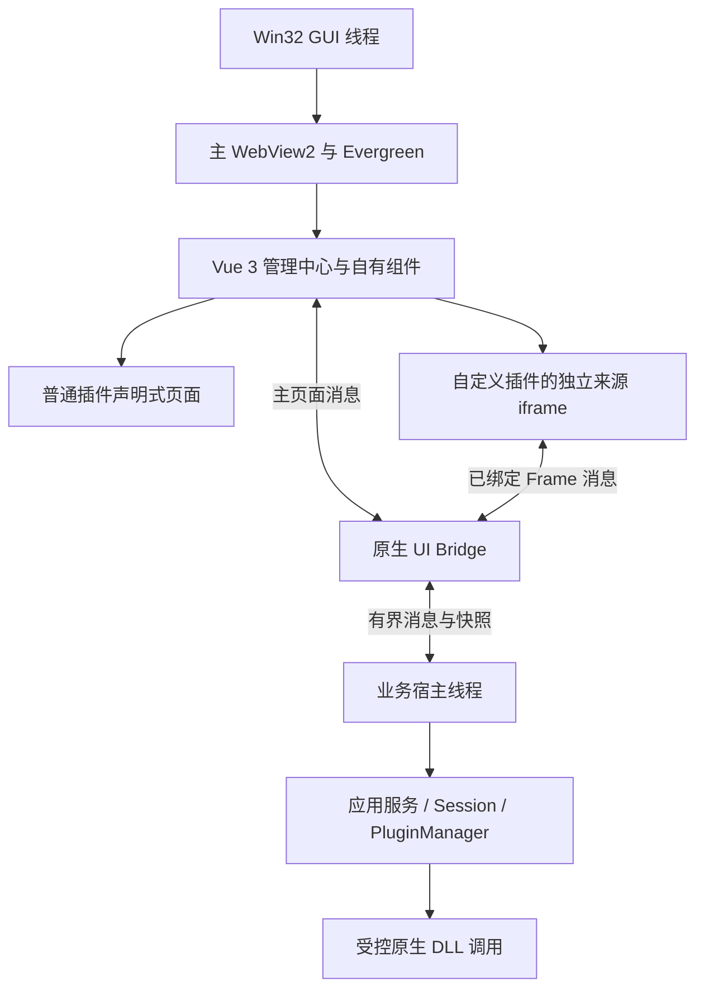

# 大肥鱼管理中心 UI 技术选型

日期：2026-11-15，Asia/Shanghai。设计基线：`b14116f`。本记录确定首版技术路线，配合 [UI 框架设计方案](ui-framework-design.md) 使用；本轮只有文档，不引入实现代码或依赖安装。

后续实现与验证结果见 [U01 验收记录](archive/ui/ui-u01-validation.md)。该记录保留本次选型的依据；验证结果不扩展为系统输入法人工体验或完整管理中心已经交付。

## 1 选型结论

| 层次 | 首版选择 | 主要取舍 |
|---|---|---|
| 桌面容器 | Win32 原生窗口与 WebView2 | 直接衔接 C++ 宿主，承担 Windows 专用容器和运行库分发责任 |
| WebView2 运行库 | Evergreen，提供缺失检测与离线安装途径 | 使用共享、自动更新的运行库，需要兼容性回归；不承诺没有先决条件的解压即用 |
| 前端实现 | Vue 3、TypeScript、Vite | 优先保证表单、组件声明和状态展示的可读性 |
| 基础交互组件 | Reka UI，封装为大肥鱼自有组件并使用 CSS 主题变量 | 复用键盘、焦点和可访问性基础，自行完成视觉样式与业务组件 |
| 导航与状态 | Vue Router 的 hash 模式；只读宿主快照与本地草稿分开 | 不依赖生产 Web 服务的路径重写，不在前端建立第二套业务状态 |
| 普通插件 UI | 宿主渲染的声明式组件树 | 插件无需携带 Vue，也不能导入组件代码到主界面 |
| 自定义插件页面 | 独立来源、带限制的 iframe | 保持布局和框架自由；不承诺独立渲染进程或强 CPU 隔离 |
| 房间绘制 | HTML、SVG、静态图层和 CSS 动效 | 首版不引入游戏引擎或全场景 WebGL；大规模动态绘制再按实际需求评估 |

这套组合保留现有 C++20、CMake、VS2022、同进程 DLL 和宿主线程责任。GUI 是现有应用能力的新入口，原生业务不迁入 JavaScript。首版保留独立 CLI 入口；CLI 与 GUI 复用业务库，但不隐含跨进程会话共享。

## 2 桌面容器比较

| 方案 | 适合的情况 | 对当前项目的成本 | 结论 |
|---|---|---|---|
| Win32 与 WebView2 | 已有 C++ 主体，需要 Web 组件和场景界面 | 原生消息桥、窗口焦点、缩放及 WebView2 分发需要自行实现 | 采用，新增的适配边界最直接 |
| Qt Quick 与 QML | 希望统一使用 QML 开发原生界面，或跨平台是近期硬要求 | 引入 Qt、QML 与相应资源链；若仍要求 Web 自定义页，还要维护第二种页面体系 | 首版不采用，跨平台或 QML 统一开发成为目标时再评估 |
| WinUI 3 与 WebView2 | 大量使用 Windows 原生控件及 Fluent 交互 | 引入 Windows App SDK、XAML 与构建分发环节；房间和复杂 Web 页面仍需嵌入层 | 当前不增加这层依赖 |
| Electron | 希望 JavaScript 主进程统一管理桌面功能和多平台发行 | 需要把现有 C++ 核心接入原生模块或子进程通信，增加一套主进程和运行库维护 | 首版不采用 |

WebView2 提供 Win32/C++ 嵌入与消息互通，能在现有工具链中建立薄的 GUI 入口。[Win32 接入说明](https://learn.microsoft.com/en-us/microsoft-edge/webview2/get-started/win32)

Qt Quick 提供 QML 和 C++ 接口；WinUI 3 基于 Windows App SDK 和 XAML；Electron 的应用入口运行于 Node.js 主进程。表中的迁移成本是针对大肥鱼当前架构的判断，不是这几个框架的通用优劣排名。[Qt Quick](https://doc.qt.io/qt-6/qtquick-index.html)、[WinUI 3](https://learn.microsoft.com/en-us/windows/apps/winui/winui3/)、[Electron 进程模型](https://www.electronjs.org/docs/latest/tutorial/process-model)

GUI 线程管理 Win32 与 WebView2；业务宿主线程创建并推进 Session、PluginManager 和相关资源。消息桥只在正确线程复制和调度请求，不在窗口事件中调用耗时业务，也不跨线程访问插件表。CLI 不链接 GUI 容器，缺少 WebView2 不应破坏终端问答。

### 2.1 Evergreen 与 Fixed Version

Evergreen 作为默认发行路线。GUI 启动前检查运行库和所需接口，缺失时提供明确安装指引；离线发行配套官方 Evergreen Standalone Installer。已有 CMake 安装目录继续作为打包基础，前端资产随包发布，不在运行时启动 Vite 或本地 HTTP 服务。

Fixed Version 可以随应用携带固定运行库，但版本更新需要项目自行组织，包体也会增加。只有新增“不能安装共享运行库”或“必须锁定浏览器版本”的明确发行要求，才启用这条独立发行路线。Evergreen 的离线安装不等于 Fixed Version，也不能把已安装 Edge 浏览器当作生产运行库。[微软分发说明](https://learn.microsoft.com/en-us/microsoft-edge/webview2/concepts/distribution)

SDK、前端依赖使用明确版本和锁文件；Evergreen 本身不锁用户机器的统一版本。较新的 Frame 接口必须做能力检测：不满足时禁用对应自定义页面并说明原因，不能降级为同来源注入脚本来绕过约束。

## 3 前端实现库比较

| 方案 | 主要优点 | 本项目的取舍 | 结论 |
|---|---|---|---|
| Vue 3 与 TypeScript | 单文件组件、模板和表单组织清晰，可将外部状态作为浅引用接入 | 需要严格区分本地表单草稿与只读宿主状态 | 采用 |
| React 与 TypeScript | 组合能力强，外部存储订阅接口明确，适合既有 React 团队与组件资产 | 同样可以完成方案；当前没有需要继承的 React 代码或团队偏好依据 | 保留为合理备选，不同时引入 |
| Svelte | 编译式组件与局部状态表达简洁 | 可以实现该产品，但当前没有需要利用的 Svelte 资产，改选它没有明确必要收益 | 首版不采用 |
| 原生 TypeScript 与 Web Components | 底层约束少，适合少量独立控件或协议客户端 | 全量管理中心需要自行维护大量表单、路由、焦点及生命周期组合 | 用于无框架客户端接口，不承担主界面组件体系 |

选择 Vue 的依据是当前以配置表单、能力列表、诊断与声明式渲染为主的页面结构，以及预期的维护方式。React 同样有合适的外部快照订阅能力，两者都能保持原生宿主为业务状态来源。[Vue 外部状态接入](https://vuejs.org/guide/extras/reactivity-in-depth.html#integration-with-external-state-systems)、[React 外部存储接口](https://react.dev/reference/react/useSyncExternalStore)、[Svelte 组件模型](https://svelte.dev/docs/svelte/overview)

### 3.1 具体组合

- 使用 Vue 3 Composition API、单文件组件和 TypeScript；声明式树只映射到预编译、已登记的组件，不在运行时编译插件模板。
- Vite 负责开发与静态生产构建；类型检查单独使用 `vue-tsc`，不能把“打包成功”当作类型检查通过。
- 使用 Vue Router 的 hash 模式，导航身份仍来自宿主目录，不能由插件任意新增顶层路由。
- 宿主快照通过只读类型与 `shallowRef` 整体替换，表单草稿保存在页面本地。首版不为业务状态额外引入 Pinia 或 Redux；显示偏好需要共享时再独立组织。
- 使用 Node.js 受支持的 LTS 版本与 npm 锁文件完成构建；Node.js 不进入用户运行目录。U01 建立工程时记录并锁定兼容的精确工具版本。

Vite 输出静态资产；Vue 官方将单文件组件类型检查交给 `vue-tsc`。hash 路由不要求服务端路径重写，适合当前本地资源发行方式。[Vite 构建](https://vite.dev/guide/)、[Vue 类型检查](https://vuejs.org/guide/typescript/overview.html)、[Vue Router 模式](https://router.vuejs.org/guide/essentials/history-mode.html)

### 3.2 组件库与视觉

选用 Reka UI 的无预设样式组件作为基础交互层，包装成大肥鱼自己的按钮、表单、抽屉、对话框与页签；公开给普通插件的是声明式契约，不是 Reka API。Reka 提供键盘、焦点和 ARIA 等基础，但布局、视觉状态和业务行为仍由本项目完成并验收。[Reka UI 设计原则](https://reka-ui.com/docs/overview/introduction)

Element Plus、Ant Design Vue 这类完整组件库适合快速组织常规管理页面；本项目优先保证房间与管理面板的统一外观，因此首版不整套引入后台主题。CSS 变量定义颜色、间距、字体和状态，组件内部样式使用局部作用域；是否使用某种 CSS 编写工具不进入插件契约。

房间的逐帧变化交给 CSS、SVG 或浏览器动画能力，不通过高频替换整个业务快照驱动。只有实际出现大量动态物件、复杂粒子或场景性能瓶颈时，才单独评估 Canvas 或专用渲染库。

## 4 自定义页面容器比较

| 容器 | 获得的边界 | 主要成本与限制 | 结论 |
|---|---|---|---|
| 同文档动态加载插件组件 | 共享组件和布局方便 | 插件代码与主界面处于同一文档，样式、依赖及清理责任耦合；Shadow DOM 也不能替代权限边界 | 不用于插件自定义页面 |
| 独立来源的受限 iframe | 文档和样式边界明确，能够嵌入抽屉或工作区，前端框架独立 | 需管理来源、Frame 生命周期、消息授权与焦点；不保证独立进程 | 首版采用 |
| 独立 WebView2 控件且共享环境 | 可以独立导航、关闭和设置控制器 | 需要额外协调原生窗口层级、尺寸、焦点与叠层；渲染进程仍可能共享 | 只在明确需要独立窗口能力时升级 |
| 独立 WebView2 环境与用户数据目录 | 浏览器进程组可分开管理 | 更多进程、缓存、启动和回收成本，且仍不能隔离同进程原生 DLL | 更强故障隔离成为需求后单独设计 |

WebView2 官方提供 Frame 创建、导航、销毁与双向消息接口，首版可以直接将 UI 权限绑定到宿主持有的具体 Frame，而不依赖插件自报身份。[Frame 生命周期与通信](https://learn.microsoft.com/en-us/microsoft-edge/webview2/concepts/frames)

一个渲染进程可能服务同一用户数据目录下多个 WebView2 实例。要获得独立浏览器进程组，需要不同用户数据目录及相应 Environment；单独创建控件不构成进程隔离保证。[WebView2 进程模型](https://learn.microsoft.com/en-us/microsoft-edge/webview2/concepts/process-model)

### 4.1 iframe 的具体约束

1. 主界面与每个插件使用宿主分配的不同来源；不能用同一来源下的不同路径充当隔离。实例代次与视图代次另外绑定，不靠地址字符串代替生命周期。
2. 首版使用 `sandbox` 限制，允许脚本和保留插件自身来源身份；必须保证插件与父页面不同源，并禁止导航到主界面来源。不给顶层导航、弹窗、下载等默认放行权限。
3. 限制资源加载与网络访问，资源只来自经过校验的包；首版不允许嵌套业务 iframe、Service Worker 或后台常驻脚本。新增浏览器能力需单独声明并验证回收行为。
4. C++ 宿主通过 Frame 事件建立绑定，使用对应 Frame 的 WebMessage 接口通信；每次核对来源、实例代次、视图代次、操作范围和消息大小，不开放通用 Host Object。
5. Frame 导航、销毁或桥接重建时立即撤销旧授权；旧消息无法调用新实例。页面关闭后，已接纳业务继续由原生宿主跟踪，不能因销毁 iframe 提前卸载 DLL。
6. 首版同时只保留一个活动自定义页面。离开前处理未保存草稿，再销毁页面和订阅；后续重新打开通过状态查询恢复，不缓存持有旧实例的活页面。

`allow-same-origin` 保留的是嵌入页面自身来源，并不让它自动与父页面同源。若父子页面本来同源，再同时允许脚本，则会削弱 iframe 的限制，因此上述不同来源与导航拦截必须一起成立。[MDN iframe 约束](https://developer.mozilla.org/en-US/docs/Web/HTML/Reference/Elements/iframe#sandbox)

主界面统一处理插件身份、全局确认和操作结果。iframe 内部不能把弹层绘制到容器之外；需要全局交互时，通过明确的宿主接口申请。主题与语言只以获准的值传入，自定义页面不能取得主界面的 DOM 或业务存储。

### 4.2 何时升级容器

默认 iframe 的接受条件是：满足页面权限与生命周期隔离，且在实际负载下不影响可接受的交互响应。它不提供对恶意脚本死循环或共享渲染进程故障的完整隔离。

若未来插件要求独立窗口、专用媒体控制或经测量确实需要更强故障隔离，再选择独立控件或独立进程组。迁移保留同一 UI 协议与插件描述，不要求普通插件改成另一套业务接口，也不把“换控件”描述为原生插件沙盒。

## 5 与现有架构的衔接

Core 仍决定业务状态、取消和实际退出。Vue 负责显示和草稿；UI Bridge 负责消息身份、容量和线程切换；页面生命周期不能反向改变 DLL 的完成条件。普通插件的声明与自定义页面都走同一授权与操作协议。

给插件作者发布的客户端接口采用不依赖 Vue 的 TypeScript/JavaScript 协议包。自定义页面可以使用 Vue、React、Svelte 或原生 JavaScript，只需输出符合资源与容器约束的静态文件。宿主 Vue 与 Reka 的升级不直接成为插件原生 ABI 的升级要求。

## 6 实施前验证与版本策略

U01 验证所选技术路线的关键边界，并测量启动速度、内存占用和场景响应；本轮选型依据架构适配与维护成本，没有进行性能跑分。

| 验证点 | 必须观察的结果 |
|---|---|
| 运行库和离线发行 | 缺失有明确反馈；安装所需运行库后，本地资产可以离线启动；CLI 独立可用 |
| Frame 与消息 | 不同来源正常交互；越权、导航改源、旧代次和销毁后的消息被拒绝 |
| 容器限制 | sandbox、资源响应、CSP 和 Frame API 配合有效；不靠放宽到同来源解决失败 |
| 输入与布局 | 中文输入法、Tab、Escape、抽屉遮罩、焦点返回及系统缩放正确 |
| 生命周期 | 重复开关自定义页后订阅、临时资源与 UI 代码引用归还；在途业务仍有宿主责任 |
| 异常恢复 | 页面错误可定位；渲染故障可重建界面或明确退出，不重复接纳先前命令 |
| 性能 | 分别记录空页面、声明式页面、房间与自定义页的开销；按观测决定后续优化 |

依赖选择正式发布版本，锁定精确 SDK 与 npm 依赖，并在构建记录中保留版本和来源。Vite 构建目标需匹配支持的 Runtime 特性，不能直接把开发模式的最新语法假设用于所有用户机器。

如果某项必要的权限或回收约束无法成立，暂停对应功能并记录具体失败证据，再评审容器替代方案；不通过开放通用代理、同源脚本注入或强制卸载来使示例运行。
