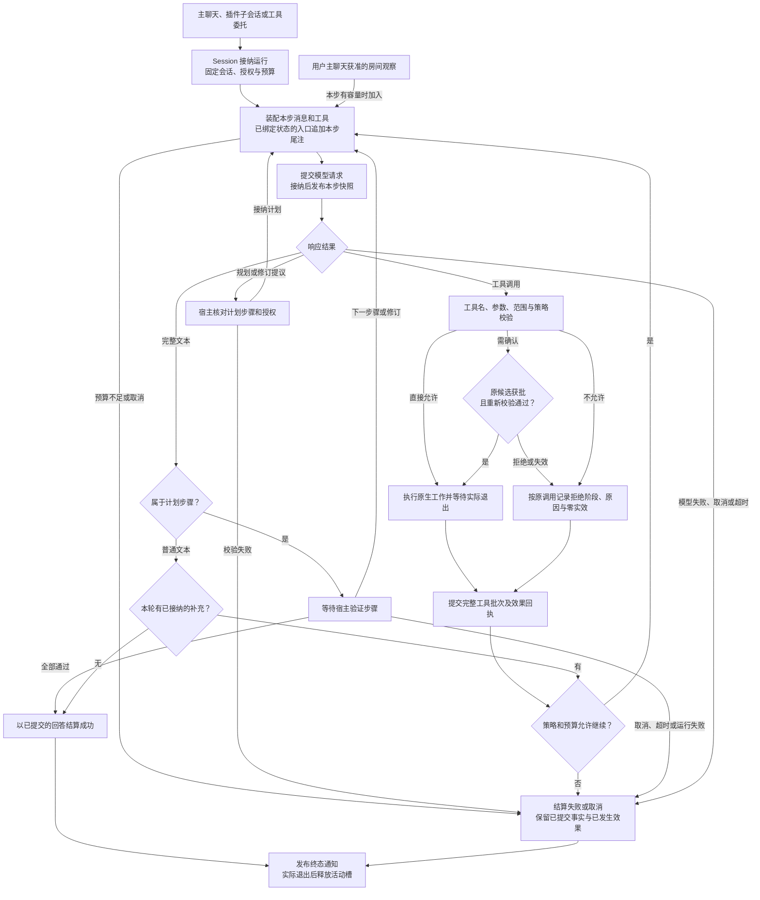

# Agent循环与上下文设计

本体的主会话、插件托管的子会话和受控终端委托共用 `Session`、`RunLoop` 及工具执行器。每个入口独立绑定历史、受众、授权工具和证据范围。一次回合可以发起多次模型决策，每次决策可以有多次传输尝试。核对基线为主线 `8fce20e`。[Session](../../modules/agent/src/session.cpp) · [RunLoop](../../modules/agent/src/run_loop.cpp) · [子会话宿主](../../apps/host/src/subagents.cpp)

**目录**　[决策、工具与结束条件](#决策工具与结束条件) · [系统规则与工具契约](#系统规则与工具契约) · [冻结决策与状态查询](#冻结决策与状态查询) · [关注与唤醒](#关注与唤醒) · [容量与长会话](#容量与长会话) · [插件事实与工作](#插件事实与工作) · [输出、回放与验收](#输出回放与验收)

## 决策、工具与结束条件

- **普通问答**收到完整文本后准备结算。允许本轮补充的入口若已收到新原话，就把阶段文本与这些原话带入同一回合的后续请求。工具执行中到达的补充排在该批全部工具结果之后。每条补充记录实际模型步骤或未带入原因。失败或取消保留此前已提交的事实。[回合循环](../../modules/agent/src/run_loop.cpp) · [原话回执](../../modules/agent/include/dafeiyu/turn_input.hpp) · [离线回放](../../apps/host/src/trace_replay.cpp)
- **终端委托**中，`/run` 授予一个只读工具，`/run-confirmed` 允许具体变更候选进入审批。`/task` 固定同一个插件实例上的首读、变更、末读，宿主核对步骤顺序、实际回执和期望值。原候选的批准与实际调用分开记录。[应用入口](../../apps/host/src/application.cpp) · [工具批次](../../modules/agent/src/tool_batch.cpp) · [读回验证](../../apps/host/src/tool_verification.cpp)
- **原生观察与计划控制**通过显式宿主入口接纳。观察触发默认只读，变更分支要求声明条件、可信当前采样和确认。计划步骤支持有界重规划、目标修订和等待验证时换入新观察。诊断和离线比较沿用运行身份和版本信息。[观察控制](../../modules/agent/src/observation_controller.cpp) · [计划与观察入口](../../modules/agent/src/session.cpp) · [离线场景](../../modules/agent/tests/offline_scenario.cpp)

工具调用按原 `tool_call_id` 返回。执行器对实际参数、当轮范围、当前授权、任务修订、代码租约、观察时效和预算逐项复核。已经变更目标的输入可使原变更候选失效，合法的独立只读观察仍可继续。长工作先返回接纳或拒绝，后续进展、实效及实际退出始终关联原工作。只剩外部依赖时等待新的原话、工作回执或期限，只挂起依赖该条件的步骤。[执行复核](../../modules/agent/tests/session_action_guard.cpp) · [实效回归](../../modules/agent/tests/goal_effect_guard.cpp)

| 裁定类别 | 模型做下一次判断所需的事实 |
| --- | --- |
| 参数、范围或任务修订 | 参数不合契约给出字段路径、实际值和允许类型或枚举。工具未在当步授权、已禁用或已撤销时返回当前适用范围。收到新的用户补充时关联原话和目标修订。 |
| 审批或观察 | 区分等待、拒绝、过期及撤销，带原审批号。观察失效时带对象、原采样号、时效或覆盖缺口，以及受影响的步骤。 |
| 执行、实效或退出 | 分别说明是否接纳、已知部分实效和是否退出。结果不明时沿原工作查回执。连续失败的进展比较采用工具、语义参数、原因、相关前置条件和实效，排除新时间戳、尝试号和跟踪号造成的差异。[当前指纹](../../modules/agent/src/tool_batch.cpp) · [无进展判断](../../modules/agent/src/run_loop.cpp) |

## 系统规则与工具契约

1. **职责与信息来源。** 当前入口承担什么任务，哪些是真人原话、宿主记录、插件观察或外部数据。
2. **授权与行动边界。** 哪些工具可以请求，哪些前置、范围和批准由宿主在执行前复核。
3. **判断与结算。** 依哪些事实继续、补查或等待，用什么回执确认结果与退出。
4. **输出与投递。** 谁会收到文本、工具发言或内部报告，怎样核对实际送达。
5. **人格与风格。** 身份、语气、详略和措辞如何适配受众。换人格时可以单独审查表达变化，真实性、权限与结算仍由对应规则段承载。

人格来自本体的版本化档案。普通聊天、书房点名及声明面向玩家的子回合可复用表达层，插件提供自己的领域规则与原始事实。内部回报单独声明输出去向。每条原话与工具结果记录真实来源和可用的原事件时间，重投及重放沿用首次记录。用户文字中的 `<status>` 按外部数据编码。适配器以供应商支持的原生角色传输，保留工具配对、推理续行和原调用身份。[规则渲染](../../modules/agent/src/prompt_rules.cpp) · [人格](../../apps/host/src/persona.cpp) · [模型编码](../../modules/model/src/protocol.cpp)

工具目录、执行校验及供模型使用的参数契约共用技能定义。当步已知需要的工具立即提供，按需发现的工具在原轨迹位置登记稳定 ID、契约版本和当时的定义。当步过滤权限、可用性及计划子集后稳定排序，重复发现指回首次记录，升级、撤权或绑定切换单列变化。历史引用仍须服从当前授权。主线已在宿主和一个 MC 绑定验证这一流程。[有序工具](../../modules/agent/src/tool_catalog.cpp) · [契约追踪](../../apps/host/src/tool_contract_trace.cpp) · [跨轮回归](../../apps/host/tests/tool_contract_trace.cpp)

普通决策使用本次原话、原工作实效及最近实际送达文本。规划与修订引用目标、受保护的已完成前缀、允许的工具 ID 和可核查的观察，模型此步的可执行工具数为零。步骤执行只授予该步可用工具。请求 Hook 可依契约改写系统字段，核查实际效果以 `model.prepared` 和供应商编码为准。[计划协议](../../modules/agent/src/plan_protocol.cpp) · [固定回放](../../modules/agent/tests/loop_projection.cpp)

## 冻结决策与状态查询

每个决策固定会话与绑定代次、用途、目标修订、授权和事实截止号、判定时刻、当步关注和模型预算。只读投影从已采事实生成有序消息、契约与证据引用。工具结果先按原调用闭合，再追加本步唯一的一条 `user` 状态尾注，来源为 `host_status`。模型客户端接纳实际请求后，宿主才把新版本发布给该绑定。[实际提交](../../modules/agent/src/run_loop.cpp) · [当前状态投影](../../modules/agent/src/decision_status.cpp)

| 字段或边界 | 实际含义 |
| --- | --- |
| 身份和作用域 | `dafeiyu.agent_status/1` 的 `scope`、`snapshot`、`turn`、`step` 标识一个绑定下的一次决策。有任务时才附任务身份。`asOf.event` 是接纳事实号上界，`asOf.utcMs` 是这一步判断的时刻。 |
| 声明与采样 | 本体与插件按命名空间登记稳定键、schema 版本、描述、值类型及默认关注。采样附对象、来源、原事实号和可取得的时间与有效期。无采样、已过期、未知实效与实测为零分别表达。[注册与校验](../../modules/agent/src/decision_status.cpp) |
| 展示与读回 | 尾注最多展示 8 个显式项、16 KiB，完整读回连响应最多 64 KiB，同一绑定保留最近 32 个已发布版本。`status_read` 按快照号查询可读原件，执行前沿原只读授权复核。提供方可用 `snapshotRead=false` 标明仅供当前决策的材料，快照读回以 `omittedDecisionOnly` 给出省略项数。超出保留窗口、清空、换绑和撤权均返回可区别的结果。[查询实现](../../modules/agent/src/decision_query.cpp) |
| 待办与环境 | `host.plan_todo` 带创建／最近更新时间和原验证证据。终端明确给定的工作目录、系统和可取得的时区属于该次开发任务。游戏现场的角色、维度和库存由桥接取样，标明宿主收件时间，试点采样有效窗口为 1 秒。[待办投影](../../modules/agent/src/plan_status.cpp) · [目录采样](../../apps/host/src/workspace_environment.cpp) |
| 工具数与实效 | `host.tool_counts` 分别表示提出、接纳和实际派发，按会话、回合和上次响应统计。同一原物品堆的领用与余量由领域回执证明；另一堆或失去视野时余量保持未知。[三种计数](../../modules/agent/tests/tool_counts.cpp) · [原物品堆验证](../../plugins/mc/tests/ground-pickup.test.cjs) |

同一快照按号读回时沿用其原判定时刻。相同值重采后可以有新事实号；经过有效期边界，即使值未变化，当前判定也会过期。旧尾注留在对应步骤的 Trace，新的请求只插当前版本。只读查询会返回所需声明与可见范围，零工具的规划步骤由宿主提前装入必要证据。[快照回放](../../modules/agent/tests/loop_projection.cpp)

## 关注与唤醒

当前状态声明接受 `explicit` 和 `implicit` 两种默认值。显式项按本步预算展示，隐式项保存在快照中供获准的查询读取。事实提供方可按任务或原事件提升隐式项。`wakeEvents` 在事件首次实际展示时带原号。[声明校验与快照生成](../../modules/agent/src/decision_status.cpp)

| 模式 | 何时展示 | 何时结束 |
| --- | --- | --- |
| 隐式 `implicit` | 程序维护已接纳的事实、来源及版本，保留授权内的只读查询。任务或事件将它提升为显式时才进入决策尾部。 | 事实按自身保留规则结算或淘汰。 |
| 持续启用 `continuous` | 任务建立时，按实例登记要关注的对象、项目和原因，随后每个相关决策展示当前值。 | 完成、取消或替换任务时，只释放该实例持有的关注。其他任务或用户持有的关注分别结算。 |
| 次数启用 `counted(n)` | 为指定事件或任务的后续 `n` 次相关逻辑决策展示该项，`n` 为正整数。一次性显式关注即 `counted(1)`。 | 次数用尽后解除该份关注，原件和当时的轨迹仍可查。 |

任务按标识和对象持有自己的关注。两个任务共用一个采样时，完成其中一个只释放其持有的那份。事件在实际展示且宿主收到有效模型响应时扣次。预览、预算裁剪、分派失败、重试或重复回调均按原步骤和原事件号处理。事件首度实际展示时，`wakeEvents` 保留原号；持续关注与一次性关注重合时合并展示。[冻结与计次](../../modules/agent/src/decision_attention.cpp) · [任务回归](../../modules/agent/tests/decision_status.cpp)

唤醒由宿主及领域声明决定。MC 试点只对选定玩家未执行审批的终态使用已入箱事件触发一次展示，随后仍可查询旧快照。书房主聊天的感知按既有决策机会送入，空闲收件保持静默。扩大领域唤醒和授予新动作需在对应计划另行核定。[MC 审批](../../tests/mc-companion/mc_confirmation_route.cpp) · [书房感知](内置书房设计.md#事实归属与感知)

## 容量与长会话

`context_window_tokens` 与 `reserved_output_tokens` 可共同配置，同时适用本地消息和字节硬限。输入按实际编码的 UTF-8 字段与封套估算，供应商返回的真实 token 与缓存用量单独记载，缺失保持未知。在分派首个工具前，检查整个候选批次能否容纳原调用与回执，预留不足时整批零派发。[容量计算](../../modules/agent/src/context_capacity.cpp) · [工具批次](../../modules/agent/src/tool_batch.cpp)

压缩优先保留近期原话、待答项、活跃授权、未确认实效及未送达答复。可归档的完整工具批次在确认退出后整体处理。普通历史先按完整轮次组合，仍超预算才用旧回答的首尾、字节数、代次和原消息位置代替正文。通用原件保留上限为 8192 条、8 MiB；模型视图还受 1024 条、1 MiB 等协议限制。宿主可通过 `Session::read_evidence` 在原会话代次按消息区间读取，清空后旧代次失效。[原件读口](../../modules/agent/src/session.cpp) · [协议预算](../../modules/model/src/messages.cpp)

## 插件事实与工作

子会话由宿主托管，持有独立历史和当轮工具。`dfy.agent` 保留打开、提交、查询、取消和关闭；第三版支持按单次请求降低或关闭思考。可选 `dfy.agent.facts` 通过版本协商，第一版接纳绑定事实与工作修订，第二版增加有序接纳、最终实效和原号读回。缺少该能力或未启用试点的插件沿既有接口提交。[公开 ABI](../../sdk/include/dafeiyu/agent_abi_v2.h) · [子会话事实接口](../使用说明/插件接口说明.md)

新事实须匹配来源、绑定代次、事件及修订。相同身份和内容的重发复用原接纳，同号冲突、缺序和失效代次各有结果。基线准入失败保留原有效状态。每个工作分别记录接纳、最近实效和退出，只有已退出且实效最终的工作可归档。有序索引保留 128 个工作原件、最近 128 个归档指纹和每个工作至多 16 版。在 128 个位置均受未决工作占用时，新的变更在派发前受阻，已有工作仍能结算。宿主进程内至多保留 16 份活动与退役索引。[绑定事实](../../apps/host/src/binding_facts.cpp) · [索引回归](../../apps/host/tests/binding_works.cpp)

## 输出、回放与验收

用户可见发言从本入口的原消息或回合沿投递身份防重。普通主聊天与书房点名的非空白最终文本进入持久主聊天，`main_reply` 的成功发言和相同的最终文本复用投递。独立原话可收到相同文字。插件玩家发言走游戏渠道，内部报告和静默结算保留各自去向。Hook 前文本、可见文本、持久接纳和实际可核实的送达分别留有出处。[主聊天发言](../../apps/host/src/main_output.cpp) · [主聊天实收](../../apps/host/tests/persistent_dialogue.cpp) · [MC 确认与回信](../../tests/mc-companion/mc_confirmation_route.cpp)

`model.prepared.input.messages` 与 `messageEvidence` 按下标对应实际消息和来源，`toolContracts` 指回对应定义，`wireSha256` 对应本次思考模式的协议字段。沿原消息、运行、步骤和尝试比对模型响应、宿主裁定、工作效果和渠道实收。重放器用录制响应及原工具排列核对请求，保持旧轨迹可读。[回放实现](../../apps/host/src/trace_replay.cpp) · [开发进度与集成证据](../开发计划/Agent开发计划.md)
