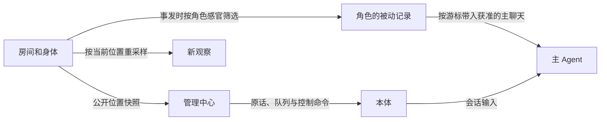

# 内置书房设计

书房是本体的默认原生环境。房间、角色身体和动作由本体推进，主面板读取房间的公开快照，主 Agent 依据当时的角色感知作判断。关闭视图后，本体内的工作继续。核对基线为主线 `8fce20e`。两个贯穿设计的场景是「隔着屏风问台灯」和「去窗边等我」。[原生书房](../../apps/host/src/builtin_room.cpp) · [书房开发计划](../开发计划/内置书房开发计划.md)

**目录**　[事实归属与感知](#事实归属与感知) · [被动记录与现地取样](#被动记录与现地取样) · [身体动作与原回执](#身体动作与原回执) · [已采纳的交互目标](#已采纳的交互目标) · [验证入口](#验证入口)

## 事实归属与感知

| 所有者 | 掌握的事实 | 可见范围 |
| --- | --- | --- |
| 房间 | 实例与代次、布局、书桌旁／窗边／屏风后等具名地点、双向路径、台灯、屏风和物件修订 | 业务线程是唯一写入者，按可控单调时钟推进。受信面板观察公开位置与变化。 |
| 身体 | 角色绑定、当前位置、移动目标、原动作号、阶段和结果 | 每个身体同一时刻只持一个移动目标。按本实例和身体身份取样或查动作回执。 |
| 主 Agent | 熟悉的固定布局、历史观察、当时亲见或亲闻、用户所说与可信设备所报 | 每种来源各有证据和时间。读当前灯态需要能看到台灯，收到用户报告只改变会话所知。 |
| 主面板 | 当前视图、展开状态、草稿、收到的快照版本和本窗最近变化 | 可信页面可看显示快照；身体的感知、抵达和物件实效由原生规则决定。 |

房间逻辑位置与视图尺寸无关。首版可视距离为 3、可听距离为 4 个逻辑单位，边界计入范围，屏风边缘可遮挡视线。点灯时是否看见操作和怎样听见声响，取决于事件发生时的实例、身体、位置和遮挡。身体走近后可获取新的现场读数。[房间与感官](../../apps/host/src/builtin_room.cpp) · [阈值与房间隔离](../../tests/application/application_lifecycle.cpp)

| 输入 | 接收条件 | 大肥鱼获得的信息 |
|---|---|---|
| 台灯状态改变，可看见台灯 | 事件发生时角色与灯处于同一实例，距离在可视范围内且视线可达 | “台灯从亮变灭”，记录地点、时刻及来源。只有确实能辨认操作者时才带身份。 |
| 听到开关声，视线被挡 | 同一实例、听距与隔断条件允许 | “书桌方向传来一声开关响”。听觉载荷只含可判知的声响和方向。 |
| 超距、两种感官都被阻隔、或其他实例发生变化 | 按发生时的姿态与环境修订核对 | 本角色没有这条感知。事后走近可以取得新的当前读数，先前不可感知的事件仍属原范围。 |
| 用户从主面板告诉她“灯亮着” | 由已绑定的用户会话接收，保留发送者和消息身份 | “用户刚才说灯亮着”。直接消息按会话投递，可与亲见事实并存，冲突时能说明各自的时间与来源。 |

## 被动记录与现地取样

环境按事件发生时的身体与感官先裁剪可知字段。每个角色最多保留最近 32 条被动记录。延迟送达仍保留原位置、时间与所知范围，迟到的听觉只含声音与方向。错实例、错身体、重复、乱序、过期和因保留窗口造成的缺口都能从回执辨认。断档后重新取样仅补当前位置有权取得的值。[感知记录](../../apps/host/src/room_perception.cpp) · [原记录及重采样](../../apps/host/tests/room_perception.cpp)

用户发起的主聊天在本来就要发出的请求前，最多装入 4 条该角色的可用感知。宿主实际分派后才推进游标。预算不足保留待送，工具执行中到达的新记录可留给下一个决策。亲见、亲闻、用户原话、具名设备报告及设备所报数值都保留各自来源。内部结算和空闲收件保持原有行为。开关声和用户贴入的相似 JSON 均无法给角色新增直接视野。[主聊天装配](../../apps/host/src/room_decision_feed.cpp) · [送模与重放](../../apps/host/tests/room_dialogue.cpp) · [预算与游标](../../modules/agent/tests/decision_observations.cpp)

## 身体动作与原回执

每个应用实例初始化书房和绑定身体，初始在书桌旁。具名地点间的原生移动在路径开放时每 250 毫秒推进一个逻辑单位，业务线程对不同调度频率采用相同的单调时钟。面板 `room.read` 可读在途坐标及抵达地点，动作结果可按原动作号核对。书桌到窗边以 100 或 500 毫秒推进，半秒时均在 `(2,0)`，一秒时在 `(0,0)` 抵达；关路时报告受阻并保留实位，重投原号不会再移动。[原生动作](../../apps/host/src/room_motion.cpp) · [时钟与阻路验收](../../apps/host/tests/room_motion.cpp) · [正式面板读口](../../apps/host/tests/management_host.cpp)

窗口重建后按新视图身份取得当前快照。命令、消息、回合和动作分别有号，重复命令按原号取回结果。正文消息可从 SQLite 跨启动补读；角色感知、身体位置和动作回执随本次房间实例保存。宿主当前的原生移动不自动从自然语言或新环境事件取得执行授权。[聊天与刷新设计](管理中心设计.md#主聊天与信箱)

## 已采纳的交互目标

下列约束用于后续交付。原生移动与感知的当前支持范围见前两节。对应开发单元为书房 14～20。[书房开发计划](../开发计划/内置书房开发计划.md#待办)

| 环节 | 设计约束 |
| --- | --- |
| 读环境与动身体 | 用户或模型可通过获准的只读接口查自身、周围、动作回执。同一入口按本体实例和角色可知范围校验。走近查看、移动、停止、等候和设灯另需有效动作候选。 |
| 受理原委托 | 「去窗边等我」中的原话、房间代次、身体、目标、到达后行为绑定在一起。候选有歧义时先确认。执行前核对目标、可达性、身体占用及预算，签发原动作号。 |
| 到达后再回应 | 在同一原动作核对身体进入目标区域，再登记到达与约定的等候，向模型提供核实结果。用户可以先看到受理及途中状态。等候是持续身体行为，回合结束后仍可继续听用户说话。 |
| 停止、改向与设灯 | 改目标先确认旧动作停止并保留实际停点，再按新授权出发。取消与到达按业务线程已经提交的事实裁定。设灯使用“设为亮／灭”的明确目标，重投不制造第二次变化。 |
| 切换与权限 | 关闭或重建视图不影响原动作。换房间实例时撤销旧绑定，迟到回执只归旧动作。哪些空闲事件可以唤醒和哪些场景可以自动授权，保留独立评审。 |

## 验证入口

「隔着屏风问台灯」用同一动作核对可见、可闻、超距、迟到与走近后重采样，再对照实际送模字段。「去窗边等我」的端到端验收须贯通原话、获准参数、在途位置、抵达回执、等候及最终答复。当前原生移动验收只覆盖原生指令到抵达。房间使用可控时钟、模型或传输替身，桌面操作走固定浏览器协议。[书房验收用例](../../apps/host/tests/room_motion.cpp) · [确定性验收范围](../开发计划/内置书房开发计划.md#实施顺序与整体验收)
