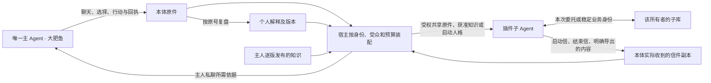

# 本体记忆与知识库设计

大肥鱼是唯一的主 Agent，插件提供的独立循环均为子 Agent。当前本体在同一份本地 SQLite 档案内分开保存主人原话、自己的经历与解释、各所有者的子库、已收信件和已发布知识。本体核对实际身份、受众和授权后，按需装配原件或摘要。更换物理存储后端属于后续设计。各阶段验收见[本体记忆开发进度](../开发计划/Agent开发计划.md#本体记忆与知识库)。

**目录**　[身份与访问范围](#身份与访问范围) · [信箱与共享读取](#信箱与共享读取) · [记录与复盘](#记录与复盘) · [本体自己的选择](#本体怎样复盘自己的选择) · [工具任务与回执](#工具任务结束后的亲历与复盘) · [解释与反例](#跨任务的解释与反例) · [跨工具与渠道的比较](#跨工具与渠道的比较) · [主人原话的版本](#跨聊天的原话复盘) · [普通聊天中的收录与查回](#普通聊天中的收录与查回) · [知识发布](#知识发布与撤下) · [检索预算](#检索和上下文预算)

## 身份与访问范围

本体以身份、当前受众和获准范围决定哪些资料进入这一步模型请求。下图中的原件、解释、信件、知识和各子库在同一份本地 SQLite 档案内按所有者和用途分开保存。



主人原话、独立读回和子 Agent 报告都可以成为知识候选的出处。发布时保留来源类型和适用条件，个人解释仍单独保存在大肥鱼自己的版本链中。

| 层次 | 当前落点 | 交给下一层的内容 |
| --- | --- | --- |
| 身份与授权 | 数据档案号、原消息或运行号、当轮受众、授权修订 | 主人私聊可查获准材料。房间、混合收件和撤权会改变实际装配范围。 |
| 原件 | 主人原话、主聊天实际投递、本体工具任务的计划、派发、回执与前后读数 | 原始事件有稳定身份，派生记录可按号取证。 |
| 复盘与版本 | 原话更正、本人选择的事后解释、单次工具任务整理、跨任务解释 | 保存理解、适用条件、版本关系和证据号，按当前权限展开。 |
| 检索与上下文 | 主聊天按问题调用记忆工具，宿主筛选、限量并装配决策尾注 | 模型获得当轮能引用的原话、判断和出处，聊天实际投递可沿 Trace 对照。 |
| 跨所有者与知识 | 三类持久子库、分身授权、持久信件、长信摘要和有来源的知识发布 | 主人按发布版本授予具体子库读或转述权，并能校正、撤下和核对失效的依据。 |

预设决定可申请的能力，稳定身份决定能接续谁的经历。宿主在会话启动时将运行号绑定到身份，再按当前委托、受众和资料层次签发读写范围。插件代次用于识别本次运行；跨代次沿用记忆需要重新核对持久绑定。

| 身份 | 何时延续 | 可用资料和写入去向 |
| --- | --- | --- |
| 主 Agent 大肥鱼 | 本体在同一用户档案内长期持有 | 本人的经历、当前理解、已收信件和获准的知识；主 Agent 自行决定是否形成新的个人认识。 |
| 一次性任务子 Agent | 同一委托失败重试或中断恢复；新委托取得新身份 | 使用本次交付的材料、获准知识和该任务自己的记录，按约定寄出结果。 |
| 分身 Agent | 由本体绑定其代表的身份、渠道和账号 | 经本体的受控查询入口获得明确授权的主 Agent 材料。读取、改写、向具体受众转述分别授权。社交平台的默认权限仍待设计。 |
| 独立业务子 Agent | 插件声明稳定业务对象，本体核对原绑定 | 独立保存该对象的经历、整理结果和倾向。相同预设的不同业务对象各自持有记忆，通过信箱交换材料。 |

各所有者使用逻辑库和各自的索引。中央目录持有归属、用途和访问范围，物理上可以先用同一个本地数据库。调用者不能通过改写查询词、对象名或原件编号扩大范围。原件展开和复用缓存时都要核对当下授权。

宿主打开档案时核验唯一的规范身份，然后在同一事务提交升级。主人可以用 `/memory profile` 查看本次打开的档案号、结构版本和主聊天记忆修订。在同一份档案升级或重新启动后，原消息号、已收信号和子库身份仍可用。另一份档案即使有相同的局部编号，也须使用它自己的完整原件号。初始身份有歧义、格式受损或档案来自未来版本时停止打开。[恢复验收](../../apps/host/tests/memory_recall/archive_recovery.jsonl)

主聊天的首个实现以数据目录中的逻辑会话号和原消息号定位个人原话。在 SQLite 事务中引用不可变的消息，重复提交沿用原件。撤权留下已撤标记。宿主只在主人直接入口提供获准的原件，状态尾注标明原来源和时间；切换受众或改变授权修订时，运行循环隔离旧模型历史、冻结快照和投递回执。[消息存储](../../apps/host/src/message_store.cpp) · [受众与送模](../../apps/host/src/main_memory.cpp) · [操作说明](../使用说明/构建与运行说明.md#交互命令)

## 信箱与共享读取

三类子库已通过 `dfy.agent.memory` 接入。插件在有效回调中以预设和对象调用 `open_bound`；宿主从加载实例取得包名。一次性委托按委托号续接，独立业务按业务对象续接，分身按渠道和账号续接。同一档案里保存稳定子库号，新的运行仍取得新的会话号。SQLite 中的子库表按所有者访问，主聊天的检索入口只访问自己的记录和明确收到的材料。

插件用 `remember` 显式交付本子会话的记录，同一事件号和内容幂等。插件用 `select_topic` 选择装配主题，宿主最多取两项自己的记录、一份明确共享的主人原话。向渠道输出的回合另验转述权。选择主题、切换受众或撤权时隔离旧历史，在途旧答复停止交付。插件陈述保留子库作者身份。清单包名和业务对象是可信插件边界内的绑定依据。

主人可在管理终端使用 `/memory avatar PLUGIN CHANNEL ACCOUNT off|read|write|both private|relay [REF]`。写权只允许写分身自己的记录。共享原话须使用本档案获准的原件号，宿主在装配时复核原件。分身在该来源授权下写入的记录也保留来源依赖。撤权影响以后读取和在途答复，已经经授权送达的内容保留其原投递事实。[接口](../../sdk/include/dafeiyu/agent_abi_v2.h) · [验收](../../tests/application/child_memory.cpp)

插件声明怎样装配子 Agent 的启动上下文，本体交付获准的人格版本和任务材料。启动、结束事件关联原委托及本次运行。结束信可以只带状态、附结果摘要，或携带明确导出的行动记录和复盘材料。插件可以先整理再寄出；宿主也可以对已交付的长材料整理，摘要保留结果、未完成项、依据和疑问。

信件固定寄出时的版本。插件用 `dfy.agent.letters` 为已绑定的子会话指定稳定交付号，可选择在内部回合装配本体人格。开始、结束各留一封信。宿主分开记录实际运行结果与发信人撰写的报告。结束前关闭而没有已核实结果时记为“关闭，结果未确认”。同一交付同参重试返回原信号；已有结束信时阻止重派原工作。

对分身来说，委托还固定启动时共享的主人原件。换成另一份原件后，原信号仍指向原来已经交付的副本，新委托使用新的交付号。重试、结束和导出会重验范围。旧档案里开始和结束来源不一致的报告保留原始记录，同时停止把该报告、它的摘录及依赖它的知识或解释送给模型。其他同来源的独立原件继续按各自的权限可见。[交付来源与旧版验收](../../apps/host/tests/memory_recall/letter_authority.jsonl)

仅状态模式交付运行状态。摘要模式交付发信人摘要，省略摘要时由宿主取有界原文预览并标明截取。原件模式可附 8192 字节内的原报告及明确选择的一份自己的笔记。主 Agent 默认看到带作者和受众的概览，可按接收方的副本号分段展开。单次查询最多三条，证据数组限 2048 字节。

插件也可以协商 `dfy.agent.letters@2`，在启动时选择本体整理模式。宿主实际收件后，大肥鱼在空闲的独立请求中读取接收方持有的正文，按原段的位置为行动、发信人报告的结果和待确认事项选取最多三条依据。宿主从原件取字并核实位置，记录发信人、整理者、起止字节与节选标志。主人私聊默认读概览，按 `bodyRef` 及摘录的 `offset` 可展开当时原文。没有正文、正在整理、已整理及回退各有状态。撤权中断在途整理。无效提议、后端失败或窗口放不下正文时，仍能按当前权限查发信人摘要与已有原件。[原信整理](../../apps/host/src/letter_digest.cpp) · [通用验收](../../apps/host/tests/memory_recall/letter_digests.jsonl)

先将信件和来源一同写盘，再经宿主[信箱调度](项目架构设计.md#事件与信箱)传递稳定编号。宿主实际取件后，普通主人私聊有待收提示，通过 `memory_search` 的 `letters` 视图查询。主 Agent 读到原信后，可用 `memory_ack` 签收。签收独立于形成个人记忆；断点恢复分别沿用原入箱、收件与签收状态。房间和混合受众不装配这些材料。[私聊收件](../../apps/host/src/main_letters.cpp) · [通用语料](../../apps/host/tests/memory_recall/child_letters.jsonl)

## 记录与复盘

记录保留所有者、描述对象、来源、原事件身份、发生与获知时间。本人亲历、用户原话、插件转述和事后推断可以关联。一次经历产生的多份摘要沿用同一依据；各自独立的经历保留独立身份。

经历保存当时的原话、感受与实际结果。新解释追加修订并关联支持或反驳它的经历，自身取舍改变时更新带适用条件的倾向。日常决策可以只读相关倾向，遇反例或追问时再按权限展开。个人记忆不设自动遗忘。知识由主人审阅候选的来源、适用对象和版本后发布，保留校正与撤下记录。其他渠道如何提供可独立核验的亲历见[待决策项](../开发计划/Agent开发计划.md#agent-决策-3)。

### 本体怎样复盘自己的选择

主人在普通私聊里给出选项时，大肥鱼可以当场选一项并说出愿意公开的简短感受。当时说不清原因也可以留空。宿主核对当前来信中的条件、选项和委托原句，在同一笔事务内保存实际发出的答复与亲历索引。每次选择以档案号和投递消息号定位，并关联来信号。重发同一次选择沿用原号。本轮支持的事实是她在主聊天里作出的决定，外部动作的完成情况需要相应渠道的实效回执。[选择与交付](../../apps/host/src/main_experience.cpp)

同主题再次发生时，投递回执提示有旧经历可比较。遇到反例、相似处境或主人追问，主 Agent 可在当前或后续私聊查阅两至三次亲历，再决定是否复盘。摘要只能引用本轮更早步骤实际读到的原件。原件保留当场感受、已发送的选择、适用条件及时间。短来信可随原件展开；较长来信保留逐字条件、选项和委托片段。

| 想回答的问题 | 需要的依据与查回方式 |
| --- | --- |
| 我现在怎样解释当时的选择？ | `why` 把第一场作为要解释的经历，后续场次提供对照。事后推测单独保存，查回时可以同时引用当场说法、后来遇到的情况和各场投递号。新证据可修订解释。 |
| 我在类似情境下真的改选过吗？ | `change` 要求首尾实选不同、主题与所摘条件相同、备选集合一致。每场均须有自选判断和宿主可独立识别的直接委托，如主人在句末说“由你决定”。其他措辞、指定选项和条件不同的经历仍可供解释。变化的内容取自各场已发出的答复。 |
| 这句话依据哪几次经历？ | 按主题查最近的对应复盘，按最初那场的投递号查它后来的复盘，投递号属于修订末场时可查对应版本，同号也作为起点时优先回答关于该起点的问题。`episodes` 可逐一展开各场原件。每轮最多三场，预算紧时先给出所有场次的实选和出处。 |

撤回某场投递或其来信后，以它为据的判断停止交付。读回旧快照也受此边界约束。主人私聊与房间、混合收件分别装配上下文。由模型识别情境中的关键条件和事后的可行解释；宿主核验逐字依据、明确委托、独立投递和访问范围。[存储与检索](../../apps/host/src/message_store.cpp) · [通用语料](../../apps/host/tests/memory_recall/experience.jsonl)

### 工具任务结束后的亲历与复盘

本体直接接纳的只读工具任务、需确认的工具任务，以及有前后读回的核验任务，在原运行实际退出后保存一份记录。插件可以执行工具，记录的行动者仍是调用该工具的本体。原运行绑定宿主实例、会话、回合和工具提供实例。工具任务使用独立上下文，主人可以接着刚结束的任务追问。切换到房间、混合来信或新的授权修订时重新装配上下文。子 Agent 的独立工作和信箱转述继续由原所有者持有。[本体任务入口](../../apps/host/src/application.cpp) · [原运行取证](../../apps/host/src/main_task_memory.cpp)

| 私聊中想知道什么 | 可以引用的证据 |
| --- | --- |
| 当时想做什么 | 用户目标、宿主约定的期望值、主 Agent 已形成的计划，以及模型确实提出的工具调用。每项提议都保留当时的调用号、参数和步骤。 |
| 实际做了什么 | 执行器分别记录接纳、派发和退出回执。受拒或启动前取消可以查到原提议；已派发的工作保留提供方报告的效果，包括生效、未生效和未知。回合取消后已发生的效果继续可查。 |
| 结果有多确定 | 有独立核验的任务记录目标是否与动作后读回相符，同时指向动作前、动作后两份原回执。只有工具自报时保留“未核验”。目标本来就满足时，读回可以确认目标，同时工作回执仍为未改变状态。 |

回执与复盘待办一同写入 SQLite。本体先推进前台任务、排队对话和到件信号，空闲时每次最多整理一项，按“读回与目标相反、已派发且实效未知，或回执报告生效而目标未核验、首次证实某项状态转变”排序。空闲整理根据原目标和原回执写回简短结论及出处。相同工具和读口的重复转变、例行只读、仅有计划以及启动前的拒绝保留事实供查。待办可跨启动续办，整理过程只读已有证据。[任务存储与整理](../../apps/host/src/task_store.cpp)

普通主人私聊可用 `memory_search` 的 `tasks` 视图按目标词或工具号查找。任务号形如 `档案号/task/序号`，概览附上原行动、工具回执和已有的核验出处。`firstAction` 与 `nextAction` 串起同一运行中的全部提议。按原件号能展开参数和回执正文。概览以省略号标出截短的文字，目标、计划和期望值可分别用任务号加 `/goal`、`/plan`、`/expected` 展开。长原文按 `nextOffset` 分段续读。私聊每轮最多查一次、装三条，证据数组限 2048 字节。撤回任务号后，其行动、回执、复盘和待办一同停止交付。[通用任务语料](../../apps/host/tests/memory_recall/tasks.jsonl) · [实际调用与投递验收](../../tests/application/task_memory.cpp)

管理中心的「旧任务」卡把选中的完整任务号与接续原话一并入库。宿主重核任务属于当前档案且仍可读，以独立的主人私聊启动回合。首次送模前读取一份任务概览，以已入库的接续消息号标记证据。模型可以继续按 `memory_search` 的当轮额度查原回执。房间和混合受众仍按实际收件范围装配。[接续装配](../../apps/host/src/main_task_memory.cpp) · [管理中心协议](管理中心设计.md#消息回执与分页)

`app.task_resume` 用同一份 T03 SQLite 快照启动独立进程。固定模型替身在主动查回组的第二次请求、接续组的第一次请求收到同一概览，均可追到目标 `idle`、独立读回 `focus` 和目标未达成的核验。用例打印实际编码请求字节数，并核对同名任务、跨档案、撤权及合入房间来信后的送模范围。[离线对照](../../tests/application/task_resume.cpp) · [跨进程入口](../../tests/application/task_resume.cmake)

`ui.task_resume` 从重启后的正式管理中心点选两张同名卡中较早的 T03。固定模型核对首包中的原行动、工具回执和独立读回编号，Trace 对照实际请求与回复投递。[端到端验收](../../tests/desktop/ui_history_host.cpp)

### 跨任务的解释与反例

本体按实际变更工具和独立读回工具归集可比较的任务。一个任务号只计一次，保留动作前读数、原目标、实际派发的动作、工作回执和动作后读数。包含完整核验的例行重复也能为判断增加独立依据。只有计划、被拒的提议和缺少独立读回的任务仍可在任务原件中查询。

本体先处理前台、来信和单任务待办，连续空闲五秒后，才以大肥鱼的人格发起一次无工具的后台推断。首次比较两次任务，随后按原任务号逐次加入新经历。每次最多交给模型四份观察，包括本次、近两份可比依据及已有判断的一个反例。游标跨重启持久化。前台到件或撤权会打断推断，迟到答复失效。[空闲调度](../../apps/host/src/task_reflection.cpp)

| 判断怎样变化 | 宿主依据与私聊查回 |
| --- | --- |
| 形成并获得支持 | 大肥鱼用自己的话提出解释，同时给出可检验的适用条件与预期。至少引用两次独立且支持该判断的任务。宿主用截至当次的全部同组读数重验。相同条件与预测再次得到支持时追加一版。 |
| 遇到反例 | 新回执一旦与当前预测相反，当前解释即标为受到挑战，查回先给出反例。模型可以暂缓判断。保持原预测同时限定原先的适用范围，可形成收窄版；更改预测或重订条件，可形成修正版。两者都须引用使旧判断失效的经历。 |
| 看现在或当时怎么想 | 主人私聊的 `understanding` 视图按工具、任务目标、任务号或解释版本查。`claim` 是大肥鱼的解释，`facts` 列出实际读数、工作效果和可展开的行动、前后采样与回执号。先给出仍与当前判断冲突的反例，再列促成修订的旧反例和该版明确引用的支持材料。其他吻合原件可继续翻页。每项注明是否被该版引用。新版本保留上一版和被修正版本的引用，历史版按当时已有的证据展示。 |

当前条件支持不限、指定动作前读数或指定目标，预测支持达到目标、读数改变、读数不变或读到指定值。自由文本中的主观原因仍属大肥鱼的理解。私聊查询每轮一次，证据分页最多三项，解释和证据合计按 2048 个 UTF-8 字节控制。撤回源任务会停用同组中依赖其证据范围的版本，并从仍可用的原件重新评估。其他工具组独立延续。[校验与版本存储](../../apps/host/src/task_understanding.cpp) · [通用语料](../../apps/host/tests/memory_recall/understandings.jsonl)

普通聊天追问“归架时学到了什么”时，主 Agent 可以从问题提炼“归架”“索书号”等最多三个词，查询当前解释的正文、工具号和已核验任务的目标。宿主先比较命中的不同词数，再比较是否命中完整工具号或完整目标。平分时只交付需要澄清的状态。精确原件或版本号单独查询，已撤权及被取代的文本不能通过主题间接命中。问现场状态仍需新采样。固定后端评测包含 32～4096 次观察，每档 21 问均符合预期，证据数组最大 1934 字节。当前规模继续使用 SQLite 的词面匹配，由主 Agent 提出同义词。开放问法的语义质量、更多样的语料和更大规模需另测。[通用问句](../../apps/host/tests/memory_recall/understanding_queries.jsonl)

### 跨工具与渠道的比较

主人先为比较登记对象、度量、单位和适用条件。比较方法有两种。按目标达成情况比较时，两种不同工具可以各有自己的预期读数。按原值比较时，使用完整的读回值。每份材料还标明采样检查点，指向主人声明要核对的同一次状态。任务启动时可以绑定，事后也能按原件号归入比较，查询会标明是哪种方式。重复添加同一份原件只计一次。

两条不同动作路径提供实际读回后，大肥鱼可在空闲时解释这些经历。同检查点的两个不同读工具给出相异可比值时，读取结果优先带回双方出处，解释须保留疑问。检查点不同的变化可说明条件差异。子 Agent 的结束信保留发信人和原信号，单靠转述不足以形成大肥鱼的跨工具亲历结论。比较的对象、单位和检查点取决于登记方，宿主只能核实行动、读回与归属。

私人聊天可用比较键、版本号或一至三个主题词查回。用对象或主人登记的别称定位，再用度量、条件、采样检查点缩小范围。多个词须能在同一组材料中得到支持，同等匹配时询问具体对象或条件。撤回全部依据的比较退出主题检索。解释有作者和引用，事实可继续展开到动作和原回执。新读回推翻旧结论时会先标为受挑战，空闲提交的新解释可沿上版号追溯。撤权与依赖版本停用在同一事务提交。[证据选择和修订](../../apps/host/src/case_review.cpp) · [通用语料](../../apps/host/tests/memory_recall/comparisons.jsonl) · [近似对象与歧义测试](../../apps/host/tests/memory_recall/comparison_queries.jsonl)

长历史的数量和检查点分歧由 SQLite 索引聚合。宿主保留至多六项优先见证，包括实际存在分歧的两份读回、最新动作、其他路径或读数以及最新报告。当前页的其他成员按序取回，只展开实际需要的原件。代表性的最新一项恰好与分歧双方各有一个属性相同时，也可定位真正互相矛盾的两份来源。数据库仍须处理符合范围的索引，深页耗时与原件装入量分别计量。[单组长历史验收](../../apps/host/tests/memory_recall/long_case_queries.jsonl)

单工具系列、跨工具比较和长信整理共用一个空闲调用槽。宿主等待连续五秒安静，跳过当前为空的类别。结论、延期或回退与下次从哪一类开始在同一事务提交。主人插话时立即优先处理前台，迟到的解释失去写回资格。重新启动会从最后一次完整结算后的类别继续；未完成材料仍在原队列中。[混合待办验收](../../apps/host/tests/memory_recall/idle_schedule.jsonl)

#### 两个业务渠道的现场采样

主人可以在私聊里问“物流交接和馆藏交接的两次称重能相互印证吗？”。主 Agent 用 `memory_search` 的 `observations` 视图，一次提交两个完整任务名或本档案的读回回执号。任务重名时须澄清。宿主从已派发、成功返回的只读工作或变更任务的最终核验读回取证，查回时重新检查两边的读取权。

渠道用 `dfy.observation/1` 标明对象、度量、检查点、采样方、采样号、展示名、十进制原值及单位。对象、度量、检查点与采样方使用双方约定的带命名空间标识；业务插件负责把本地登记号映射到这些标识。物流磅单的运单号、馆藏台账的登记号随各自原回执保存。以下是一份直接读回，插件可附加原业务记录。

```json
{"format":"dfy.observation/1","object":"assets:B7","measure":"quantity:gross","checkpoint":"audit:R1","observer":"scales:quay","sample":"W18","label":"交接箱","value":"1.25","unit":"kg"}
```

转发信封只有 `format` 和 `forward` 两个字段。`forward` 填本档案里更早的直接读回回执号。宿主沿号重读原件，保留投递与原件各自的工具和回执号。两个入口若引用同一回执，或所标采样方和采样号相同且内容相符，只计一次。多跳转发和已撤回的来源均无法取得本轮比较结果。

| 核对项 | 可向主人说明的依据 |
| --- | --- |
| 对象和度量 | 以原件里的稳定标识为准。同名异物、毛重与净重均分别报告。 |
| 检查点和采样来源 | 对象、度量及检查点一致，且双方原读口和采样方分别独立，才据数值判断一致或冲突。来源独立性依赖渠道如实标注设备与采样号。 |
| 单位与数值 | 支持质量的 `kg/g/mg` 和长度的 `m/cm/mm`，用十进制移位精确换算。原值为最多 24 个字符的非负十进制字符串。未知单位、不同量纲及无法解析的数值保留原读数。 |
| 原件追溯 | 每个判断带理由、双方原值和回执号。用 `tasks` 视图展开原回执可读到工具原始输出。比较在当前回合计算，现有档案无需迁移。[比较实现](../../apps/host/src/channel_observation.cpp) · [通用语料](../../apps/host/tests/memory_recall/channel_observations.jsonl) |

宿主解析至多 4096 字节的采样信封。两份证据共用 2048 字节的送模预算。字段较长时保留判断和双方出处，再成对装入核对字段，剩余内容可按原回执号展开。

### 跨聊天的原话复盘

主人再次提及已收录的主题，或明确更改约定时，普通私聊的收录回执会提示大肥鱼比较原件。即使中途退出，查询选中尚待比较的原话时也会从当前索引重建提示。主人追问“我当时怎么说的”同样可以触发对照。单条原话可以照常引用；同主题的两件事情分别保留。临时例外、转述和含义不明的矛盾需要结合上下文判断。[主聊天判断与工具](../../apps/host/src/main_memory.cpp)

大肥鱼在本轮查回两份有权限的原件，比较对象、条件和意思，再提交原件号、各自的逐字摘录和关系。重述给同一版增加一份依据，提及次数按不同原消息号计算。明确改口追加一版，保留这次更正所依据的旧原件。宿主在同一事务内复核受众所选的原件、当前授权、主题、引文和顺序。原消息次序与来源时间不支持“后来改口”时，原话保持分开。同号重试沿用已记录的关系。[存储与版本判断](../../apps/host/src/message_store.cpp)

| 主人想知道什么 | 私聊查询带回的依据 |
| --- | --- |
| 现在以哪条为准 | `current` 为每项已整理的当前版本选一份仍获准的代表原话，附逐字结论、可见提及数和最近依据号。另有更正待比对时标明 `needs_review`。尚未整理的原话单独返回。 |
| 当时怎么说、后来怎么改 | `history` 按版本返回，分别标出当前和已替代的说法。`previousReference` 指向这次更正所比对的旧原件，按当下授权提供。 |
| 查看指定那一次的原话 | `originals` 可按主题或稳定原件号选取原文、时间和渠道。主人也可直接输入 `回想 会话号/消息号`。 |

三种查询共用每轮一次、最多三条、证据数组 2048 字节的预算。撤回一份原话后，只使用同版本尚获准的依据；当前版本的全部依据撤回后，上一版只可作为历史查询。第三版档案中的原件保持原号，可在新的私聊中参与复盘。[通用复盘语料](../../apps/host/tests/memory_recall/reflection.jsonl) · [实际送模与聊天投递验收](../../apps/host/tests/dialogue_memory.cpp)

### 普通聊天中的收录与查回

在支持工具调用的主人私聊中，大肥鱼判断这条话对未来是否有用。长期偏好、持续约束、后续承诺、有后续用途的经历和明确更正可以收录。临时要求只用于当前任务，转述和猜测保留其不确定性。对方要求保密或拒绝保存时跳过。一次收录引用整条短原话，混有私密内容时也应跳过。模型提出类别、适用范围、主题和原话片段，宿主仅接受长期适用的提议，核实片段来自本轮实际接纳的真人消息，再把原件号写入回执。重复写入或撤权遵循同一套规则。[主聊天判断](../../apps/host/src/main_memory.cpp)

当前对话已足够作答、或问题只需要常识时直接回应。确实需要旧依据时，主 Agent 可在一轮内提交一次查询，给出一至三个主题词和所需条数。宿主按完整主题优先、其次主题包含词、同级原消息由新到旧排序，多个词命中同一原件只取一次。单事实最多一条，多事实或对照最多三条。最多考察前十二份候选，逐条计算含原件号、原时间、渠道、主题、原话和分隔符的 JSON 数组，最多 2048 个 UTF-8 字节。过大的候选跳过，继续尝试下一份。无命中与命中受限分别回执；更正保留前后两条供按需对照。[检索与计量](../../apps/host/src/message_store.cpp)

原件只在本轮检索后的决策尾注中出现，工具回执保存数量和截断标志。重新读取旧状态快照可以取得当时的其他状态和省略项数。房间及混合收件沿用原受众隔离。预算约束本轮检索新增的证据数组，聊天历史、模型自己复述的文本和工具定义另行计量。[通用用例](../../apps/host/tests/memory_recall/dialogue.jsonl) · [送模核对](../../apps/host/tests/dialogue_memory.cpp)

## 检索和上下文预算

### 未登记说法与相近对象

主人问“育苗房的水汽表晨检怎么样”时，如果“水汽表”是育苗房湿度计的已登记别称，主聊天可以查回这组比较的原件。检索会在同一组里核对完整别称、登记对象上的位置和有效检查点。整句可以是第一次出现。“苗圃空气含水探头”缺少这样的对应关系，当前返回无依据。

比较键和本档案原件号仍可直接定位。普通问词先按登记字段查找。对象名称没有整项命中时，宿主核对全半角 ASCII、大小写和组合表达，沿用编号中的前导零，并检查连续数字的边界。“样品盒0”不会带出“样品盒02”。条件或检查点可以用“的”或空格和完整对象组合。别名前的位置必须出现在该组登记对象的开头。所有问词须由同一组支持。完整登记名的原件已撤回时，旁机的子串命中不能替代本机。多组同样符合时请主人澄清。[词面检索](../../apps/host/src/case_search.cpp) · [组合条件](../../apps/host/src/case_composition.cpp)

离线对照固定模型提议的主题词，逐题核对第二份模型请求里的比较号、来源及实际聊天投递。52 题中有 32 个有标注目标的问题，另有 20 个相近对象、冲突条件、歧义或权限对照。在 32、512、4096 个比较组中，词面基线每档找回 8 个目标，有 1 次误配。新规则每档找回 24 个目标，0 次误配。组成这 24 个目标的是 8 个词面对照、10 个组合说法和 6 个书写变体。8 个需要推断同义关系的改述仍无依据。另有 12 步跨重启管理用例，涵盖追加及删除别称、撤回原件、同形名字与混合字宽的编号。[冻结问句](../../apps/host/tests/memory_recall/comparison_paraphrases.jsonl) · [变更用例](../../apps/host/tests/memory_recall/comparison_term_changes.jsonl)

对实际无结果的位置，另用相邻字符对的 Dice 系数尝试补查，保留同组条件约束，并列时澄清。在 4096 组时，阈值 0.15 额外找回 2 个目标，同时引入 9 次误配。阈值提高到 0.30、0.50、0.70 后分别有 9、9、4 次误配，额外找回目标均为 0。例如相似度高的“南楼回气格栅”可能指向北楼。这个实验只读取离线档案中的当前有效索引，正式聊天继续采用可核对的登记字段。向量语义候选和真实模型提取问词的表现有待独立评测。[字符相似度对照](../../apps/host/tests/memory_recall/compare_paraphrase_overlap.py)

同机 Release 交替运行两种策略各三次，取每次工具往返 P95 的中位数。往返从固定后端提出检索起算，到后端实际拿到证据为止。

| 比较组数 | 词面基线 | 组合规则 |
| ---: | ---: | ---: |
| 32 | 4.23 ms | 4.38 ms |
| 512 | 4.25 ms | 5.45 ms |
| 4096 | 9.97 ms | 12.13 ms |

4096 组时，两种策略均发出 104 份请求。52 题合计送入模型的证据数组从 6674 增至 17821 字节，完整编码请求合计从 1252164 增至 1264610 字节。单题证据最大值均为 1198 字节。多出的证据对应实际找回的对象。时间是本机离线测量值。

在构建目录运行 `ctest -C Release -R app.comparison_paraphrases -V` 可重放正式策略。独立计分时，使用该测试显示的可执行文件和参数，将末项替换为 `--measure-paraphrases`，保存标准输出。字符对照脚本依次接收问句 JSONL、该输出和本次生成的编号档案目录。词面基线可在提交 `14dca35b` 用相同输入重放。

### 知识发布与撤下

大肥鱼可以在主人私聊中引用本轮真正查到的一至三份依据提议知识，填写条目键、候选版本、所依据的发布修订、主题、适用条件与正文。来源类型区分主人原话、动作后的独立读回和子 Agent 的结束报告。主人也可在管理终端提议。候选只进入审阅范围；主人发布时重验基线和全部来源，同一基线上的竞争草案只有先发布的一份能生效。

校正追加新版本，撤下推进修订并清空当前发布。已撤回的原件会使依赖版本停止交付。主人能按条目审阅修订关系，按候选标签核对内容与依据。子 Agent 通过 `dfy.agent.knowledge` 选择主题，宿主只交付主人授予该子库的当前版本、适用条件与来源类别。私人原件号只交给主人。转述还需该版本的转述权，分身同时需要渠道转述权。发布新版本后重新确定读者。生效中的旧调用会在权限变化时被封住。[发布与读取](../../apps/host/src/knowledge_store.cpp) · [通用验收](../../apps/host/tests/memory_recall/knowledge.jsonl)

子会话已经读到的知识及其来源随实际模型上下文保存撤权依赖。只改下一轮的主题时，查询上一轮的答复仍受原授权约束。真正接纳换题或改受众的请求时，旧答复清除，宿主固定新的上下文范围。撤下旧条目后，独立的新工作可以继续；新旧条目共用的必要原件撤回时，两者都受影响。连续选择同一知识主题可保留此前获准的对话。[上下文与在途撤权验收](../../apps/host/tests/memory_recall/child_context.jsonl)

### 查询步骤

1. 本体用可信的身份、委托、受众和问题用途选库。查原话、查倾向、查知识分别选相应资料。查询过去的版本仍使用调用者此刻的权限。
2. 在获准库中选取指定时点有效的候选，保留来源和修订。先按原事件合并同库副本，再限制各库候选数。实验以精确主题和正文子串匹配为基线，按命中方式、库内名次和稳定次序合并跨库结果。
3. 在整个查询的上下文预算内装入证据。跨库转述只占一次；有分歧的独立来源在预算允许时均保留。每条材料连同来源、版本、编码和分隔符一起计量，单条过大时继续尝试后续候选。证据不足可以返回空。正式入口应让接收方区分无命中、预算截断和库暂不可用。
4. 长期保存量、检索候选数和实际装入量分别控制。用相同资料和预算比较全文、别名及后续语义检索，核对证据召回、越权与过期候选、重复占用、上下文开销及延迟。需要复盘时由各所有者在自己的范围内回看原件。

首轮实验用合成资料预先给出授权和版本有效期，直接计量序列化证据的 UTF-8 字节。后续接入时，宿主还须从实际绑定生成授权、在写入时维护版本，并按供应商实际请求核对 token 开销。历史查询要能分别回答“当时有效什么”和“当时已经知道什么”。

Claude 的会话挂载机制提供了按库指定访问模式的参考；其记忆研究展示了当场记录、空闲整理和向新会话预先带入少量材料的分工。大肥鱼的知识发布规则和各角色权限由本体独立定义。[会话记忆库](https://platform.claude.com/docs/en/managed-agents/memory) · [记忆组件研究](https://www.anthropic.com/research/components-of-agent-memory)
