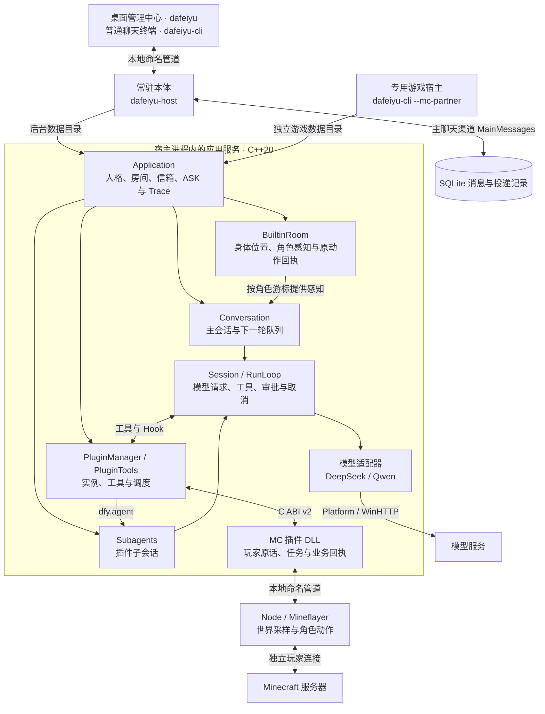

# 项目架构设计

大肥鱼由一个常驻本体持有主会话。桌面管理中心和普通聊天终端连接同一用户数据目录的本体。专用 MC 宿主在自己的数据目录装配应用服务。本文说明进程归属、跨模块消息和插件生命周期。实现核对基线为主线 `8fce20e`。[常驻入口](../../apps/host/src/resident_entry.cpp) · [终端与游戏入口](../../apps/terminal/src/main.cpp)

**目录**　[进程与模块](#进程与模块) · [工程组织](#工程组织) · [事件与信箱](#事件与信箱) · [提问与回信](#提问与回信) · [插件生命周期与回调](#插件生命周期与回调) · [持久化与追溯](#持久化与追溯) · [记忆与知识库的职责](#记忆与知识库的职责) · [主人身份与游戏绑定](#主人身份与游戏绑定) · [领域设计与开发进度](#领域设计与开发进度)

## 进程与模块

箭头表示调用或数据方向。桌面管理中心和可选终端共用常驻本体。图中 `Application` 以下的服务由各宿主进程分别装配。桌面的 `--room-preview` 直接显示固定样本。

| 模块 | 职责与源码入口 |
| --- | --- |
| **App** | 组装模型、插件和主会话，接纳工具授权、审批与状态读回。普通聊天、`--mc-partner` 和桌面主面板共享应用服务代码。`CompanionSession` 处理伙伴计划板、信箱委托和固定场景。`--complete` 是直接调用模型的单次文本入口。[命令行](../../apps/terminal/src/main.cpp) · [Application](../../apps/host/src/application.cpp) · [伙伴会话](../../apps/host/src/companion.cpp) |
| **Agent** | `Session` 持有当前运行、有界历史与当前绑定的状态版本。`RunLoop` 按稳定顺序提交工具定义。规划和修订提议复用目标、已确认步骤与原回执，可执行工具数为零。执行前为完整工具批次预留回执空间，已核实的旧批次可按工具契约归档。[Session](../../modules/agent/src/session.cpp) · [RunLoop](../../modules/agent/src/run_loop.cpp) · [容量](../../modules/agent/src/context_capacity.cpp) · [子会话宿主](../../apps/host/src/subagents.cpp) |
| **人格与场景** | 本体读取一个版本化人格档案，直接对话、房间点名和声明面向玩家的子回合共用。插件提供领域规则、原话和游戏事实。宿主按职责与来源、授权、判断与结算、输出与投递、人格与风格的顺序渲染系统规则，随后投影当前消息和获准工具。内部停手判断和委托结算使用独立契约。真实送模记录保存人格和场景版本。[人格档案](../../apps/host/src/persona.cpp) · [子回合装配](../../apps/host/src/subagents.cpp) · [SDK 声明](../../sdk/include/dafeiyu/agent_abi_v2.h) |
| **Model / Platform** | Model 编解码请求并通过异步客户端接收完整响应。HTTP、控制台输入、DLL 装载和摘要算法属于 Windows Platform。默认 Provider 内置，空插件目录可直接问答。[模型客户端](../../modules/model/src/client.cpp) · [协议](../../modules/model/src/protocol.cpp) · [WinHTTP](../../modules/platform/src/winhttp.cpp) · [代码装载](../../modules/platform/src/code_module.cpp) |
| **Plugins / SDK** | 可信 DLL 通过版本化 C ABI 接入，安装后显式加载。`modules/plugin_host` 管理实例与依赖、Hook 顺序、事件及活动调度。`modules/plugin_tools` 把实例登记的工具接到 Agent 执行器。实例忙碌时拒绝卸载，等原工作实际退出后可重试。[管理器](../../modules/plugin_host/src/manager.cpp) · [工具登记](../../modules/plugin_tools/src/registration.cpp) · [原生工具执行](../../modules/plugin_tools/src/native_work.cpp) · [SDK 契约](../使用说明/插件接口说明.md) |
| **Runtime / Events** | Runtime 提供有界操作、预算和调度，Events 提供广播通知与定向信箱。信箱地址绑定发送方、接收方与独立 FIFO，类别和版本决定处理方式。接纳、业务结果和实际退出分别结算。[广播通道](../../modules/events/src/broadcast_channel.cpp) · [信箱](../../modules/events/src/mailboxes.cpp) · [本体收件](../../apps/host/src/mailbox_intake.cpp) |
| **ASK** | `AskService` 持有通用票据，`InteractionRoutes` 将声明式解析结果分流到渠道或主 Agent 信箱。插件消费原答复并裁定动作。[ASK 状态机](../../apps/host/src/ask.cpp) · [交互路由](../../apps/host/src/interaction_routes.cpp) · [事件与信箱](#事件与信箱) |
| **回信与回执** | `mail_reply` 将模型工具调用解析为绑定原信和本轮的转发意图。`ReplyDelivery` 处理两条路径的最终入箱与确认。入箱回执和插件消费回执各有身份。[回信工具](../../apps/host/src/mail_reply_tool.cpp) · [结果投递](../../apps/host/src/reply_delivery.cpp) |
| **Trace** | 启用记录后，可按原消息、会话、回合和工作号串查实际送模、模型响应、工具及信件结果。`messageEvidence` 标明消息来源与原事件时间，`wireSha256` 校验协议字段，`toolContracts` 将当步可用定义指回首次出现或更新的位置。终端可用录制响应和工具回执离线重跑单轮。独立的 MC Trace 查看器在本机浏览器读取宿主日志，可附加同局游戏回执逐项对照。[本体落盘](../../apps/host/src/run_log.cpp) · [终端审阅与回放](../使用说明/构建与运行说明.md) · [MC Trace 查看器](../使用说明/MC轨迹查看器说明.md) |
| **Desktop** | Vue 主面板经 WebView2 和异步命名管道向后台本体提交用户意图。窗口关闭后已接纳回合继续运行。应用管理主会话和下一轮队列，Agent 记录本轮补充实际进入的模型步骤。刷新按原命令查回执。受信页面通过 `room.read` 读取身体位置，公开 `state.read` 返回无正文运行摘要。[后台服务](../../apps/host/src/management/resident.cpp) · [窗口客户端](../../apps/host/src/management/client.cpp) · [应用队列](../../apps/host/src/dialogue_queue.cpp) · [面板运行说明](../使用说明/桌面管理中心说明.md) |

## 工程组织

根工程准备第三方依赖，再登记 SDK、基础模块、发布插件和应用。各模块声明自己的目标及契约测试，顶层测试目录组织跨模块场景。构建参数和运行命令见[构建与运行说明](../使用说明/构建与运行说明.md)。

| 目录 | 维护的构建单元 |
| --- | --- |
| [modules/](../../modules/CMakeLists.txt) | 平台、运行时、事件、模型、Agent、插件宿主、插件工具和原生托盘。一个模块可提供多个目标，例如 Events 提供 `dfy_events` 和 `dfy_event_streams`，共用模块内的测试。 |
| [apps/](../../apps/CMakeLists.txt) | `desktop` 构建默认管理中心 `dafeiyu` 并维护前端资源，`host` 提供常驻本体 `dafeiyu-host` 和命令执行，`terminal` 提供可选客户端 `dafeiyu-cli`。 |
| [sdk/](../../sdk/CMakeLists.txt) 与 [plugins/](../../plugins/CMakeLists.txt) | SDK 维护公开 C ABI 和验证夹具。发布插件维护自身实现、包资源与测试。观察、状态面板两个示例同时随 SDK 提供独立构建入口。 |
| [tests/](../../tests/CMakeLists.txt) | 按应用、Agent 与原生工具、插件、桌面、MC 陪伴组织跨模块场景。测试程序统一输出到构建树的 `tests/<配置>/`，供 CTest、回放和试玩脚本定位。 |

## 事件与信箱

`dfy.event.routes@1` 在插件加载时登记事件名、版本、闭合字段契约和原生解析器。运行中的插件按实例序号提交事件。宿主校验并入队时记录 `event.captured`，后续取件调用原解析器并记录 `event.decoded`。应用分派器把 ABI 投影转换为类型化指令，再记录 `event.dispatched` 或拒绝。普通信件、直接 ASK、交主 Agent 的提问、渠道反馈和插件收件确认分别进入对应处理分支。MC 的待答事项及超时规则由 MC 插件持有。[插件 SDK](../../sdk/include/dafeiyu/routed_event_abi_v2.h) · [宿主解析](../../modules/plugin_host/src/host_routed_events.cpp) · [应用分派](../../apps/host/src/event_dispatch.cpp)

每个受信地址有独立 FIFO。信箱标识绑定发送方与接收方，类别和版本决定处理方式。插件可用 `dfy.mailbox.rules@1` 为同一信箱声明多个类别，按箱设优先级，按类别决定唤醒。高优先档和普通档分别轮转，两档都积压时最多连续取三封高优先件。主回合忙时留队，获准消息在回合接纳后出队，过滤件由收件器消费。管理中心持独立只读视图，可见入箱及实际取件两类回执。[信箱网络](../../modules/events/src/mailboxes.cpp) · [取件调度](../../apps/host/src/mailbox_intake.cpp) · [管理投影](../../apps/host/src/mailbox_view.cpp)

到件可按类别唤醒空闲主 Agent，也可由用户主动审查或在普通对话时带入已审查的一封。房间、插件和直接对话各有原来源和可公开范围。[房间信箱](../../apps/host/src/room_mailbox.cpp) · [接收与路由](../../apps/host/src/interaction_routes.cpp)

## 提问与回信

ASK 票据关联原事件、事项和修订。原事件声明可用的游戏渠道，宿主按运行入口报告能呈现和接收答复的终端渠道。主 Agent 的 `ask` 工具只枚举可用渠道，实际调用时复核。网页陪玩宿主由后台管道启动，MC 问题只有游戏渠道。渠道实际呈现后，在答复截止前接纳配对的第一份有效答复。直接路径把结果送回原插件入箱。主 Agent 路径把结果放入原主信箱，由 `mail_reply` 转发。已接纳的答复在本次宿主运行内跨越答复截止继续保留，直至同一插件实例按原身份确认收件。Trace 分别记录答复接纳、信箱入队和 `interaction.acknowledged`。普通信件可作为上下文入轮，提问工具仅在对应的提问信件回合中开放。[ASK](../../apps/host/src/ask.cpp) · [分流和回信](../../apps/host/src/interaction_routes.cpp)

主侧结果信件按原消息序号和实际接纳它的回合绑定 `mail_reply({})`。模型的结构化工具调用经过通用执行器后接纳转发意图，Trace 记作 `reply.intent`。主回合已退出而尚未提交意图时，原答复进入待复审，用户调用 `/mail review` 可再次取件。复审信件使用被动类别。[回信工具](../../apps/host/src/mail_reply_tool.cpp) · [复审与意图处理](../../apps/host/src/interaction_routes.cpp)

直接路径与主 Agent 路径使用同一个结果投递服务。原信箱暂满时保留正文重试，入箱后等待插件确认。MC 版本 2 的收件事件带实际信箱和信件序号，与原事件、事项、修订、票据和实例共同核对。宿主兼容版本 1 的关联凭据，并在 Trace 标记 `legacyReceipt`。[结果投递](../../apps/host/src/reply_delivery.cpp) · [MC 收件](../../plugins/mc/src/partner_question.cpp)

领域内追问的原话、玩家、局内目标及受影响步骤由插件维护。通用 ASK 的答复截止、渠道呈现与结果入箱由本体维护。若答复涉及动作，领域执行器仍须重核原候选和当前现场。[MC伙伴设计](MC伙伴设计.md)

## 插件生命周期与回调

包定义与默认配置随包分发，用户覆盖按插件保存。加载时核对包依赖、角色和能力版本。通用宿主掌握实例、代次与活动代码持有，领域 DLL 持有业务现场。已接纳的工作依次记录实效及实际退出。活动调用、依赖或代码租约尚未释放时，保留实例，可在原工作退出后重试卸载。包目录变化与内存中的实例拥有各自的身份。[实例管理](../../modules/plugin_host/src/manager.cpp) · [插件接口说明](../使用说明/插件接口说明.md)

插件载入时声明 Hook 点和适用范围，范围可覆盖本体、本插件或其他插件。宿主校验依赖图并检测环，再按稳定拓扑顺序发布各 Hook 表。依赖已满足的插件按注册顺序取用，同一插件内按处理器注册顺序取用。每个主回合和子回合在接纳时固定控制、文本和实际退出的登记表及版本。当前回合持有适用模块直至实际退出。事件、通用 ASK 与信箱等独立于回合的系统转换使用各转换开始时的已发布表。

| 阶段转换 | 插件能力和宿主保留的字段 |
| --- | --- |
| 事件接纳 → 取件解析 | 只读观察事件身份和类型。接纳通知在宿主推进时从有界队列送出。 |
| 解析完成 → 投影分派 | 解析结果可只读观察。分派前可阻断普通事件或新 ASK，阻断 ASK 产生 `route_denied` 终态投递。渠道反馈和收件确认只读。分派完成可观察接受或拒绝。 |
| 信箱审查 → 主回合上下文 | 普通信件可按序改写模型侧正文或过滤。Trace 保存原信身份及正文。绑定 ASK 和回信的信件只暴露元数据。结构化信封由宿主包装。 |
| ASK 已呈现 / 答复接纳 / 到期、取消或失败 | 只读观察实际状态迁移、票据和渠道，重复回执复用同一次迁移。 |
| 回信入箱 → 插件确认收件 | 只读观察首次入箱和首次收件，含原事项及实际信箱与消息序号。 |
| 文本入轮 → 请求发出 | 可改写普通输入和模型请求的系统指令字段，可阻断模型请求。 |
| 模型返回 → 工具候选 | 可改写模型文本和普通工具参数。绑定 `ask`、`mail_reply` 的回合保留原工具参数。 |
| 工具候选 → 实际启动 | 按最终参数授权、校验和审批。控制 Hook 可拒绝或要求确认。 |
| 工具读回 → 下一步 | 控制 Hook 可阻断后续运行。原子会话所有者还可在下一次模型请求处让出回合，由原插件决定何时提交新一轮。宿主记录效果和原回执，离线回放复现该让出边界。 |
| 最终文本 → 可见回复 → 回合实际退出 | 可改写可见回复，原会话历史独立保存。实际退出只读观察。 |

系统阶段用 `dfy.hook.transition@1`，回合控制和字段改写沿用 `dfy.hooks@1` 与 `dfy.hook.text@1`。回合字段的独立提案基于原值，不同结果产生冲突。声明接续且依赖先前改写者的处理器可读到前一结果。只读观察异常与业务状态独立，Trace 可记录系统观察的版本和异常数。[C ABI](../../sdk/include/dafeiyu/hook_abi_v2.h) · [宿主顺序表](../../modules/plugin_host/src/manager.cpp) · [正式循环](../../modules/agent/src/run_loop.cpp)

## 持久化与追溯

| 事实 | 所有者与寿命 |
| --- | --- |
| 主聊天正文、提交与投递 | 本体写入用户数据目录中的 SQLite。使用原消息与提交号跨后台重启补读；写入待定时沿原投递号补写。[消息存储](../../apps/host/src/main_messages.cpp) |
| 回合、绑定、房间动作、游戏任务 | 各所属实例在进程内持有。窗口断开后主体继续，新实例重新核验身份。已退役工作可在其受限窗口内沿原绑定查证。[会话](../../modules/agent/src/session.cpp) · [绑定事实](../../apps/host/src/binding_facts.cpp) · [书房动作](../../apps/host/src/room_motion.cpp) |
| 软件运行日志 | 本体、普通终端和窗口分进程记录启动、连接和退出。退出操作由原实例号贯穿，最终结果由外部进程句柄核实。[软件日志](../../apps/host/src/software_log.cpp) |
| Agent Trace | 按原消息、会话、运行、步骤、尝试及工作号记录送模、模型输出、裁定、效果与投递。固定响应重放时沿实际工具顺序和协议字段比对。关闭 Trace 时，业务事实与持久聊天仍可正常推进。[落盘](../../apps/host/src/run_log.cpp) · [回放](../../apps/host/src/trace_replay.cpp) |

### 记忆与知识库的职责

本体的持久化数据系统将提供两类内容和一项共用能力。以下是已采纳、尚待实现的产品方向。当前可跨启动读回的是主聊天，当前人格来自版本化档案。游戏任务或在途工作重启后如何恢复仍需独立决定。[消息存储](../../apps/host/src/main_messages.cpp) · [人格档案](../../apps/host/src/persona.cpp) · [任务恢复议题](../开发计划/Agent开发计划.md#agent-决策-4)

| 职责 | 已确定的含义 |
| --- | --- |
| 记忆 | 分层保存大肥鱼的个人经历，不设自动遗忘规则。她可以自行从亲历中养成习惯，也可以逐渐改变对冒险等事情的态度，无需主人确认。主人的偏好与她自己的倾向分别记录。她能记得自己在什么情境里有过怎样的感觉，即使暂时说不清原因，这份直觉也可以跨任务影响相似情境中的选择。后来的经历可以让她改变看法。 |
| 本地知识库 | 以本地 Wiki 组织经检验的客观知识和标准知识。人工收录和 Agent 提炼都经过检验。对大肥鱼而言，已收录知识在适用条件下作为正确依据，使用时判断时效和相关性，日常查阅可在本地完成。遇到冲突，大肥鱼分析依据与适用条件，决定分辨知识、校正知识或标记删除。 |
| 共享检索 | 为个人记忆和知识条目提供查找能力，读回时保留资料种类和来源。一次经历可以影响大肥鱼自己的习惯，从经历提炼出的规则经过知识收录检验才成为 Wiki 条目。 |

已确认复盘中要区分两种变化。大肥鱼可以对同一段往事形成新解释，也可以在相近条件下改变自己的取舍。两种变化可以分别发生，也可以同时发生。具体分层、复盘结果怎样写回以及相似情境中该想起什么仍待讨论。[记忆与人格演变讨论记录](../开发计划/参考/记忆与人格演变讨论记录.md)

知识发布权仍待讨论，主 Agent 与子 Agent 的系统化分工安排在记忆讨论之后。[待决策事项](../开发计划/Agent开发计划.md#待决策)

## 主人身份与游戏绑定

已采纳的职责是由本体设置保存主人的身份标识，各入口按自身渠道核对到同一人。MC 插件负责把已绑定的本体身份与对应的游戏玩家相联。专用启动器由 MC 插件提供，一次启动 Minecraft 和大肥鱼并初始化这份绑定。身份映射的存储与传递格式留待实现设计。[本体设置交付](../开发计划/管理中心开发计划.md#管理-身份-1) · [MC 启动器](../开发计划/MC伙伴开发计划.md#mc-连接-04)

当前管理中心可保存主体超时等公开设置，MC 桥接直接使用本局配置的玩家 UUID。新的主体身份和启动器仍待开发。[本体配置](../../apps/host/src/host_settings.cpp) · [游戏绑定现状](../使用说明/MC伙伴使用说明.md#连接自己的服务器)

## 领域设计与开发进度

[Agent 循环与上下文](Agent循环与上下文设计.md)负责送模、授权和工作结算。[管理中心](管理中心设计.md)负责可信客户端、持久聊天与设置。[内置书房](内置书房设计.md)负责房间、身体和角色感知。[MC 伙伴](MC伙伴设计.md)负责游戏事实、动作和领域回执。各主题计划及其最新交付从[设计文档索引](../设计文档.md)进入。
